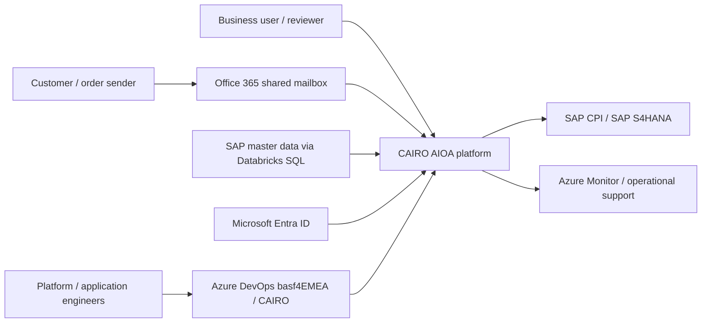
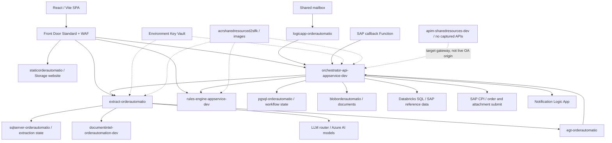
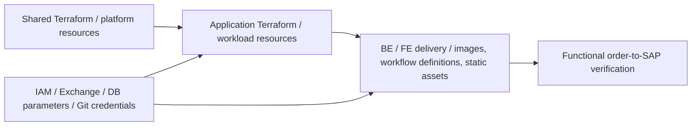

# 01 — Executive overview: AI Order Automation

## TL;DR

- AIOA converts purchase-order emails/uploads into reviewed SAP sales orders. [Doc][Code]
- Extraction, orchestration and rules are independent backend container services. [Code][Live]
- SAP master data improves matching; users retain review and publish control. [Code]
- Shared and application Terraform roots split cross-cutting and workload infrastructure. [Code]
- Live frontend/routing differ materially from the simplified official architecture. [Live]

## High-level: business problem and solution

Customers send PDFs, Excel files and email content, not consistent SAP payloads.
Manual entry requires identifying partners, sales area, materials, units, quantities and dates.
Customer material numbers differ from BASF material identifiers.
One document can contain ambiguous addresses or produce several sales orders.
AIOA reduces repetitive extraction/matching while keeping business validation and review. [Doc][Code]

This is not merely OCR: document analysis supplies content/layout, LLM prompts extract typed fields, SAP-derived data resolves candidates, rules validate business conditions, and the user approves the result.
Success means SAP accepted the intended order, not just an HTTP 200 from an AI service. [Code]

### Business lifecycle

| Step | Action | Owner | Persistent outcome |
|---|---|---|---|
| 1 | Email/upload PO | Office 365 Logic App / React | Document and metadata |
| 2 | Validate access/duplicates | Orchestrator | Blob document + PostgreSQL case |
| 3 | Extract header/lines | Extraction + DI + LLM router | Extraction SQL records |
| 4 | Normalize/validate | Rules | Decision outputs |
| 5 | Enrich partners/materials | Orchestrator + Databricks SQL | Candidates/confidence |
| 6 | Review/correct | Business user | Edited case and selected matches |
| 7 | Preview/group | Orchestrator/rules | One or more prospective orders |
| 8 | Publish | SAP CPI/S4 clients | Per-order attempt/result |
| 9 | Callback/retry | Functions + orchestrator | Reconciled order/attachment state |
| 10 | Notify/monitor | Logic Apps + telemetry | Mail/run history and traces |

All lifecycle rows describe source responsibilities, not an executed transaction. [Code]

### Actors and responsibilities

| Actor | Responsibility | Boundary |
|---|---|---|
| Customer | Send purchase order | Not automatically an Entra user |
| System user | Upload/review/publish within scope | `system_user` app role |
| Power user | Elevated business operations | `power_user`, not Azure Owner |
| System admin | Manage application users/roles | `system_admin`, not subscription admin |
| Platform engineer | Networks, infra, configuration and observability | Human grants separate from workload grants |
| App developer | Business code and app CD | Shared resources have separate ownership |
| IAM administrator | Grants, groups, consent and privileged operations | Pipeline SP may not assign roles |
| Pipeline SP | Infrastructure/app delivery | Does not transfer authority to runtime MI |
| Runtime identity | ACR pull/API/vault permissions | Explicit resource scope required |
| Mailbox administrator | Shared mailbox delegation/connector auth | ARM deployment cannot supply Exchange rights |
| SAP owner | CPI/OAuth/mTLS/interface contract | Entra OBO not automatically trusted |
| Data engineer | SAP lineage and Databricks jobs | Git sync is not job execution |

### Context diagram

### Container diagram: actual edge plus implemented downstream dependencies

The diagram is representative DEV; later chapters give QA/PROD exact names.
Databricks resource ownership/location is outside the captured CAIRO inventory.
Solid lines mean live route configuration or source-proved relationships; they do not prove recent transaction success. [Live][Code]

## Low-level: infrastructure ownership

### Shared/platform layer

`EC_Shared_Resources_IaC` owns common network/NSGs/private DNS, ACR, ML dependencies and APIM in active source.
Its root directly declares resources rather than calling external `EC_Terraform_Modules`.
Databricks/ADLS definitions remain commented; some live hubs/projects require separate ownership confirmation. [Code][Live]

Real anchors:

- `rg-sharedresources-dev` / `vnet-sharedresources-dev`.
- `rg-sharedresources-prod` / `vnet-sharedresources-prod`.
- DEV/QA `acrsharedresourced2slfk`; PROD `acrsharedresourceezuzal`.
- APIM DEV External and PROD Internal, both Developer capacity 1.
- Shared vault, ML API/notebook/storage/registry DNS/PE resources. [Live]

### Application layer

`EC_OrderAutomation_IaC` owns workload plans/sites, Functions, databases, application storage, Event Grid, vaults and OA Front Door routes/WAF.
It references the shared VNet and creates an application PE subnet beneath it.
The app root also directly declares resources rather than consuming the generic modules. [Code]

Real anchors:

- `rg-order_automation-dev`, `rg-order_automation-qa`, `rg-order_automation-prod`.
- `uami-order_automation-dev/qa/prod`.
- Administrator secret data-source names `sql-admin-password`, `postgresqlpassword`.
- Environment-specific workflow/event/data resources. [Code][Live]

### Third boundary: application delivery and manual work

BE pipelines build/push containers and deploy Logic App ARM workflow definitions.
FE pipelines build static assets, embedding Vite settings, then upload `$web`.
Databricks CD updates a Git folder; it does not automatically schedule/execute jobs.
Humans still authorize Office 365, configure extensions, supply Git credentials, grant IAM and assign app roles. [Code][Chat]

## SaaS/PaaS/IaaS classification

Model is a shared-responsibility explanation, not proof of business usage.
Networking/control services do not fit a compute-only taxonomy perfectly.

| Service | Model | Why / retained responsibility | Evidence |
|---|---|---|---|
| Outlook / Exchange Online | SaaS | Managed mail; customer owns delegation, consent and data | Intake [Doc][Code] |
| Azure DevOps Repos/Boards/Pipelines/Artifacts | SaaS | Managed collaboration; customer owns YAML, identities, feeds and gates | Delivery/work items [Code][Chat] |
| Entra ID | SaaS identity platform | Managed IdP; customer owns registrations/scopes/roles | User/workload auth [Code] |
| App Service | PaaS | Managed hosts; customer owns image/startup/settings/security | OA backend [Live] |
| Functions | PaaS/serverless | Managed execution; customer owns worker/triggers/auth/retries | Callbacks/shells [Live] |
| Logic Apps / API connections | PaaS integration | Managed workflow/connectors; customer owns definitions/OAuth | Email/notification/incident [Live] |
| ACR | PaaS | Managed registry; customer owns image/RBAC/reachability | Two Premium registries [Live] |
| Front Door / WAF | PaaS edge/security | Managed edge; customer owns origins/routes/rules/TLS | Five profiles/policies [Live] |
| APIM | PaaS | Managed gateway; customer owns APIs/policies/network | Two instances, API lists empty [Live] |
| API Center | PaaS catalog | Metadata governance, not gateway execution | `apic-mcp-dev`, Free [Live] |
| PostgreSQL Flexible Server | PaaS DB | Managed host; customer owns schema/extensions/auth | Workflow/Assistant [Live] |
| Azure SQL Database | PaaS DB | Managed engine; customer owns schema/contained users/firewall | Extraction [Code][Live] |
| Cosmos DB | PaaS DB | Managed distributed engine; customer owns data model | Assistant adjacent resource [Live] |
| Blob / ADLS Gen2 | PaaS storage | Managed durability; customer owns ACL/data/retention/exposure | Documents/zones/state [Live] |
| Storage static website | PaaS static hosting | Managed file serving, no frontend server required | OA SPA [Live][Code] |
| Event Grid | PaaS eventing | Managed delivery; customer owns schema/auth/idempotency | Extraction + antimalware [Live] |
| Databricks | PaaS analytics / SaaS-like workspace | Managed Spark workspace; customer owns jobs/data/Git/compute | External SQL/CD [Chat][Code] |
| Azure OpenAI / AI Services | PaaS AI API | Managed models; customer owns prompts/deployments/quota/data | Foundry accounts [Live] |
| AI Foundry Hub/Project | PaaS AI control plane | Managed workspace/catalog; customer owns connections | DEV/PROD projects [Live] |
| AI Search | PaaS search | Managed index; customer owns ingestion/schema/access/scale | DEV Standard [Live] |
| Document Intelligence | PaaS AI API | Managed OCR/layout; customer owns input and processing | Explicit extraction call [Code] |
| Content Safety / Translator | PaaS AI API | Managed classification/translation; actual OA calls unverified | Supporting intent/library [Doc][Code] |
| Speech Services | PaaS AI API | Managed speech; customer owns network/content | Assistant TTS [Live] |
| Machine Learning | PaaS ML | Managed workspace; customer owns assets/network/dependencies | ML default + hubs/projects [Live] |
| Bing account | Managed API/SaaS-like | Search capability; runtime usage unverified | One account [Live] |
| Key Vault | PaaS security | Managed store; customer owns grants/rotation/network | Seven vaults [Live] |
| Monitor / App Insights / LAW | PaaS observability | Managed logs; customer owns instrumentation/diagnostics/retention | Shared telemetry [Live] |
| Defender for Cloud | SaaS security management | Managed posture/threat system; customer enables plans/responds | Coverage not fully collected [Chat][Doc] |
| Azure Policy | Managed governance/control | Azure evaluates; customer owns assignment/exemption/remediation | Corporate assignment [Live] |
| VNet/subnet/NSG/PE/PDNS | IaaS-style network primitives | Azure fabric managed; customer designs connectivity/rules/DNS | Shared network [Live] |
| Network Watcher | Managed diagnostics | Customer configures/runs checks | One watcher [Live] |
| Recovery Services / Maintenance | PaaS management | Customer chooses protection/schedules | Enterprise governance assets [Live] |
| SAP S4HANA | Enterprise app; hosting unknown | External SAP contract/data responsibility | Master/transaction system [Doc][Code] |
| SAP CPI | Integration PaaS | Customer owns iFlows/auth/contracts | Order/attachment submission [Code] |
| VM / AKS / Synapse | IaaS / PaaS | Generic policy scope only; not visible CAIRO runtime | Not established deployed [Live][Doc] |

## One-page: how everything connects

1. User opens Front Door; Storage returns the React/Vite SPA.
2. MSAL authenticates via Entra; browser sends API bearer to `/api/*`.
3. Live Front Door routes directly to orchestrator, not APIM.
4. Orchestrator validates app scope/duplicates, stores Blob document and PostgreSQL case.
5. Extraction asynchronously stores SQL state and invokes DI/LLM/rules.
6. Event Grid emits/delivers `OrderAutomation.ExtractionCompleted`; failed delivery can dead-letter.
7. Orchestrator enriches against Databricks SQL SAP reference data.
8. User reviews candidates/confidence, corrects fields and previews grouped orders.
9. CPI/S4 clients publish and track individual orders/attachments.
10. Callback processing reconciles state; notifications and telemetry support operations.

Email orders enter the same case workflow through a mailbox Logic App.
Incident/pipeline-failure bugs are a separate operational workflow, not order processing.
Shared registry/AI/DNS/network support multiple workloads.
Vault/IAM/policy/monitoring cross every layer but require per-caller verification. [Code][Live][Doc]

## Architectural decisions and trade-offs

### Why retain human review?

Documents contain ambiguous parties, customer codes and units.
A confident language-model extraction is not proof of a valid SAP identity.
The UI exposes candidates/confidence and lets an authorized user correct the case. [Code]
This separates extraction convenience from final business accountability.
Review should verify the selected material/partner context and prospective order grouping.

### Why asynchronous extraction?

Document/model calls may exceed interactive response budgets.
The upload path creates a case; the extraction process owns independent state.
Event completion and browser polling provide different notification/read mechanisms. [Code]
This improves responsiveness but introduces retry, terminal-state and idempotency concerns.
A timeout at one layer does not automatically cancel a downstream job.

### Why separate services but shared compute?

Independent images permit extraction, rules and orchestration to evolve separately.
Shared B3 plans keep environment resource cost/concurrency management simple. [Live][Code]
The trade-off is shared worker capacity and related failure/performance blast radius.
No captured evidence establishes production load-test or autoscale sufficiency.

### Why master-data enrichment rather than trusting extracted identifiers?

A customer code/description can differ from the internal SAP material.
KNMT/direct/fuzzy/ground-truth strategies resolve candidates using reference context. [Code]
Country/sales-area scope and business rules matter beyond string similarity.
Master-data freshness and false-positive review remain explicit operational responsibilities.

### What remains operational debt?

The documented private/edge-only architecture is not uniformly enforced live.
Actual identity/auth models mix MI, SP tokens, keys and connection strings.
Some setting ownership is ignored by IaC without complete app-CD management. [Live][Code][Chat]
Hardening must first provide caller reachability and functional parity, then remove legacy paths.

## Component ownership and validation map

| Boundary | Primary owner/evidence | Smallest useful validation |
|---|---|---|
| Frontend build | FE pipeline / Vite source [Code] | Served bundle points to intended API and login redirect works |
| Global routing | OA IaC / live Front Door [Code][Live] | Exact route reaches expected backend with correct host header |
| Backend image | Per-service BE CD [Code] | Correct image pulls, starts and actual health route responds |
| Workflow DB | OA IaC + Alembic [Code] | Required extension/table/reference data and case creation |
| Extraction DB | SQL + extraction migrations [Code] | Async case result stored/read |
| Completion delivery | Event Grid + webhook [Live][Code] | Validation, acknowledgement, persisted transition and retry safety |
| Master-data query | External Databricks SQL [Code][Chat] | Approved query returns expected country/partner/material context |
| Business authorization | Backend DB roles/scopes [Code] | Allowed user succeeds, wrong-scope user denied |
| Email intake | BE ARM + manual Office 365 [Code][Chat] | Approved mailbox event reaches backend case |
| SAP submit | Runtime CPI clients + SAP owner [Code] | Accepted reviewed order, attachment and callback state |
| Incident automation | Notebook/Logic App/history [Doc][Live] | Stable-title repeat updates existing bug without duplicate |
| Observability | Instrumentation + diagnostics [Code][Live] | One correlation chain visible without sensitive payload leak |
| Infrastructure change | Terraform state + ADO [Code] | Reviewed plan matches owner/environment; apply + functional test |

### Questions to ask before operating production

1. Which branch/commit/image is approved, and which configured values are intentionally environment-specific?
2. Who owns the actual runtime settings: IaC, app CD or manual administrator?
3. Which identity is selected for registry pulls, vault references and downstream tokens?
4. Does the caller have both network route and data-plane authority?
5. What is the rollback if a migration, edge rule, secret rotation or workflow change fails?
6. What new transaction proves the change rather than merely checking the old page?
7. Which existing failed cases need replay/re-upload instead of client-side patching?

## How it connects to other components

Chapters 03/04 explain reachability and trust; 05/06 explain runtime/state; 07 explains live routing; 08–12 explain delivery and recovery.

## Where to look in the Azure Portal / ADO

- Resource groups → OA environment → resource overview.
- Front Door → **Front Door manager** → route/origin group.
- App Service → **Environment variables**, **Deployment Center**, **Identity**, **Log stream**.
- ADO CAIRO → **Repos**, **Pipelines**, **Library**.
- Databricks → **SQL Warehouses**, **Workspace**, **Jobs & Pipelines**.
- SAP CPI monitoring is client-managed; confirm tenant/iFlow with SAP owner, not an invented Azure blade.

## Interview talking points

- Explain OCR versus typed extraction versus enrichment versus rules.
- Explain accepted case versus finished extraction versus SAP order.
- Explain why separate containers can share one App Service plan.
- Explain PaaS shared responsibility and non-Terraform prerequisites.
- Correct the target APIM diagram using actual route evidence.
- Explain why Assistant Factory is adjacent rather than an OA hop.

## Evidence & confidence

`doc_aioa.txt` supplies business/ownership intent. `raw_apps.md` §§1–7 supplies implemented responsibilities. `raw_iac.md` root summaries supplies ownership. `raw_azure.md` App/Front Door/AI/Event sections supplies live metadata. No end-to-end order was executed.
