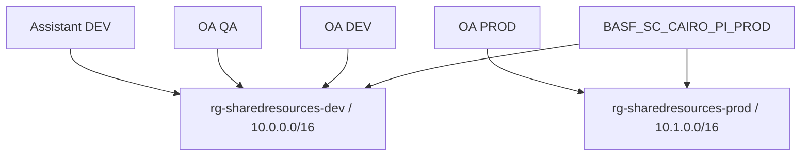

# 02 — Subscriptions, environments and naming

## TL;DR

- CAIRO PROD is primary: 23 RGs and 340 visible resources. [Live]
- DEV, QA, PROD and Assistant TEST share the production-named subscription. [Live]
- QA shares DEV networking/registry, not a separate QA platform VNet. [Live]
- ARGUS reads were denied; WAM returned empty accessible lists. [Live]
- Names/tags aid navigation; actual endpoints, identities and scopes establish boundaries.

## High-level: subscription is not environment

Subscription: `BASF_SC_CAIRO_PI_PROD`.
ID: `87a57a8d-4e3f-4cf5-b508-ce306917ec5f`.
Tenant: `ecaa386b-c8df-4ce0-ad01-740cbdb5ba55`. [Live]
“PROD” is a corporate account label, not a guarantee every contained workload is production.

| Subscription | Read/access evidence | Count | Interpretation |
|---|---|---|---|
| CAIRO PROD | Explicit list/show snapshot | 340 resources / 23 RGs | Primary accessible scope |
| `BASF_SC_ARGUS_PI_PROD` | Authorization denied | Unknown | Not zero; different subscription-specific caller reported |
| `BASF_SC_ARGUS_PI_DEV` | Authorization denied | Unknown | No inferred inventory |
| `BASF_SC_WAM_PI_PROD` | Empty accessible lists | 0 returned resources / RGs | Within captured scope only |

No default subscription/login configuration was changed. [Live]
Azure access and ADO access are independent; ADO list calls returned TF400813. [Live]

### Environment map

| Environment | RG / evidence | Shared dependency |
|---|---|---|
| OA DEV | `rg-order_automation-dev` [Live] | DEV VNet/registry |
| OA QA | `rg-order_automation-qa` [Live] | DEV VNet/registry |
| OA PROD | `rg-order_automation-prod` [Live] | PROD VNet/registry |
| Shared DEV | `rg-sharedresources-dev` [Live] | Supports DEV/QA/Assistant DEV |
| Shared PROD | `rg-sharedresources-prod` [Live] | PROD cross-cutting platform |
| Assistant DEV | `rg-assistant_factory-dev` [Live] | Shared DEV VNet |
| Assistant TEST | `rg-assistant_factory-test` [Live] | Live TEST PostgreSQL; no separate VNet captured |
| MCP DEV | `rg-mcp-registry-dev` [Live] | API Center `apic-mcp-dev` |
| Explore | FE `.env.explore` [Code] | No separate CAIRO live RG/profile identified |
| QUAL | Databricks `dbks-ec-qual`; Assistant YAML `qual` [Chat][Code] | External/branch vocabulary |
| PRD | Assistant folder YAML/execute path [Code] | Verify branch/connection mapping |

## Low-level: naming conventions

### Corporate names

- `BASF_RG_Network_BASF_SC_CAIRO_PI_PROD`: corporate network RG.
- `BASF_VN_PI_BASF_SC_CAIRO_PI_PROD`: corporate VNet.
- `BASF_SN_PI_BASF_SC_CAIRO_PI_PROD_Intranet`: subnet segment.
- `BASF_NSG_PI_BASF_SC_CAIRO_PI_PROD_Integration`: integration NSG. [Live]

The full meaning of `PI` is not established; do not invent corporate vocabulary.

### Application/shared names

| Prefix/pattern | Example | Meaning |
|---|---|---|
| `rg-<workload>-<env>` | `rg-order_automation-qa` | Workload group |
| `vnet-*` | `vnet-sharedresources-prod` | Network boundary |
| `snet-*` | `snet-apim` | Subnet purpose |
| `nsg-*` | `nsg-snet-apim-dev` | Subnet/security rule owner |
| `uami-*` | `uami-order_automation-prod` | Independent runtime identity |
| `pe-*` | Captured per-service endpoint names | Private endpoint |
| `appi-*` | `appi-order_automation-prod` | Application Insights |
| `law-*` | `law-orderautomation-prod` | Log Analytics |
| `egt-*` | `egt-orderautomation-prod` | Custom Event Grid topic |
| `pgsql-*` | `pgsql-orderautomation-qa` | PostgreSQL |
| `sqlserver-*` / `sqldb-*` | `sqlserver-orderautomatio` | SQL logical server/database |

[Code] `name_prefix` lowercases workload/environment.
Compact prefixes strip punctuation and truncate to 14 characters; Key Vault may use 15.
Storage is limited to 24 characters; random suffixes support global uniqueness.
[Live] This explains `extract-orderautomatio`, `bloborderautomatio`, `staticorderautomatio`, `pgsql-orderautomatio`.
Later environment names use different conventions; do not predict every name by one algorithm.

Exceptions worth remembering:

- `kv-orderautomation` is the migrated DEV vault. [Chat][Live]
- `kv-sharedre-prod-ezuzal` is shared PROD's real vault. [Live]
- `pqsql-assistantfactory-test` retains the live spelling. [Live]
- `TODO-existing-frontdoor-prefix-fd-dev` actually exists. [Live]
- `tf_state_*` groups contain deployment state, not order payloads. [Live]

### Tags

Common OA/shared tags: `Environment`, `Owner=EC-AI`, `CostCenter`, `ManagedBy=Terraform`, `Resource_Type`. [Live][Code]
Assistant DEV uses `Use_Case=Assistant_Factory_Dev`, `Use_Case_Type=Internal`.
Assistant TEST RG tags are empty.
Corporate groups may carry documentation/control URLs rather than application taxonomy. [Live]

A `ManagedBy=Terraform` tag does not prove the current state owns every setting.
Workflow definitions may deploy through BE ARM; settings may be ignored by IaC and changed manually. [Code][Chat]

### Regions

- Main workload/shared resources: **West Europe**.
- State RGs and ServiceHealthNotificator: **North Europe**.
- Callback Flex Consumption Function resources/hosts: **Germany West Central**.
- Assistant image AI resource/project: **Sweden Central**.
- Front Door/WAF: **Global** edge. [Live]

RG location is metadata placement, not mandatory child placement.
Model GlobalStandard serving implications differ from account location; confirm approved data residency.

## All resource groups and purpose

The table below includes all 23 captured RGs.
Purpose is inferred from contained resources and naming, not an organizational charter.
Tags reproduce metadata only; private contact/tag values are omitted.

| RG [Live] | Location | Purpose | Safe tag summary |
| --- | --- | --- | --- |
| BASF_RG_Network_BASF_SC_CAIRO_PI_PROD | westeurope | Corporate segmented VNets / peerings | No application tags returned |
| BASF_RG_Firewall_BASF_SC_CAIRO_PI_PROD | westeurope | Corporate subnet network-security groups | No application tags returned |
| NetworkWatcherRG | westeurope | Network diagnostic service | No application tags returned |
| BASF_RG_VMUpdateManagement_BASF_SC_CAIRO_PI_PROD | westeurope | Enterprise maintenance schedules | Not returned |
| rg-sharedresources-dev | westeurope | Shared platform network, registry, AI/ML and dependencies | CostCenter=shared_resources-dev; Environment=dev; ManagedBy=Terraform; Owner=EC-AI; Resource_Type=Resource_Group |
| ai_appi-mlops-sharedresources-dev_6c149add-cabf-483c-b4dc-a4390f1991b3_managed | westeurope | Azure-managed Application Insights / workspace dependencies | CostCenter=shared_resources-dev; Environment=dev; ManagedBy=Terraform; Owner=EC-AI; Resource_Type=Application_Insights |
| rg-order_automation-dev | westeurope | OA runtime, workflow/event, databases and application storage | CostCenter=order_automation-dev; Environment=dev; ManagedBy=Terraform; Owner=EC-AI; Resource_Type=Resource_Group |
| ai_appi-orderautomatio_262abf35-58f1-4a36-bf43-38ade07a896a_managed | westeurope | Azure-managed Application Insights / workspace dependencies | CostCenter=order_automation-dev; Environment=dev; ManagedBy=Terraform; Owner=EC-AI; Resource_Type=Application_Insights |
| rg-order_automation-qa | westeurope | OA runtime, workflow/event, databases and application storage | CostCenter=order_automation-qa; Environment=qa; ManagedBy=Terraform; Owner=EC-AI; Resource_Type=Resource_Group |
| rg-sharedresources-prod | westeurope | Shared platform network, registry, AI/ML and dependencies | CostCenter=shared_resources-prod; Environment=prod; ManagedBy=Terraform; Owner=EC-AI; Resource_Type=Resource_Group |
| ai_appi-mlops-sharedresources-prod_f195cd14-8b1d-43f9-817b-b5912aa8b6ca_managed | westeurope | Azure-managed Application Insights / workspace dependencies | CostCenter=shared_resources-prod; Environment=prod; ManagedBy=Terraform; Owner=EC-AI; Resource_Type=Application_Insights |
| rg-order_automation-prod | westeurope | OA runtime, workflow/event, databases and application storage | CostCenter=order_automation-prod; Environment=prod; ManagedBy=Terraform; Owner=EC-AI; Resource_Type=Resource_Group |
| rg-assistant_factory-test | westeurope | Separate Assistant Factory workload / data / edge | Not returned |
| BASF_RG_RecoveryServicesVault | westeurope | Backup vault / managed identity / governance | Not returned |
| rg-assistant_factory-dev | westeurope | Separate Assistant Factory workload / data / edge | Resource_Type=Resource_Group; Use_Case=Assistant_Factory_Dev; Use_Case_Type=Internal |
| ai_assistantfactory-appinsights-dev_fe9a288d-8039-4aaf-b5b9-fcc86ede7479_managed | westeurope | Azure-managed Application Insights / workspace dependencies | Resource_Type=Application_Insights; Use_Case=Assistant_Factory_Dev; Use_Case_Type=Internal |
| rg-mcp-registry-dev | westeurope | MCP API Center catalog experimentation | No application tags returned |
| BASF_RG_ServiceHealthNotificator | northeurope | Subscription service-health alerting | Not returned |
| tf_state_shared_dev | northeurope | Terraform remote-state backend storage | No application tags returned |
| tf_state_orderautomation_qa | northeurope | Terraform remote-state backend storage | No application tags returned |
| tf_state_shared_prod | northeurope | Terraform remote-state backend storage | No application tags returned |
| tf_state_orderautomation_prod | northeurope | Terraform remote-state backend storage | No application tags returned |
| DefaultResourceGroup-DEWC | germanywestcentral | Default telemetry workspace / supporting service | No application tags returned |

## Counts by resource type

Mixed provider casing is retained as captured; normalize when aggregating analytics.
18 `Microsoft.Web/sites` includes 12 web sites and six Functions.
No captured VM, AKS, Databricks workspace or Synapse type is present. [Live]

| Resource type [Live] | Count |
| --- | --- |
| Microsoft.ApiCenter/services | 1 |
| Microsoft.ApiManagement/service | 2 |
| Microsoft.Bing/accounts | 1 |
| Microsoft.Cdn/profiles | 5 |
| Microsoft.Cdn/profiles/afdendpoints | 5 |
| Microsoft.CognitiveServices/accounts | 6 |
| Microsoft.CognitiveServices/accounts/projects | 3 |
| Microsoft.ContainerRegistry/registries | 2 |
| Microsoft.DBforPostgreSQL/flexibleServers | 5 |
| Microsoft.DocumentDB/databaseAccounts | 1 |
| Microsoft.EventGrid/systemTopics | 27 |
| Microsoft.EventGrid/topics | 3 |
| Microsoft.Insights/actiongroups | 4 |
| Microsoft.Insights/activityLogAlerts | 1 |
| Microsoft.Insights/components | 7 |
| Microsoft.KeyVault/vaults | 7 |
| Microsoft.Logic/workflows | 5 |
| Microsoft.MachineLearningServices/workspaces | 6 |
| Microsoft.Maintenance/maintenanceConfigurations | 10 |
| Microsoft.ManagedIdentity/userAssignedIdentities | 4 |
| Microsoft.Network/frontdoorWebApplicationFirewallPolicies | 5 |
| Microsoft.Network/networkInterfaces | 28 |
| Microsoft.Network/networkSecurityGroups | 16 |
| Microsoft.Network/networkWatchers | 1 |
| Microsoft.Network/privateDnsZones | 37 |
| Microsoft.Network/privateDnsZones/virtualNetworkLinks | 16 |
| Microsoft.Network/privateEndpoints | 28 |
| Microsoft.Network/virtualNetworks | 4 |
| Microsoft.OperationalInsights/workspaces | 4 |
| Microsoft.OperationsManagement/solutions | 1 |
| Microsoft.RecoveryServices/vaults | 1 |
| Microsoft.Search/searchServices | 1 |
| Microsoft.Sql/servers | 3 |
| Microsoft.Sql/servers/databases | 6 |
| Microsoft.Storage/storageAccounts | 27 |
| Microsoft.Web/connections | 8 |
| Microsoft.Web/serverFarms | 11 |
| Microsoft.Web/sites | 18 |
| microsoft.alertsmanagement/smartDetectorAlertRules | 11 |
| microsoft.insights/actiongroups | 1 |
| microsoft.insights/components | 4 |
| microsoft.operationalinsights/workspaces | 4 |

## Resource-group operational clusters

### Corporate landing-zone/support

Network/firewall RGs contain address segmentation and NSGs.
VM update management contains maintenance schedules, not proof VMs currently exist.
Recovery Services exists; protected items/restores/SLO coverage are not established.
Service health and Network Watcher support operations, not order transactions. [Live]

### Shared platform

Shared DEV/PROD supply network/ACR/ML/AI dependencies.
Auto-managed Application Insights RGs contain related managed LAW resources.
GUID suffixes are managed linkage, not environment indicators. [Live]

### OA workload

DEV/QA/PROD hold backend, workflows, events, databases and application storage.
DEV includes test backend and `logicapp-test`.
Multiple production callback-related names exist; only SAP interface configuration proves which is active. [Live][Chat]

### State

State can contain vault-read secrets despite sensitive display flags.
Restrict backend access, version/backup state and treat output artifacts as privileged.
Do not download/share them as ordinary support documentation. [Code]

## Drift/validation walkthrough

1. Confirm environment using RG, endpoint, database and identity, not subscription name.
2. Check exact pipeline commit contains selected tfvars. [Code]
3. Compare effective settings securely; DEV→QA copies previously retained explicit cross-environment endpoints. [Chat]
4. Scope QA identity independently even when it shares DEV ACR. [Live]
5. Compare FE built API endpoint with live route/hostname; `.env.prod` differs. [Code][Live]
6. App runtime enum may not accept suffix `dev`; historical accepted values differed. [Chat]
7. Treat TODO resources as owned live objects requiring review, not immediate deletion. [Live]

## Environment-specific resource cards

The following live-derived cards identify each workload's captured resource categories.
Use them to plan a deployment checklist and detect missing/extra environment resources.
They do not claim all listed resources participate in the same request.

### BASF_RG_Network_BASF_SC_CAIRO_PI_PROD [Live]

Corporate segmented VNets / peerings.

- **Microsoft.Network/virtualNetworks:** 2 — BASF_VN_PI_BASF_SC_CAIRO_PI_PROD, BASF_VN_PI_BASF_SC_CAIRO_PI_PROD_Bastion

### BASF_RG_Firewall_BASF_SC_CAIRO_PI_PROD [Live]

Corporate subnet network-security groups.

- **Microsoft.Network/networkSecurityGroups:** 6 — BASF_NSG_PI_BASF_SC_CAIRO_PI_PROD_AzureBastionHost, BASF_NSG_PI_BASF_SC_CAIRO_PI_PROD_Integration, BASF_NSG_PI_BASF_SC_CAIRO_PI_PROD_Intranet, BASF_NSG_PI_BASF_SC_CAIRO_PI_PROD_Presentation, BASF_NSG_PI_BASF_SC_CAIRO_PI_PROD_Security_Server, BASF_NSG_PI_BASF_SC_CAIRO_PI_PROD_Security_WAF

### NetworkWatcherRG [Live]

Network diagnostic service.

- **Microsoft.Network/networkWatchers:** 1 — NetworkWatcher_westeurope

### BASF_RG_VMUpdateManagement_BASF_SC_CAIRO_PI_PROD [Live]

Enterprise maintenance schedules.

- **Microsoft.Maintenance/maintenanceConfigurations:** 10 — BASF_Linux_Critical-Security_PROD, BASF_Linux_Other_PROD, BASF_Windows_Critical_PROD, BASF_Windows_Definition_PROD, BASF_Windows_FeaturePack_PROD, BASF_Windows_Security_PROD, BASF_Windows_ServicePack_PROD, BASF_Windows_Tools_PROD, BASF_Windows_UpdateRollup_PROD, BASF_Windows_Updates_PROD

### rg-sharedresources-dev [Live]

Shared platform network, registry, AI/ML and dependencies.

- **Microsoft.ApiManagement/service:** 1 — apim-sharedresources-dev
- **Microsoft.Bing/accounts:** 1 — bingsearch-sharedresources-dev
- **Microsoft.Cdn/profiles:** 1 — TODO-existing-frontdoor-prefix-fd-dev
- **Microsoft.Cdn/profiles/afdendpoints:** 1 — TODO-existing-frontdoor-prefix-fd-dev/TODO-existing-frontdoor-prefix-dev
- **Microsoft.CognitiveServices/accounts:** 2 — aihubsharedres8407751719, assistantfactory-swecen-resource
- **Microsoft.CognitiveServices/accounts/projects:** 2 — aihubsharedres8407751719/aifoundry-project-sharedresources-dev, assistantfactory-swecen-resource/assistantfactory-swecen
- **Microsoft.ContainerRegistry/registries:** 1 — acrsharedresourced2slfk
- **Microsoft.EventGrid/systemTopics:** 2 — aihubsharedres7811513971-91e7a966-ff2c-4555-bc72-3622760a7994, stsharedresourced2slfk-aac5b2f6-a132-4d18-8a65-616b55aa66a0
- **Microsoft.Insights/components:** 1 — appi-mlops-sharedresources-dev
- **Microsoft.KeyVault/vaults:** 1 — kv-sharedresources-dev
- **Microsoft.MachineLearningServices/workspaces:** 3 — aihub-sharedresources-dev, aiproject-sharedresources-dev, mlw-sharedresources-dev
- **Microsoft.Network/frontdoorWebApplicationFirewallPolicies:** 1 — TODOexistingfrontdoorprefixwafdev
- **Microsoft.Network/networkInterfaces:** 4 — pe-acr-sharedresources-dev.nic.f30f2e8f-cb7f-4c8a-9834-fbe0f500de78, pe-blob-sharedresources-dev.nic.f7c0eac5-e76b-428c-a8c7-ea8ef7d5b3fc, pe-kv-sharedresources-dev.nic.c57ddce7-59a2-411d-bcdd-14d9810660ab, pe-mlapi-sharedresources-dev.nic.a51467ed-34d4-4b2b-acbd-af2d94eb8fad
- **Microsoft.Network/networkSecurityGroups:** 6 — assistantfactory-nsg-dev, nsg-order_automation-dev, nsg-order_automation-qa, nsg-snet-apim-dev, nsg-snet-mlops-dev, nsg-snet-private-endpoints-dev
- **Microsoft.Network/privateDnsZones:** 6 — privatelink.api.azureml.ms, privatelink.azurecr.io, privatelink.blob.core.windows.net, privatelink.dfs.core.windows.net, privatelink.notebooks.azure.net, privatelink.vaultcore.azure.net
- **Microsoft.Network/privateDnsZones/virtualNetworkLinks:** 6 — privatelink.api.azureml.ms/link-mlapi-dev, privatelink.azurecr.io/link-acr-dev, privatelink.blob.core.windows.net/link-blob-dev, privatelink.dfs.core.windows.net/link-dfs-dev, privatelink.notebooks.azure.net/link-mlnotebook-dev, privatelink.vaultcore.azure.net/link-keyvault-dev
- **Microsoft.Network/privateEndpoints:** 4 — pe-acr-sharedresources-dev, pe-blob-sharedresources-dev, pe-kv-sharedresources-dev, pe-mlapi-sharedresources-dev
- **Microsoft.Network/virtualNetworks:** 1 — vnet-sharedresources-dev
- **Microsoft.Search/searchServices:** 1 — aisearch-sharedresources-dev
- **Microsoft.Storage/storageAccounts:** 2 — aihubsharedres7811513971, stsharedresourced2slfk
- **microsoft.alertsmanagement/smartDetectorAlertRules:** 1 — Failure Anomalies - appi-mlops-sharedresources-dev
- **microsoft.insights/actiongroups:** 1 — Application Insights Smart Detection

### ai_appi-mlops-sharedresources-dev_6c149add-cabf-483c-b4dc-a4390f1991b3_managed [Live]

Azure-managed Application Insights / workspace dependencies.

- **microsoft.operationalinsights/workspaces:** 1 — managed-appi-mlops-sharedresources-dev-ws

### rg-order_automation-dev [Live]

OA runtime, workflow/event, databases and application storage.

- **Microsoft.Cdn/profiles:** 1 — order-automation-fd-dev
- **Microsoft.Cdn/profiles/afdendpoints:** 1 — order-automation-fd-dev/order-automation-dev
- **Microsoft.CognitiveServices/accounts:** 1 — documentintel-orderautomation-dev
- **Microsoft.DBforPostgreSQL/flexibleServers:** 1 — pgsql-orderautomatio
- **Microsoft.EventGrid/systemTopics:** 5 — bloborderautomatio-41ced44e-25bb-4f42-a3fa-37a09ea184bf, dlsecorderautodev-ca44a312-b4c2-40cb-80f9-0b1e8533a11a, rgorderautomationde94c5-dab555b0-7141-4dc0-a948-c2f51e4a3dec, staticorderautomatio-7515fb05-07d3-4fae-ac06-7f57456cdb74, storderautomatioc3cj2s-b9d80638-228c-4eeb-818b-048ed7392514
- **Microsoft.EventGrid/topics:** 1 — egt-orderautomatio
- **Microsoft.Insights/actiongroups:** 1 — monitor-order_automation-dev
- **Microsoft.Insights/components:** 1 — appi-orderautomatio
- **Microsoft.KeyVault/vaults:** 1 — kv-orderautomation
- **Microsoft.Logic/workflows:** 3 — logicapp-email-to-bug-dev, logicapp-orderautomatio, logicapp-test
- **Microsoft.ManagedIdentity/userAssignedIdentities:** 1 — uami-order_automation-dev
- **Microsoft.Network/frontdoorWebApplicationFirewallPolicies:** 1 — orderautomationwafdev
- **Microsoft.Network/networkInterfaces:** 5 — pe-adlsdfs-order_automation-dev.nic.070cd0a5-3779-43c6-a18d-31abd92d6f2d, pe-blob-order_automation-dev.nic.73048470-af9f-4c7b-a1b0-55180ad7207f, pe-eventgrid-order_automation-dev.nic.e626b53e-70b7-478a-b224-fec6203d9b76, pe-keyvault-order_automation-dev.nic.57d9bedb-11dd-4c70-abdf-eb50eaf5cf48, pe-pgsql-orderautomatio.nic.d6278c20-7af2-45f7-a643-7092707e9462
- **Microsoft.Network/privateDnsZones:** 7 — privatelink.azurewebsites.net, privatelink.blob.core.windows.net, privatelink.database.windows.net, privatelink.dfs.core.windows.net, privatelink.eventgrid.azure.net, privatelink.postgres.database.azure.com, privatelink.vaultcore.azure.net
- **Microsoft.Network/privateEndpoints:** 5 — pe-adlsdfs-order_automation-dev, pe-blob-order_automation-dev, pe-eventgrid-order_automation-dev, pe-keyvault-order_automation-dev, pe-pgsql-orderautomatio
- **Microsoft.OperationalInsights/workspaces:** 1 — law-orderautomatio
- **Microsoft.Sql/servers:** 1 — sqlserver-orderautomatio
- **Microsoft.Sql/servers/databases:** 2 — sqlserver-orderautomatio/master, sqlserver-orderautomatio/sqldb-order_automation-dev
- **Microsoft.Storage/storageAccounts:** 5 — bloborderautomatio, dlsecorderautodev, rgorderautomationde94c5, staticorderautomatio, storderautomatioc3cj2s
- **Microsoft.Web/connections:** 4 — conversionservice, office365, office365-1, office365-support-dev
- **Microsoft.Web/serverFarms:** 3 — ASP-rgorderautomationdev-ad27, appserviceplan-dev, functionappservice-order_automation-dev
- **Microsoft.Web/sites:** 6 — apim-integration-test-backend-dev, extract-orderautomatio, functionapp-orderautomatio, orchestrator-api-appservice-dev, rules-engine-appservice-dev, salesorderstatus
- **microsoft.alertsmanagement/smartDetectorAlertRules:** 2 — Failure Anomalies - appi-orderautomatio, Failure Anomalies - salesorderstatus
- **microsoft.insights/components:** 1 — salesorderstatus

### ai_appi-orderautomatio_262abf35-58f1-4a36-bf43-38ade07a896a_managed [Live]

Azure-managed Application Insights / workspace dependencies.

- **microsoft.operationalinsights/workspaces:** 1 — managed-appi-orderautomatio-ws

### rg-order_automation-qa [Live]

OA runtime, workflow/event, databases and application storage.

- **Microsoft.Cdn/profiles:** 1 — order-automation-fd-qa
- **Microsoft.Cdn/profiles/afdendpoints:** 1 — order-automation-fd-qa/order-automation-qa
- **Microsoft.DBforPostgreSQL/flexibleServers:** 1 — pgsql-orderautomation-qa
- **Microsoft.EventGrid/systemTopics:** 5 — rgorderautomationqabbce-c22ef3f3-cb67-4c2d-b7b6-3a5db801f56b, stbloborderautoqa-8583b4c3-af3f-4541-84ab-f8a708029481, stdlsorderautoqa-38b1a074-aea4-4b17-9d51-89e5319f821f, stfuncorderautoqamw1rh7-78617074-2a0c-4c9a-b9fe-946959c65033, ststaticorderautoqa-cfdbcf61-33eb-41b0-9718-fe7b813d08cd
- **Microsoft.EventGrid/topics:** 1 — egt-orderautomation-qa
- **Microsoft.Insights/actiongroups:** 1 — monitor-order_automation-qa
- **Microsoft.Insights/components:** 1 — appi-order_automation-qa
- **Microsoft.KeyVault/vaults:** 1 — kv-orderautomation-qa
- **Microsoft.Logic/workflows:** 1 — logicapp-order_automation-qa
- **Microsoft.ManagedIdentity/userAssignedIdentities:** 1 — uami-order_automation-qa
- **Microsoft.Network/frontdoorWebApplicationFirewallPolicies:** 1 — orderautomationwafqa
- **Microsoft.Network/networkInterfaces:** 5 — pe-adlsdfs-order_automation-qa.nic.dcc508ff-c2cd-4bc1-822e-079dc22e704f, pe-blob-order_automation-qa.nic.3ceafcd1-9525-4ac0-bb97-38f705d876b3, pe-eventgrid-order_automation-qa.nic.4e7b9875-5ad2-45a4-906c-18f20f207c25, pe-keyvault-order_automation-qa.nic.e8a47c6f-8a2e-4b35-8577-b09203eb9a50, pe-pgsql-order_automation-qa.nic.962d0338-608e-4e9f-a5ed-6d38d492efde
- **Microsoft.Network/privateDnsZones:** 7 — privatelink.azurewebsites.net, privatelink.blob.core.windows.net, privatelink.database.windows.net, privatelink.dfs.core.windows.net, privatelink.eventgrid.azure.net, privatelink.postgres.database.azure.com, privatelink.vaultcore.azure.net
- **Microsoft.Network/privateEndpoints:** 5 — pe-adlsdfs-order_automation-qa, pe-blob-order_automation-qa, pe-eventgrid-order_automation-qa, pe-keyvault-order_automation-qa, pe-pgsql-order_automation-qa
- **Microsoft.OperationalInsights/workspaces:** 1 — law-orderautomation-qa
- **Microsoft.Sql/servers:** 1 — sqlserver-orderautomation-qa
- **Microsoft.Sql/servers/databases:** 2 — sqlserver-orderautomation-qa/master, sqlserver-orderautomation-qa/sqldb-order_automation-qa
- **Microsoft.Storage/storageAccounts:** 5 — rgorderautomationqabbce, stbloborderautoqa, stdlsorderautoqa, stfuncorderautoqamw1rh7, ststaticorderautoqa
- **Microsoft.Web/connections:** 2 — conversionservice, office365
- **Microsoft.Web/serverFarms:** 3 — ASP-rgorderautomationqa-ad96, appserviceplan-order_automation-qa, functionappservice-order_automation-qa
- **Microsoft.Web/sites:** 5 — extract-orderautomation-qa, functionapp-orderautomation-qa, orchestrator-api-appservice-qa, rules-engine-appservice-qa, salesorderstatus-qa
- **microsoft.alertsmanagement/smartDetectorAlertRules:** 2 — Failure Anomalies - appi-order_automation-qa, Failure Anomalies - salesorderstatus-qa
- **microsoft.insights/components:** 1 — salesorderstatus-qa

### rg-sharedresources-prod [Live]

Shared platform network, registry, AI/ML and dependencies.

- **Microsoft.ApiManagement/service:** 1 — apim-sharedresources-prod
- **Microsoft.CognitiveServices/accounts:** 1 — aihubsharedres3426890388
- **Microsoft.CognitiveServices/accounts/projects:** 1 — aihubsharedres3426890388/aifoundry-project-shared-prod
- **Microsoft.ContainerRegistry/registries:** 1 — acrsharedresourceezuzal
- **Microsoft.EventGrid/systemTopics:** 2 — aihubsharedres7930556471-2b064aa7-1b9e-4b22-b7f0-766aa73aaae4, stsharedresourceezuzal-4e18ec2c-575e-4b34-a7fa-5d1325367761
- **Microsoft.Insights/components:** 1 — appi-mlops-sharedresources-prod
- **Microsoft.KeyVault/vaults:** 1 — kv-sharedre-prod-ezuzal
- **Microsoft.MachineLearningServices/workspaces:** 3 — aihub-sharedresources-prod, aiproject-sharedresources-prod, mlw-sharedresources-prod
- **Microsoft.Network/networkInterfaces:** 4 — pe-acr-sharedresources-prod.nic.91893e88-41a0-4269-91b2-6a26003f5fcf, pe-blob-sharedresources-prod.nic.537544f9-3888-4dcf-bd2e-611d0bc2d1f5, pe-kv-sharedresourceezuzal.nic.f1aa9590-25f9-45c8-8ba9-2e88b6419475, pe-mlapi-sharedresources-prod.nic.3838db0e-12d7-4588-be03-44265bc16547
- **Microsoft.Network/networkSecurityGroups:** 4 — nsg-order_automation-prod, nsg-snet-apim-prod, nsg-snet-mlops-prod, nsg-snet-private-endpoints-prod
- **Microsoft.Network/privateDnsZones:** 6 — privatelink.api.azureml.ms, privatelink.azurecr.io, privatelink.blob.core.windows.net, privatelink.dfs.core.windows.net, privatelink.notebooks.azure.net, privatelink.vaultcore.azure.net
- **Microsoft.Network/privateDnsZones/virtualNetworkLinks:** 6 — privatelink.api.azureml.ms/link-mlapi-prod, privatelink.azurecr.io/link-acr-prod, privatelink.blob.core.windows.net/link-blob-prod, privatelink.dfs.core.windows.net/link-dfs-prod, privatelink.notebooks.azure.net/link-mlnotebook-prod, privatelink.vaultcore.azure.net/link-keyvault-prod
- **Microsoft.Network/privateEndpoints:** 4 — pe-acr-sharedresources-prod, pe-blob-sharedresources-prod, pe-kv-sharedresourceezuzal, pe-mlapi-sharedresources-prod
- **Microsoft.Network/virtualNetworks:** 1 — vnet-sharedresources-prod
- **Microsoft.Storage/storageAccounts:** 2 — aihubsharedres7930556471, stsharedresourceezuzal
- **microsoft.alertsmanagement/smartDetectorAlertRules:** 1 — Failure Anomalies - appi-mlops-sharedresources-prod

### ai_appi-mlops-sharedresources-prod_f195cd14-8b1d-43f9-817b-b5912aa8b6ca_managed [Live]

Azure-managed Application Insights / workspace dependencies.

- **microsoft.operationalinsights/workspaces:** 1 — managed-appi-mlops-sharedresources-prod-ws

### rg-order_automation-prod [Live]

OA runtime, workflow/event, databases and application storage.

- **Microsoft.Cdn/profiles:** 1 — order-automation-fd-prod
- **Microsoft.Cdn/profiles/afdendpoints:** 1 — order-automation-fd-prod/order-automation-prod
- **Microsoft.CognitiveServices/accounts:** 1 — documentintel-orderautomation-prod
- **Microsoft.DBforPostgreSQL/flexibleServers:** 1 — pgsql-orderautomation-prod
- **Microsoft.EventGrid/systemTopics:** 6 — rgorderautomationpr9c9e-c1c97ca9-14bd-4ffe-a7f4-eaea6b8a1776, rgorderautomationprbb6d-9a0f3e5c-f5d5-4b7d-8caf-2eabc1a8fd30, stbloborderautoprod-c50a4105-7a53-424b-8d86-fd3221554a43, stdlsorderautoprod-17604889-1786-4af1-b1d1-8e20b43921b2, stfuncorderautoprodok2ed-9c63b3b9-23f7-467d-8eac-b5620bdab47b, ststaticorderautoprod-42c3b417-8370-4b31-83ad-fd681cf8b768
- **Microsoft.EventGrid/topics:** 1 — egt-orderautomation-prod
- **Microsoft.Insights/actiongroups:** 1 — monitor-order_automation-prod
- **Microsoft.Insights/components:** 2 — appi-order_automation-prod, salesorderstatus-prod
- **Microsoft.KeyVault/vaults:** 1 — kv-orderautomation-prod
- **Microsoft.Logic/workflows:** 1 — logicapp-order_automation-prod
- **Microsoft.ManagedIdentity/userAssignedIdentities:** 1 — uami-order_automation-prod
- **Microsoft.Network/frontdoorWebApplicationFirewallPolicies:** 1 — orderautomationwafprod
- **Microsoft.Network/networkInterfaces:** 5 — pe-adlsdfs-order_automation-prod.nic.d1296067-1c5a-4755-9099-f516dab6c115, pe-blob-order_automation-prod.nic.587b388a-5374-4a25-b6f4-53d101e0b9f3, pe-eventgrid-order_automation-prod.nic.e4967713-182f-47c1-9a19-b12b2d7bc9f5, pe-keyvault-order_automation-prod.nic.244f1c48-8b72-43a5-9260-4946636d183f, pe-pgsql-order_automation-prod.nic.6a662fa9-764b-42dd-9d87-86eec203b1a6
- **Microsoft.Network/privateDnsZones:** 7 — privatelink.azurewebsites.net, privatelink.blob.core.windows.net, privatelink.database.windows.net, privatelink.dfs.core.windows.net, privatelink.eventgrid.azure.net, privatelink.postgres.database.azure.com, privatelink.vaultcore.azure.net
- **Microsoft.Network/privateEndpoints:** 5 — pe-adlsdfs-order_automation-prod, pe-blob-order_automation-prod, pe-eventgrid-order_automation-prod, pe-keyvault-order_automation-prod, pe-pgsql-order_automation-prod
- **Microsoft.OperationalInsights/workspaces:** 1 — law-orderautomation-prod
- **Microsoft.Sql/servers:** 1 — sqlserver-orderautomation-prod
- **Microsoft.Sql/servers/databases:** 2 — sqlserver-orderautomation-prod/master, sqlserver-orderautomation-prod/sqldb-order_automation-prod
- **Microsoft.Storage/storageAccounts:** 6 — rgorderautomationpr9c9e, rgorderautomationprbb6d, stbloborderautoprod, stdlsorderautoprod, stfuncorderautoprodok2ed, ststaticorderautoprod
- **Microsoft.Web/connections:** 2 — conversionservice, office365
- **Microsoft.Web/serverFarms:** 3 — ASP-rgorderautomationprod-b631, appserviceplan-order_automation-prod, functionappservice-order_automation-prod
- **Microsoft.Web/sites:** 5 — extract-orderautomation-prod, functionapp-orderautomation-prod, orchestrator-api-appservice-prod, rules-engine-appservice-prod, sapordercallback-prod
- **microsoft.alertsmanagement/smartDetectorAlertRules:** 4 — Failure Anomalies - appi-order_automation-prod, Failure Anomalies - salesorderstatus-prod, Failure Anomalies - salesorderstatusprodtest, Failure Anomalies - sapordercallback-prod
- **microsoft.insights/components:** 2 — salesorderstatusprodtest, sapordercallback-prod

### rg-assistant_factory-test [Live]

Separate Assistant Factory workload / data / edge.

- **Microsoft.DBforPostgreSQL/flexibleServers:** 1 — pqsql-assistantfactory-test

### BASF_RG_RecoveryServicesVault [Live]

Backup vault / managed identity / governance.

- **Microsoft.KeyVault/vaults:** 1 — basfkvcairo0947583261
- **Microsoft.ManagedIdentity/userAssignedIdentities:** 1 — BASF-ID-RSV-CAIRO-PI-PROD-we
- **Microsoft.RecoveryServices/vaults:** 1 — BASF-RecoveryServicesVault

### rg-assistant_factory-dev [Live]

Separate Assistant Factory workload / data / edge.

- **Microsoft.Cdn/profiles:** 1 — assistantfactory-dev
- **Microsoft.Cdn/profiles/afdendpoints:** 1 — assistantfactory-dev/assistantfactory-dev
- **Microsoft.CognitiveServices/accounts:** 1 — assistantfactory-tts-dev
- **Microsoft.DBforPostgreSQL/flexibleServers:** 1 — assistantfactory-postgresql-dev
- **Microsoft.DocumentDB/databaseAccounts:** 1 — assistantfactory-cosmosdb-account-dev
- **Microsoft.EventGrid/systemTopics:** 1 — assistantadlsdev-03092317-4c72-40a8-bb21-975244f25e9c
- **Microsoft.Insights/components:** 1 — assistantfactory-appinsights-dev
- **Microsoft.KeyVault/vaults:** 1 — assistantfactory-kv-dev
- **Microsoft.Network/frontdoorWebApplicationFirewallPolicies:** 1 — assistantapiwaf
- **Microsoft.Network/networkInterfaces:** 5 — assistant-factory-prvt-postgres-dev.nic.24af0674-96f9-4797-8ff8-763cc4ebcde0, assistant-factory-prvt-tts-dev.nic.316c44b5-2f57-4fd2-9a26-0a741d252979, assistantfactory-prvt-adls-dev.nic.b1c158ac-8971-46a6-9437-142175d7eea1, assistantfactory-prvt-cosmos-dev.nic.7186ac1e-39e1-482f-874f-e9b284a5a9a1, assistantfactory-prvt-kv-dev.nic.edbfec62-926f-4fa1-99c9-e0d9d3507311
- **Microsoft.Network/privateDnsZones:** 4 — privatelink.cognitiveservices.azure.com, privatelink.mongo.cosmos.azure.com, privatelink.postgres.database.azure.com, privatelink.vaultcore.azure.com
- **Microsoft.Network/privateDnsZones/virtualNetworkLinks:** 4 — privatelink.cognitiveservices.azure.com/assistantfactory-cognitive-dns-vnet-link, privatelink.mongo.cosmos.azure.com/assistantfactory-cosmos-dns-vnet-link, privatelink.postgres.database.azure.com/assistant-factory-postgres-dns-vnet-link, privatelink.vaultcore.azure.com/assistantfactory-kv-dns-vnet-link
- **Microsoft.Network/privateEndpoints:** 5 — assistant-factory-prvt-postgres-dev, assistant-factory-prvt-tts-dev, assistantfactory-prvt-adls-dev, assistantfactory-prvt-cosmos-dev, assistantfactory-prvt-kv-dev
- **Microsoft.Storage/storageAccounts:** 1 — assistantadlsdev
- **Microsoft.Web/serverFarms:** 2 — assistantfactory-appservice-plan-dev, assistantfactory-mcp-appservice-plan-dev
- **Microsoft.Web/sites:** 2 — assistantfactory-appservice-dev, assistantfactory-mcp-appservice-dev
- **microsoft.alertsmanagement/smartDetectorAlertRules:** 1 — Failure Anomalies - assistantfactory-appinsights-dev

### ai_assistantfactory-appinsights-dev_fe9a288d-8039-4aaf-b5b9-fcc86ede7479_managed [Live]

Azure-managed Application Insights / workspace dependencies.

- **microsoft.operationalinsights/workspaces:** 1 — managed-assistantfactory-appinsights-dev-ws

### rg-mcp-registry-dev [Live]

MCP API Center catalog experimentation.

- **Microsoft.ApiCenter/services:** 1 — apic-mcp-dev

### BASF_RG_ServiceHealthNotificator [Live]

Subscription service-health alerting.

- **Microsoft.Insights/actiongroups:** 1 — 87a57a8d-4e3f-4cf5-b508-ce306917ec5f
- **Microsoft.Insights/activityLogAlerts:** 1 — 87a57a8d-4e3f-4cf5-b508-ce306917ec5f

### tf_state_shared_dev [Live]

Terraform remote-state backend storage.

- **Microsoft.EventGrid/systemTopics:** 3 — tfassistantapidev1aafad-cccdfe1e-9a02-4ebe-805c-1d90bfd689f6, tforderautodev1aafad-b06ac68f-c50d-4303-b9fe-631a5a736434, tfsharedresourcesdev-5f54e822-9e9f-4bfd-bb0e-71f85e087be3
- **Microsoft.Storage/storageAccounts:** 3 — tfassistantapidev1aafad, tforderautodev1aafad, tfsharedresourcesdev

### tf_state_orderautomation_qa [Live]

Terraform remote-state backend storage.

- **Microsoft.EventGrid/systemTopics:** 1 — tforderautoqac1b485-c2e10fc1-4e06-47a9-91d7-b41b393108f3
- **Microsoft.Storage/storageAccounts:** 1 — tforderautoqac1b485

### tf_state_shared_prod [Live]

Terraform remote-state backend storage.

- **Microsoft.EventGrid/systemTopics:** 1 — tfsharedresourcesprod-914b87c0-23ec-4bbd-b28b-92b3ba888220
- **Microsoft.Storage/storageAccounts:** 1 — tfsharedresourcesprod

### tf_state_orderautomation_prod [Live]

Terraform remote-state backend storage.

- **Microsoft.EventGrid/systemTopics:** 1 — tforderautoproddb0729-749befe8-7981-440a-a6a7-5bda58bc1996
- **Microsoft.Storage/storageAccounts:** 1 — tforderautoproddb0729

### DefaultResourceGroup-DEWC [Live]

Default telemetry workspace / supporting service.

- **Microsoft.OperationalInsights/workspaces:** 1 — DefaultWorkspace-87a57a8d-4e3f-4cf5-b508-ce306917ec5f-DEWC
- **Microsoft.OperationsManagement/solutions:** 1 — SecurityCenterFree(DefaultWorkspace-87a57a8d-4e3f-4cf5-b508-ce306917ec5f-DEWC)

## How it connects to other components

Environment mapping controls routes, vaults, images and data. Chapter 03 describes QA networking; 04 describes identity scopes; 09 describes branch/group resolution.

## Where to look in the Azure Portal / ADO

- **Subscriptions** → subscription → **Properties**, **Resource groups**, **Resources**.
- RG → **Tags**, **Deployments**, **Activity log**.
- Resource → **JSON View** / **Properties** → actual location and identity.
- **Cost Management** → **Cost analysis** → group by RG/tag.
- ADO **Pipelines** → run → source branch/commit; **Library** → environment variable group.

## Interview talking points

- Explain same-subscription isolation and blast radius.
- Explain QA sharing DEV platform.
- Explain globally unique/compact names.
- Explain RG versus child region.
- Explain denied versus empty inventory.
- Explain why ManagedBy does not establish state ownership.

## Evidence & confidence

`raw_azure.md` lines 1–740 and Other subscriptions/Azure DevOps sections; `raw_iac.md` naming/environment sections; `raw_apps.md` §9. Explore/qual remain source/history vocabulary, not inferred live CAIRO environments.
