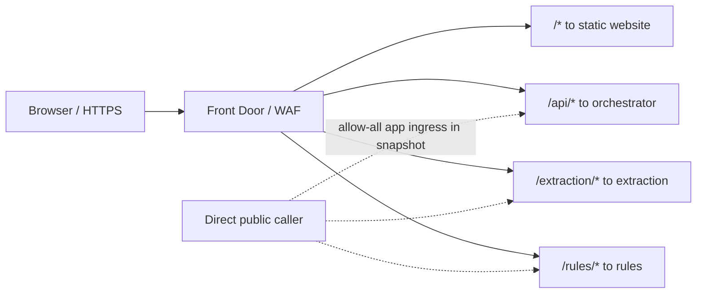
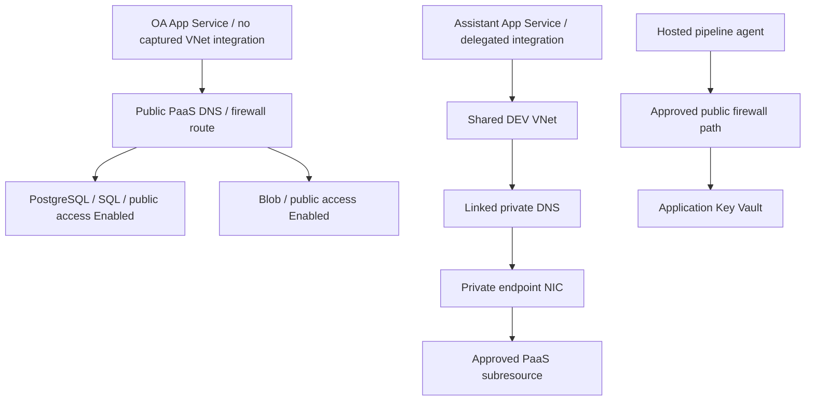
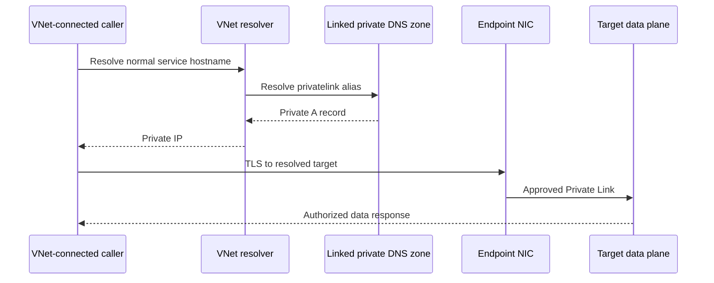

# 03 — Networking: reachability before credentials

## TL;DR

- Captured: four VNets, 16 NSGs, 28 PEs and 37 private DNS zones. [Live]
- OA DEV/QA/PROD apps have no captured VNet integration despite PEs. [Live]
- QA shares DEV VNet; PROD uses `10.1.0.0/16`. [Live]
- APIM DEV is External, PROD Internal; public flags and private paths differ. [Live]
- BASF policy requires an NSG in the initial subnet request. [Code][Chat]

## High-level: inbound, outbound and DNS

A private endpoint supplies a private NIC to a PaaS **subresource**.
It does not automatically integrate an App Service into a VNet.
It does not disable a public endpoint or link DNS to every caller.
Successful authentication and successful reachability are independent prerequisites.

### Actual inbound user flow

[Live] Origins are direct App Service/storage hosts, not APIM.
[Live] Main OA sites have allow-all ingress rules.
[Doc] The single protected entry point remains an intended design, not fully observed enforcement.

### Outbound target and live gap

Assistant apps have site-level integration subnet IDs. [Live]
OA private-vault gaps/public-hostname DB timeouts caused prior failures. [Chat]
No new caller-side DNS/packet tests were executed.

## Low-level: VNets and every subnet

Corporate VNet has five `172.20.196.*` segments.
Corporate Bastion VNet has `192.168.0.0/24` and `AzureBastionSubnet=192.168.0.0/26`.
Peerings are Connected both ways without gateway transit, remote gateways or forwarded traffic.
A named Bastion subnet/NSG does not prove an Azure Bastion service exists. [Live]

Shared DEV: `vnet-sharedresources-dev`, `10.0.0.0/16`.
Shared PROD: `vnet-sharedresources-prod`, `10.1.0.0/16`.
Both have empty custom DNS server/peering lists in the capture.
QA's `10.0.4.0/24` subnet resides in DEV VNet.
PROD OA subnet is `10.1.4.0/24`.
Assistant App Service integration subnets delegate `Microsoft.Web/serverFarms`. [Live]

### BASF_VN_PI_BASF_SC_CAIRO_PI_PROD [Live]

- RG: BASF_RG_Network_BASF_SC_CAIRO_PI_PROD
- Address spaces: 172.20.196.128/27, 172.20.196.160/27, 172.20.196.192/27, 172.20.196.224/28, 172.20.196.240/28
- Region: westeurope
- Custom DNS: Not returned
- Source: raw_azure.md line 1214

| Subnet | CIDR(s) | Delegation | NSG | Service endpoints | PE policies |
| --- | --- | --- | --- | --- | --- |
| BASF_SN_PI_BASF_SC_CAIRO_PI_PROD_Intranet | 172.20.196.128/27 | None returned | BASF_NSG_PI_BASF_SC_CAIRO_PI_PROD_Intranet | None returned | Enabled |
| BASF_SN_PI_BASF_SC_CAIRO_PI_PROD_Integration | 172.20.196.160/27 | None returned | BASF_NSG_PI_BASF_SC_CAIRO_PI_PROD_Integration | None returned | Enabled |
| BASF_SN_PI_BASF_SC_CAIRO_PI_PROD_Presentation | 172.20.196.192/27 | None returned | BASF_NSG_PI_BASF_SC_CAIRO_PI_PROD_Presentation | None returned | Enabled |
| BASF_SN_PI_BASF_SC_CAIRO_PI_PROD_Security_WAF | 172.20.196.224/28 | None returned | BASF_NSG_PI_BASF_SC_CAIRO_PI_PROD_Security_WAF | None returned | Enabled |
| BASF_SN_PI_BASF_SC_CAIRO_PI_PROD_Security_Server | 172.20.196.240/28 | None returned | BASF_NSG_PI_BASF_SC_CAIRO_PI_PROD_Security_Server | None returned | Enabled |

- Peering **BASF_VN_PI_BASF_SC_CAIRO_PI_PROD-BastionVnet**: Connected; remote BASF_VN_PI_BASF_SC_CAIRO_PI_PROD_Bastion; forwarded=False; gateway transit=False; remote gateway=False.

### BASF_VN_PI_BASF_SC_CAIRO_PI_PROD_Bastion [Live]

- RG: BASF_RG_Network_BASF_SC_CAIRO_PI_PROD
- Address spaces: 192.168.0.0/24
- Region: westeurope
- Custom DNS: Not returned
- Source: raw_azure.md line 1214

| Subnet | CIDR(s) | Delegation | NSG | Service endpoints | PE policies |
| --- | --- | --- | --- | --- | --- |
| AzureBastionSubnet | 192.168.0.0/26 | None returned | BASF_NSG_PI_BASF_SC_CAIRO_PI_PROD_AzureBastionHost | None returned | Enabled |

- Peering **BastionVnet-BASF_VN_PI_BASF_SC_CAIRO_PI_PROD**: Connected; remote BASF_VN_PI_BASF_SC_CAIRO_PI_PROD; forwarded=False; gateway transit=False; remote gateway=False.

### vnet-sharedresources-dev [Live]

- RG: rg-sharedresources-dev
- Address spaces: 10.0.0.0/16
- Region: westeurope
- Custom DNS: None returned
- Source: raw_azure.md line 1214

| Subnet | CIDR(s) | Delegation | NSG | Service endpoints | PE policies |
| --- | --- | --- | --- | --- | --- |
| snet-mlops | 10.0.1.0/24 | None returned | nsg-snet-mlops-dev | Microsoft.KeyVault, Microsoft.Storage, Microsoft.ContainerRegistry | Enabled |
| snet-apim | 10.0.0.0/24 | None returned | nsg-snet-apim-dev | Microsoft.KeyVault, Microsoft.Storage | Enabled |
| snet-order_automation-dev | 10.0.2.0/24 | None returned | nsg-order_automation-dev | Microsoft.CognitiveServices, Microsoft.Web, Microsoft.KeyVault, Microsoft.Storage, Microsoft.Sql | Disabled |
| snet-private-endpoints | 10.0.3.0/24 | None returned | nsg-snet-private-endpoints-dev | None returned | Disabled |
| snet-order_automation-qa | 10.0.4.0/24 | None returned | nsg-order_automation-qa | Microsoft.CognitiveServices, Microsoft.Web, Microsoft.KeyVault, Microsoft.Storage, Microsoft.Sql | Disabled |
| assistantfactory-cosmos-subnet-dev | 10.0.7.0/28 | None returned | assistantfactory-nsg-dev | Microsoft.Storage, Microsoft.KeyVault, Microsoft.Sql, Microsoft.Web, Microsoft.AzureCosmosDB, Microsoft.CognitiveServices | Disabled |
| assistantfactory-kv-subnet-dev | 10.0.7.16/28 | None returned | assistantfactory-nsg-dev | Microsoft.Storage, Microsoft.KeyVault, Microsoft.Sql, Microsoft.Web, Microsoft.AzureCosmosDB, Microsoft.CognitiveServices | Disabled |
| assistantfactory-adls-subnet-dev | 10.0.7.32/28 | None returned | assistantfactory-nsg-dev | Microsoft.Storage, Microsoft.KeyVault, Microsoft.Sql, Microsoft.Web, Microsoft.AzureCosmosDB, Microsoft.CognitiveServices | Disabled |
| assistant-factory-tts-subnet-dev | 10.0.7.48/28 | None returned | assistantfactory-nsg-dev | Microsoft.Storage, Microsoft.KeyVault, Microsoft.Sql, Microsoft.Web, Microsoft.AzureCosmosDB, Microsoft.CognitiveServices | Disabled |
| assistant-factory-postgres-subnet-dev | 10.0.7.64/28 | None returned | assistantfactory-nsg-dev | Microsoft.Storage, Microsoft.KeyVault, Microsoft.Sql, Microsoft.Web, Microsoft.AzureCosmosDB, Microsoft.CognitiveServices | Disabled |
| assistantfactory-app-subnet-dev | 10.0.5.0/24 | Microsoft.Web/serverFarms | assistantfactory-nsg-dev | Microsoft.Storage, Microsoft.KeyVault, Microsoft.Sql, Microsoft.Web, Microsoft.AzureCosmosDB, Microsoft.CognitiveServices | Enabled |
| assistantfactory-mcp-app-subnet-dev | 10.0.6.0/24 | Microsoft.Web/serverFarms | assistantfactory-nsg-dev | Microsoft.Storage, Microsoft.KeyVault, Microsoft.Sql, Microsoft.Web, Microsoft.AzureCosmosDB, Microsoft.CognitiveServices | Enabled |

### vnet-sharedresources-prod [Live]

- RG: rg-sharedresources-prod
- Address spaces: 10.1.0.0/16
- Region: westeurope
- Custom DNS: None returned
- Source: raw_azure.md line 1214

| Subnet | CIDR(s) | Delegation | NSG | Service endpoints | PE policies |
| --- | --- | --- | --- | --- | --- |
| snet-private-endpoints | 10.1.3.0/24 | None returned | nsg-snet-private-endpoints-prod | None returned | Disabled |
| snet-apim | 10.1.0.0/24 | None returned | nsg-snet-apim-prod | Microsoft.KeyVault, Microsoft.Storage | Enabled |
| snet-mlops | 10.1.1.0/24 | None returned | nsg-snet-mlops-prod | Microsoft.KeyVault, Microsoft.Storage, Microsoft.ContainerRegistry | Enabled |
| snet-order_automation-prod | 10.1.4.0/24 | None returned | nsg-order_automation-prod | Microsoft.CognitiveServices, Microsoft.Web, Microsoft.KeyVault, Microsoft.Storage, Microsoft.Sql | Disabled |

### Delegation versus service endpoint versus PE

Delegation gives a supported subnet placement/integration to a managed service.
Service endpoints extend VNet identity to a PaaS public endpoint, not a private IP.
PEs create private NICs for `blob`, `dfs`, `vault`, `registry`, database or other subresources.
PE network policies Disabled and subnet NSG association are distinct properties.
Do not read Disabled PE policy as “the entire subnet has no NSG.”

### Databricks VNet injection: unverified

Shared source retains commented workspace/cluster definitions with injected-network/no-public-IP intent.
They are disabled, not active deployment. [Code]
CAIRO Databricks workspace list returned empty. [Live]
Historical DEV/QUAL hosts are evidenced elsewhere; their actual subnet CIDRs/NSGs are not. [Chat]
Do not assign them captured OA subnets without workspace-owned evidence.

## NSGs and atomic subnet policy

A split Terraform subnet-then-association fails because BASF Deny evaluates the initial subnet request.
Use the NSG ID **inside** the original subnet properties.
AzAPI child subnet resources implement this in shared/application source. [Code][Chat]
The NSG's existence is compliance plumbing; its actual rules still require least-privilege review.

Historical PROD `10.0.4.0/24` inside `10.1.0.0/16` also failed CIDR containment.
That failure is separate from NSG policy.
Live PROD `10.1.4.0/24` is authoritative. [Chat][Live]

### Source APIM dependency rules

| Direction | Priority | Endpoint/tag | TCP ports | Purpose |
|---|---|---|---|---|
| Inbound | 100 | ApiManagement | 3443 | Management activation |
| Inbound | 110 | AzureLoadBalancer | 6390 | Health |
| Inbound | 115 | Internet | 443 | External DEV gateway |
| Outbound | 200 | Storage | 443 | Dependency |
| Outbound | 210 | Sql | 1433 | Dependency |
| Outbound | 220 | AzureKeyVault | 443 | Vault |
| Outbound | 230 | AzureMonitor | 1886,443 | Telemetry |
| Outbound | 240 | AzureActiveDirectory | 443 | Identity |
| Inbound | 4096 | Internet | All | Deny except earlier matches |

[Code] Complete actual rules per NSG follow below.
Default outbound Internet Allow can remain despite explicit inbound Deny.
Do not call this all-egress-denied without an observed outbound denial.

### BASF_NSG_PI_BASF_SC_CAIRO_PI_PROD_AzureBastionHost [Live]

RG: `BASF_RG_Firewall_BASF_SC_CAIRO_PI_PROD`. Attached subnets: AZUREBASTIONSUBNET.

| Rule | Priority | Direction | Protocol | Source | Destination | Ports | Action |
| --- | --- | --- | --- | --- | --- | --- | --- |
| AllowHttpsInbound | 120 | Inbound | TCP | Internet | * | 443 | Allow |
| AllowGatewayManagerInbound | 130 | Inbound | TCP | GatewayManager | * | 443 | Allow |
| AllowAzureLoadBalancerInbound | 140 | Inbound | TCP | AzureLoadBalancer | * | 443 | Allow |
| AllowBastionHostCommunication | 150 | Inbound | * | VirtualNetwork | VirtualNetwork | 8080, 5701 | Allow |
| AllowSshRdpOutbound | 100 | Outbound | * | * | VirtualNetwork | 22, 3389 | Allow |
| AllowAzureCloudOutbound | 110 | Outbound | TCP | * | AzureCloud | 443 | Allow |
| AllowBastionCommunication | 120 | Outbound | * | VirtualNetwork | VirtualNetwork | 8080, 5701 | Allow |
| AllowGetSessionInformation | 130 | Outbound | * | Internet | * | 80 | Allow |
| BASF_GOV_AllowQualysAppliance | 133 | Inbound | * | 51.124.206.246, 52.174.97.154, 20.93.154.180 | VirtualNetwork | * | Allow |

### BASF_NSG_PI_BASF_SC_CAIRO_PI_PROD_Integration [Live]

RG: `BASF_RG_Firewall_BASF_SC_CAIRO_PI_PROD`. Attached subnets: BASF_SN_PI_BASF_SC_CAIRO_PI_PROD_INTEGRATION.

| Rule | Priority | Direction | Protocol | Source | Destination | Ports | Action |
| --- | --- | --- | --- | --- | --- | --- | --- |
| BASF_GOV_AllowQualysAppliance | 133 | Inbound | * | 51.124.206.246, 52.174.97.154, 20.93.154.180 | VirtualNetwork | * | Allow |

### BASF_NSG_PI_BASF_SC_CAIRO_PI_PROD_Intranet [Live]

RG: `BASF_RG_Firewall_BASF_SC_CAIRO_PI_PROD`. Attached subnets: BASF_SN_PI_BASF_SC_CAIRO_PI_PROD_INTRANET.

| Rule | Priority | Direction | Protocol | Source | Destination | Ports | Action |
| --- | --- | --- | --- | --- | --- | --- | --- |
| BASF_GOV_AllowQualysAppliance | 133 | Inbound | * | 51.124.206.246, 52.174.97.154, 20.93.154.180 | VirtualNetwork | * | Allow |

### BASF_NSG_PI_BASF_SC_CAIRO_PI_PROD_Presentation [Live]

RG: `BASF_RG_Firewall_BASF_SC_CAIRO_PI_PROD`. Attached subnets: BASF_SN_PI_BASF_SC_CAIRO_PI_PROD_PRESENTATION.

| Rule | Priority | Direction | Protocol | Source | Destination | Ports | Action |
| --- | --- | --- | --- | --- | --- | --- | --- |
| BASF_GOV_AllowQualysAppliance | 133 | Inbound | * | 51.124.206.246, 52.174.97.154, 20.93.154.180 | VirtualNetwork | * | Allow |

### BASF_NSG_PI_BASF_SC_CAIRO_PI_PROD_Security_Server [Live]

RG: `BASF_RG_Firewall_BASF_SC_CAIRO_PI_PROD`. Attached subnets: BASF_SN_PI_BASF_SC_CAIRO_PI_PROD_SECURITY_SERVER.

| Rule | Priority | Direction | Protocol | Source | Destination | Ports | Action |
| --- | --- | --- | --- | --- | --- | --- | --- |
| BASF_GOV_AllowQualysAppliance | 133 | Inbound | * | 51.124.206.246, 52.174.97.154, 20.93.154.180 | VirtualNetwork | * | Allow |

### BASF_NSG_PI_BASF_SC_CAIRO_PI_PROD_Security_WAF [Live]

RG: `BASF_RG_Firewall_BASF_SC_CAIRO_PI_PROD`. Attached subnets: BASF_SN_PI_BASF_SC_CAIRO_PI_PROD_SECURITY_WAF.

| Rule | Priority | Direction | Protocol | Source | Destination | Ports | Action |
| --- | --- | --- | --- | --- | --- | --- | --- |
| BASF_GOV_AllowQualysAppliance | 133 | Inbound | * | 51.124.206.246, 52.174.97.154, 20.93.154.180 | VirtualNetwork | * | Allow |

### assistantfactory-nsg-dev [Live]

RG: `rg-sharedresources-dev`. Attached subnets: ASSISTANT-FACTORY-POSTGRES-SUBNET-DEV, ASSISTANT-FACTORY-TTS-SUBNET-DEV, ASSISTANTFACTORY-ADLS-SUBNET-DEV, ASSISTANTFACTORY-APP-SUBNET-DEV, ASSISTANTFACTORY-COSMOS-SUBNET-DEV, ASSISTANTFACTORY-KV-SUBNET-DEV, ASSISTANTFACTORY-MCP-APP-SUBNET-DEV.

| Rule | Priority | Direction | Protocol | Source | Destination | Ports | Action |
| --- | --- | --- | --- | --- | --- | --- | --- |
| BASF_GOV_AllowQualysAppliance | 133 | Inbound | * | 51.124.206.246, 52.174.97.154, 20.93.154.180 | VirtualNetwork | * | Allow |

### nsg-order_automation-dev [Live]

RG: `rg-sharedresources-dev`. Attached subnets: SNET-ORDER_AUTOMATION-DEV.

| Rule | Priority | Direction | Protocol | Source | Destination | Ports | Action |
| --- | --- | --- | --- | --- | --- | --- | --- |
| BASF_GOV_AllowQualysAppliance | 133 | Inbound | * | 51.124.206.246, 52.174.97.154, 20.93.154.180 | VirtualNetwork | * | Allow |

### nsg-order_automation-qa [Live]

RG: `rg-sharedresources-dev`. Attached subnets: SNET-ORDER_AUTOMATION-QA.

| Rule | Priority | Direction | Protocol | Source | Destination | Ports | Action |
| --- | --- | --- | --- | --- | --- | --- | --- |
| BASF_GOV_AllowQualysAppliance | 133 | Inbound | * | 51.124.206.246, 52.174.97.154, 20.93.154.180 | VirtualNetwork | * | Allow |

### nsg-snet-apim-dev [Live]

RG: `rg-sharedresources-dev`. Attached subnets: SNET-APIM.

| Rule | Priority | Direction | Protocol | Source | Destination | Ports | Action |
| --- | --- | --- | --- | --- | --- | --- | --- |
| Deny-Internet-Inbound | 4096 | Inbound | * | Internet | * | * | Deny |
| BASF_GOV_AllowQualysAppliance | 133 | Inbound | * | 51.124.206.246, 52.174.97.154, 20.93.154.180 | VirtualNetwork | * | Allow |
| Allow-APIM-entra_id | 240 | Outbound | Tcp | VirtualNetwork | AzureActiveDirectory | 443 | Allow |
| Allow-APIM-key_vault | 220 | Outbound | Tcp | VirtualNetwork | AzureKeyVault | 443 | Allow |
| Allow-APIM-azure_monitor | 230 | Outbound | Tcp | VirtualNetwork | AzureMonitor | 1886, 443 | Allow |
| Allow-APIM-sql | 210 | Outbound | Tcp | VirtualNetwork | Sql | 1433 | Allow |
| Allow-APIM-load_balancer | 110 | Inbound | Tcp | AzureLoadBalancer | VirtualNetwork | 6390 | Allow |
| Allow-APIM-storage | 200 | Outbound | Tcp | VirtualNetwork | Storage | 443 | Allow |
| Allow-APIM-management | 100 | Inbound | Tcp | ApiManagement | VirtualNetwork | 3443 | Allow |
| Allow-APIM-client_https | 115 | Inbound | Tcp | Internet | VirtualNetwork | 443 | Allow |

### nsg-snet-mlops-dev [Live]

RG: `rg-sharedresources-dev`. Attached subnets: SNET-MLOPS.

| Rule | Priority | Direction | Protocol | Source | Destination | Ports | Action |
| --- | --- | --- | --- | --- | --- | --- | --- |
| Deny-Internet-Inbound | 4096 | Inbound | * | Internet | * | * | Deny |
| BASF_GOV_AllowQualysAppliance | 133 | Inbound | * | 51.124.206.246, 52.174.97.154, 20.93.154.180 | VirtualNetwork | * | Allow |

### nsg-snet-private-endpoints-dev [Live]

RG: `rg-sharedresources-dev`. Attached subnets: SNET-PRIVATE-ENDPOINTS.

| Rule | Priority | Direction | Protocol | Source | Destination | Ports | Action |
| --- | --- | --- | --- | --- | --- | --- | --- |
| Deny-Internet-Inbound | 4096 | Inbound | * | Internet | * | * | Deny |
| BASF_GOV_AllowQualysAppliance | 133 | Inbound | * | 51.124.206.246, 52.174.97.154, 20.93.154.180 | VirtualNetwork | * | Allow |

### nsg-order_automation-prod [Live]

RG: `rg-sharedresources-prod`. Attached subnets: SNET-ORDER_AUTOMATION-PROD.

| Rule | Priority | Direction | Protocol | Source | Destination | Ports | Action |
| --- | --- | --- | --- | --- | --- | --- | --- |
| BASF_GOV_AllowQualysAppliance | 133 | Inbound | * | 51.124.206.246, 52.174.97.154, 20.93.154.180 | VirtualNetwork | * | Allow |

### nsg-snet-apim-prod [Live]

RG: `rg-sharedresources-prod`. Attached subnets: SNET-APIM.

| Rule | Priority | Direction | Protocol | Source | Destination | Ports | Action |
| --- | --- | --- | --- | --- | --- | --- | --- |
| Allow-APIM-management | 100 | Inbound | Tcp | ApiManagement | VirtualNetwork | 3443 | Allow |
| Allow-APIM-sql | 210 | Outbound | Tcp | VirtualNetwork | Sql | 1433 | Allow |
| Allow-APIM-load_balancer | 110 | Inbound | Tcp | AzureLoadBalancer | VirtualNetwork | 6390 | Allow |
| Allow-APIM-storage | 200 | Outbound | Tcp | VirtualNetwork | Storage | 443 | Allow |
| Deny-Internet-Inbound | 4096 | Inbound | * | Internet | * | * | Deny |
| Allow-APIM-entra_id | 240 | Outbound | Tcp | VirtualNetwork | AzureActiveDirectory | 443 | Allow |
| Allow-APIM-azure_monitor | 230 | Outbound | Tcp | VirtualNetwork | AzureMonitor | 1886, 443 | Allow |
| Allow-APIM-key_vault | 220 | Outbound | Tcp | VirtualNetwork | AzureKeyVault | 443 | Allow |
| BASF_GOV_AllowQualysAppliance | 133 | Inbound | * | 51.124.206.246, 52.174.97.154, 20.93.154.180 | VirtualNetwork | * | Allow |

### nsg-snet-mlops-prod [Live]

RG: `rg-sharedresources-prod`. Attached subnets: SNET-MLOPS.

| Rule | Priority | Direction | Protocol | Source | Destination | Ports | Action |
| --- | --- | --- | --- | --- | --- | --- | --- |
| Deny-Internet-Inbound | 4096 | Inbound | * | Internet | * | * | Deny |
| BASF_GOV_AllowQualysAppliance | 133 | Inbound | * | 51.124.206.246, 52.174.97.154, 20.93.154.180 | VirtualNetwork | * | Allow |

### nsg-snet-private-endpoints-prod [Live]

RG: `rg-sharedresources-prod`. Attached subnets: SNET-PRIVATE-ENDPOINTS.

| Rule | Priority | Direction | Protocol | Source | Destination | Ports | Action |
| --- | --- | --- | --- | --- | --- | --- | --- |
| Deny-Internet-Inbound | 4096 | Inbound | * | Internet | * | * | Deny |
| BASF_GOV_AllowQualysAppliance | 133 | Inbound | * | 51.124.206.246, 52.174.97.154, 20.93.154.180 | VirtualNetwork | * | Allow |

### Azure default NSG rules [Live]

| Direction | Priority | Rule | Effect |
| --- | --- | --- | --- |
| Inbound | 65000 | AllowVnetInBound | VirtualNetwork to VirtualNetwork; all |
| Inbound | 65001 | AllowAzureLoadBalancerInBound | Load balancer to all; all |
| Inbound | 65500 | DenyAllInBound | Deny remaining inbound |
| Outbound | 65000 | AllowVnetOutBound | VirtualNetwork to VirtualNetwork; all |
| Outbound | 65001 | AllowInternetOutBound | Allow Internet outbound |
| Outbound | 65500 | DenyAllOutBound | Deny remaining outbound |

## Private DNS and endpoints

Zone group registration, VNet link, caller route and target authentication are separate.
Inventory captured zones/links, not every A record or caller-side answer. [Live]

| Zone | Target |
|---|---|
| `privatelink.vaultcore.azure.net` | Key Vault vault |
| `privatelink.blob.core.windows.net` | Blob |
| `privatelink.dfs.core.windows.net` | ADLS filesystem API |
| `privatelink.azurecr.io` | Registry |
| `privatelink.azurewebsites.net` | Sites/Functions private inbound |
| `privatelink.database.windows.net` | Azure SQL |
| `privatelink.postgres.database.azure.com` | PostgreSQL |
| `privatelink.eventgrid.azure.net` | Custom topic |
| `privatelink.api.azureml.ms` | ML API |
| `privatelink.notebooks.azure.net` | ML notebooks |

Zones can repeat in different RGs as distinct objects.
Linking same-name zones to one VNet can conflict.
An unlinked application zone does not automatically resolve privately.
App source defaults `create_private_dns_vnet_links=false`; shared linked zones may supply resolution. [Code]

### All captured private DNS zones [Live]

| Zone | RG | Record sets |
| --- | --- | --- |
| privatelink.cognitiveservices.azure.com | rg-assistant_factory-dev | 1 |
| privatelink.mongo.cosmos.azure.com | rg-assistant_factory-dev | 1 |
| privatelink.postgres.database.azure.com | rg-assistant_factory-dev | 2 |
| privatelink.vaultcore.azure.com | rg-assistant_factory-dev | 1 |
| privatelink.azurewebsites.net | rg-order_automation-dev | 1 |
| privatelink.blob.core.windows.net | rg-order_automation-dev | 2 |
| privatelink.database.windows.net | rg-order_automation-dev | 1 |
| privatelink.dfs.core.windows.net | rg-order_automation-dev | 2 |
| privatelink.eventgrid.azure.net | rg-order_automation-dev | 2 |
| privatelink.postgres.database.azure.com | rg-order_automation-dev | 2 |
| privatelink.vaultcore.azure.net | rg-order_automation-dev | 2 |
| privatelink.azurewebsites.net | rg-order_automation-prod | 1 |
| privatelink.blob.core.windows.net | rg-order_automation-prod | 2 |
| privatelink.database.windows.net | rg-order_automation-prod | 1 |
| privatelink.dfs.core.windows.net | rg-order_automation-prod | 2 |
| privatelink.eventgrid.azure.net | rg-order_automation-prod | 2 |
| privatelink.postgres.database.azure.com | rg-order_automation-prod | 2 |
| privatelink.vaultcore.azure.net | rg-order_automation-prod | 2 |
| privatelink.azurewebsites.net | rg-order_automation-qa | 1 |
| privatelink.blob.core.windows.net | rg-order_automation-qa | 2 |
| privatelink.database.windows.net | rg-order_automation-qa | 1 |
| privatelink.dfs.core.windows.net | rg-order_automation-qa | 2 |
| privatelink.eventgrid.azure.net | rg-order_automation-qa | 2 |
| privatelink.postgres.database.azure.com | rg-order_automation-qa | 2 |
| privatelink.vaultcore.azure.net | rg-order_automation-qa | 2 |
| privatelink.api.azureml.ms | rg-sharedresources-dev | 4 |
| privatelink.azurecr.io | rg-sharedresources-dev | 3 |
| privatelink.blob.core.windows.net | rg-sharedresources-dev | 2 |
| privatelink.dfs.core.windows.net | rg-sharedresources-dev | 1 |
| privatelink.notebooks.azure.net | rg-sharedresources-dev | 2 |
| privatelink.vaultcore.azure.net | rg-sharedresources-dev | 2 |
| privatelink.api.azureml.ms | rg-sharedresources-prod | 4 |
| privatelink.azurecr.io | rg-sharedresources-prod | 3 |
| privatelink.blob.core.windows.net | rg-sharedresources-prod | 2 |
| privatelink.dfs.core.windows.net | rg-sharedresources-prod | 1 |
| privatelink.notebooks.azure.net | rg-sharedresources-prod | 2 |
| privatelink.vaultcore.azure.net | rg-sharedresources-prod | 2 |

### Actually returned VNet links [Live]

| Zone | Link | VNet | State | Auto registration |
| --- | --- | --- | --- | --- |
| privatelink.api.azureml.ms | link-mlapi-dev | vnet-sharedresources-dev | Completed | false |
| privatelink.api.azureml.ms | link-mlapi-prod | vnet-sharedresources-prod | Completed | false |
| privatelink.azurecr.io | link-acr-dev | vnet-sharedresources-dev | Completed | false |
| privatelink.azurecr.io | link-acr-prod | vnet-sharedresources-prod | Completed | false |
| privatelink.blob.core.windows.net | link-blob-dev | vnet-sharedresources-dev | Completed | false |
| privatelink.blob.core.windows.net | link-blob-prod | vnet-sharedresources-prod | Completed | false |
| privatelink.cognitiveservices.azure.com | assistantfactory-cognitive-dns-vnet-link | vnet-sharedresources-dev | Completed | false |
| privatelink.dfs.core.windows.net | link-dfs-dev | vnet-sharedresources-dev | Completed | false |
| privatelink.dfs.core.windows.net | link-dfs-prod | vnet-sharedresources-prod | Completed | false |
| privatelink.mongo.cosmos.azure.com | assistantfactory-cosmos-dns-vnet-link | vnet-sharedresources-dev | Completed | false |
| privatelink.notebooks.azure.net | link-mlnotebook-dev | vnet-sharedresources-dev | Completed | false |
| privatelink.notebooks.azure.net | link-mlnotebook-prod | vnet-sharedresources-prod | Completed | false |
| privatelink.postgres.database.azure.com | assistant-factory-postgres-dns-vnet-link | vnet-sharedresources-dev | Completed | false |
| privatelink.vaultcore.azure.com | assistantfactory-kv-dns-vnet-link | vnet-sharedresources-dev | Completed | false |
| privatelink.vaultcore.azure.net | link-keyvault-dev | vnet-sharedresources-dev | Completed | false |
| privatelink.vaultcore.azure.net | link-keyvault-prod | vnet-sharedresources-prod | Completed | false |

[Live][Code] Assistant link `assistantfactory-kv-dns-vnet-link` uses **privatelink.vaultcore.azure.com**, while the canonical Key Vault zone is **privatelink.vaultcore.azure.net**. This is explicit live/source drift requiring DNS ownership review, not evidence that vault names resolve correctly.

The tables above do not dump DNS records or prove runtime answers. Repeated zones in different RGs require explicit link/record ownership review.

### All captured private endpoints and connection states [Live]

#### assistant-factory-prvt-postgres-dev

- RG: `rg-assistant_factory-dev`
- Subnet: `assistant-factory-postgres-subnet-dev`
- Target: `assistantfactory-postgresql-dev`; subresources: postgresqlServer; approval: **Approved**; connection: `postgres-prvsc-dev`.
- Returned DNS config: None returned

#### assistant-factory-prvt-tts-dev

- RG: `rg-assistant_factory-dev`
- Subnet: `assistant-factory-tts-subnet-dev`
- Target: `assistantfactory-tts-dev`; subresources: account; approval: **Pending**; connection: `tts-prvsc-dev`.
- Returned DNS config: None returned

#### assistantfactory-prvt-adls-dev

- RG: `rg-assistant_factory-dev`
- Subnet: `assistantfactory-adls-subnet-dev`
- Target: `assistantadlsdev`; subresources: dfs; approval: **Pending**; connection: `adls-prvsc-dev`.
- Returned DNS config: None returned

#### assistantfactory-prvt-cosmos-dev

- RG: `rg-assistant_factory-dev`
- Subnet: `assistantfactory-cosmos-subnet-dev`
- Target: `assistantfactory-cosmosdb-account-dev`; subresources: MongoDB; approval: **Pending**; connection: `cosmos-prvsc-dev`.
- Returned DNS config: None returned

#### assistantfactory-prvt-kv-dev

- RG: `rg-assistant_factory-dev`
- Subnet: `assistantfactory-kv-subnet-dev`
- Target: `assistantfactory-kv-dev`; subresources: vault; approval: **Pending**; connection: `kv-prvsc-dev`.
- Returned DNS config: fqdn=assistantfactory-kv-dev.vault.azure.net; ipAddresses=10.0.7.20

#### pe-adlsdfs-order_automation-dev

- RG: `rg-order_automation-dev`
- Subnet: `snet-order_automation-dev`
- Target: `dlsecorderautodev`; subresources: dfs; approval: **Approved**; connection: `psc-adlsdfs-order_automation-dev`.
- Returned DNS config: None returned

#### pe-blob-order_automation-dev

- RG: `rg-order_automation-dev`
- Subnet: `snet-order_automation-dev`
- Target: `bloborderautomatio`; subresources: blob; approval: **Approved**; connection: `psc-blob-order_automation-dev`.
- Returned DNS config: None returned

#### pe-eventgrid-order_automation-dev

- RG: `rg-order_automation-dev`
- Subnet: `snet-order_automation-dev`
- Target: `egt-orderautomatio`; subresources: topic; approval: **Approved**; connection: `psc-eventgrid-order_automation-dev`.
- Returned DNS config: None returned

#### pe-keyvault-order_automation-dev

- RG: `rg-order_automation-dev`
- Subnet: `snet-order_automation-dev`
- Target: `kv-orderautomation`; subresources: vault; approval: **Approved**; connection: `psc-keyvault-order_automation-dev`.
- Returned DNS config: None returned

#### pe-pgsql-orderautomatio

- RG: `rg-order_automation-dev`
- Subnet: `snet-order_automation-dev`
- Target: `pgsql-orderautomatio`; subresources: postgresqlServer; approval: **Approved**; connection: `psc-pgsql-orderautomatio`.
- Returned DNS config: None returned

#### pe-adlsdfs-order_automation-prod

- RG: `rg-order_automation-prod`
- Subnet: `snet-order_automation-prod`
- Target: `stdlsorderautoprod`; subresources: dfs; approval: **Approved**; connection: `psc-adlsdfs-order_automation-prod`.
- Returned DNS config: None returned

#### pe-blob-order_automation-prod

- RG: `rg-order_automation-prod`
- Subnet: `snet-order_automation-prod`
- Target: `stbloborderautoprod`; subresources: blob; approval: **Approved**; connection: `psc-blob-order_automation-prod`.
- Returned DNS config: None returned

#### pe-eventgrid-order_automation-prod

- RG: `rg-order_automation-prod`
- Subnet: `snet-order_automation-prod`
- Target: `egt-orderautomation-prod`; subresources: topic; approval: **Approved**; connection: `psc-eventgrid-order_automation-prod`.
- Returned DNS config: None returned

#### pe-keyvault-order_automation-prod

- RG: `rg-order_automation-prod`
- Subnet: `snet-order_automation-prod`
- Target: `kv-orderautomation-prod`; subresources: vault; approval: **Approved**; connection: `psc-keyvault-order_automation-prod`.
- Returned DNS config: None returned

#### pe-pgsql-order_automation-prod

- RG: `rg-order_automation-prod`
- Subnet: `snet-order_automation-prod`
- Target: `pgsql-orderautomation-prod`; subresources: postgresqlServer; approval: **Approved**; connection: `psc-pgsql-order_automation-prod`.
- Returned DNS config: None returned

#### pe-adlsdfs-order_automation-qa

- RG: `rg-order_automation-qa`
- Subnet: `snet-order_automation-qa`
- Target: `stdlsorderautoqa`; subresources: dfs; approval: **Approved**; connection: `psc-adlsdfs-order_automation-qa`.
- Returned DNS config: None returned

#### pe-blob-order_automation-qa

- RG: `rg-order_automation-qa`
- Subnet: `snet-order_automation-qa`
- Target: `stbloborderautoqa`; subresources: blob; approval: **Approved**; connection: `psc-blob-order_automation-qa`.
- Returned DNS config: None returned

#### pe-eventgrid-order_automation-qa

- RG: `rg-order_automation-qa`
- Subnet: `snet-order_automation-qa`
- Target: `egt-orderautomation-qa`; subresources: topic; approval: **Approved**; connection: `psc-eventgrid-order_automation-qa`.
- Returned DNS config: None returned

#### pe-keyvault-order_automation-qa

- RG: `rg-order_automation-qa`
- Subnet: `snet-order_automation-qa`
- Target: `kv-orderautomation-qa`; subresources: vault; approval: **Approved**; connection: `psc-keyvault-order_automation-qa`.
- Returned DNS config: None returned

#### pe-pgsql-order_automation-qa

- RG: `rg-order_automation-qa`
- Subnet: `snet-order_automation-qa`
- Target: `pgsql-orderautomation-qa`; subresources: postgresqlServer; approval: **Approved**; connection: `psc-pgsql-order_automation-qa`.
- Returned DNS config: None returned

#### pe-acr-sharedresources-dev

- RG: `rg-sharedresources-dev`
- Subnet: `snet-private-endpoints`
- Target: `acrsharedresourced2slfk`; subresources: registry; approval: **Approved**; connection: `psc-acr-sharedresources-dev`.
- Returned DNS config: None returned

#### pe-blob-sharedresources-dev

- RG: `rg-sharedresources-dev`
- Subnet: `snet-private-endpoints`
- Target: `stsharedresourced2slfk`; subresources: blob; approval: **Approved**; connection: `psc-blob-sharedresources-dev`.
- Returned DNS config: None returned

#### pe-kv-sharedresources-dev

- RG: `rg-sharedresources-dev`
- Subnet: `snet-private-endpoints`
- Target: `kv-sharedresources-dev`; subresources: vault; approval: **Approved**; connection: `psc-kv-sharedresources-dev`.
- Returned DNS config: None returned

#### pe-mlapi-sharedresources-dev

- RG: `rg-sharedresources-dev`
- Subnet: `snet-private-endpoints`
- Target: `mlw-sharedresources-dev`; subresources: amlworkspace; approval: **Approved**; connection: `psc-mlapi-sharedresources-dev`.
- Returned DNS config: None returned

#### pe-acr-sharedresources-prod

- RG: `rg-sharedresources-prod`
- Subnet: `snet-private-endpoints`
- Target: `acrsharedresourceezuzal`; subresources: registry; approval: **Approved**; connection: `psc-acr-sharedresources-prod`.
- Returned DNS config: None returned

#### pe-blob-sharedresources-prod

- RG: `rg-sharedresources-prod`
- Subnet: `snet-private-endpoints`
- Target: `stsharedresourceezuzal`; subresources: blob; approval: **Approved**; connection: `psc-blob-sharedresources-prod`.
- Returned DNS config: None returned

#### pe-kv-sharedresourceezuzal

- RG: `rg-sharedresources-prod`
- Subnet: `snet-private-endpoints`
- Target: `kv-sharedre-prod-ezuzal`; subresources: vault; approval: **Approved**; connection: `psc-kv-sharedresourceezuzal`.
- Returned DNS config: None returned

#### pe-mlapi-sharedresources-prod

- RG: `rg-sharedresources-prod`
- Subnet: `snet-private-endpoints`
- Target: `mlw-sharedresources-prod`; subresources: amlworkspace; approval: **Approved**; connection: `psc-mlapi-sharedresources-prod`.
- Returned DNS config: None returned

Pending Assistant ADLS/Cosmos/Speech/Key Vault requests are not working private connections. Private IPs/zone-group records are not universally exposed in this projection; verify endpoint DNS configuration/NIC before use. [Live]

## Public/private exposure matrix

| Component | Public posture | Private path | Conclusion |
|---|---|---|---|
| OA backend | Allow-all; `httpsOnly=false` | No integration captured | Not edge-only/private-only |
| OA FE | Public static website/AFD | No AFD private-link origin captured | Public assets; APIs require auth |
| Assistant apps | HTTPS-only; AFD tag/deny-all | Delegated integration | Verify FDID and downstream DNS |
| DEV APIM | External, public Enabled | snet-apim | Public TLS gateway |
| PROD APIM | Internal, public Enabled metadata | `10.1.0.4` | Gateway Internal; flag not public-reachability proof |
| ACR | Enabled/default Allow/admin false | Registry PEs | Hybrid, auth still required |
| Shared ML storage | Disabled | Blob PE | Private route required |
| OA storage | Enabled/default Allow | Blob/DFS PEs | Additive PEs, not private-only |
| OA PostgreSQL | Enabled/password auth | DB PEs | Not private-only |
| OA SQL | Enabled/Azure-services firewall | PE optional in source | Verify captured target, don't assume |
| Shared vault | Disabled | Vault PEs | Hosted agents need approved route |
| App vault | Enabled/Deny ACL+allowlist | Vault PEs where captured | Both firewall and RBAC needed |
| AI/DI/Search | Enabled | No universal private-only evidence | Check each ACL/auth |
| Default ML | Disabled | Workspace PEs | Different from public Hub/Project |
| Event Grid | Enabled | Topic PEs | Publisher path separate from webhook delivery |
| Functions | Public host/allow-all | Empty integrations | Function route/auth separate |

Matrix is [Live]; source-only optional SQL wording explicitly differs.

## Hosted agents and vault firewall

[Code][Chat] Application vault allowlists were expanded for hosted West Europe agents.
Regional AzureCloud ranges are broad/changing and not exclusive to one pipeline.
AzureServices bypass does not mean any Azure-hosted program is trusted.
Prefer approved VNet-reachable agents where supported.
Temporary public exceptions need scoped approval, cleanup and audit.
More IAM does not fix DNS/firewall; broader network rules do not fix Secrets User denial.

## Investigation and verification

1. Identify caller: browser, worker, hosted agent, Databricks or SAP.
2. Resolve normal hostname from its network.
3. Inspect link/PE target/subnet/approval state.
4. Check public flag/firewall and NSG priority/direction.
5. Check identity/data-plane grants after connectivity.
6. Test real endpoint and business result, not Running status.
7. Inspect Activity log to identify IaC/CD/manual writer.
8. Persist fix in the actual owner's deployment definition.

No standalone public-IP/route-table resources returned in CAIRO. [Live]
PaaS public IPs/AFD still exist without standalone public-IP objects.
Corrected ARM route-table query supersedes the earlier CLI argument failure. [Live]

## How it connects to other components

Chapter 04 permissions require chapter 03 reachability; chapter 05 identifies integration; chapter 07 defines inbound origins; chapter 08 owns atomic subnet changes.

## Where to look in the Azure Portal / ADO

- **Virtual networks** → VNet → **Address space**, **Subnets**, **Peerings**, **DNS servers**.
- **NSGs** → **Inbound/Outbound security rules**, **Subnets**.
- Target → **Networking** → public/firewall/**Private endpoint connections**.
- **Private endpoints** → **Network interface**, **DNS configuration**, connection state.
- **Private DNS zones** → **Recordsets**, **Virtual network links**.
- App Service → **Networking** → **VNet integration**, **Access restrictions**.
- APIM → **Network**, **Overview**.
- **Policy** → **Compliance**, **Assignments**; RG **Deployments** → operation failures.
- Databricks networking must be checked in its owning subscription once located.

## Interview talking points

- Explain PE/DNS/caller integration as three prerequisites.
- Separate inbound and outbound networking.
- Explain hybrid public+PE posture.
- Explain atomic subnet Deny policy fix.
- Separate APIM control ports from client TLS.
- Explain shared QA blast radius.
- Explain hosted-agent vault trust limits.

## Evidence & confidence

`raw_azure.md` Networking 741–1226 plus app/API/target metadata. `raw_iac.md` network/allowlist sections; `raw_chats.md` network/ACR/vault incidents. No DNS packet tests or full A-record inventory; Databricks injection unverified.
