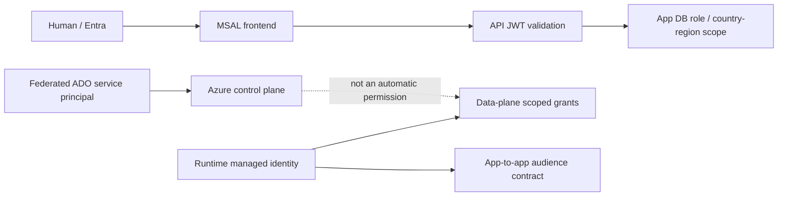

# 04 — Identity, security and governance

## TL;DR

- User authentication, app roles, Azure RBAC and data-plane grants differ. [Code][Chat]
- Human, pipeline SP and runtime identity need independent grants. [Chat]
- OA UAMIs pull images; app/workflow system identities have separate uses. [Code][Live]
- Vault RBAC cannot bypass DNS/firewalls; Terraform sensitive data can enter state. [Code][Chat]
- Corporate assignments are live; recommended CIS/ISO phases are not deployed proof. [Live][Doc]

## High-level: trust boundaries

Contributor is not automatic secret/table read authority.
Application system_admin is not Azure Owner.
Login authenticates the person; backend scope/role authorizes the action.
Correct identity must still reach the target through chapter 03. [Code][Chat]

## Low-level: Entra authentication

Tenant: `ecaa386b-c8df-4ce0-ad01-740cbdb5ba55`. [Live]
Historical delivery client ID: `93298f9a-4b19-401f-95c7-ea6e7dba0545`.
Historical object ID: `ee1718d8-9826-4c4f-941c-dd33df45323a`.
Historical SP: `BASF_SP_BASF_SC_CAIRO_PI_PROD`, with workload identity federation. [Chat]
Identifiers are not credentials; current registration/grant membership still needs Entra inspection.

### Frontend MSAL contract

[Code] Uses VITE_AZURE_CLIENT_ID/TENANT_ID and tenant-specific login.microsoftonline.com authority.
Redirect is window.location.origin, so served origins need registration alignment.
Scopes: openid/profile/email/User.Read; Graph uses a separate access token.
API bearer is an **ID token**, not an API-scoped access token, in inspected source.
Expiration check has a 60-second buffer and forceRefresh handling.
This is an observation, not a best-practice endorsement.
API access-token migration requires FE/BE coordinated scopes/audiences/caller validation.
VITE_* config is publicly embedded into the build; never put secrets there.

### App-to-app callers

[Code] Orchestrator distinguishes users, Logic App/general SPs, SAP callbacks and Event Grid route handling.
Extraction/rules clients support MI/none; none is conditional/local, not deployment advice.
Receiving audience must match the requested token resource/scope. [Doc][Code]
MI client selection chooses caller identity; requested resource selects audience.
Valid token for another resource still fails the receiver.
Registration audience, UAMI client ID and principal ID are not interchangeable.

### Application authorization

Roles: `system_admin`, `system_user`, `power_user`. [Code]
User-country/user-region entities own business scope.
System admin endpoints enforce backend permission, not only FE visibility.
Auto-created users can still have no business role.
Historical Access Pending was missing app role after successful login, not Azure IAM. [Chat]
Assign approved application permissions with audit, not subscription Owner as a workaround.

### OBO and SAP

[Doc] MCP design asks whether Entra OBO is acceptable to SAP OAuth or must bridge to historical Databricks/mTLS.
No automatic trust/exchange is established.
CPI order-submit credential/auth contract is separate in source. [Code]

## Managed identities and role matrix

System identity follows resource lifecycle; UAMI is independent/reusable.
OA apps attach system+environment UAMI; Functions/Logic Apps have system identities. [Code][Live]
Attached identity is not always selected identity:

- ACR needs `acrUseManagedIdentityCreds` and intended UAMI selection.
- Vault reference identity is separate from ACR pull identity.
- Role assignment targets correct principal/object ID.
- App restart/refresh may be needed after reference/config repair. [Code][Chat]

| UAMI [Live] | RG | Client ID | Principal ID |
| --- | --- | --- | --- |
| uami-order_automation-dev | rg-order_automation-dev | 7601555f-4e60-471e-8f52-efb275cf095c | 4e62aa5a-a4ee-4dc1-ae24-7dc628132577 |
| uami-order_automation-qa | rg-order_automation-qa | 3c1b6c4c-485b-41b4-b7ec-0a91f48fecc1 | 1f3e93d9-b4b8-4e32-bbcb-442ed31d0f9b |
| uami-order_automation-prod | rg-order_automation-prod | e5be9402-38b1-463c-a39c-67727327e48f | 70c3c04e-7992-4d19-ad53-75b33aa115cd |
| BASF-ID-RSV-CAIRO-PI-PROD-we | BASF_RG_RecoveryServicesVault | 285aa9cb-1e97-4144-9305-7afc99647512 | e7bc7ee2-2c8a-4346-a7bc-dd24ba1588f0 |

### Required/expected permissions versus observed grants

| Caller | Scope | Permission | Evidence boundary |
|---|---|---|---|
| OA DEV UAMI | DEV ACR | AcrPull | IaC intent [Code] |
| OA QA UAMI | DEV ACR | AcrPull | Independently verify QA grant [Code] |
| OA PROD UAMI | PROD ACR | AcrPull | Historical missing grant repaired; verify persistence [Chat] |
| Pipeline SP | App vault | Secrets User for reads | Human access did not fix pipeline 403 [Chat] |
| Secrets writer | App vault | Secrets Officer/appropriate admin | Approved write, not assumed [Chat] |
| Runtime UAMI | Own vault | Secrets User | Needs selected identity/network [Chat] |
| APIM/ML MI | Shared vault | Secrets User | `manage_kv_rbac` conditional, DEV false [Code] |
| AI SP | AI resource/RG | OpenAI User / Cognitive Services User | Both visible for delivery SP shared DEV [Live] |
| ADLS reader/writer | Account/path | Blob role + path ACL as needed | Live RG roles + separate script [Live][Code] |
| Event publisher | Topic | Key in inspected implementation | MI-only not proved [Code] |
| Extraction SQL SP | DB | Entra contained-user permissions | ClientSecretCredential, not MI [Code] |
| OA PostgreSQL login | DB/schema | Database permissions | Password auth live [Live] |
| Databricks SP | Workspace/Git folder/source | Entitlement, folder ACL, Git credential | Separate auth layers [Chat] |
| Office 365 connection | Shared mailbox | OAuth consent + delegation | Not Azure RBAC [Chat][Code] |
| IAM operator | Grant scope | Role-assignment write | Vault Administrator alone insufficient [Chat] |

### Actually visible roles

16 captured rows are partial, not full effective/inherited IAM.
Missing AcrPull/Secrets User rows here do not establish grant absence. [Live]

| Principal [Live] | Role | Scope |
| --- | --- | --- |
| ab93adea-02e8-45d7-acc1-ac2a2651936e | Azure AI Administrator | rg-sharedresources-dev |
| AdminIT CAIRO_AZURE_AI_DEVELOPER_D | Azure AI Developer | rg-sharedresources-dev |
| AdminIT CAIRO_AZURE_AI_PROJECT_MANAGER_D | Foundry Project Manager | rg-sharedresources-dev |
| AdminIT CAIRO_AZURE_AI_ACCOUNT_OWNER_D | Foundry Account Owner | rg-sharedresources-dev |
| AdminIT CAIRO_AZURE_AI_USER_D | Foundry User | rg-sharedresources-dev |
| AdminIT CAIRO_ADLS_D_RWX | Storage Blob Data Contributor | rg-order_automation-dev |
| AdminIT CAIRO_ADLS_D_RX | Storage Blob Data Reader | rg-order_automation-dev |
| api://93298f9a-4b19-401f-95c7-ea6e7dba0545 | Cognitive Services OpenAI User | rg-sharedresources-dev |
| 442ef9dd-c862-4857-90c2-4c0d487ebe78 | Azure AI Administrator | rg-sharedresources-dev |
| 0f9302ec-baec-44d0-8e92-6f250e6890cb | Azure AI Administrator | rg-sharedresources-prod |
| 345da447-d60f-4fc1-be8b-335a8cf5f9e6 | Azure AI Administrator | rg-sharedresources-prod |
| e1e7b8d2-26b4-429f-9f2f-6b05cbadd918 | Log Analytics Contributor | BASF_RG_RecoveryServicesVault |
| faeee7d2-c02d-45f5-a4d1-319b01d28dc3 | Backup Contributor | BASF_RG_RecoveryServicesVault |
| api://93298f9a-4b19-401f-95c7-ea6e7dba0545 | Cognitive Services User | rg-sharedresources-dev |
| AdminIT CAIRO_AZURE_AI_USER_D | Cognitive Services User | rg-sharedresources-dev |
| AdminIT CAIRO_AZURE_AI_USER_D | Cognitive Services User | rg-sharedresources-prod |

## Key Vault model

Seven vaults use RBAC and soft delete in captured metadata. [Live]
Shared vaults are private; application vaults are public Enabled but firewalled.
RBAC and network conditions must both pass.
Purge protection prevents immediate permanent deletion, not unauthorized reads.

### assistantfactory-kv-dev [Live]

Source: `raw_azure.md`, line 4120.

- **name:** assistantfactory-kv-dev
- **vaultUri:** https://assistantfactory-kv-dev.vault.azure.net/
- **location:** westeurope
- **sku:** family=A; name=standard
- **enableRbacAuthorization:** true
- **enableSoftDelete:** true
- **enablePurgeProtection:** Not returned
- **publicNetworkAccess:** Enabled

### basfkvcairo0947583261 [Live]

Source: `raw_azure.md`, line 4144.

- **name:** basfkvcairo0947583261
- **vaultUri:** https://basfkvcairo0947583261.vault.azure.net/
- **location:** westeurope
- **sku:** family=A; name=standard
- **enableRbacAuthorization:** true
- **enableSoftDelete:** true
- **enablePurgeProtection:** true
- **publicNetworkAccess:** Disabled

### kv-orderautomation [Live]

Source: `raw_azure.md`, line 4207.

- **name:** kv-orderautomation
- **vaultUri:** https://kv-orderautomation.vault.azure.net/
- **location:** westeurope
- **sku:** family=A; name=standard
- **enableRbacAuthorization:** true
- **enableSoftDelete:** true
- **enablePurgeProtection:** true
- **publicNetworkAccess:** Enabled

### kv-orderautomation-prod [Live]

Source: `raw_azure.md`, line 4238.

- **name:** kv-orderautomation-prod
- **vaultUri:** https://kv-orderautomation-prod.vault.azure.net/
- **location:** westeurope
- **sku:** family=A; name=standard
- **enableRbacAuthorization:** true
- **enableSoftDelete:** true
- **enablePurgeProtection:** true
- **publicNetworkAccess:** Enabled

### kv-orderautomation-qa [Live]

Source: `raw_azure.md`, line 4278.

- **name:** kv-orderautomation-qa
- **vaultUri:** https://kv-orderautomation-qa.vault.azure.net/
- **location:** westeurope
- **sku:** family=A; name=standard
- **enableRbacAuthorization:** true
- **enableSoftDelete:** true
- **enablePurgeProtection:** true
- **publicNetworkAccess:** Enabled

### kv-sharedre-prod-ezuzal [Live]

Source: `raw_azure.md`, line 4315.

- **name:** kv-sharedre-prod-ezuzal
- **vaultUri:** https://kv-sharedre-prod-ezuzal.vault.azure.net/
- **location:** westeurope
- **sku:** family=A; name=standard
- **enableRbacAuthorization:** true
- **enableSoftDelete:** true
- **enablePurgeProtection:** true
- **publicNetworkAccess:** Disabled

### kv-sharedresources-dev [Live]

Source: `raw_azure.md`, line 4378.

- **name:** kv-sharedresources-dev
- **vaultUri:** https://kv-sharedresources-dev.vault.azure.net/
- **location:** westeurope
- **sku:** family=A; name=standard
- **enableRbacAuthorization:** true
- **enableSoftDelete:** true
- **enablePurgeProtection:** true
- **publicNetworkAccess:** Disabled

#### basfkvcairo0947583261 firewall [Live]

- Default: Deny
- Bypass: AzureServices
- IP rules: None returned
- VNet rules: None returned

#### kv-orderautomation firewall [Live]

- Default: Allow
- Bypass: AzureServices
- IP rules: 54.246.0.0/15, 34.98.192.0/18, 16.24.0.0/16, 165.85.0.0/16, 13.124.0.0/15, 128.246.11.0/24, 99.80.0.0/15, 13.250.0.0/15, 34.124.64.0/19, 54.228.0.0/15, 148.64.13.28/32, 13.69.231.192/27, 52.178.150.68/32, 54.194.0.0/15, 141.6.110.0/24, 157.175.0.0/16, 46.51.128.0/18, 52.16.0.0/14, 20.82.226.52/32, 34.100.104.0/21, 63.32.0.0/14, 54.72.0.0/14, 52.208.0.0/13, 54.216.0.0/15, 141.6.11.0/24, 34.104.6.0/23, 34.100.112.0/20, 52.78.0.0/15, 208.127.0.0/16, 54.76.0.0/15, 13.36.0.0/14, 54.154.0.0/15, 165.1.128.0/17, 35.203.228.0/23, 54.78.0.0/16, 185.48.120.0/22, 34.100.0.0/18, 114.141.120.0/21, 13.209.0.0/16, 134.238.0.0/16, 46.137.0.0/17, 54.220.0.0/16, 108.128.0.0/13, 34.98.152.0/21, 176.34.64.0/18, 168.149.244.0/23, 35.203.226.0/23, 46.137.128.0/18, 13.244.0.0/14, 34.240.0.0/12, 13.69.227.208/28, 137.83.192.0/18, 35.180.0.0/15, 218.94.47.192/28, 139.180.249.0/24, 94.245.91.93/32, 130.41.0.0/16, 3.248.0.0/13, 15.164.0.0/15, 34.99.0.0/16, 15.188.0.0/16, 46.51.192.0/20, 52.146.138.32/27, 34.98.160.0/19, 52.30.0.0/15, 54.180.0.0/15, 18.200.0.0/16, 34.103.0.0/16, 176.34.128.0/17, 20.82.246.112/28, 40.115.108.29/32, 3.36.0.0/14, 18.202.0.0/15, 15.236.0.0/15, 51.104.190.227/32, 34.100.64.0/19, 15.184.0.0/15, 54.170.0.0/15, 3.34.0.0/15, 20.82.224.59/32, 157.241.0.0/16, 66.159.192.0/19, 52.48.0.0/14, 52.47.0.0/16, 79.125.0.0/17, 51.124.0.0/16, 172.160.192.0/18, 40.74.28.0/23, 172.199.233.80/28, 172.199.233.128/26, 20.61.0.0/16, 51.107.0.0/16, 4.175.0.0/16, 4.180.0.0/16, 4.210.128.0/17, 4.231.0.0/17, 4.245.0.0/17, 9.129.63.0/25, 9.163.0.0/16, 13.69.0.0/17, 13.73.128.0/18, 13.73.224.0/21, 13.80.0.0/15, 13.88.200.0/21, 13.93.0.0/17, 13.94.128.0/17, 13.95.0.0/16, 13.104.145.192/26, 13.104.146.0/26, 13.104.146.128/25, 13.104.158.176/28, 13.104.209.0/24, 13.104.214.0/25, 13.104.218.128/25, 13.105.22.0/24, 13.105.23.128/25, 13.105.28.32/28, 13.105.29.128/25, 13.105.60.48/28, 13.105.60.96/27, 13.105.60.128/27, 13.105.66.144/28, 13.105.105.96/27, 13.105.105.128/28, 13.105.105.160/27, 20.4.0.0/16, 20.8.0.0/16, 20.13.0.0/17, 20.16.0.0/16, 20.23.0.0/16, 20.31.0.0/16, 20.33.1.0/24, 20.33.2.0/24, 20.33.6.0/24, 20.33.21.0/24, 20.33.25.0/24, 20.33.33.0/24, 20.33.36.0/24, 20.33.39.0/24, 20.33.49.0/24, 20.33.66.0/24, 20.33.72.0/24, 20.33.86.0/24, 20.33.92.0/24, 20.33.110.0/24, 20.33.145.0/24, 20.33.163.0/24, 20.33.198.0/24, 20.33.207.0/24, 20.33.217.0/24, 20.33.232.0/24, 20.33.244.0/24, 20.38.108.0/23, 20.38.200.0/22, 20.47.7.0/24, 20.47.18.0/23, 20.47.30.0/24, 20.47.96.0/23, 20.47.115.0/24, 20.47.118.0/24, 20.50.0.0/18, 20.50.88.0/21, 20.50.128.0/17, 20.54.128.0/17, 20.56.0.0/16, 20.60.26.0/23, 20.60.130.0/24, 20.60.150.0/23, 20.60.196.0/23, 20.60.222.0/23, 20.60.250.0/23, 20.67.0.0/17, 20.71.0.0/16, 20.73.0.0/16, 20.76.0.0/16, 20.82.0.0/17, 20.86.0.0/16, 20.93.128.0/17, 20.95.64.0/24, 20.95.66.0/24, 20.95.68.0/23, 20.95.72.0/23, 20.95.76.0/23, 20.95.81.0/24, 20.95.98.0/24, 20.95.103.0/24, 20.95.107.0/24, 20.95.121.0/24, 20.95.122.0/24, 20.95.126.0/24, 20.101.0.0/16, 20.103.0.0/16, 20.105.128.0/17, 20.107.0.0/17, 20.123.128.0/17, 20.126.0.0/16, 20.135.24.0/23, 20.135.140.0/22, 20.135.144.0/23, 20.143.1.0/24, 20.143.32.0/23, 20.143.39.0/24, 20.143.50.0/23, 20.143.80.0/22, 20.143.194.0/23, 20.150.8.0/23, 20.150.37.0/24, 20.150.42.0/24, 20.150.74.0/24, 20.150.76.0/24, 20.150.83.0/24, 20.150.122.0/24, 20.152.46.0/23, 20.152.88.0/23, 20.153.4.0/24, 20.153.31.0/24, 20.153.97.0/24, 20.153.108.0/24, 20.153.130.0/24, 20.153.141.0/24, 20.153.150.0/23, 20.153.152.0/24, 20.153.154.0/24, 20.157.18.0/24, 20.157.21.0/24, 20.157.22.0/24, 20.157.30.0/24, 20.157.33.0/24, 20.157.97.0/24, 20.157.115.0/24, 20.157.123.0/24, 20.157.146.0/24, 20.157.158.0/24, 20.157.170.0/24, 20.157.186.0/24, 20.157.212.0/24, 20.157.221.0/24, 20.157.223.0/24, 20.157.230.0/24, 20.157.245.0/24, 20.160.0.0/16, 20.190.137.0/24, 20.190.160.0/24, 20.201.216.0/24, 20.201.241.0/24, 20.201.242.0/24, 20.202.2.0/24, 20.202.12.0/22, 20.202.16.0/22, 20.202.140.0/24, 20.202.150.0/24, 20.202.152.0/24, 20.202.154.0/24, 20.202.156.0/24, 20.202.158.0/24, 20.202.160.0/24, 20.202.162.0/24, 20.202.164.0/24, 20.202.166.0/24, 20.202.168.0/24, 20.202.236.0/24, 20.202.248.0/24, 20.202.250.0/23, 20.209.10.0/23, 20.209.48.0/23, 20.209.72.0/23, 20.209.76.0/23, 20.209.108.0/23, 20.209.192.0/23, 20.209.230.0/23, 20.224.0.0/16, 20.229.0.0/16, 20.234.128.0/17, 20.238.128.0/17, 23.97.128.0/17, 23.98.46.0/24, 23.100.0.0/20, 23.101.64.0/20, 40.64.144.32/27, 40.64.145.128/28, 40.64.172.128/25, 40.67.192.0/19, 40.68.0.0/16, 40.78.210.0/24, 40.79.205.192/27, 40.79.205.224/28, 40.79.206.0/27, 40.82.92.0/22, 40.87.184.0/22, 40.90.17.64/27, 40.90.18.192/26, 40.90.20.128/25, 40.90.21.0/25, 40.90.130.0/27, 40.90.133.0/27, 40.90.134.64/26, 40.90.134.128/26, 40.90.138.0/27, 40.90.141.32/27, 40.90.141.160/27, 40.90.142.224/28, 40.90.144.192/27, 40.90.145.192/27, 40.90.146.16/28, 40.90.146.128/27, 40.90.150.128/25, 40.90.157.64/26, 40.90.159.0/24, 40.91.28.0/22, 40.91.192.0/18, 40.93.65.0/24, 40.98.26.0/24, 40.101.2.192/26, 40.101.3.0/25, 40.101.20.64/26, 40.101.20.128/25, 40.112.36.128/25, 40.112.37.0/26, 40.112.38.192/26, 40.112.96.0/19, 40.113.96.0/19, 40.113.128.0/18, 40.114.128.0/17, 40.115.0.0/18, 40.118.0.0/17, 40.119.128.0/19, 40.120.152.0/22, 40.123.140.0/22, 40.123.180.0/22, 40.126.9.0/24, 40.126.32.0/24, 48.199.0.0/16, 48.205.3.0/24, 48.205.11.0/24, 48.205.19.0/24, 48.205.27.0/24, 48.205.35.0/24, 48.205.43.0/24, 48.205.51.0/24, 48.205.59.0/24, 48.205.67.0/24, 48.205.75.0/24, 48.205.83.0/24, 48.205.88.0/24, 48.205.92.0/24, 48.205.96.0/24, 48.205.100.0/24, 48.205.104.0/24, 48.205.108.0/24, 48.205.112.0/24, 48.205.116.0/24, 48.205.119.0/24, 48.205.121.0/24, 48.205.123.0/24, 48.205.125.0/24, 48.205.127.0/24, 48.205.129.0/24, 48.205.131.0/24, 48.205.133.0/24, 48.205.135.0/24, 48.205.137.0/24, 48.205.139.0/24, 48.205.141.0/24, 48.205.143.0/24, 48.205.145.0/24, 48.205.147.0/24, 48.205.250.0/24, 48.207.0.0/16, 48.208.72.0/24, 48.208.216.0/24, 48.209.0.0/17, 48.209.192.0/18, 48.212.23.0/24, 48.212.151.0/24, 48.213.23.0/24, 48.213.128.0/25, 48.213.128.128/26, 48.222.128.0/17, 50.85.0.0/16, 51.5.11.0/24, 51.5.12.0/24, 51.5.255.208/28, 51.5.255.224/28, 51.105.96.0/19, 51.105.128.0/17, 51.136.0.0/16, 51.137.0.0/17, 51.137.192.0/18, 51.138.0.0/17, 51.144.0.0/16, 51.145.128.0/17, 52.101.69.0/24, 52.101.70.0/23, 52.101.72.0/23, 52.102.161.0/24, 52.103.33.0/24, 52.103.161.0/24, 52.106.139.0/24, 52.106.184.128/27, 52.108.24.0/21, 52.108.56.0/21, 52.108.80.0/24, 52.108.108.0/23, 52.108.110.0/24, 52.109.88.0/22, 52.111.243.0/24, 52.112.14.0/23, 52.112.22.0/24, 52.112.102.0/24, 52.112.124.0/24, 52.112.144.0/20, 52.112.197.0/24, 52.112.216.0/21, 52.112.233.0/24, 52.112.237.0/24, 52.112.238.0/24, 52.112.254.0/24, 52.113.9.0/24, 52.113.12.0/24, 52.113.37.0/24, 52.113.38.0/23, 52.113.69.0/24, 52.113.83.0/24, 52.113.85.0/24, 52.113.86.0/24, 52.113.144.0/21, 52.113.199.0/24, 52.114.53.0/24, 52.114.63.0/24, 52.114.72.0/22, 52.114.241.0/24, 52.114.242.0/24, 52.114.252.0/22, 52.115.33.0/24, 52.115.35.0/24, 52.115.37.0/24, 52.115.39.0/24, 52.115.41.0/24, 52.115.43.0/24, 52.115.45.0/24, 52.115.226.0/23, 52.115.228.0/23, 52.120.128.0/21, 52.120.208.0/20, 52.121.24.0/21, 52.121.64.0/20, 52.122.20.0/22, 52.122.96.0/20, 52.122.112.0/21, 52.123.7.0/24, 52.123.18.0/24, 52.123.102.0/23, 52.123.104.0/24, 52.123.126.0/24, 52.123.133.0/24, 52.123.134.0/23, 52.123.195.0/24, 52.125.140.0/23, 52.136.192.0/18, 52.137.0.0/18, 52.142.192.0/18, 52.143.0.0/18, 52.143.194.0/24, 52.143.208.0/24, 52.148.192.0/18, 52.149.64.0/18, 52.157.64.0/18, 52.157.128.0/17, 52.166.0.0/16, 52.174.0.0/16, 52.178.0.0/17, 52.232.0.0/17, 52.232.147.0/24, 52.233.128.0/17, 52.236.128.0/17, 52.239.140.0/22, 52.239.212.0/23, 52.239.242.0/23, 52.245.48.0/22, 52.245.124.0/22, 57.150.2.0/23, 57.150.80.0/23, 57.150.90.0/23, 57.150.110.0/23, 57.150.150.0/23, 57.150.166.0/23, 57.150.224.0/23, 57.153.0.0/16, 57.157.12.0/24, 57.157.13.0/25, 57.157.13.128/28, 57.157.13.144/29, 57.157.13.170/31, 57.157.13.172/30, 57.157.13.176/28, 57.157.13.192/26, 57.157.14.0/23, 57.157.56.0/24, 57.157.57.0/27, 57.157.57.32/28, 57.157.57.48/30, 57.163.36.0/23, 57.168.0.0/16, 65.52.128.0/19, 68.219.160.0/19, 70.152.36.0/24, 70.152.181.0/24, 70.152.182.0/23, 70.152.184.0/21, 70.152.192.0/20, 70.152.208.0/23, 70.152.210.0/24, 72.145.128.0/18, 74.144.128.0/17, 74.178.128.0/17, 74.234.128.0/17, 98.64.0.0/16, 98.71.128.0/17, 104.40.128.0/17, 104.44.89.160/27, 104.44.90.192/27, 104.44.93.0/27, 104.44.93.192/27, 104.44.95.80/28, 104.44.95.96/28, 104.45.0.0/18, 104.45.64.0/20, 104.46.32.0/19, 104.47.128.0/18, 104.47.216.64/26, 104.214.192.0/18, 108.141.0.0/16, 108.142.0.0/15, 128.251.128.0/17, 132.164.0.0/17, 132.220.0.0/16, 134.149.128.0/17, 135.130.102.0/23, 135.130.162.0/23, 135.130.204.0/23, 135.236.0.0/17, 137.116.192.0/19, 137.117.128.0/17, 145.190.59.0/24, 145.190.66.0/23, 145.190.68.0/24, 145.190.78.0/24, 145.190.81.0/24, 145.190.86.0/24, 145.190.135.0/24, 145.190.170.0/24, 151.206.71.0/24, 151.206.72.0/24, 151.206.92.0/23, 151.206.139.0/24, 157.55.8.64/26, 157.55.8.144/28, 168.61.56.0/21, 168.63.0.0/19, 168.63.96.0/19, 172.201.0.0/16, 172.205.128.0/17, 172.211.0.0/16, 191.233.64.0/18, 191.237.232.0/22, 191.239.200.0/22, 193.149.80.0/21, 213.199.128.0/20, 213.199.180.32/28, 213.199.180.96/27, 213.199.180.192/27, 213.199.183.0/24
- VNet rules: None returned

#### kv-orderautomation-prod firewall [Live]

- Default: Allow
- Bypass: AzureServices
- IP rules: 54.246.0.0/15, 34.98.192.0/18, 16.24.0.0/16, 165.85.0.0/16, 13.124.0.0/15, 128.246.11.0/24, 99.80.0.0/15, 13.250.0.0/15, 34.124.64.0/19, 54.228.0.0/15, 148.64.13.28/32, 13.69.231.192/27, 52.178.150.68/32, 54.194.0.0/15, 141.6.110.0/24, 157.175.0.0/16, 46.51.128.0/18, 52.16.0.0/14, 20.82.226.52/32, 34.100.104.0/21, 63.32.0.0/14, 54.72.0.0/14, 52.208.0.0/13, 54.216.0.0/15, 141.6.11.0/24, 34.104.6.0/23, 34.100.112.0/20, 52.78.0.0/15, 208.127.0.0/16, 54.76.0.0/15, 13.36.0.0/14, 54.154.0.0/15, 165.1.128.0/17, 35.203.228.0/23, 54.78.0.0/16, 185.48.120.0/22, 34.100.0.0/18, 114.141.120.0/21, 13.209.0.0/16, 134.238.0.0/16, 46.137.0.0/17, 54.220.0.0/16, 108.128.0.0/13, 34.98.152.0/21, 176.34.64.0/18, 168.149.244.0/23, 35.203.226.0/23, 46.137.128.0/18, 13.244.0.0/14, 34.240.0.0/12, 13.69.227.208/28, 137.83.192.0/18, 35.180.0.0/15, 218.94.47.192/28, 139.180.249.0/24, 94.245.91.93/32, 130.41.0.0/16, 3.248.0.0/13, 15.164.0.0/15, 34.99.0.0/16, 15.188.0.0/16, 46.51.192.0/20, 52.146.138.32/27, 34.98.160.0/19, 52.30.0.0/15, 54.180.0.0/15, 18.200.0.0/16, 34.103.0.0/16, 176.34.128.0/17, 20.82.246.112/28, 40.115.108.29/32, 3.36.0.0/14, 18.202.0.0/15, 15.236.0.0/15, 51.104.190.227/32, 34.100.64.0/19, 15.184.0.0/15, 54.170.0.0/15, 3.34.0.0/15, 20.82.224.59/32, 157.241.0.0/16, 66.159.192.0/19, 52.48.0.0/14, 52.47.0.0/16, 79.125.0.0/17
- VNet rules: None returned

#### kv-orderautomation-qa firewall [Live]

- Default: Allow
- Bypass: AzureServices
- IP rules: 54.246.0.0/15, 34.98.192.0/18, 16.24.0.0/16, 165.85.0.0/16, 13.124.0.0/15, 128.246.11.0/24, 99.80.0.0/15, 13.250.0.0/15, 34.124.64.0/19, 54.228.0.0/15, 148.64.13.28/32, 13.69.231.192/27, 52.178.150.68/32, 54.194.0.0/15, 141.6.110.0/24, 157.175.0.0/16, 46.51.128.0/18, 52.16.0.0/14, 20.82.226.52/32, 34.100.104.0/21, 63.32.0.0/14, 54.72.0.0/14, 52.208.0.0/13, 54.216.0.0/15, 141.6.11.0/24, 34.104.6.0/23, 34.100.112.0/20, 52.78.0.0/15, 208.127.0.0/16, 54.76.0.0/15, 13.36.0.0/14, 54.154.0.0/15, 165.1.128.0/17, 35.203.228.0/23, 54.78.0.0/16, 185.48.120.0/22, 34.100.0.0/18, 114.141.120.0/21, 13.209.0.0/16, 134.238.0.0/16, 46.137.0.0/17, 54.220.0.0/16, 108.128.0.0/13, 34.98.152.0/21, 176.34.64.0/18, 168.149.244.0/23, 35.203.226.0/23, 46.137.128.0/18, 13.244.0.0/14, 34.240.0.0/12, 13.69.227.208/28, 137.83.192.0/18, 35.180.0.0/15, 218.94.47.192/28, 139.180.249.0/24, 94.245.91.93/32, 130.41.0.0/16, 3.248.0.0/13, 15.164.0.0/15, 34.99.0.0/16, 15.188.0.0/16, 46.51.192.0/20, 52.146.138.32/27, 34.98.160.0/19, 52.30.0.0/15, 54.180.0.0/15, 18.200.0.0/16, 34.103.0.0/16, 176.34.128.0/17, 20.82.246.112/28, 40.115.108.29/32, 3.36.0.0/14, 18.202.0.0/15, 15.236.0.0/15, 51.104.190.227/32, 34.100.64.0/19, 15.184.0.0/15, 54.170.0.0/15, 3.34.0.0/15, 20.82.224.59/32, 157.241.0.0/16, 66.159.192.0/19, 52.48.0.0/14, 52.47.0.0/16, 79.125.0.0/17
- VNet rules: None returned

#### kv-sharedre-prod-ezuzal firewall [Live]

- Default: Deny
- Bypass: AzureServices
- IP rules: None returned
- VNet rules: None returned

#### kv-sharedresources-dev firewall [Live]

- Default: Deny
- Bypass: AzureServices
- IP rules: None returned
- VNet rules: None returned

### Secret names only

Lists below contain names only; denied name queries remain unknown.
Names ending connection-string/client-secret/key do not expose their values.

### assistantfactory-kv-dev secret names [Live]

Source: `raw_azure.md`, line 4130.

- `acr-password`
- `acr-url`
- `acr-username`
- `postgresql-password`
- `postgresql-user`

### basfkvcairo0947583261 secret names [Live]

Source: `raw_azure.md`, line 4154.

Name query unavailable/blocked; contents unknown.

### kv-orderautomation secret names [Live]

Source: `raw_azure.md`, line 4217.

- `api-azure-storage-connection-string`
- `api-databricks-sp-client-secret`
- `api-sap-cpi-order-submit-client-secret`
- `appinsights-connection-string`
- `appinsights-connection-string-salesorderstatus`
- `clientsecret`
- `Databricks-ADO-PAT`
- `deployment-storage-connection-string`
- `documentintelligence-apikey`
- `llm-router-apikey`
- `postgresqlpassword`
- `sql-admin-password`

### kv-orderautomation-prod secret names [Live]

Source: `raw_azure.md`, line 4248.

- `8f1e2589-4491-40f4-a8e0-94d0f4324641-workspaceartifactstore00010101000000000`
- `8f1e2589-4491-40f4-a8e0-94d0f4324641-workspaceblobstore00010101000000000`
- `8f1e2589-4491-40f4-a8e0-94d0f4324641-workspaceworkingdirectory00010101000000000`
- `extraction-api-database-url`
- `extraction-appinsights-connection-string`
- `extraction-azure-sp-client-secret`
- `extraction-document-intelligence-api-key`
- `extraction-eventgrid-topic-key`
- `extraction-llm-router-api-key`
- `orchestrator-api-database-url`
- `orchestrator-appinsights-connection-string`
- `orchestrator-azure-sp-client-secret`
- `orchestrator-azure-storage-connection-string`
- `orchestrator-databricks-sp-client-secret`
- `orchestrator-document-intelligence-api-key`
- `orchestrator-llm-router-api-key`
- `orchestrator-sap-cpi-client-secret`
- `postgresqlpassword`
- `rules-api-database-url`
- `rules-appinsights-connection-string`
- `sql-admin-password`

### kv-orderautomation-qa secret names [Live]

Source: `raw_azure.md`, line 4288.

- `api-azure-storage-connection-string`
- `api-database-url`
- `api-database-url-async`
- `api-database-url-mssql`
- `api-database-url-postgresql`
- `api-databricks-sp-client-secret`
- `api-sap-cpi-order-submit-client-secret`
- `appinsights-connection-string`
- `appinsights-connection-string-rulesengine`
- `appinsights-connection-string-salesorderstatus`
- `clientsecret`
- `deployment-storage-connection-string`
- `documentintelligence-apikey`
- `eventgrid-topic-key`
- `llm-router-apikey`
- `newrelic-license-key`
- `postgresqlpassword`
- `sql-admin-password`

### kv-sharedre-prod-ezuzal secret names [Live]

Source: `raw_azure.md`, line 4325.

Name query unavailable/blocked; contents unknown.

### kv-sharedresources-dev secret names [Live]

Source: `raw_azure.md`, line 4388.

Name query unavailable/blocked; contents unknown.

### Secret-state risk

Terraform data sources read SQL/PostgreSQL administrator passwords. [Code]
Sensitive suppresses common display but does not remove values from state.
Ignore_changes does not guarantee absence from state.
Protect backend/output artifacts and controlled rotation.
Inspect password plans to avoid accidental replacement. [Chat][Code]

### Reference failure walkthrough

1. Historical 11 references lacked final `)` and became literal setting strings. [Chat]
2. System identity was chosen instead of authorized UAMI. [Chat]
3. Blob/telemetry failures produced misleading downstream UI symptoms.
4. Correct syntax and selection; refresh/restart; verify a new upload.
5. Old cases missing storage metadata may need re-upload.
6. Persist setting ownership/validation to prevent CD/IaC overwrite.

Do not print resolved secret values during verification.

## AI and database authentication

[Live] Delivery SP has visible OpenAI User and Cognitive Services User grants at shared DEV RG.
[Chat] API-key success plus SP PermissionDenied exposed missing data-plane entitlement.
Foundry administration, resource Contributor and inference permissions solve different tasks.
Deployment name/version/quota/region are separate from token validity.

[Live] OA PostgreSQL DEV/QA/PROD Entra auth Disabled, password Enabled.
[Live] Assistant DEV/TEST both Entra/password Enabled; DEV admin is assistant_factory-deploy-sp.
OA administrator queries failed Bad Request; successful server authConfig establishes current mode.
Do not describe OA as Entra-only from a recommendation.

[Code] Extraction Azure SQL token auth uses ClientSecretCredential/pyodbc, not MI.
[Live] DEV SQL has an Entra administrator; QA/PROD lists returned empty.
Contained DB users/schema permissions are separate from Azure RBAC.

## Defender and monitoring

[Chat] Story 573746 concerned Containers/AppService/KeyVault plans and SOC routing.
Secure Score 80% was a target, not a Terraform property.
Removing Defender state ownership avoided restricted operations, not proof plans disabled/enabled.
Full active Defender pricing/alert routing was not collected. [Live]
Smart detectors/action groups exist; metric-alert list returned empty.
Selected diagnostic examples returned empty value arrays.
Instrumentation and resource diagnostic settings are separate.

## Azure Policy: live versus recommended

| Assignment [Live] | Display name | Scope | Enforcement |
| --- | --- | --- | --- |
| BASF_SC_APA_20011_87a57a8d-4e3f-4cf5-b508-ce306917ec5f | [1.0.0] BASF_SC_APA_20011 BASFCloudNativeSecurityEnforcement 3.0 - BASF_SC_CAIRO_PI_PROD | /subscriptions/87a57a8d-4e3f-4cf5-b508-ce306917ec5f | Default |
| SqlVmAndArcSqlServersProtection | Defender for SQL Servers on Machines provisioning (subscription: 87a57a8d-4e3f-4cf5-b508-ce306917ec5f) | /subscriptions/87a57a8d-4e3f-4cf5-b508-ce306917ec5f | Default |
| DataProtectionSecurityCenter | ASC DataProtection (subscription: 87a57a8d-4e3f-4cf5-b508-ce306917ec5f) | /subscriptions/87a57a8d-4e3f-4cf5-b508-ce306917ec5f | Default |
| 97b3e4b6c15046e88d059008 | Configure backup on virtual machines without a given tag to an existing recovery services vault in the same location | /subscriptions/87a57a8d-4e3f-4cf5-b508-ce306917ec5f | Default |
| 9ebbbba34d654da9bb67b22c | [Preview]: Azure Recovery Services vaults should disable public network access | BASF_RG_RecoveryServicesVault | Default |
| c717fb0cd1184c43ab3dece3 | Deploy Diagnostic Settings for Recovery Services Vault to Log Analytics workspace for resource specific categories. | BASF_RG_RecoveryServicesVault | Default |
| d6f6f56014b749a49fc8d2c3 | [Preview]: Immutability must be enabled for Recovery Services vaults | BASF_RG_RecoveryServicesVault | Default |
| f19b0c83716f4b8185e32dbf | [Preview]: Disable Cross Subscription Restore for Azure Recovery Services vaults | BASF_RG_RecoveryServicesVault | Default |
| SecurityCenterBuiltIn | ASC Default (subscription: 87a57a8d-4e3f-4cf5-b508-ce306917ec5f) | /subscriptions/87a57a8d-4e3f-4cf5-b508-ce306917ec5f | Default |

[Live] BASFCloudNativeSecurityEnforcement 3.0, ASC Default/DataProtection/SQL-machine and backup assignments appear.
Default enforcement mode does not reveal each member effect/compliance/exemption.
Empty RG assignment list does not remove inherited policy.

[Doc] Recommended initiatives: Azure Security Benchmark, CIS Azure Foundations v2.0, ISO/IEC 27001:2013.
These three recommendations are not proof of three matching assignments.

| Phase | Action | Prerequisite |
|---|---|---|
| 1 | Audit baseline/compliance dashboard | Visibility without breaking deployment |
| 2 | Agreed Deny for highest-risk controls | Tested exceptions/change ownership |
| 3 | Modify/DeployIfNotExists | Assignment MI/remediation permissions |
| 4 | Management-group scope | Enterprise hierarchy and exemptions |

| Domain | Recommendation | Observed boundary |
|---|---|---|
| Consistency | Tags/locations/SKUs/naming | Uneven tags; taxonomy needs agreement |
| Networking | NSGs/no public management/PEs | Atomic policy known; public PaaS persists |
| Identity | Entra-only/disable shared keys/MI | Mixed keys/passwords/tokens remain |
| Protection | Purge/TLS/encryption | Metadata partial, CMK scope unverified |
| Telemetry | Diagnostics/Defender/retention | Coverage not complete |
| PaaS | TLS/debug/MI Functions | No inferred AKS deployment |
| Analytics | SQL auditing/Synapse private | Synapse not visible |
| Resilience/cost | Backup/SKU guardrails | Protected items/SLOs unverified |

CIS technical hardening and ISO management-system certification are not interchangeable. [Doc]

## Production lockdown and follow-up

[Doc] Intended: pipeline-only changes, strict runtime RBAC, no direct developer access.
[Live] OA ingress still allows all; httpsOnly false; databases/storage/events public; WAF rule sets empty.
[Code] Some connections remain key/secret based.
Human lockdown/approval enforcement is not exhaustively verified.

Proposed sequence, not executed:

1. Inventory real callers/OAuth contracts.
2. Add supported outbound integration/private DNS.
3. Solve agent reachability before closing registry/vault public paths.
4. Scope data-plane roles per workload/environment.
5. Enforce AFD tag plus correct FDID and HTTPS-only.
6. Establish WAF rules, diagnostic coverage and restore verification.
7. Remove old keys only after new auth is functional.
8. Record approval, least-privilege review and expiring exemptions.

## How it connects to other components

Identity crosses FE/API, ACR, vault, DB, AI, mail, Databricks and SAP. Chapter 03 supplies routes, 05/06 actual auth modes, 08/09 pipeline authority.

## Where to look in the Azure Portal / ADO

- Entra **App registrations** → **Authentication**, **Expose an API**, **API permissions**, **App roles**.
- **Enterprise applications** → **Users and groups**, **Sign-in logs**.
- **Managed Identities** → UAMI → **Azure role assignments**; site **Identity**.
- Resource **IAM** → **Role assignments**, **Check access**.
- Vault **Access configuration**, **IAM**, **Networking**, **Secrets**, **Diagnostic settings**.
- App **Environment variables** → reference status; effective reference identity.
- PostgreSQL **Authentication**; SQL **Microsoft Entra ID**, **Networking**.
- **Policy** → **Assignments**, **Compliance**, **Exemptions**, **Remediation**.
- Defender **Environment settings** → subscription → **Defender plans**; **Regulatory compliance**, **Security alerts**.
- ADO **Project settings** → **Service connections**; **Library** → **Pipeline permissions**.

## Interview talking points

- Distinguish human, pipeline and runtime grants.
- Explain Contributor versus Secrets User/data-plane.
- Explain attached versus selected UAMI.
- Explain Access Pending after login.
- Explain audience/ID-token contract debt.
- Explain sensitive state/federation.
- Explain policy recommendation versus assignment.

## Evidence & confidence

`raw_azure.md` Key Vault/Governance/DB sections; `raw_apps.md` auth/config; `raw_iac.md` identity/vault; `raw_chats.md` access/reference/Defender incidents; `doc_policy.txt`. No full inherited IAM/compliance export or secret values.
