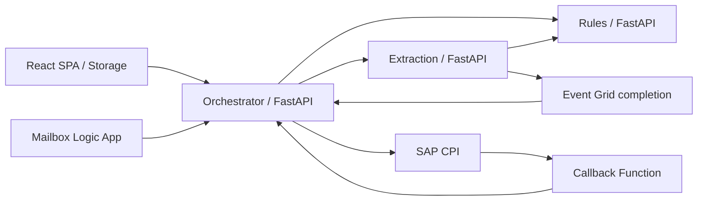

# 05 — Compute and applications

## TL;DR

- OA has three main container services per environment plus test/callback resources. [Live]
- React/Vite frontend is Storage static hosting, not a fourth OA container site. [Live][Code]
- FastAPI orchestrator/extraction/rules use ports 3000/8000/8001 in source. [Code]
- Logic Apps deploy definitions separately and still need manual mailbox authorization. [Code][Chat]
- Running site/Enabled workflow does not prove healthy processing. [Chat]

## High-level: compute responsibilities

| Component | Responsibility | State/dependencies |
|---|---|---|
| Orchestrator | Cases, users, enrichment, review, SAP publication | PostgreSQL, Blob, extraction/rules, Databricks SQL, CPI |
| Extraction | Async document/typed field extraction | Azure SQL, Document Intelligence, LLM router, Event Grid |
| Rules | Decision graphs and consignment/deposit checks | JSON graphs, shared application reference tables |
| Frontend | Upload/review/monitor/manage users | Browser MSAL and API requests |
| Intake Logic App | Poll mailbox, capture/convert, call backend | Office 365/conversion connectors |
| Notification Logic App | Send business/operational mail | HTTP trigger + Office 365 connection |
| Callback Function | Receive SAP result and forward | XML/HTTP backend callback contract |
| Incident Logic App | Capture support mail, test-job action | Office 365 support connection; downstream verification needed |
| Assistant Factory | Separate assistants/agents application | PostgreSQL/AI/vector/Graph lifecycle capabilities |

[Code] Responsibilities do not prove the latest deployed image has identical behavior.

## Low-level: plans, sites and deployment images

11 plans are captured, including B3, EP1 and FC1 families. [Live]
OA DEV B3 serves four web sites; QA/PROD B3 each serve three.
Several independently deployed apps therefore share compute capacity/blast radius.
B3 is Basic, not an autoscale-enabled production HA assertion.
EP1 Function plans differ from FC1 Flex Consumption callback plans.
Plan SKU/capacity is not proof of active autoscale policy, zone resilience or workload load-test suitability.

| Plan [Live] | RG | SKU/tier | Capacity | Sites | Region | Zone redundant |
| --- | --- | --- | --- | --- | --- | --- |
| ASP-rgorderautomationdev-ad27 | rg-order_automation-dev | FC1/FlexConsumption | 0 | 1 | Germany West Central | false |
| ASP-rgorderautomationqa-ad96 | rg-order_automation-qa | FC1/FlexConsumption | 0 | 1 | Germany West Central | false |
| ASP-rgorderautomationprod-b631 | rg-order_automation-prod | FC1/FlexConsumption | 0 | 1 | Germany West Central | false |
| assistantfactory-appservice-plan-dev | rg-assistant_factory-dev | B3/Basic | 1 | 1 | West Europe | false |
| assistantfactory-mcp-appservice-plan-dev | rg-assistant_factory-dev | B3/Basic | 1 | 1 | West Europe | false |
| appserviceplan-dev | rg-order_automation-dev | B3/Basic | 1 | 4 | West Europe | false |
| functionappservice-order_automation-dev | rg-order_automation-dev | EP1/ElasticPremium | 1 | 1 | West Europe | false |
| appserviceplan-order_automation-qa | rg-order_automation-qa | B3/Basic | 1 | 3 | West Europe | false |
| functionappservice-order_automation-qa | rg-order_automation-qa | EP1/ElasticPremium | 1 | 1 | West Europe | false |
| functionappservice-order_automation-prod | rg-order_automation-prod | EP1/ElasticPremium | 1 | 1 | West Europe | false |
| appserviceplan-order_automation-prod | rg-order_automation-prod | B3/Basic | 1 | 3 | West Europe | false |

### Every captured app/Function

Metadata below includes runtime image, settings **names**, identity attachment and restrictions.
App settings values were intentionally not read.
An empty linuxFxVersion on a Function does not prove worker/runtime absence: worker values were excluded.
All healthCheckPath nulls are reported as not returned, not a live HTTP health result.

### apim-integration-test-backend-dev [Live]

- RG: `rg-order_automation-dev`
- Kind: app,linux
- Host: `apim-integration-test-backend-dev.azurewebsites.net`
- Plan: `appserviceplan-dev`
- Resource state: Running (not HTTP health)
- Region: Not returned
- HTTPS-only: false
- Site integration subnet: Not returned
- Identity type: SystemAssigned, UserAssigned; system principal: c884b73e-d2f3-4825-b483-15ffb14840b4; UAMIs: uami-order_automation-dev
- Setting names (values not read):
  - `ENVIRONMENT`, `WEBSITES_ENABLE_APP_SERVICE_STORAGE`, `WEBSITES_PORT`, `WEBSITE_ENABLE_SYNC_UPDATE_SITE`
- Runtime/image: PYTHON\|3.12
- Always on: true; health-check path: Not returned; route-all: false
- TLS: 1.2; FTPS: FtpsOnly
- Ingress rules: 2147483647 Allow Any Allow all

### assistantfactory-appservice-dev [Live]

- RG: `rg-assistant_factory-dev`
- Kind: app,linux,container
- Host: `assistantfactory-appservice-dev.azurewebsites.net`
- Plan: `assistantfactory-appservice-plan-dev`
- Resource state: Running (not HTTP health)
- Region: Not returned
- HTTPS-only: true
- Site integration subnet: assistantfactory-app-subnet-dev
- Identity type: SystemAssigned, UserAssigned; system principal: b766ad57-3614-4b78-92d6-c2ecb60cdbc1; UAMIs: uami-order_automation-dev
- Setting names (values not read):
  - `AGENT_SERVICE_CLIENT_ID`, `AGENT_SERVICE_CLIENT_SECRET`, `AI_FOUNDRY_NAME`, `CAIRO_SUBSCRIPTION`, `DOCKER_CUSTOM_IMAGE_NAME`, `DOCKER_REGISTRY_SERVER_PASSWORD`, `DOCKER_REGISTRY_SERVER_URL`
  - `DOCKER_REGISTRY_SERVER_USERNAME`, `LOGIN_REDIRECT_URI_HOSTNAME`, `POSTGRES_DSN`, `PROJECT_ENDPOINT`, `RESOURCE_GROUP`, `ROUTER_CLIENT_ID`, `ROUTER_CLIENT_SECRET`
  - `ROUTER_SCOPE`, `SPEECH_SERVICE_ENDPOINT`, `SPEECH_SERVICE_KEY`, `SPEECH_SERVICE_REGION`, `STORAGE_ACCOUNT_NAME`, `TENANT_ID`, `WEBSITES_CONTAINER_START_TIME_LIMIT`
  - `WEBSITES_ENABLE_APP_SERVICE_STORAGE`, `WEBSITES_PORT`
- Runtime/image: DOCKER\|acrsharedresourced2slfk.azurecr.io/assistantfactorydev:20261009.415273
- Always on: true; health-check path: Not returned; route-all: false
- TLS: 1.2; FTPS: FtpsOnly
- Ingress rules: 100 Allow AzureFrontDoor.Backend AllowFrontDoor, 2147483647 Deny Any Deny all

### assistantfactory-mcp-appservice-dev [Live]

- RG: `rg-assistant_factory-dev`
- Kind: app,linux,container
- Host: `assistantfactory-mcp-appservice-dev.azurewebsites.net`
- Plan: `assistantfactory-mcp-appservice-plan-dev`
- Resource state: Running (not HTTP health)
- Region: Not returned
- HTTPS-only: true
- Site integration subnet: assistantfactory-mcp-app-subnet-dev
- Identity type: SystemAssigned; system principal: eeb70ab9-0777-48ea-a32f-9cb731ff43bb; UAMIs: None returned
- Setting names (values not read):
  - `DOCKER_REGISTRY_SERVER_PASSWORD`, `DOCKER_REGISTRY_SERVER_URL`, `DOCKER_REGISTRY_SERVER_USERNAME`, `WEBSITES_ENABLE_APP_SERVICE_STORAGE`, `WEBSITES_PORT`
- Runtime/image: DOCKER\|playgroundacrprod.azurecr.io/ap_genai_mcp:20260417.1
- Always on: true; health-check path: Not returned; route-all: false
- TLS: 1.2; FTPS: FtpsOnly
- Ingress rules: 101 Allow AzureFrontDoor.Backend None, 2147483647 Deny Any Deny all

### extract-orderautomatio [Live]

- RG: `rg-order_automation-dev`
- Kind: app,linux,container
- Host: `extract-orderautomatio.azurewebsites.net`
- Plan: `appserviceplan-dev`
- Resource state: Running (not HTTP health)
- Region: Not returned
- HTTPS-only: false
- Site integration subnet: Not returned
- Identity type: SystemAssigned, UserAssigned; system principal: c0dba556-ae50-4ee0-a127-4731ef6d8cf7; UAMIs: uami-order_automation-dev
- Setting names (values not read):
  - `API_DATABASE_URL`, `APPINSIGHTS_INSTRUMENTATIONKEY`, `APPINSIGHTS_PROFILERFEATURE_VERSION`, `APPINSIGHTS_SNAPSHOTFEATURE_VERSION`, `APPLICATIONINSIGHTS_CONFIGURATION_CONTENT`, `ApplicationInsightsAgent_EXTENSION_VERSION`, `AZURE_SERVICE_PRINCIPAL_CLIENT_ID`
  - `AZURE_SERVICE_PRINCIPAL_SCOPE`, `AZURE_SERVICE_PRINCIPAL_TENANT_ID`, `DiagnosticServices_EXTENSION_VERSION`, `DOCKER_REGISTRY_SERVER_PASSWORD`, `DOCKER_REGISTRY_SERVER_URL`, `DOCKER_REGISTRY_SERVER_USERNAME`, `DOCUMENT_INTELLIGENCE_ENDPOINT`
  - `ENVIRONMENT`, `EVENTGRID_TOPIC_ENDPOINT`, `EVENTGRID_TOPIC_KEY`, `InstrumentationEngine_EXTENSION_VERSION`, `LLM_ROUTER_API_VERSION`, `LLM_ROUTER_DEPLOYMENT_NAME`, `LLM_ROUTER_ENDPOINT`
  - `LLM_ROUTER_PUBLIC_DATA_PROCESSING`, `LLM_ROUTER_TEMPERATURE`, `NEW_RELIC_OTLP_ENDPOINT`, `OTEL_EXPORTERS`, `OTEL_LOG_LEVEL`, `RULES_AUTH_MODE`, `RULES_SERVICE_SCOPE`
  - `RULES_SERVICE_URL`, `SnapshotDebugger_EXTENSION_VERSION`, `WEBSITE_ENABLE_SYNC_UPDATE_SITE`, `WEBSITES_ENABLE_APP_SERVICE_STORAGE`, `WEBSITES_PORT`, `XDT_MicrosoftApplicationInsights_BaseExtensions`, `XDT_MicrosoftApplicationInsights_Mode`
  - `XDT_MicrosoftApplicationInsights_PreemptSdk`, `APPLICATIONINSIGHTS_CONNECTION_STRING`, `AZURE_SERVICE_PRINCIPAL_CLIENT_SECRET`, `DOCUMENT_INTELLIGENCE_API_KEY`, `LLM_ROUTER_API_KEY`
- Runtime/image: DOCKER\|acrsharedresourced2slfk.azurecr.io/extraction-service:20261008.414465
- Always on: true; health-check path: Not returned; route-all: false
- TLS: 1.2; FTPS: FtpsOnly
- Ingress rules: 2147483647 Allow Any Allow all

### extract-orderautomation-prod [Live]

- RG: `rg-order_automation-prod`
- Kind: app,linux,container
- Host: `extract-orderautomation-prod.azurewebsites.net`
- Plan: `appserviceplan-order_automation-prod`
- Resource state: Running (not HTTP health)
- Region: Not returned
- HTTPS-only: false
- Site integration subnet: Not returned
- Identity type: SystemAssigned, UserAssigned; system principal: 4c3a4aaf-db0c-4372-9e51-4ffde642a7db; UAMIs: uami-order_automation-prod
- Setting names (values not read):
  - `APPINSIGHTS_INSTRUMENTATIONKEY`, `APPINSIGHTS_PROFILERFEATURE_VERSION`, `APPINSIGHTS_SNAPSHOTFEATURE_VERSION`, `APPLICATIONINSIGHTS_CONFIGURATION_CONTENT`, `ApplicationInsightsAgent_EXTENSION_VERSION`, `AZURE_SERVICE_PRINCIPAL_CLIENT_ID`, `AZURE_SERVICE_PRINCIPAL_SCOPE`
  - `AZURE_SERVICE_PRINCIPAL_TENANT_ID`, `DiagnosticServices_EXTENSION_VERSION`, `DOCKER_REGISTRY_SERVER_PASSWORD`, `DOCKER_REGISTRY_SERVER_URL`, `DOCKER_REGISTRY_SERVER_USERNAME`, `DOCUMENT_INTELLIGENCE_ENDPOINT`, `ENVIRONMENT`
  - `EVENTGRID_TOPIC_ENDPOINT`, `InstrumentationEngine_EXTENSION_VERSION`, `LLM_ROUTER_API_VERSION`, `LLM_ROUTER_DEPLOYMENT_NAME`, `LLM_ROUTER_ENDPOINT`, `LLM_ROUTER_PUBLIC_DATA_PROCESSING`, `LLM_ROUTER_TEMPERATURE`
  - `NEW_RELIC_OTLP_ENDPOINT`, `OTEL_EXPORTERS`, `OTEL_LOG_LEVEL`, `RULES_AUTH_MODE`, `RULES_SERVICE_SCOPE`, `RULES_SERVICE_URL`, `SnapshotDebugger_EXTENSION_VERSION`
  - `WEBSITE_ENABLE_SYNC_UPDATE_SITE`, `WEBSITES_ENABLE_APP_SERVICE_STORAGE`, `WEBSITES_PORT`, `XDT_MicrosoftApplicationInsights_BaseExtensions`, `XDT_MicrosoftApplicationInsights_Mode`, `XDT_MicrosoftApplicationInsights_PreemptSdk`, `API_DATABASE_URL`
  - `APPLICATIONINSIGHTS_CONNECTION_STRING`, `AZURE_SERVICE_PRINCIPAL_CLIENT_SECRET`, `DOCUMENT_INTELLIGENCE_API_KEY`, `EVENTGRID_TOPIC_KEY`, `LLM_ROUTER_API_KEY`
- Runtime/image: DOCKER\|acrsharedresourceezuzal.azurecr.io/extraction-service-prod:20261007.413305
- Always on: true; health-check path: Not returned; route-all: false
- TLS: 1.2; FTPS: FtpsOnly
- Ingress rules: 2147483647 Allow Any Allow all

### extract-orderautomation-qa [Live]

- RG: `rg-order_automation-qa`
- Kind: app,linux,container
- Host: `extract-orderautomation-qa.azurewebsites.net`
- Plan: `appserviceplan-order_automation-qa`
- Resource state: Running (not HTTP health)
- Region: Not returned
- HTTPS-only: false
- Site integration subnet: Not returned
- Identity type: SystemAssigned, UserAssigned; system principal: 517066eb-9e9b-42f2-aa71-a5ab8fd185bf; UAMIs: uami-order_automation-qa
- Setting names (values not read):
  - `APPINSIGHTS_INSTRUMENTATIONKEY`, `APPINSIGHTS_PROFILERFEATURE_VERSION`, `APPINSIGHTS_SNAPSHOTFEATURE_VERSION`, `APPLICATIONINSIGHTS_CONFIGURATION_CONTENT`, `ApplicationInsightsAgent_EXTENSION_VERSION`, `AZURE_SERVICE_PRINCIPAL_CLIENT_ID`, `AZURE_SERVICE_PRINCIPAL_SCOPE`
  - `AZURE_SERVICE_PRINCIPAL_TENANT_ID`, `DiagnosticServices_EXTENSION_VERSION`, `DOCKER_REGISTRY_SERVER_URL`, `DOCKER_REGISTRY_SERVER_USERNAME`, `DOCUMENT_INTELLIGENCE_ENDPOINT`, `ENVIRONMENT`, `EVENTGRID_TOPIC_ENDPOINT`
  - `InstrumentationEngine_EXTENSION_VERSION`, `LLM_ROUTER_API_VERSION`, `LLM_ROUTER_DEPLOYMENT_NAME`, `LLM_ROUTER_ENDPOINT`, `LLM_ROUTER_PUBLIC_DATA_PROCESSING`, `LLM_ROUTER_TEMPERATURE`, `NEW_RELIC_OTLP_ENDPOINT`
  - `OTEL_EXPORTERS`, `OTEL_LOG_LEVEL`, `RULES_AUTH_MODE`, `RULES_SERVICE_SCOPE`, `RULES_SERVICE_URL`, `SnapshotDebugger_EXTENSION_VERSION`, `WEBSITE_ENABLE_SYNC_UPDATE_SITE`
  - `WEBSITES_ENABLE_APP_SERVICE_STORAGE`, `WEBSITES_PORT`, `XDT_MicrosoftApplicationInsights_BaseExtensions`, `XDT_MicrosoftApplicationInsights_Mode`, `XDT_MicrosoftApplicationInsights_PreemptSdk`, `DOCKER_REGISTRY_SERVER_PASSWORD`, `API_DATABASE_URL`
  - `APPLICATIONINSIGHTS_CONNECTION_STRING`, `AZURE_SERVICE_PRINCIPAL_CLIENT_SECRET`, `DOCUMENT_INTELLIGENCE_API_KEY`, `EVENTGRID_TOPIC_KEY`, `LLM_ROUTER_API_KEY`
- Runtime/image: DOCKER\|acrsharedresourced2slfk.azurecr.io/extraction-service-qa:20261007.413301
- Always on: true; health-check path: Not returned; route-all: false
- TLS: 1.2; FTPS: FtpsOnly
- Ingress rules: 2147483647 Allow Any Allow all

### functionapp-orderautomatio [Live]

- RG: `rg-order_automation-dev`
- Kind: functionapp,linux
- Host: `functionapp-orderautomatio.azurewebsites.net`
- Plan: `functionappservice-order_automation-dev`
- Resource state: Running (not HTTP health)
- Region: Not returned
- HTTPS-only: Not returned
- Site integration subnet: Not returned
- Identity type: SystemAssigned; system principal: 9e66d350-c22a-4c04-9e9a-af88b91d9d61; UAMIs: None returned
- Setting names (values not read):
  - `FUNCTIONS_EXTENSION_VERSION`, `AzureWebJobsStorage`, `ENVIRONMENT`, `AzureWebJobsDashboard`, `WEBSITE_CONTENTAZUREFILECONNECTIONSTRING`, `WEBSITE_CONTENTSHARE`
- Runtime/image: Not returned
- Always on: false; health-check path: Not returned; route-all: false
- TLS: 1.2; FTPS: Disabled
- Ingress rules: 2147483647 Allow Any Allow all

### functionapp-orderautomation-prod [Live]

- RG: `rg-order_automation-prod`
- Kind: functionapp,linux
- Host: `functionapp-orderautomation-prod.azurewebsites.net`
- Plan: `functionappservice-order_automation-prod`
- Resource state: Running (not HTTP health)
- Region: Not returned
- HTTPS-only: Not returned
- Site integration subnet: Not returned
- Identity type: SystemAssigned; system principal: 8c8ad50d-fcdb-4152-89f9-2eb0649e318d; UAMIs: None returned
- Setting names (values not read):
  - `FUNCTIONS_EXTENSION_VERSION`, `AzureWebJobsStorage`, `ENVIRONMENT`, `AzureWebJobsDashboard`, `WEBSITE_CONTENTAZUREFILECONNECTIONSTRING`, `WEBSITE_CONTENTSHARE`
- Runtime/image: Not returned
- Always on: false; health-check path: Not returned; route-all: false
- TLS: 1.2; FTPS: Disabled
- Ingress rules: 2147483647 Allow Any Allow all

### functionapp-orderautomation-qa [Live]

- RG: `rg-order_automation-qa`
- Kind: functionapp,linux
- Host: `functionapp-orderautomation-qa.azurewebsites.net`
- Plan: `functionappservice-order_automation-qa`
- Resource state: Running (not HTTP health)
- Region: Not returned
- HTTPS-only: Not returned
- Site integration subnet: Not returned
- Identity type: SystemAssigned; system principal: beae9c17-09cf-4abd-80f1-235a89b9e4c0; UAMIs: None returned
- Setting names (values not read):
  - `FUNCTIONS_EXTENSION_VERSION`, `AzureWebJobsStorage`, `WEBSITE_CONTENTAZUREFILECONNECTIONSTRING`, `WEBSITE_CONTENTSHARE`, `ENVIRONMENT`, `AzureWebJobsDashboard`
- Runtime/image: Not returned
- Always on: false; health-check path: Not returned; route-all: false
- TLS: 1.2; FTPS: Disabled
- Ingress rules: 2147483647 Allow Any Allow all

### orchestrator-api-appservice-dev [Live]

- RG: `rg-order_automation-dev`
- Kind: app,linux,container
- Host: `orchestrator-api-appservice-dev.azurewebsites.net`
- Plan: `appserviceplan-dev`
- Resource state: Running (not HTTP health)
- Region: Not returned
- HTTPS-only: false
- Site integration subnet: Not returned
- Identity type: SystemAssigned, UserAssigned; system principal: a081ff4a-b2de-479c-8db1-5408e0638ccd; UAMIs: uami-order_automation-dev
- Setting names (values not read):
  - `API_AZURE_ENTRA_USER_CLIENT_ID`, `API_AZURE_EVENTGRID_CLIENT_ID`, `API_AZURE_SERVICE_PRINCIPAL_TENANT_ID`, `API_AZURE_STORAGE_CONTAINER`, `API_DATABASE_URL`, `API_DATABRICKS_HTTP_PATH`, `API_DATABRICKS_SERVER_HOSTNAME`
  - `API_DATABRICKS_SP_CLIENT_ID`, `API_DATABRICKS_SP_TENANT_ID`, `API_DUPLICATION_CHECK_ENABLED`, `API_EXTRACTION_SERVICE_TIMEOUT`, `API_EXTRACTION_SERVICE_URL`, `API_GT_ENRICHMENT_ENABLED`, `API_LOW_CONFIDENCE_THRESHOLD`
  - `API_NOTIFICATION_AUTH_MODE`, `API_NOTIFICATION_LOGICAPP_TIMEOUT`, `API_NOTIFICATION_LOGICAPP_URL`, `API_NOTIFICATIONS_ENABLED`, `API_RULES_SERVICE_TIMEOUT`, `API_RULES_SERVICE_URL`, `API_S4_SAP_ASYNC_PUBLISHING_ENABLED`
  - `API_S4_SAP_TOKEN_URL`, `API_SAP_CPI_ORDER_ATTACHMENT_BASE_URL`, `API_SAP_CPI_ORDER_SUBMIT_BASE_URL`, `API_SAP_CPI_ORDER_SUBMIT_CLIENT_ID`, `API_SAP_CPI_ORDER_SUBMIT_PURCHASE_ORDER_TYPE`, `API_SAP_CPI_ORDER_SUBMIT_RECEIVER_SYSTEM`, `API_SAP_CPI_ORDER_SUBMIT_SAPCLNT`
  - `API_SAP_CPI_ORDER_SUBMIT_SAPSID`, `API_SAP_CPI_ORDER_SUBMIT_TIMEOUT`, `API_SAP_CPI_ORDER_SUBMIT_TOKEN_URL`, `APPINSIGHTS_INSTRUMENTATIONKEY`, `APPINSIGHTS_PROFILERFEATURE_VERSION`, `APPINSIGHTS_SNAPSHOTFEATURE_VERSION`, `APPLICATIONINSIGHTS_CONFIGURATION_CONTENT`
  - `ApplicationInsightsAgent_EXTENSION_VERSION`, `AZURE_SERVICE_PRINCIPAL_CLIENT_ID`, `AZURE_SERVICE_PRINCIPAL_SCOPE`, `DiagnosticServices_EXTENSION_VERSION`, `DOCKER_REGISTRY_SERVER_PASSWORD`, `DOCKER_REGISTRY_SERVER_URL`, `DOCKER_REGISTRY_SERVER_USERNAME`
  - `DOCUMENT_INTELLIGENCE_ENDPOINT`, `ENVIRONMENT`, `InstrumentationEngine_EXTENSION_VERSION`, `LLM_ROUTER_API_VERSION`, `LLM_ROUTER_DEPLOYMENT_NAME`, `LLM_ROUTER_ENDPOINT`, `LLM_ROUTER_PUBLIC_DATA_PROCESSING`
  - `LLM_ROUTER_TEMPERATURE`, `NEW_RELIC_OTLP_ENDPOINT`, `OTEL_EXPORTERS`, `OTEL_LOG_LEVEL`, `SnapshotDebugger_EXTENSION_VERSION`, `WEBSITE_ENABLE_SYNC_UPDATE_SITE`, `WEBSITES_ENABLE_APP_SERVICE_STORAGE`
  - `WEBSITES_PORT`, `XDT_MicrosoftApplicationInsights_BaseExtensions`, `XDT_MicrosoftApplicationInsights_Mode`, `XDT_MicrosoftApplicationInsights_PreemptSdk`, `API_AZURE_STORAGE_CONNECTION_STRING`, `API_DATABRICKS_SP_CLIENT_SECRET`, `API_SAP_CPI_ORDER_SUBMIT_CLIENT_SECRET`
  - `APPLICATIONINSIGHTS_CONNECTION_STRING`, `AZURE_SERVICE_PRINCIPAL_CLIENT_SECRET`, `DOCUMENT_INTELLIGENCE_API_KEY`, `LLM_ROUTER_API_KEY`
- Runtime/image: DOCKER\|acrsharedresourced2slfk.azurecr.io/order-automation:20261012.417561
- Always on: true; health-check path: Not returned; route-all: false
- TLS: 1.2; FTPS: FtpsOnly
- Ingress rules: 2147483647 Allow Any Allow all

### orchestrator-api-appservice-prod [Live]

- RG: `rg-order_automation-prod`
- Kind: app,linux,container
- Host: `orchestrator-api-appservice-prod.azurewebsites.net`
- Plan: `appserviceplan-order_automation-prod`
- Resource state: Running (not HTTP health)
- Region: Not returned
- HTTPS-only: false
- Site integration subnet: Not returned
- Identity type: SystemAssigned, UserAssigned; system principal: 64e9e0b8-c693-49f7-8b4d-c3033c12cc0d; UAMIs: uami-order_automation-prod
- Setting names (values not read):
  - `API_AZURE_ENTRA_USER_CLIENT_ID`, `API_AZURE_EVENTGRID_CLIENT_ID`, `API_AZURE_SERVICE_PRINCIPAL_TENANT_ID`, `API_AZURE_STORAGE_CONTAINER`, `API_DATABRICKS_HTTP_PATH`, `API_DATABRICKS_SERVER_HOSTNAME`, `API_DATABRICKS_SP_CLIENT_ID`
  - `API_DATABRICKS_SP_TENANT_ID`, `API_DUPLICATION_CHECK_ENABLED`, `API_EXTRACTION_SERVICE_TIMEOUT`, `API_EXTRACTION_SERVICE_URL`, `API_GT_ENRICHMENT_ENABLED`, `API_RULES_SERVICE_TIMEOUT`, `API_RULES_SERVICE_URL`
  - `API_S4_SAP_ASYNC_PUBLISHING_ENABLED`, `API_S4_SAP_TOKEN_URL`, `API_SAP_CPI_ORDER_ATTACHMENT_BASE_URL`, `API_SAP_CPI_ORDER_SUBMIT_BASE_URL`, `API_SAP_CPI_ORDER_SUBMIT_CLIENT_ID`, `API_SAP_CPI_ORDER_SUBMIT_PURCHASE_ORDER_TYPE`, `API_SAP_CPI_ORDER_SUBMIT_RECEIVER_SYSTEM`
  - `API_SAP_CPI_ORDER_SUBMIT_SAPCLNT`, `API_SAP_CPI_ORDER_SUBMIT_SAPSID`, `API_SAP_CPI_ORDER_SUBMIT_TIMEOUT`, `API_SAP_CPI_ORDER_SUBMIT_TOKEN_URL`, `APPINSIGHTS_INSTRUMENTATIONKEY`, `APPINSIGHTS_PROFILERFEATURE_VERSION`, `APPINSIGHTS_SNAPSHOTFEATURE_VERSION`
  - `APPLICATIONINSIGHTS_CONFIGURATION_CONTENT`, `ApplicationInsightsAgent_EXTENSION_VERSION`, `AZURE_SERVICE_PRINCIPAL_CLIENT_ID`, `AZURE_SERVICE_PRINCIPAL_SCOPE`, `DiagnosticServices_EXTENSION_VERSION`, `DOCKER_REGISTRY_SERVER_PASSWORD`, `DOCKER_REGISTRY_SERVER_URL`
  - `DOCKER_REGISTRY_SERVER_USERNAME`, `DOCUMENT_INTELLIGENCE_ENDPOINT`, `ENVIRONMENT`, `InstrumentationEngine_EXTENSION_VERSION`, `LLM_ROUTER_API_VERSION`, `LLM_ROUTER_DEPLOYMENT_NAME`, `LLM_ROUTER_ENDPOINT`
  - `LLM_ROUTER_PUBLIC_DATA_PROCESSING`, `LLM_ROUTER_TEMPERATURE`, `NEW_RELIC_OTLP_ENDPOINT`, `OTEL_EXPORTERS`, `OTEL_LOG_LEVEL`, `SnapshotDebugger_EXTENSION_VERSION`, `WEBSITE_ENABLE_SYNC_UPDATE_SITE`
  - `WEBSITES_ENABLE_APP_SERVICE_STORAGE`, `WEBSITES_PORT`, `XDT_MicrosoftApplicationInsights_BaseExtensions`, `XDT_MicrosoftApplicationInsights_Mode`, `XDT_MicrosoftApplicationInsights_PreemptSdk`, `API_AZURE_STORAGE_CONNECTION_STRING`, `API_DATABASE_URL`
  - `API_DATABRICKS_SP_CLIENT_SECRET`, `API_SAP_CPI_ORDER_SUBMIT_CLIENT_SECRET`, `APPLICATIONINSIGHTS_CONNECTION_STRING`, `AZURE_SERVICE_PRINCIPAL_CLIENT_SECRET`, `DOCUMENT_INTELLIGENCE_API_KEY`, `LLM_ROUTER_API_KEY`
- Runtime/image: DOCKER\|acrsharedresourceezuzal.azurecr.io/order-automation-prod:20261007.413306
- Always on: true; health-check path: Not returned; route-all: false
- TLS: 1.2; FTPS: FtpsOnly
- Ingress rules: 2147483647 Allow Any Allow all

### orchestrator-api-appservice-qa [Live]

- RG: `rg-order_automation-qa`
- Kind: app,linux,container
- Host: `orchestrator-api-appservice-qa.azurewebsites.net`
- Plan: `appserviceplan-order_automation-qa`
- Resource state: Running (not HTTP health)
- Region: Not returned
- HTTPS-only: false
- Site integration subnet: Not returned
- Identity type: SystemAssigned, UserAssigned; system principal: d60b4022-3338-4c2d-a0e1-9966c47d7778; UAMIs: uami-order_automation-qa
- Setting names (values not read):
  - `API_AZURE_ENTRA_USER_CLIENT_ID`, `API_AZURE_EVENTGRID_CLIENT_ID`, `API_AZURE_SERVICE_PRINCIPAL_TENANT_ID`, `API_AZURE_STORAGE_CONTAINER`, `API_DATABRICKS_HTTP_PATH`, `API_DATABRICKS_SERVER_HOSTNAME`, `API_DATABRICKS_SP_CLIENT_ID`
  - `API_DATABRICKS_SP_TENANT_ID`, `API_DUPLICATION_CHECK_ENABLED`, `API_EXTRACTION_SERVICE_TIMEOUT`, `API_EXTRACTION_SERVICE_URL`, `API_GT_ENRICHMENT_ENABLED`, `API_RULES_SERVICE_TIMEOUT`, `API_RULES_SERVICE_URL`
  - `API_S4_SAP_ASYNC_PUBLISHING_ENABLED`, `API_S4_SAP_TOKEN_URL`, `API_SAP_CPI_ORDER_ATTACHMENT_BASE_URL`, `API_SAP_CPI_ORDER_SUBMIT_BASE_URL`, `API_SAP_CPI_ORDER_SUBMIT_CLIENT_ID`, `API_SAP_CPI_ORDER_SUBMIT_PURCHASE_ORDER_TYPE`, `API_SAP_CPI_ORDER_SUBMIT_RECEIVER_SYSTEM`
  - `API_SAP_CPI_ORDER_SUBMIT_SAPCLNT`, `API_SAP_CPI_ORDER_SUBMIT_SAPSID`, `API_SAP_CPI_ORDER_SUBMIT_TIMEOUT`, `API_SAP_CPI_ORDER_SUBMIT_TOKEN_URL`, `APPINSIGHTS_INSTRUMENTATIONKEY`, `APPINSIGHTS_PROFILERFEATURE_VERSION`, `APPINSIGHTS_SNAPSHOTFEATURE_VERSION`
  - `APPLICATIONINSIGHTS_CONFIGURATION_CONTENT`, `ApplicationInsightsAgent_EXTENSION_VERSION`, `AZURE_ENTRA_USER_CLIENT_ID`, `AZURE_SERVICE_PRINCIPAL_CLIENT_ID`, `AZURE_SERVICE_PRINCIPAL_SCOPE`, `AZURE_SERVICE_PRINCIPAL_TENANT_ID`, `DiagnosticServices_EXTENSION_VERSION`
  - `DOCKER_REGISTRY_SERVER_PASSWORD`, `DOCKER_REGISTRY_SERVER_URL`, `DOCKER_REGISTRY_SERVER_USERNAME`, `DOCUMENT_INTELLIGENCE_ENDPOINT`, `ENVIRONMENT`, `InstrumentationEngine_EXTENSION_VERSION`, `LLM_ROUTER_API_VERSION`
  - `LLM_ROUTER_DEPLOYMENT_NAME`, `LLM_ROUTER_ENDPOINT`, `LLM_ROUTER_PUBLIC_DATA_PROCESSING`, `LLM_ROUTER_TEMPERATURE`, `NEW_RELIC_OTLP_ENDPOINT`, `OTEL_EXPORTERS`, `OTEL_LOG_LEVEL`
  - `S4_SAP_TOKEN_URL`, `SnapshotDebugger_EXTENSION_VERSION`, `WEBSITE_ENABLE_SYNC_UPDATE_SITE`, `WEBSITES_ENABLE_APP_SERVICE_STORAGE`, `WEBSITES_PORT`, `XDT_MicrosoftApplicationInsights_BaseExtensions`, `XDT_MicrosoftApplicationInsights_Mode`
  - `XDT_MicrosoftApplicationInsights_PreemptSdk`, `API_AZURE_STORAGE_CONNECTION_STRING`, `API_DATABASE_URL`, `API_DATABRICKS_SP_CLIENT_SECRET`, `API_SAP_CPI_ORDER_SUBMIT_CLIENT_SECRET`, `APPLICATIONINSIGHTS_CONNECTION_STRING`, `AZURE_SERVICE_PRINCIPAL_CLIENT_SECRET`
  - `DATABASE_URL`, `DOCUMENT_INTELLIGENCE_API_KEY`, `LLM_ROUTER_API_KEY`
- Runtime/image: DOCKER\|acrsharedresourced2slfk.azurecr.io/order-automation-qa:20261012.417325
- Always on: true; health-check path: Not returned; route-all: false
- TLS: 1.2; FTPS: FtpsOnly
- Ingress rules: 2147483647 Allow Any Allow all

### rules-engine-appservice-dev [Live]

- RG: `rg-order_automation-dev`
- Kind: app,linux,container
- Host: `rules-engine-appservice-dev.azurewebsites.net`
- Plan: `appserviceplan-dev`
- Resource state: Running (not HTTP health)
- Region: Not returned
- HTTPS-only: false
- Site integration subnet: Not returned
- Identity type: SystemAssigned, UserAssigned; system principal: a615a832-283c-4805-b49c-52be8e06df68; UAMIs: uami-order_automation-dev
- Setting names (values not read):
  - `ENVIRONMENT`, `WEBSITES_ENABLE_APP_SERVICE_STORAGE`, `WEBSITES_PORT`, `WEBSITE_ENABLE_SYNC_UPDATE_SITE`, `API_DATABASE_URL`, `API_PREFIX`, `APP_NAME`
  - `APP_VERSION`, `AUTH_ENABLED`, `AUTH_EXTRACTION_SERVICE_MI_ID`, `AUTH_ORCHESTRATOR_MI_ID`, `AZURE_SERVICE_PRINCIPAL_CLIENT_ID`, `AZURE_SERVICE_PRINCIPAL_TENANT_ID`, `CPI_TABLE_RULES_FILENAMES`
  - `DOCKER_REGISTRY_SERVER_PASSWORD`, `DOCKER_REGISTRY_SERVER_URL`, `DOCKER_REGISTRY_SERVER_USERNAME`, `LOG_FORMAT`, `LOG_LEVEL`, `NEW_RELIC_LICENSE_KEY`, `NEW_RELIC_OTLP_ENDPOINT`
  - `OTEL_EXPORTERS`, `OTEL_LOG_LEVEL`, `PORT`, `X_USE_CASE`, `APPLICATIONINSIGHTS_CONNECTION_STRING`
- Runtime/image: DOCKER\|acrsharedresourced2slfk.azurecr.io/rules-service:20260727.372383
- Always on: true; health-check path: Not returned; route-all: false
- TLS: 1.2; FTPS: FtpsOnly
- Ingress rules: 2147483647 Allow Any Allow all

### rules-engine-appservice-prod [Live]

- RG: `rg-order_automation-prod`
- Kind: app,linux,container
- Host: `rules-engine-appservice-prod.azurewebsites.net`
- Plan: `appserviceplan-order_automation-prod`
- Resource state: Running (not HTTP health)
- Region: Not returned
- HTTPS-only: false
- Site integration subnet: Not returned
- Identity type: SystemAssigned, UserAssigned; system principal: 70b91c28-9d3c-4c55-83f4-d794731d025f; UAMIs: uami-order_automation-prod
- Setting names (values not read):
  - `ENVIRONMENT`, `WEBSITES_ENABLE_APP_SERVICE_STORAGE`, `WEBSITES_PORT`, `WEBSITE_ENABLE_SYNC_UPDATE_SITE`, `API_PREFIX`, `APP_NAME`, `APP_VERSION`
  - `AUTH_ENABLED`, `AUTH_EXTRACTION_SERVICE_MI_ID`, `AUTH_ORCHESTRATOR_MI_ID`, `AZURE_SERVICE_PRINCIPAL_CLIENT_ID`, `AZURE_SERVICE_PRINCIPAL_TENANT_ID`, `CPI_TABLE_RULES_FILENAMES`, `DOCKER_REGISTRY_SERVER_URL`
  - `DOCKER_REGISTRY_SERVER_USERNAME`, `LOG_FORMAT`, `LOG_LEVEL`, `NEW_RELIC_LICENSE_KEY`, `NEW_RELIC_OTLP_ENDPOINT`, `OTEL_EXPORTERS`, `OTEL_LOG_LEVEL`
  - `PORT`, `X_USE_CASE`, `DOCKER_REGISTRY_SERVER_PASSWORD`, `API_DATABASE_URL`, `APPLICATIONINSIGHTS_CONNECTION_STRING`
- Runtime/image: DOCKER\|acrsharedresourceezuzal.azurecr.io/rules-service-prod:20261007.413307
- Always on: true; health-check path: Not returned; route-all: false
- TLS: 1.2; FTPS: FtpsOnly
- Ingress rules: 2147483647 Allow Any Allow all

### rules-engine-appservice-qa [Live]

- RG: `rg-order_automation-qa`
- Kind: app,linux,container
- Host: `rules-engine-appservice-qa.azurewebsites.net`
- Plan: `appserviceplan-order_automation-qa`
- Resource state: Running (not HTTP health)
- Region: Not returned
- HTTPS-only: false
- Site integration subnet: Not returned
- Identity type: SystemAssigned, UserAssigned; system principal: e2e7fc26-bcc1-4493-ba75-dde1a737534b; UAMIs: uami-order_automation-qa
- Setting names (values not read):
  - `API_PREFIX`, `APP_NAME`, `APP_VERSION`, `AUTH_ENABLED`, `AUTH_EXTRACTION_SERVICE_MI_ID`, `AUTH_ORCHESTRATOR_MI_ID`, `AZURE_SERVICE_PRINCIPAL_CLIENT_ID`
  - `AZURE_SERVICE_PRINCIPAL_TENANT_ID`, `CPI_TABLE_RULES_FILENAMES`, `DOCKER_REGISTRY_SERVER_URL`, `DOCKER_REGISTRY_SERVER_USERNAME`, `ENVIRONMENT`, `LOG_FORMAT`, `LOG_LEVEL`
  - `NEW_RELIC_OTLP_ENDPOINT`, `OTEL_EXPORTERS`, `OTEL_LOG_LEVEL`, `PORT`, `WEBSITES_ENABLE_APP_SERVICE_STORAGE`, `WEBSITES_PORT`, `WEBSITE_ENABLE_SYNC_UPDATE_SITE`
  - `X_USE_CASE`, `DOCKER_REGISTRY_SERVER_PASSWORD`, `API_DATABASE_URL`, `APPLICATIONINSIGHTS_CONNECTION_STRING`, `NEW_RELIC_LICENSE_KEY`
- Runtime/image: DOCKER\|acrsharedresourced2slfk.azurecr.io/rules-service-qa:20261007.413303
- Always on: true; health-check path: Not returned; route-all: false
- TLS: 1.2; FTPS: FtpsOnly
- Ingress rules: 2147483647 Allow Any Allow all

### salesorderstatus [Live]

- RG: `rg-order_automation-dev`
- Kind: functionapp,linux
- Host: `salesorderstatus-dcgrf6gac7brc0f0.germanywestcentral-01.azurewebsites.net`
- Plan: `ASP-rgorderautomationdev-ad27`
- Resource state: Running (not HTTP health)
- Region: Not returned
- HTTPS-only: Not returned
- Site integration subnet: Not returned
- Identity type: UserAssigned; system principal: None; UAMIs: uami-order_automation-dev
- Setting names (values not read):
  - `APPLICATIONINSIGHTS_CONNECTION_STRING`, `AzureWebJobsStorage`, `DEPLOYMENT_STORAGE_CONNECTION_STRING`, `WEBHOOK_URL`
- Runtime/image: Not returned
- Always on: false; health-check path: Not returned; route-all: false
- TLS: 1.2; FTPS: FtpsOnly
- Ingress rules: 2147483647 Allow Any Allow all

### salesorderstatus-qa [Live]

- RG: `rg-order_automation-qa`
- Kind: functionapp,linux
- Host: `salesorderstatus-qa-ehdvfkatasephyaz.germanywestcentral-01.azurewebsites.net`
- Plan: `ASP-rgorderautomationqa-ad96`
- Resource state: Running (not HTTP health)
- Region: Not returned
- HTTPS-only: Not returned
- Site integration subnet: Not returned
- Identity type: UserAssigned; system principal: None; UAMIs: uami-order_automation-qa
- Setting names (values not read):
  - `WEBHOOK_URL`, `APPLICATIONINSIGHTS_CONNECTION_STRING`, `AzureWebJobsStorage`, `DEPLOYMENT_STORAGE_CONNECTION_STRING`
- Runtime/image: Not returned
- Always on: false; health-check path: Not returned; route-all: false
- TLS: 1.2; FTPS: FtpsOnly
- Ingress rules: 2147483647 Allow Any Allow all

### sapordercallback-prod [Live]

- RG: `rg-order_automation-prod`
- Kind: functionapp,linux
- Host: `sapordercallback-prod-eabqayevbrfufucq.germanywestcentral-01.azurewebsites.net`
- Plan: `ASP-rgorderautomationprod-b631`
- Resource state: Running (not HTTP health)
- Region: Not returned
- HTTPS-only: Not returned
- Site integration subnet: Not returned
- Setting names (values not read):
  - `APPLICATIONINSIGHTS_CONNECTION_STRING`, `AzureWebJobsStorage`, `DEPLOYMENT_STORAGE_CONNECTION_STRING`, `WEBHOOK_URL`
- Runtime/image: Not returned
- Always on: false; health-check path: Not returned; route-all: false
- TLS: 1.2; FTPS: FtpsOnly
- Ingress rules: 2147483647 Allow Any Allow all

### Registry resources and repositories

Both current registries are Premium, admin disabled, public Enabled, firewall default Allow. [Live]
PE presence adds a private path; it does not disable public pulls/pushes.
DEV registry also hosts `assistantfactorydev` and `cairo_genai_python_base`.
MCP image currently references external `playgroundacrprod.azurecr.io/ap_genai_mcp:20260417.1`; that registry is not one of the two captured CAIRO registries. [Live]

### acrsharedresourced2slfk [Live]

Source: `raw_azure.md`, line 2912.

- **name:** acrsharedresourced2slfk
- **location:** westeurope
- **loginServer:** acrsharedresourced2slfk.azurecr.io
- **sku:** name=Premium; tier=Premium
- **adminUserEnabled:** false
- **publicNetworkAccess:** Enabled
- **networkRuleSet:** defaultAction=Allow; ipRules=None returned

### acrsharedresourced2slfk repository names [Live]

Source: `raw_azure.md`, line 2922.

- **name:** assistantfactorydev

- **name:** cairo_genai_python_base

- **name:** extraction-service

- **name:** extraction-service-qa

- **name:** order-automation

- **name:** order-automation-qa

- **name:** rules-service

- **name:** rules-service-qa

### acrsharedresourceezuzal [Live]

Source: `raw_azure.md`, line 2939.

- **name:** acrsharedresourceezuzal
- **location:** westeurope
- **loginServer:** acrsharedresourceezuzal.azurecr.io
- **sku:** name=Premium; tier=Premium
- **adminUserEnabled:** false
- **publicNetworkAccess:** Enabled
- **networkRuleSet:** defaultAction=Allow; ipRules=None returned

### acrsharedresourceezuzal repository names [Live]

Source: `raw_azure.md`, line 2949.

- **name:** extraction-service-prod

- **name:** order-automation-prod

- **name:** rules-service-prod

### Image-pull failure lesson

[Chat] CD username/password configuration reset `acrUseManagedIdentityCreds=false` while registry admin was disabled.
Attached UAMI/AcrPull alone did not fix wrong pull mode.
Correct the selected UAMI, MI pull setting and grant, then verify image tag/startup/health.
Persist the model in IaC and app CD to avoid repeated reset.
Hosted-agent registry firewall denial is a separate network problem from runtime pull authorization.

## Backend internals

### Orchestrator

FastAPI, Python 3.13-slim multi-stage image, uv/Uvicorn, non-root appuser, port 3000. [Code]
Runtime source command binds `0.0.0.0:3000`.
Domain/application/infrastructure layers coordinate transitions and external clients.
Current entities include cases, users, roles, user_roles, country/region assignments, countries/regions, sap_orders, consignment_rules and deposit_skus.
Historical migrations contain removed caches; do not list every migration table as current.

Inputs are access/duplicate checked; document is persisted before extraction.
Editing supports extraction/result changes, re-enrichment, revert-to-extraction and selected candidate replacement.
Publication can group/split into several orders.
Order retry and attachment retry are different outcomes; a case action can partly succeed.
Ground-truth feedback/materialized views influence future matching; PUBLISHED_EXCLUDED excludes feedback. [Code]

Actual clients:

- Async PostgreSQL SQLAlchemy/asyncpg.
- Blob client **from connection string**, not proved MI Blob auth.
- Extraction and rules clients support MI/none.
- Databricks SQL provider retrieves SAP-derived master data.
- SAP order XML/submit and attachment clients have distinct configuration.
- Notification auth defaults none in source, MI optional; check deployed workflow auth.
- Custom Entra JWT middleware separates user/service/callback/event routes. [Code]

### Extraction

FastAPI, Python 3.13-slim, uv/Uvicorn, port 8000; source API_PREFIX defaults empty. [Code]
Source command sets app-dir src.
Async acceptance is not extraction completion.
Tables: extraction_cases and extraction_results in SQL Server/Azure SQL-compatible storage.
DB_USE_AZURE_AD_AUTH uses ClientSecretCredential and encoded ODBC access token, not MI.
DI handles content/layout; structured prompts extract PO, partners, dates, materials, UOM and lines.
Prompts distinguish BASF seller from customer parties and avoid copying an address from the wrong block.
Batching has thresholds/page-row/batch size; configured capability is not active everywhere.
EventGridPublisherClient uses AzureKeyCredential/topic key and emits completion.
Receiving orchestrator webhook handles completion independently of browser polling. [Code]

### Rules

FastAPI, Python 3.13-slim, port 8001; default API prefix /api. [Code]
Graph names:

- consignment_rules.
- country_normalization.
- delivery_date_default.
- delivery_date_validation.
- sales_area_resolution.

Consignment/deposit lookups use API_DATABASE_URL and tables migrated by orchestrator.
Entra JWKS validation accepts configured orchestrator/extraction identities.
No direct rules→OpenAI/Blob/SAP/Key Vault call was proved.
Do not add unnecessary AI dependency to a deterministic service.

### Endpoint inventory from source

Paths below retain source router context; mount/API-prefix composition matters.
Front Door route matching does not automatically rewrite /extraction or /rules to source API paths.
Use route/rewrite definitions and deployed endpoint tests before assuming equivalence.

### Orchestrator endpoints [Code]

Source: raw_apps.md lines 1259–1361.

| Method | Service/external-default path | Handler | Intent/source |
| --- | --- | --- | --- |
| GET | `/api/cases` | `list_cases` | List cases endpoint. ? `cases.py` |
| GET | `/api/cases/{case_id}` | `get_case_details` | Get case details endpoint. ? `cases.py` |
| POST | `/api/cases/{case_id}/extract` | `extract_case_data` | Extract case data endpoint. ? `cases.py` |
| POST | `/api/cases/{case_id}/cancel-extraction` | `cancel_extraction` | Cancel extraction endpoint. ? `cases.py` |
| POST | `/api/cases/{case_id}/cancel-enrichment` | `cancel_enrichment` | Cancel enrichment endpoint. ? `cases.py` |
| POST | `/api/cases/{case_id}/enrich` | `enrich_case_data` | Enrich case data endpoint. ? `cases.py` |
| POST | `/api/cases/{case_id}/enrich/sold-to` | `enrich_sold_to` | Delta enrich sold-to partner. ? `cases.py` |
| POST | `/api/cases/{case_id}/enrich/ship-to` | `enrich_ship_to` | Delta enrich ship-to partner. ? `cases.py` |
| POST | `/api/cases/{case_id}/enrich/line-items` | `enrich_line_items` | Delta enrich line items. ? `cases.py` |
| POST | `/api/cases/{case_id}/enrich/sales-org` | `enrich_sales_org` | Delta enrich sales organization. ? `cases.py` |
| PUT | `/api/cases/{case_id}/extraction` | `update_extraction` | Update case extraction data endpoint. ? `cases.py` |
| POST | `/api/cases/{case_id}/revert-to-extraction` | `revert_to_extraction` | Revert a case back to extraction stage. ? `cases.py` |
| PUT | `/api/cases/{case_id}/enrichment` | `update_enrichment` | Update case enrichment data endpoint. ? `cases.py` |
| POST | `/api/cases/{case_id}/publish` | `publish_case` | Publish case to SAP S4/HANA. ? `cases.py` |
| GET | `/api/cases/{case_id}/publish-preview` | `get_publish_preview` | ? `cases.py` |
| POST | `/api/cases/{case_id}/order-type-split` | `order_type_split_case` | ? `cases.py` |
| GET | `/api/cases/{case_id}/orders` | `list_case_orders` | ? `cases.py` |
| GET | `/api/cases/{case_id}/orders/{order_id}` | `get_case_order` | ? `cases.py` |
| PATCH | `/api/cases/{case_id}/orders/{order_id}` | `update_case_order` | ? `cases.py` |
| POST | `/api/cases/{case_id}/orders/{order_id}/retry` | `retry_case_order` | ? `cases.py` |
| POST | `/api/cases/{case_id}/orders/{order_id}/retry-attachment` | `retry_case_order_attachment` | ? `cases.py` |
| DELETE | `/api/cases/{case_id}` | `delete_case` | Delete case endpoint. ? `cases.py` |
| GET | `/api/cases/{case_id}/file` | `download_case_file` | Download case file endpoint. ? `cases.py` |
| GET | `/api/cases/{case_id}/preview-file` | `download_case_preview` | Download case preview endpoint. ? `cases.py` |
| GET | `/api/consignment-rules` | `list_consignment_rules` | ? `consignment.py` |
| POST | `/api/consignment-rules` | `create_consignment_rule` | ? `consignment.py` |
| PATCH | `/api/consignment-rules/{rule_id}` | `update_consignment_rule` | ? `consignment.py` |
| DELETE | `/api/consignment-rules/{rule_id}` | `delete_consignment_rule` | ? `consignment.py` |
| GET | `/api/deposit-skus` | `list_deposit_skus` | ? `deposit.py` |
| POST | `/api/deposit-skus` | `create_deposit_sku` | ? `deposit.py` |
| PATCH | `/api/deposit-skus/{deposit_sku_id}` | `update_deposit_sku` | ? `deposit.py` |
| DELETE | `/api/deposit-skus/{deposit_sku_id}` | `delete_deposit_sku` | ? `deposit.py` |
| GET, HEAD | `/api/` | `root` | Lightweight liveness probe for Azure App Service health probes (HEAD /). ? `health.py` |
| GET | `/api/health` | `health_check` | Health check endpoint. ? `health.py` |
| GET | `/api/roles` | `list_roles` | Return all application roles. ? `reference_data.py` |
| GET | `/api/region` | `list_regions` | Return all BASF business regions. ? `reference_data.py` |
| GET | `/api/countries` | `list_countries` | Return all countries with their region code. ? `reference_data.py` |
| POST | `/api/fileupload` | `upload_file` | Upload a purchase order PDF file. ? `upload.py` |
| GET | `/api/users/me` | `get_current_user_endpoint` | Get current authenticated user profile. ? `users.py` |
| GET | `/api/users/{user_id}` | `get_user_by_id` | Get a user by internal user ID. ? `users.py` |
| GET | `/api/users` | `list_users` | List all users with pagination. ? `users.py` |
| POST | `/api/users` | `create_user` | Create a new user account. ? `users.py` |
| PATCH | `/api/users/{user_id}` | `update_user` | Update a user by internal user ID. ? `users.py` |
| PUT | `/api/users/{user_id}/roles` | `replace_user_roles` | Replace all roles for a user atomically. Requires system_admin. ? `users.py` |
| POST | `/api/users/{user_id}/roles` | `assign_user_role` | Assign a role to a user. Requires system_admin. ? `users.py` |
| DELETE | `/api/users/{user_id}/roles/{role_name}` | `remove_user_role` | Remove a role from a user. Requires system_admin. ? `users.py` |
| POST | `/api/webhooks/eventgrid` | `handle_eventgrid_webhook` | Handle incoming Event Grid webhook events. ? `webhooks.py` |
| POST | `/api/webhooks/sap/callback` | `handle_sap_callback` | Handle SAP CPI callback for async order publishing results. ? `webhooks.py` |

### Extraction endpoints [Code]

Source: raw_apps.md lines 1362–1376.

| Method | Service/external-default path | Handler | Intent/source |
| --- | --- | --- | --- |
| POST | `/cases` | `create_case` | Trigger a new document processing case. ? `routes.py` |
| POST | `/cases/{case_id}/cancel` | `cancel_case` | Cancel an in-progress extraction case. ? `routes.py` |
| GET | `/cases/{case_id}/result` | `get_case_result` | Retrieve the extraction results for a completed case. ? `routes.py` |
| GET | `/health` | `health_check` | Health check endpoint. ? `routes.py` |

### Rules endpoints [Code]

Source: raw_apps.md lines 1377–1391.

| Method | Service/external-default path | Handler | Intent/source |
| --- | --- | --- | --- |
| GET | `/api/decisions` | `list_decisions` | List all available decision graphs. ? `routes.py` |
| POST | `/api/evaluate/{graph_name}` | `evaluate_rule` | Evaluate a business rule decision. ? `routes.py` |
| POST | `/api/consignment/check` | `check_consignment_order` | ? `routes.py` |
| POST | `/api/deposit/check` | `check_deposit_order` | ? `routes.py` |

### Configuration contract from source

Names/types only; no setting values or secrets.
Compare these source keys with captured app names above to detect missing/renamed config.
Model defaults or optional types do not establish deployed feature flags.

### Orchestrator configuration [Code]

| Environment name | Field/type | Operational concern |
| --- | --- | --- |
| `API_ENVIRONMENT` | `environment: Literal['local', 'explore', 'qa', 'production']` | Runtime / feature behavior |
| `API_PORT` | `port: int` | Runtime / feature behavior |
| `API_DEBUG` | `debug: bool` | Runtime / feature behavior |
| `API_LOG_LEVEL` | `log_level: str` | Observability |
| `API_LOG_FORMAT` | `log_format: Literal['json', 'text']` | Observability |
| `API_OTEL_EXPORTER_OTLP_ENDPOINT` | `otel_exporter_otlp_endpoint: str` | Observability |
| `API_OTEL_EXPORTERS` | `otel_exporters: str` | Observability |
| `API_NEW_RELIC_OTLP_ENDPOINT` | `new_relic_otlp_endpoint: str` | Observability |
| `API_NEW_RELIC_LICENSE_KEY` | `new_relic_license_key: str` | Observability; value [REDACTED] |
| `API_APPLICATIONINSIGHTS_CONNECTION_STRING` | `applicationinsights_connection_string: str` | Observability; value [REDACTED] |
| `API_OTEL_LOG_LEVEL` | `otel_log_level: str` | Observability |
| `API_DATABASE_URL` | `database_url: PostgresDsn` | Database/schema; value [REDACTED] |
| `API_DATABASE_SSL` | `database_ssl: bool` | Database/schema |
| `API_CORS_ORIGINS` | `cors_origins: list[str]` | Runtime / feature behavior |
| `API_CORS_ALLOW_CREDENTIALS` | `cors_allow_credentials: bool` | Runtime / feature behavior |
| `API_CORS_ALLOW_METHODS` | `cors_allow_methods: list[str]` | Runtime / feature behavior |
| `API_CORS_ALLOW_HEADERS` | `cors_allow_headers: list[str]` | Runtime / feature behavior |
| `API_AUTH_ENABLED` | `auth_enabled: bool` | Identity |
| `API_DUPLICATION_CHECK_ENABLED` | `duplication_check_enabled: bool` | Runtime / feature behavior |
| `API_USER_AUTO_PROVISIONING_ENABLED` | `user_auto_provisioning_enabled: bool` | Runtime / feature behavior |
| `API_ENRICHMENT_PROVIDER` | `enrichment_provider: Literal['vdwh', 'datafarm']` | Master data/enrichment |
| `API_GT_ENRICHMENT_ENABLED` | `gt_enrichment_enabled: bool` | Master data/enrichment |
| `API_EMAIL_INTAKE_AUTO_ENRICHMENT` | `email_intake_auto_enrichment: bool` | Master data/enrichment |
| `API_BLOCK_PUBLISHING` | `block_publishing: bool` | Runtime / feature behavior |
| `API_MAINTENANCE_MODE` | `maintenance_mode: bool` | Runtime / feature behavior |
| `API_EMAIL_INTAKE_IGNORE_NON_BUSINESS_UPLOADS` | `email_intake_ignore_non_business_uploads: bool` | Runtime / feature behavior |
| `API_PARTNER_MATCHING_MAX_RESULTS` | `partner_matching_max_results: int` | Master data/enrichment |
| `API_FUZZY_AUTO_RESOLVE_THRESHOLD` | `fuzzy_auto_resolve_threshold: float` | Master data/enrichment |
| `API_FUZZY_EXACT_COUNTRY_MATCH` | `fuzzy_exact_country_match: float` | Master data/enrichment |
| `API_AZURE_ENTRA_USER_CLIENT_ID` | `azure_entra_user_client_id: str \| None` | Identity |
| `API_AUTH_LOGICAPP_CLIENT_ID` | `auth_logicapp_client_id: str` | Identity |
| `API_AUTH_GENERAL_SP_CLIENT_ID` | `auth_general_sp_client_id: str` | Identity |
| `API_AUTH_SAP_CALLBACK_CLIENT_ID` | `auth_sap_callback_client_id: str` | SAP integration |
| `API_AZURE_SERVICE_PRINCIPAL_TENANT_ID` | `azure_service_principal_tenant_id: str \| None` | Identity |
| `API_S4_SAP_SERVICE_PRINCIPAL_CLIENT_ID` | `s4_sap_service_principal_client_id: str \| None` | SAP integration |
| `API_S4_SAP_SERVICE_PRINCIPAL_CLIENT_SECRET` | `s4_sap_service_principal_client_secret: str \| None` | SAP integration; value [REDACTED] |
| `API_S4_SAP_TOKEN_URL` | `s4_sap_token_url: str \| None` | SAP integration |
| `API_S4_SAP_TOKEN_SCOPE` | `s4_sap_token_scope: str \| None` | SAP integration |
| `API_S4_SAP_TARGET_NAME` | `s4_sap_target_name: str \| None` | SAP integration |
| `API_S4_SAP_SOURCE_NAME` | `s4_sap_source_name: str \| None` | SAP integration |
| `API_S4_SAP_BASE_URL` | `s4_sap_base_url: str \| None` | SAP integration |
| `API_S4_SAP_TIMEOUT` | `s4_sap_timeout: float` | SAP integration |
| `API_S4_SAP_ASYNC_PUBLISHING_ENABLED` | `s4_sap_async_publishing_enabled: bool` | SAP integration |
| `API_SAP_CPI_ORDER_SUBMIT_BASE_URL` | `sap_cpi_order_submit_base_url: str \| None` | SAP integration |
| `API_SAP_CPI_ORDER_SUBMIT_TOKEN_URL` | `sap_cpi_order_submit_token_url: str \| None` | SAP integration |
| `API_SAP_CPI_ORDER_SUBMIT_CLIENT_ID` | `sap_cpi_order_submit_client_id: str \| None` | SAP integration |
| `API_SAP_CPI_ORDER_SUBMIT_CLIENT_SECRET` | `sap_cpi_order_submit_client_secret: str \| None` | SAP integration; value [REDACTED] |
| `API_SAP_CPI_ORDER_SUBMIT_TIMEOUT` | `sap_cpi_order_submit_timeout: float` | SAP integration |
| `API_SAP_CPI_ORDER_SUBMIT_SAPSID` | `sap_cpi_order_submit_sapsid: str \| None` | SAP integration |
| `API_SAP_CPI_ORDER_SUBMIT_SAPCLNT` | `sap_cpi_order_submit_sapclnt: str \| None` | SAP integration |
| `API_SAP_CPI_ORDER_SUBMIT_RECEIVER_SYSTEM` | `sap_cpi_order_submit_receiver_system: str \| None` | SAP integration |
| `API_SAP_CPI_ORDER_SUBMIT_PURCHASE_ORDER_TYPE` | `sap_cpi_order_submit_purchase_order_type: str` | SAP integration |
| `API_SAP_CPI_ORDER_ATTACHMENT_BASE_URL` | `sap_cpi_order_attachment_base_url: str \| None` | SAP integration |
| `API_AZURE_STORAGE_CONNECTION_STRING` | `azure_storage_connection_string: str \| None` | Storage; value [REDACTED] |
| `API_AZURE_STORAGE_CONTAINER` | `azure_storage_container: str` | Storage |
| `API_TENANT_ID` | `tenant_id: str` | Identity |
| `API_EXTRACTION_SERVICE_URL` | `extraction_service_url: str` | Runtime / feature behavior |
| `API_EXTRACTION_SERVICE_TIMEOUT` | `extraction_service_timeout: float` | Runtime / feature behavior |
| `API_EXTRACTION_SERVICE_SCOPE` | `extraction_service_scope: str \| None` | Identity |
| `API_EXTRACTION_AUTH_MODE` | `extraction_auth_mode: Literal['mi', 'none']` | Identity |
| `API_RULES_SERVICE_URL` | `rules_service_url: str` | Runtime / feature behavior |
| `API_RULES_SERVICE_TIMEOUT` | `rules_service_timeout: float` | Runtime / feature behavior |
| `API_RULES_SERVICE_SCOPE` | `rules_service_scope: str \| None` | Identity |
| `API_RULES_AUTH_MODE` | `rules_auth_mode: Literal['mi', 'none']` | Identity |
| `API_AZURE_EVENTGRID_CLIENT_ID` | `azure_eventgrid_client_id: str \| None` | Identity |
| `API_DATABRICKS_SERVER_HOSTNAME` | `databricks_server_hostname: str` | Master data/enrichment |
| `API_DATABRICKS_HTTP_PATH` | `databricks_http_path: str` | Master data/enrichment |
| `API_DATABRICKS_SP_CLIENT_ID` | `databricks_sp_client_id: str \| None` | Identity |
| `API_DATABRICKS_SP_CLIENT_SECRET` | `databricks_sp_client_secret: str \| None` | Master data/enrichment; value [REDACTED] |
| `API_DATABRICKS_SP_TENANT_ID` | `databricks_sp_tenant_id: str \| None` | Identity |
| `API_DATABRICKS_MAX_RETRIES` | `databricks_max_retries: int` | Master data/enrichment |
| `API_DATABRICKS_QUERY_TIMEOUT` | `databricks_query_timeout: float` | Master data/enrichment |
| `API_DATABRICKS_THREAD_POOL_WORKERS` | `databricks_thread_pool_workers: int` | Master data/enrichment |
| `API_RUN_MIGRATIONS_ON_STARTUP` | `run_migrations_on_startup: bool` | Database/schema |
| `API_MIGRATIONS_FAIL_ON_ERROR` | `migrations_fail_on_error: bool` | Database/schema |
| `API_MIGRATIONS_LOCK_KEY` | `migrations_lock_key: int` | Database/schema; value [REDACTED] |
| `API_MIGRATIONS_TIMEOUT` | `migrations_timeout: int` | Database/schema |
| `API_MIGRATIONS_MAX_ATTEMPTS` | `migrations_max_attempts: int` | Database/schema |
| `API_NOTIFICATIONS_ENABLED` | `notifications_enabled: bool` | Notifications |
| `API_NOTIFICATION_LOGICAPP_URL` | `notification_logicapp_url: str \| None` | Notifications |
| `API_NOTIFICATION_LOGICAPP_TIMEOUT` | `notification_logicapp_timeout: float` | Notifications |
| `API_NOTIFICATION_AUTH_MODE` | `notification_auth_mode: Literal['mi', 'none']` | Identity |
| `API_NOTIFICATION_LOGICAPP_SCOPE` | `notification_logicapp_scope: str \| None` | Identity |
| `API_LOW_CONFIDENCE_THRESHOLD` | `low_confidence_threshold: float` | Runtime / feature behavior |
| `API_NOTIFICATION_RECIPIENTS_FALLBACK` | `notification_recipients_fallback: str` | Notifications |

### Extraction configuration [Code]

| Environment name | Field/type | Operational concern |
| --- | --- | --- |
| `APP_NAME` | `APP_NAME: str` | Runtime / feature behavior |
| `APP_VERSION` | `APP_VERSION: str` | Runtime / feature behavior |
| `API_PREFIX` | `API_PREFIX: str` | Runtime / feature behavior |
| `HOST` | `HOST: str` | Runtime / feature behavior |
| `PORT` | `PORT: int` | Runtime / feature behavior |
| `ENVIRONMENT` | `ENVIRONMENT: Literal['local', 'explore', 'qa', 'production']` | Runtime / feature behavior |
| `X_USE_CASE` | `X_USE_CASE: str` | Runtime / feature behavior |
| `LOG_LEVEL` | `LOG_LEVEL: str` | Observability |
| `LOG_FORMAT` | `LOG_FORMAT: Literal['json', 'text']` | Observability |
| `OTEL_EXPORTER_OTLP_ENDPOINT` | `OTEL_EXPORTER_OTLP_ENDPOINT: str` | Observability |
| `OTEL_EXPORTERS` | `OTEL_EXPORTERS: str` | Observability |
| `NEW_RELIC_OTLP_ENDPOINT` | `NEW_RELIC_OTLP_ENDPOINT: str` | Observability |
| `NEW_RELIC_LICENSE_KEY` | `NEW_RELIC_LICENSE_KEY: str` | Observability; value [REDACTED] |
| `APPLICATIONINSIGHTS_CONNECTION_STRING` | `APPLICATIONINSIGHTS_CONNECTION_STRING: str` | Observability; value [REDACTED] |
| `OTEL_LOG_LEVEL` | `OTEL_LOG_LEVEL: str` | Observability |
| `DATABASE_URL` | `DATABASE_URL: str` | Database/schema; value [REDACTED] |
| `DB_SCHEMA` | `DB_SCHEMA: str` | Database/schema |
| `DB_USE_AZURE_AD_AUTH` | `DB_USE_AZURE_AD_AUTH: bool` | Database/schema |
| `AZURE_SQL_TOKEN_SCOPE` | `AZURE_SQL_TOKEN_SCOPE: str` | Database/schema |
| `RUN_MIGRATIONS_ON_STARTUP` | `RUN_MIGRATIONS_ON_STARTUP: bool` | Database/schema |
| `MIGRATIONS_FAIL_ON_ERROR` | `MIGRATIONS_FAIL_ON_ERROR: bool` | Database/schema |
| `MIGRATIONS_LOCK_RESOURCE` | `MIGRATIONS_LOCK_RESOURCE: str` | Database/schema |
| `MIGRATIONS_TIMEOUT` | `MIGRATIONS_TIMEOUT: int` | Database/schema |
| `MIGRATIONS_MAX_ATTEMPTS` | `MIGRATIONS_MAX_ATTEMPTS: int` | Database/schema |
| `debug` | `debug: bool` | Runtime / feature behavior |
| `AZURE_SERVICE_PRINCIPAL_CLIENT_ID` | `AZURE_SERVICE_PRINCIPAL_CLIENT_ID: str` | Identity |
| `AZURE_SERVICE_PRINCIPAL_CLIENT_SECRET` | `AZURE_SERVICE_PRINCIPAL_CLIENT_SECRET: str` | Identity; value [REDACTED] |
| `AZURE_SERVICE_PRINCIPAL_TENANT_ID` | `AZURE_SERVICE_PRINCIPAL_TENANT_ID: str` | Identity |
| `AZURE_SERVICE_PRINCIPAL_SCOPE` | `AZURE_SERVICE_PRINCIPAL_SCOPE: str` | Identity |
| `DOCUMENT_INTELLIGENCE_ENDPOINT` | `DOCUMENT_INTELLIGENCE_ENDPOINT: str` | Document AI |
| `DOCUMENT_INTELLIGENCE_API_KEY` | `DOCUMENT_INTELLIGENCE_API_KEY: str` | Document AI; value [REDACTED] |
| `LLM_ROUTER_ENDPOINT` | `LLM_ROUTER_ENDPOINT: str` | Document AI |
| `LLM_ROUTER_API_VERSION` | `LLM_ROUTER_API_VERSION: str` | Document AI |
| `LLM_ROUTER_DEPLOYMENT_NAME` | `LLM_ROUTER_DEPLOYMENT_NAME: str` | Document AI |
| `LLM_ROUTER_TEMPERATURE` | `LLM_ROUTER_TEMPERATURE: float` | Document AI |
| `LLM_ROUTER_API_KEY` | `LLM_ROUTER_API_KEY: str` | Document AI; value [REDACTED] |
| `INSTRUCTION_CHAR_LIMIT` | `INSTRUCTION_CHAR_LIMIT: int` | Document AI |
| `EXTRACTION_BATCH_ENABLED` | `EXTRACTION_BATCH_ENABLED: bool` | Document AI |
| `EXTRACTION_BATCH_PAGE_THRESHOLD` | `EXTRACTION_BATCH_PAGE_THRESHOLD: int` | Document AI |
| `EXTRACTION_BATCH_ROW_THRESHOLD` | `EXTRACTION_BATCH_ROW_THRESHOLD: int` | Document AI |
| `EXTRACTION_BATCH_SIZE` | `EXTRACTION_BATCH_SIZE: int` | Document AI |
| `EVENTGRID_TOPIC_ENDPOINT` | `EVENTGRID_TOPIC_ENDPOINT: str` | Events |
| `EVENTGRID_TOPIC_KEY` | `EVENTGRID_TOPIC_KEY: str` | Events; value [REDACTED] |
| `WEBHOOK_CALLBACK_URL` | `WEBHOOK_CALLBACK_URL: str` | Events |
| `AUTH_ENABLED` | `AUTH_ENABLED: bool` | Identity |
| `AUTH_ORCHESTRATOR_MI_ID` | `AUTH_ORCHESTRATOR_MI_ID: str` | Identity |
| `RULES_SERVICE_URL` | `RULES_SERVICE_URL: str` | Runtime / feature behavior |
| `RULES_AUTH_MODE` | `RULES_AUTH_MODE: str` | Identity |
| `RULES_SERVICE_SCOPE` | `RULES_SERVICE_SCOPE: str` | Identity |

### Rules configuration [Code]

| Environment name | Field/type | Operational concern |
| --- | --- | --- |
| `APP_NAME` | `APP_NAME: str` | Runtime / feature behavior |
| `APP_VERSION` | `APP_VERSION: str` | Runtime / feature behavior |
| `API_PREFIX` | `API_PREFIX: str` | Runtime / feature behavior |
| `HOST` | `HOST: str` | Runtime / feature behavior |
| `PORT` | `PORT: int` | Runtime / feature behavior |
| `DEBUG` | `DEBUG: bool` | Runtime / feature behavior |
| `ENVIRONMENT` | `ENVIRONMENT: Literal['local', 'explore', 'qa', 'production']` | Runtime / feature behavior |
| `X_USE_CASE` | `X_USE_CASE: str` | Runtime / feature behavior |
| `LOG_LEVEL` | `LOG_LEVEL: str` | Observability |
| `LOG_FORMAT` | `LOG_FORMAT: Literal['json', 'text']` | Observability |
| `AUTH_ENABLED` | `AUTH_ENABLED: bool` | Identity |
| `AZURE_SERVICE_PRINCIPAL_TENANT_ID` | `AZURE_SERVICE_PRINCIPAL_TENANT_ID: str` | Identity |
| `AZURE_SERVICE_PRINCIPAL_CLIENT_ID` | `AZURE_SERVICE_PRINCIPAL_CLIENT_ID: str` | Identity |
| `AUTH_ORCHESTRATOR_MI_ID` | `AUTH_ORCHESTRATOR_MI_ID: str` | Identity |
| `AUTH_EXTRACTION_SERVICE_MI_ID` | `AUTH_EXTRACTION_SERVICE_MI_ID: str` | Identity |
| `OTEL_EXPORTER_OTLP_ENDPOINT` | `OTEL_EXPORTER_OTLP_ENDPOINT: str` | Observability |
| `OTEL_EXPORTERS` | `OTEL_EXPORTERS: str` | Observability |
| `NEW_RELIC_OTLP_ENDPOINT` | `NEW_RELIC_OTLP_ENDPOINT: str` | Observability |
| `NEW_RELIC_LICENSE_KEY` | `NEW_RELIC_LICENSE_KEY: str` | Observability; value [REDACTED] |
| `APPLICATIONINSIGHTS_CONNECTION_STRING` | `APPLICATIONINSIGHTS_CONNECTION_STRING: str` | Observability; value [REDACTED] |
| `OTEL_LOG_LEVEL` | `OTEL_LOG_LEVEL: str` | Observability |
| `RULES_DIRECTORY` | `RULES_DIRECTORY: str` | Runtime / feature behavior |
| `API_DATABASE_URL` | `API_DATABASE_URL: str` | Database/schema; value [REDACTED] |

## Logic Apps and connectors

Terraform often creates the shell and ignores definitions/parameters.
BE ARM deploys the actual workflow.
Office 365 connection must be created/authorized with an approved delegated user and shared-mailbox rights. [Code][Chat]
Successful ARM cannot grant Exchange mailbox permission or consent.
O365 blocked legacy mail access; password alone cannot bypass IMAP/EWS/SMTP restrictions. [Doc][Chat]

### conversionservice [Live]

Source: `raw_azure.md`, line 2780.

- **name:** conversionservice
- **resourceGroup:** rg-order_automation-dev
- **api:** /subscriptions/87a57a8d-4e3f-4cf5-b508-ce306917ec5f/providers/Microsoft.Web/locations/westeurope/managedApis/conversionservice
- **displayName:** conversionservice
- **statuses:** status=Connected
- **parameterNames:** None returned

### conversionservice [Live]

Source: `raw_azure.md`, line 2790.

- **name:** conversionservice
- **resourceGroup:** rg-order_automation-qa
- **api:** /subscriptions/87a57a8d-4e3f-4cf5-b508-ce306917ec5f/providers/Microsoft.Web/locations/westeurope/managedApis/conversionservice
- **displayName:** conversionservice
- **statuses:** status=Connected
- **parameterNames:** None returned

### conversionservice [Live]

Source: `raw_azure.md`, line 2800.

- **name:** conversionservice
- **resourceGroup:** rg-order_automation-prod
- **api:** /subscriptions/87a57a8d-4e3f-4cf5-b508-ce306917ec5f/providers/Microsoft.Web/locations/westeurope/managedApis/conversionservice
- **displayName:** conversionservice
- **statuses:** status=Connected
- **parameterNames:** None returned

### logicapp-email-to-bug-dev [Live]

Source: `raw_azure.md`, line 2810.

- **name:** logicapp-email-to-bug-dev
- **resourceGroup:** rg-order_automation-dev
- **state:** Enabled
- **triggers:** When_a_new_email_arrives_in_a_shared_mailbox_(V2)
- **actions:** Capture_email, Compose_intake_status, Fail_email_capture, Run_Databricks_test_job

### logicapp-order_automation-prod [Live]

Source: `raw_azure.md`, line 2820.

- **name:** logicapp-order_automation-prod
- **resourceGroup:** rg-order_automation-prod
- **state:** Enabled
- **triggers:** When_a_new_email_arrives_in_a_shared_mailbox_(V2)
- **actions:** Initialize_variables, Set_variable_-_country_inbox_email, Set_variable_-_user_contact_email, Get_email_(V2), Filter_array_-_Resend_from, Filter_array_-_Sender, For_each, Set_variable_-_email_message_id, Filter_array, Set_variable_-_email_subject, Set_variable_-_review_base_url

### logicapp-order_automation-qa [Live]

Source: `raw_azure.md`, line 2830.

- **name:** logicapp-order_automation-qa
- **resourceGroup:** rg-order_automation-qa
- **state:** Enabled
- **triggers:** When_a_new_email_arrives_in_a_shared_mailbox_(V2)
- **actions:** Initialize_variables, Set_variable_-_country_inbox_email, Set_variable_-_user_contact_email, Get_email_(V2), Filter_array_-_Resend_from, Filter_array_-_Sender, For_each, Set_variable_-_email_message_id, Filter_array, Set_variable_-_email_subject, Set_variable_-_review_base_url

### logicapp-orderautomatio [Live]

Source: `raw_azure.md`, line 2840.

- **name:** logicapp-orderautomatio
- **resourceGroup:** rg-order_automation-dev
- **state:** Enabled
- **triggers:** When_a_new_email_arrives_in_a_shared_mailbox_(V2)
- **actions:** Initialize_variables, Set_variable_-_country_inbox_email, Set_variable_-_user_contact_email, Get_email_(V2), Filter_array_-_Resend_from, Filter_array_-_Sender, Condition_-_Has_Attachments, Set_variable_-_email_message_id, Filter_array, Set_variable_-_email_subject, Set_variable_-_email_body, Set_variable_-_review_base_url

### logicapp-test [Live]

Source: `raw_azure.md`, line 2850.

- **name:** logicapp-test
- **resourceGroup:** rg-order_automation-dev
- **state:** Enabled
- **triggers:** manual
- **actions:** Send_an_email_(V2)

### office365 [Live]

Source: `raw_azure.md`, line 2860.

- **name:** office365
- **resourceGroup:** rg-order_automation-dev
- **api:** /subscriptions/87a57a8d-4e3f-4cf5-b508-ce306917ec5f/providers/Microsoft.Web/locations/westeurope/managedApis/office365
- **displayName:** office365
- **statuses:** status=Connected
- **parameterNames:** None returned

### office365 [Live]

Source: `raw_azure.md`, line 2870.

- **name:** office365
- **resourceGroup:** rg-order_automation-qa
- **api:** /subscriptions/87a57a8d-4e3f-4cf5-b508-ce306917ec5f/providers/Microsoft.Web/locations/westeurope/managedApis/office365
- **displayName:** office365
- **statuses:** status=Connected
- **parameterNames:** None returned

### office365 [Live]

Source: `raw_azure.md`, line 2880.

- **name:** office365
- **resourceGroup:** rg-order_automation-prod
- **api:** /subscriptions/87a57a8d-4e3f-4cf5-b508-ce306917ec5f/providers/Microsoft.Web/locations/westeurope/managedApis/office365
- **displayName:** office365
- **statuses:** status=Connected
- **parameterNames:** None returned

### office365-1 [Live]

Source: `raw_azure.md`, line 2890.

- **name:** office365-1
- **resourceGroup:** rg-order_automation-dev
- **api:** /subscriptions/87a57a8d-4e3f-4cf5-b508-ce306917ec5f/providers/Microsoft.Web/locations/westeurope/managedApis/office365
- **displayName:** U10145266@basfad.basf.net
- **statuses:** status=Connected
- **parameterNames:** None returned

### office365-support-dev [Live]

Source: `raw_azure.md`, line 2900.

- **name:** office365-support-dev
- **resourceGroup:** rg-order_automation-dev
- **api:** /subscriptions/87a57a8d-4e3f-4cf5-b508-ce306917ec5f/providers/Microsoft.Web/locations/westeurope/managedApis/office365
- **displayName:** office365-support-dev
- **statuses:** status=Connected
- **parameterNames:** None returned

### Intake

Shared Inbox trigger polls every minute with attachments/split-on handling. [Code]
Get email V2, sender/resend filters, metadata and attachment/body-only branches prepare input.
HTTP multipart call carries document plus backend metadata.
Current intake HTTP actions use ManagedServiceIdentity; older README SP parameter names are not the active HTTP auth. [Code]
DEV top-level action set differs from QA/PROD; nested action definitions were not collected live.
PROD historical empty shell has been superseded by live trigger/actions, but runs still need functional evidence. [Chat][Live]

### Notification

HTTP-triggered ARM workflow sends Office 365 email.
`logicapp-test` now has manual trigger and Send_an_email_V2. [Live]
Historical missing $connections binding was corrected; a deployment success did not prove delivery. [Chat]
Callback URLs can contain signatures and are never copied here.
Test approved to/subject/body and run success with recipient confirmation.

### Incident intake and failure notebook are different artifacts

Source email_incident_service originally only captured/validated mail, with no AI, durable dedup or ADO bug. [Code]
Live `logicapp-email-to-bug-dev` includes `Run_Databricks_test_job`. [Live]
That is evidence of a downstream action name, not successful notebook execution or work-item creation.
September 29 notebook uses stable title WIQL queries, creates a new current-sprint bug when necessary and comments on same-title existing items across sprints. [Doc]
Do not conflate order intake, business notification, pipeline-failure notebook and support-mail incident parsing.

## Functions and SAP callback risks

Historical branch implements Python Functions v2, POST salesorderstatus, XML forwarding with X-Correlation-Id and 30-second HTTP timeout. [Code]
That code is absent from current main/QA/development inspected roots.
Always returning 202 even when forwarding failed creates replay/delivery uncertainty.
No outbound Entra token acquisition is shown in that branch.
Current deployed auth/route/package cannot be inferred from historical code alone.
Logs containing XML or response bodies need sensitive-data review.

[Chat] PROD functionapp-orderautomation-prod historically returned 503 while resource Running/deployment succeeded.
Exact worker startup root cause remained unconfirmed; diagnostics and actual function route needed testing.
Do not invent a fix from an empty runtime field in the safe projection.

## Frontend

React 19, TypeScript 5.9, Vite 7, React Router 7, Fluent UI, MSAL, i18next, ExcelJS and React-PDF/PDF.js in inspected manifests. [Code]
Actual deployed versions require build-artifact confirmation.
FE accepts PDF/XLSX/XLS, limits upload to 25 MiB (26,214,400 bytes).
Edge/mail/AI limits may differ; UI limit is not universal.
Document and editable fields appear side by side; confidence/candidates support review.
Monitoring shows terminal/partial/failed/in-progress cases and per-order retries.
User administration supports application role assignment.

Build modes dev/explore/qa/prod embed public VITE configuration.
Storage website sets index/error index.html for SPA deep links. [Code]
Extraction poll ~4s; enrichment ~8s; configured timeout 20 minutes.
Browser timeout does not stop server job.
Browser does not consume Event Grid directly.
Some deployment definitions delete then upload assets; evaluate availability/rollback risk.

## Related compute: Assistant Factory / shared library

Assistant Factory is a separate FastAPI/React assistants/agents app, not OA orchestration. [Code]
Current container uses private CAIRO Python 3.14 base, uv, Redis/Uvicorn port 8080 and CPU-derived workers.
It exposes agents/models/vector stores/threads/files/connectors/evaluation/admin/scheduling/avatar capabilities.
Lifecycle jobs include migrations/export/Graph group sync/mail/images/memory/Foundry migration.
Older Cosmos README is not proof all active state uses Cosmos; current PostgreSQL also exists.
GenAI Library provides structured extraction/DI/auth/document/embedding/DevOps helpers through CAIRO_GenAI_Artifacts.
A library capability does not prove OA calls every available service.

## Troubleshooting and verification

1. Identify actual image tag and owning pipeline/commit.
2. Verify pull mode, selected identity and AcrPull/network.
3. Inspect bind port versus WEBSITES_PORT; source 3000/8000/8001, not universal 8080.
4. Inspect startup/log stream and migrations.
5. Check reference status without exposing values.
6. Hit source-supported health endpoint and a new upload/extraction/SAP transaction.
7. For workflows verify trigger history, run actions and mailbox delivery.
8. Persist fix to correct owner; ignore_changes alone does not create app-CD ownership.

## How it connects to other components

Runtime consumes chapter 06 data/AI through chapter 03 routes and chapter 04 auth. Chapter 07 edge paths and chapter 09 delivery determine which version/configuration the user actually reaches.

## Where to look in the Azure Portal / ADO

- App Service → **Overview**, **Deployment Center**, **Environment variables**, **Configuration/General settings**, **Identity**, **Networking**, **Log stream**, **Diagnose and solve problems**.
- Plan → **Scale up**, **Scale out**, **Metrics** (confirm supported SKU).
- Function → **Functions**, **Configuration**, **Deployment Center**, **Log stream**, **Application Insights**.
- Logic App → **Designer**, **Trigger history**, **Runs history**, action inputs/outputs under controlled access.
- **API connections** → Office 365 connection → **Edit API connection / Authorize**.
- Exchange admin center → **Recipients** → **Mailboxes** → shared mailbox → **Delegation**.
- ACR → **Repositories**, **IAM**, **Networking**.
- ADO → pipeline run → build/deploy logs; **Library** and source YAML branch.

## Interview talking points

- Explain independent services/shared plan trade-off.
- Explain async acceptance/completion and Event Grid/browser polling.
- Explain startup ports/MI pull drift.
- Explain workflow shell versus definition versus connector authorization.
- Explain static SPA versus frontend container.
- Explain why Running is not healthy.
- Explain callback retry/delivery risk without claiming a completed fix.

## Evidence & confidence

`raw_apps.md` §§1–7, config 904–1240, endpoints 1257–1391, frontend/Assistant catalogs; `raw_azure.md` App platforms/Logic Apps/ACR; `raw_iac.md` application resources; `raw_chats.md` startup/MI/reference/mail/function incidents. Settings values and runtime worker values were not collected.
