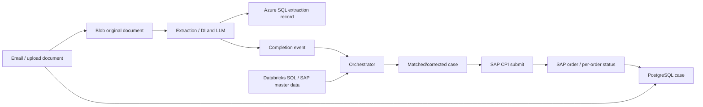
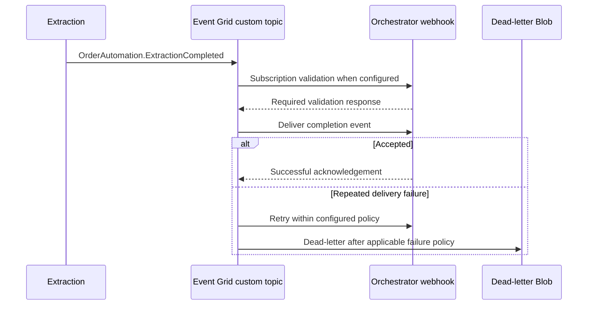

# 06 — Data, events, AI and SAP integration

## TL;DR

- PostgreSQL owns OA workflow/user/order state; Azure SQL owns extraction state. [Code]
- ADLS land/processing/output/report is documented staging; runtime Blob is distinct. [Doc][Code]
- Completion Event Grid subscriptions have 30 attempts, 1440-minute TTL and dead-letter storage. [Live]
- AI model resources exist; exact app-selected deployment remains a configuration question. [Live][Code]
- Databricks/SAP data is used from external workspaces; CAIRO has no captured workspace. [Code][Chat][Live]

## High-level: data lifecycle

[Code] This is implemented runtime flow, not proof all documents traverse every ADLS zone.
[Doc] Lake zones describe a broader staged-processing architecture.
Blob original storage, ADLS zones, SQL extraction state and PostgreSQL case state must not be conflated.

## Low-level: relational databases

### PostgreSQL Flexible Servers

Five servers captured: three OA plus Assistant DEV/TEST. [Live]
OA: version 15, GeneralPurpose Standard_D2s_v3, 64 GiB Premium_LRS storage.
OA backup retention seven days, geo redundancy Disabled, HA Disabled, autogrow Disabled.
Password auth Enabled, Entra Disabled and public network Enabled.
These values do not prove production RPO/RTO/restore suitability.
Assistant DEV version 18 and TEST version 15; both Entra/password Enabled. [Live]

### assistantfactory-postgresql-dev [Live]

Source: `raw_azure.md`, line 2973.

- **name:** assistantfactory-postgresql-dev
- **fullyQualifiedDomainName:** assistantfactory-postgresql-dev.postgres.database.azure.com
- **version:** 18
- **location:** West Europe
- **sku:** name=Standard_D2s_v3; tier=GeneralPurpose
- **storage:** autoGrow=Disabled; iops=240; storageSizeGb=64; tier=P6; type=Premium_LRS
- **backup:** backupRetentionDays=7; earliestRestoreDate=2026-10-06T09:16:36.672077+00:00; geoRedundantBackup=Disabled
- **highAvailability:** mode=Disabled; state=NotEnabled
- **authConfig:** activeDirectoryAuth=Enabled; passwordAuth=Enabled; tenantId=ecaa386b-c8df-4ce0-ad01-740cbdb5ba55
- **network:** publicNetworkAccess=Enabled

### assistantfactory-postgresql-dev Entra administrators [Live]

Source: `raw_azure.md`, line 2983.

- **principalName:** assistant_factory-deploy-sp
- **principalType:** ServicePrincipal

### pgsql-orderautomatio [Live]

Source: `raw_azure.md`, line 2993.

- **name:** pgsql-orderautomatio
- **fullyQualifiedDomainName:** pgsql-orderautomatio.postgres.database.azure.com
- **version:** 15
- **location:** West Europe
- **sku:** name=Standard_D2s_v3; tier=GeneralPurpose
- **storage:** autoGrow=Disabled; iops=240; storageSizeGb=64; tier=P6; type=Premium_LRS
- **backup:** backupRetentionDays=7; earliestRestoreDate=2026-10-06T17:32:06.434968+00:00; geoRedundantBackup=Disabled
- **highAvailability:** mode=Disabled; state=NotEnabled
- **authConfig:** activeDirectoryAuth=Disabled; passwordAuth=Enabled
- **network:** publicNetworkAccess=Enabled

### pgsql-orderautomatio Entra administrators [Live]

Source: `raw_azure.md`, line 3003.

Unavailable/blocked query; state unknown.

### pgsql-orderautomatio Entra administrators [Live]

Source: `raw_azure.md`, line 3018.

Unavailable/blocked query; state unknown.

### pgsql-orderautomation-prod [Live]

Source: `raw_azure.md`, line 3030.

- **name:** pgsql-orderautomation-prod
- **fullyQualifiedDomainName:** pgsql-orderautomation-prod.postgres.database.azure.com
- **version:** 15
- **location:** West Europe
- **sku:** name=Standard_D2s_v3; tier=GeneralPurpose
- **storage:** autoGrow=Disabled; iops=240; storageSizeGb=64; tier=P6; type=Premium_LRS
- **backup:** backupRetentionDays=7; earliestRestoreDate=2026-10-06T14:01:43.395665+00:00; geoRedundantBackup=Disabled
- **highAvailability:** mode=Disabled; state=NotEnabled
- **authConfig:** activeDirectoryAuth=Disabled; passwordAuth=Enabled
- **network:** publicNetworkAccess=Enabled

### pgsql-orderautomation-prod Entra administrators [Live]

Source: `raw_azure.md`, line 3040.

Unavailable/blocked query; state unknown.

### pgsql-orderautomation-prod Entra administrators [Live]

Source: `raw_azure.md`, line 3055.

Unavailable/blocked query; state unknown.

### pgsql-orderautomation-qa [Live]

Source: `raw_azure.md`, line 3067.

- **name:** pgsql-orderautomation-qa
- **fullyQualifiedDomainName:** pgsql-orderautomation-qa.postgres.database.azure.com
- **version:** 15
- **location:** West Europe
- **sku:** name=Standard_D2s_v3; tier=GeneralPurpose
- **storage:** autoGrow=Disabled; iops=240; storageSizeGb=64; tier=P6; type=Premium_LRS
- **backup:** backupRetentionDays=7; earliestRestoreDate=2026-10-06T12:24:59.762133+00:00; geoRedundantBackup=Disabled
- **highAvailability:** mode=Disabled; state=NotEnabled
- **authConfig:** activeDirectoryAuth=Disabled; passwordAuth=Enabled
- **network:** publicNetworkAccess=Enabled

### pgsql-orderautomation-qa Entra administrators [Live]

Source: `raw_azure.md`, line 3077.

Unavailable/blocked query; state unknown.

### pgsql-orderautomation-qa Entra administrators [Live]

Source: `raw_azure.md`, line 3092.

Unavailable/blocked query; state unknown.

### pqsql-assistantfactory-test [Live]

Source: `raw_azure.md`, line 3104.

- **name:** pqsql-assistantfactory-test
- **fullyQualifiedDomainName:** pqsql-assistantfactory-test.postgres.database.azure.com
- **version:** 15
- **location:** West Europe
- **sku:** name=Standard_B2s; tier=Burstable
- **storage:** autoGrow=Disabled; iops=120; storageSizeGb=32; tier=P4; type=Premium_LRS
- **backup:** backupRetentionDays=7; earliestRestoreDate=2026-10-06T10:04:47.616259+00:00; geoRedundantBackup=Disabled
- **highAvailability:** mode=Disabled; state=NotEnabled
- **authConfig:** activeDirectoryAuth=Enabled; passwordAuth=Enabled; tenantId=ecaa386b-c8df-4ce0-ad01-740cbdb5ba55
- **network:** publicNetworkAccess=Enabled

### pqsql-assistantfactory-test Entra administrators [Live]

Source: `raw_azure.md`, line 3114.

- **principalName:** U10145266@basfad.basf.net
- **principalType:** User

### Extensions and migrations

Required OA extensions: pgcrypto, pg_trgm, fuzzystrmatch. [Doc][Chat]
Server allow-list must permit them **before** schema migration creates/uses them.
Changing the migration alone cannot authorize a forbidden extension.
Repeat allow-list setup per server/environment and inspect resulting extension installation.
Live server parameter values were not collected; do not assume the historical fix persists.

Alembic owns application schema history. [Code]
Orchestrator migrations include case/users/roles/reference/rule/order/ground-truth evolution.
Extraction has its own SQL migration chain.
Rules table changes are part of orchestrator's DB chain, not a separate rules migration chain.
Image must include migration files; historical missing directory caused deployment with empty schema. [Doc][Chat]
A failed extension migration can cascade into missing tables/API errors.
Verify migration revision, expected tables and reference seed data before diagnosing browser CORS.

Recommended operator walkthrough:

1. Identify the actual environment server/DB and approved maintenance window.
2. Inspect Server parameters extension allow-list.
3. Verify migrations included in the deployed container artifact.
4. Run approved migration path using the intended DB identity.
5. Check migration revision/extensions/tables through authorized DB tooling.
6. Test /api/regions and case creation/enrichment.
7. Record migration/rollback outcome without copying credentials.

### Azure SQL

Three logical servers, six DB resources including system master databases. [Live]
DEV server: sqlserver-orderautomatio.
QA/PROD: sqlserver-orderautomation-qa/prod.
Extraction SQL state is independent from workflow PostgreSQL. [Code]
Code supports SQL ODBC/async access and configurable schema.
DB_USE_AZURE_AD_AUTH uses an SP client secret token path, not managed identity. [Code]
DEV Entra administrator exists; QA/PROD lists empty. [Live]
AllowAzureServices 0.0.0.0 firewall exception is broader than one VNet/application.
Public network flag is Enabled; optional source SQL PE does not prove deployed isolation.

### sqlserver-orderautomatio [Live]

Source: `raw_azure.md`, line 3124.

- **name:** sqlserver-orderautomatio
- **fullyQualifiedDomainName:** sqlserver-orderautomatio.database.windows.net
- **location:** westeurope
- **version:** 12.0
- **minimalTlsVersion:** 1.2
- **publicNetworkAccess:** Enabled

### sqlserver-orderautomatio databases [Live]

Source: `raw_azure.md`, line 3134.

- **name:** sqldb-order_automation-dev
- **sku:** capacity=10; name=Standard; tier=Standard
- **status:** Online
- **maxSizeBytes:** 5368709120
- **collation:** SQL_Latin1_General_CP1_CI_AS
- **zoneRedundant:** false

- **name:** master
- **sku:** capacity=4; family=SYSTEM; name=GP_SYSTEM; tier=System
- **status:** Online
- **maxSizeBytes:** 107374182400
- **collation:** SQL_Latin1_General_CP1_CI_AS
- **zoneRedundant:** false

### sqlserver-orderautomatio Entra administrators [Live]

Source: `raw_azure.md`, line 3145.

- **administratorType:** ActiveDirectory
- **login:** admU10168814
- **tenantId:** ecaa386b-c8df-4ce0-ad01-740cbdb5ba55

### sqlserver-orderautomatio firewall rules [Live]

Source: `raw_azure.md`, line 3155.

- **name:** ALl
- **startIpAddress:** 0.0.0.0
- **endIpAddress:** 255.255.255.255

- **name:** AllowAzureServices
- **startIpAddress:** 0.0.0.0
- **endIpAddress:** 0.0.0.0

- **name:** QueryEditorClientIPAddress_1784015881817
- **startIpAddress:** 141.6.110.159
- **endIpAddress:** 141.6.110.159

### sqlserver-orderautomation-prod [Live]

Source: `raw_azure.md`, line 3167.

- **name:** sqlserver-orderautomation-prod
- **fullyQualifiedDomainName:** sqlserver-orderautomation-prod.database.windows.net
- **location:** westeurope
- **version:** 12.0
- **minimalTlsVersion:** 1.2
- **publicNetworkAccess:** Enabled

### sqlserver-orderautomation-prod databases [Live]

Source: `raw_azure.md`, line 3177.

- **name:** master
- **sku:** capacity=4; family=SYSTEM; name=GP_SYSTEM; tier=System
- **status:** Online
- **maxSizeBytes:** 107374182400
- **collation:** SQL_Latin1_General_CP1_CI_AS
- **zoneRedundant:** false

- **name:** sqldb-order_automation-prod
- **sku:** capacity=10; name=Standard; tier=Standard
- **status:** Online
- **maxSizeBytes:** 5368709120
- **collation:** SQL_Latin1_General_CP1_CI_AS
- **zoneRedundant:** false

### sqlserver-orderautomation-prod Entra administrators [Live]

Source: `raw_azure.md`, line 3188.

No entries returned within captured scope.

### sqlserver-orderautomation-prod firewall rules [Live]

Source: `raw_azure.md`, line 3196.

- **name:** AllowAzureServices
- **startIpAddress:** 0.0.0.0
- **endIpAddress:** 0.0.0.0

### sqlserver-orderautomation-qa [Live]

Source: `raw_azure.md`, line 3206.

- **name:** sqlserver-orderautomation-qa
- **fullyQualifiedDomainName:** sqlserver-orderautomation-qa.database.windows.net
- **location:** westeurope
- **version:** 12.0
- **minimalTlsVersion:** 1.2
- **publicNetworkAccess:** Enabled

### sqlserver-orderautomation-qa databases [Live]

Source: `raw_azure.md`, line 3216.

- **name:** master
- **sku:** capacity=4; family=SYSTEM; name=GP_SYSTEM; tier=System
- **status:** Online
- **maxSizeBytes:** 107374182400
- **collation:** SQL_Latin1_General_CP1_CI_AS
- **zoneRedundant:** false

- **name:** sqldb-order_automation-qa
- **sku:** capacity=10; name=Standard; tier=Standard
- **status:** Online
- **maxSizeBytes:** 5368709120
- **collation:** SQL_Latin1_General_CP1_CI_AS
- **zoneRedundant:** false

### sqlserver-orderautomation-qa Entra administrators [Live]

Source: `raw_azure.md`, line 3227.

No entries returned within captured scope.

### sqlserver-orderautomation-qa firewall rules [Live]

Source: `raw_azure.md`, line 3235.

- **name:** AllowAzureServices
- **startIpAddress:** 0.0.0.0
- **endIpAddress:** 0.0.0.0

### Cosmos DB

assistantfactory-cosmosdb-account-dev exists with MongoDB-oriented capabilities/network metadata. [Live]
Assistant source/current PostgreSQL coexist with historical Cosmos advice.
No proved OA runtime dependency calls Cosmos.
Confirm active application persistence configuration before migration/retirement.

## Storage: zones, containers and state

### Separation of accounts

| Purpose | DEV | QA | PROD |
|---|---|---|---|
| ADLS Gen2 | dlsecorderautodev | stdlsorderautoqa | stdlsorderautoprod |
| Blob documents | bloborderautomatio | stbloborderautoqa | stbloborderautoprod |
| FE static website | staticorderautomatio | ststaticorderautoqa | ststaticorderautoprod |
| ML/shared storage | stsharedresourced2slfk | Shared DEV context | stsharedresourceezuzal |

All account names are [Live].
HNS true enables ADLS hierarchy/ACL semantics; Blob-only accounts are not interchangeable.
StorageV2 can expose both blob/dfs endpoint strings even when HNS is false; endpoint metadata alone is not HNS evidence.

### Lake zones

| Zone | Documented role | Verification caveat |
|---|---|---|
| land | Original incoming files | Confirm actual ingestion writes and file naming |
| processing | Intermediate extraction/embedding | Confirm job output, not architecture assumption |
| output | Final structured results | Distinguish actual runtime SQL result path |
| report | Reporting artifacts | Confirm consuming/report pipeline |

[Doc][Code] Terraform declares four filesystems/containers.
[Code] Orchestrator explicitly uses Blob connection-string clients.
No committed OA Databricks notebooks prove every land→processing→output→report job in the inspected repository.

### ADLS folder/permission pipelines

AdlsPermissions.ps1 creates filesystem data and folder ai_suite.
It sets root/default/access ACLs and recursively updates folder permissions.
Reader gets r-x; writer gets rwx. [Code]
It uses Azure CLI **auth-mode key**, not the read-only inventory's Entra login mode.
This is a mutating post-deployment script, not Terraform state-managed folder creation.
Wrappers include copied Assistant account names/object IDs in shared/OA repos.
Verify exact target/account/group/working directory before running; do not assume OA zones are the target.

RBAC and ACL evaluation must be understood together.
Container/path authorization is not fixed by Azure control-plane Contributor alone.
Default ACL affects inheritance for future children; access ACL affects present object access.
Recursive changes affect existing paths and require deliberate scope/review.
Chapter 11 contains operational runbooks; nothing was executed here.

### Static/runtime/backend state

$web contains public browser assets, never backend secrets.
index.html is both index/error document for SPA fallback. [Code]
Function runtime storage carries deployment/host assets, not necessarily business documents.
Terraform backend BlobStorage accounts hold privileged state.
Do not clean up any “unused-looking” container without checking runtime/state ownership.

### All storage accounts: posture overview [Live]

| Account | Region | Kind / SKU | HNS | Public network | Anonymous blobs | Shared key | TLS | Firewall |
| --- | --- | --- | --- | --- | --- | --- | --- | --- |
| aihubsharedres7811513971 | westeurope | StorageV2 / Standard_LRS | false | Not returned | false | true | TLS1_2 | Allow |
| aihubsharedres7930556471 | westeurope | StorageV2 / Standard_LRS | false | Not returned | false | true | TLS1_2 | Allow |
| assistantadlsdev | westeurope | StorageV2 / Standard_GRS | true | Enabled | false | true | TLS1_2 | Allow |
| bloborderautomatio | westeurope | StorageV2 / Standard_LRS | false | Enabled | false | true | TLS1_2 | Allow |
| dlsecorderautodev | westeurope | StorageV2 / Standard_LRS | true | Enabled | false | true | TLS1_2 | Allow |
| rgorderautomationde94c5 | germanywestcentral | StorageV2 / Standard_LRS | Not returned | Enabled | false | true | TLS1_2 | Allow |
| rgorderautomationpr9c9e | germanywestcentral | StorageV2 / Standard_LRS | Not returned | Enabled | false | true | TLS1_2 | Allow |
| rgorderautomationprbb6d | germanywestcentral | StorageV2 / Standard_LRS | Not returned | Enabled | false | true | TLS1_2 | Allow |
| rgorderautomationqabbce | germanywestcentral | StorageV2 / Standard_LRS | Not returned | Enabled | false | true | TLS1_2 | Allow |
| staticorderautomatio | westeurope | StorageV2 / Standard_LRS | false | Enabled | false | true | TLS1_2 | Allow |
| stbloborderautoprod | westeurope | StorageV2 / Standard_LRS | false | Enabled | false | true | TLS1_2 | Allow |
| stbloborderautoqa | westeurope | StorageV2 / Standard_LRS | false | Enabled | false | true | TLS1_2 | Allow |
| stdlsorderautoprod | westeurope | StorageV2 / Standard_LRS | true | Enabled | false | true | TLS1_2 | Allow |
| stdlsorderautoqa | westeurope | StorageV2 / Standard_LRS | true | Enabled | false | true | TLS1_2 | Allow |
| stfuncorderautoprodok2ed | westeurope | StorageV2 / Standard_LRS | false | Enabled | false | true | TLS1_2 | Allow |
| stfuncorderautoqamw1rh7 | westeurope | StorageV2 / Standard_LRS | false | Enabled | false | true | TLS1_2 | Allow |
| storderautomatioc3cj2s | westeurope | StorageV2 / Standard_LRS | false | Enabled | false | true | TLS1_2 | Allow |
| stsharedresourced2slfk | westeurope | StorageV2 / Standard_LRS | false | Disabled | false | true | TLS1_2 | Allow |
| stsharedresourceezuzal | westeurope | StorageV2 / Standard_LRS | false | Disabled | false | true | TLS1_2 | Allow |
| ststaticorderautoprod | westeurope | StorageV2 / Standard_LRS | false | Enabled | false | true | TLS1_2 | Allow |
| ststaticorderautoqa | westeurope | StorageV2 / Standard_LRS | false | Enabled | false | true | TLS1_2 | Allow |
| tfassistantapidev1aafad | northeurope | StorageV2 / Standard_LRS | Not returned | Not returned | false | Not returned | TLS1_2 | Deny |
| tforderautodev1aafad | northeurope | BlobStorage / Standard_LRS | Not returned | Not returned | false | Not returned | TLS1_2 | Deny |
| tforderautoproddb0729 | northeurope | BlobStorage / Standard_LRS | Not returned | Not returned | false | Not returned | TLS1_2 | Deny |
| tforderautoqac1b485 | northeurope | BlobStorage / Standard_LRS | Not returned | Not returned | false | Not returned | TLS1_2 | Deny |
| tfsharedresourcesdev | northeurope | BlobStorage / Standard_LRS | Not returned | Not returned | false | Not returned | TLS1_2 | Deny |
| tfsharedresourcesprod | northeurope | BlobStorage / Standard_LRS | Not returned | Not returned | false | Not returned | TLS1_2 | Deny |

### Account endpoints and returned containers [Live]

#### aihubsharedres7811513971

- Source: raw_azure.md line 3247; firewall bypass AzureServices; IP rules 0.
- Blob: https://aihubsharedres7811513971.blob.core.windows.net/; DFS: https://aihubsharedres7811513971.dfs.core.windows.net/; web: https://aihubsharedres7811513971.z6.web.core.windows.net/.
- Containers: 25a49d71-9ebd-4c9f-9acb-687968cb8f33-azureml, 25a49d71-9ebd-4c9f-9acb-687968cb8f33-azureml-blobstore, insights-logs-auditevent, insights-metrics-pt1m

#### aihubsharedres7930556471

- Source: raw_azure.md line 3280; firewall bypass AzureServices; IP rules 0.
- Blob: https://aihubsharedres7930556471.blob.core.windows.net/; DFS: https://aihubsharedres7930556471.dfs.core.windows.net/; web: https://aihubsharedres7930556471.z6.web.core.windows.net/.
- Containers: 8f1e2589-4491-40f4-a8e0-94d0f4324641-azureml, 8f1e2589-4491-40f4-a8e0-94d0f4324641-azureml-blobstore, insights-logs-auditevent, insights-metrics-pt1m

#### assistantadlsdev

- Source: raw_azure.md line 3313; firewall bypass AzureServices; IP rules 0.
- Blob: https://assistantadlsdev.blob.core.windows.net/; DFS: https://assistantadlsdev.dfs.core.windows.net/; web: https://assistantadlsdev.z6.web.core.windows.net/.
- Containers: data

#### bloborderautomatio

- Source: raw_azure.md line 3343; firewall bypass AzureServices; IP rules 0.
- Blob: https://bloborderautomatio.blob.core.windows.net/; DFS: https://bloborderautomatio.dfs.core.windows.net/; web: https://bloborderautomatio.z6.web.core.windows.net/.
- Containers: land, output, processing, report

#### dlsecorderautodev

- Source: raw_azure.md line 3376; firewall bypass AzureServices; IP rules 0.
- Blob: https://dlsecorderautodev.blob.core.windows.net/; DFS: https://dlsecorderautodev.dfs.core.windows.net/; web: https://dlsecorderautodev.z6.web.core.windows.net/.
- Containers: land, output, processing, report

#### rgorderautomationde94c5

- Source: raw_azure.md line 3409; firewall bypass AzureServices; IP rules 0.
- Blob: https://rgorderautomationde94c5.blob.core.windows.net/; DFS: https://rgorderautomationde94c5.dfs.core.windows.net/; web: https://rgorderautomationde94c5.z1.web.core.windows.net/.
- Containers: app-package-salesorderstatus-fc778b9, azure-webjobs-hosts, azure-webjobs-secrets

#### rgorderautomationpr9c9e

- Source: raw_azure.md line 3441; firewall bypass AzureServices; IP rules 0.
- Blob: https://rgorderautomationpr9c9e.blob.core.windows.net/; DFS: https://rgorderautomationpr9c9e.dfs.core.windows.net/; web: https://rgorderautomationpr9c9e.z1.web.core.windows.net/.
- Containers: app-package-salesorderstatusprodtest-7e126d8, azure-webjobs-hosts, azure-webjobs-secrets

#### rgorderautomationprbb6d

- Source: raw_azure.md line 3473; firewall bypass AzureServices; IP rules 0.
- Blob: https://rgorderautomationprbb6d.blob.core.windows.net/; DFS: https://rgorderautomationprbb6d.dfs.core.windows.net/; web: https://rgorderautomationprbb6d.z1.web.core.windows.net/.
- Containers: app-package-salesorderstatusprod-1773442, app-package-sapordercallback-prod-a3ccd58, azure-webjobs-hosts, azure-webjobs-secrets

#### rgorderautomationqabbce

- Source: raw_azure.md line 3506; firewall bypass AzureServices; IP rules 0.
- Blob: https://rgorderautomationqabbce.blob.core.windows.net/; DFS: https://rgorderautomationqabbce.dfs.core.windows.net/; web: https://rgorderautomationqabbce.z1.web.core.windows.net/.
- Containers: app-package-salesorderstatus-qa-829f371, azure-webjobs-hosts, azure-webjobs-secrets

#### staticorderautomatio

- Source: raw_azure.md line 3538; firewall bypass AzureServices; IP rules 0.
- Blob: https://staticorderautomatio.blob.core.windows.net/; DFS: https://staticorderautomatio.dfs.core.windows.net/; web: https://staticorderautomatio.z6.web.core.windows.net/.
- Containers: $web

#### stbloborderautoprod

- Source: raw_azure.md line 3568; firewall bypass AzureServices; IP rules 0.
- Blob: https://stbloborderautoprod.blob.core.windows.net/; DFS: https://stbloborderautoprod.dfs.core.windows.net/; web: https://stbloborderautoprod.z6.web.core.windows.net/.
- Containers: eventgridlogs, land, output, processing, report

#### stbloborderautoqa

- Source: raw_azure.md line 3602; firewall bypass AzureServices; IP rules 0.
- Blob: https://stbloborderautoqa.blob.core.windows.net/; DFS: https://stbloborderautoqa.dfs.core.windows.net/; web: https://stbloborderautoqa.z6.web.core.windows.net/.
- Containers: eventgridlogs, land, output, processing, report

#### stdlsorderautoprod

- Source: raw_azure.md line 3636; firewall bypass AzureServices; IP rules 0.
- Blob: https://stdlsorderautoprod.blob.core.windows.net/; DFS: https://stdlsorderautoprod.dfs.core.windows.net/; web: https://stdlsorderautoprod.z6.web.core.windows.net/.
- Containers: land, output, processing, report

#### stdlsorderautoqa

- Source: raw_azure.md line 3669; firewall bypass AzureServices; IP rules 0.
- Blob: https://stdlsorderautoqa.blob.core.windows.net/; DFS: https://stdlsorderautoqa.dfs.core.windows.net/; web: https://stdlsorderautoqa.z6.web.core.windows.net/.
- Containers: land, output, processing, report

#### stfuncorderautoprodok2ed

- Source: raw_azure.md line 3702; firewall bypass AzureServices; IP rules 0.
- Blob: https://stfuncorderautoprodok2ed.blob.core.windows.net/; DFS: https://stfuncorderautoprodok2ed.dfs.core.windows.net/; web: https://stfuncorderautoprodok2ed.z6.web.core.windows.net/.
- Containers: Not collected/returned

#### stfuncorderautoqamw1rh7

- Source: raw_azure.md line 3730; firewall bypass AzureServices; IP rules 0.
- Blob: https://stfuncorderautoqamw1rh7.blob.core.windows.net/; DFS: https://stfuncorderautoqamw1rh7.dfs.core.windows.net/; web: https://stfuncorderautoqamw1rh7.z6.web.core.windows.net/.
- Containers: Not collected/returned

#### storderautomatioc3cj2s

- Source: raw_azure.md line 3758; firewall bypass AzureServices; IP rules 0.
- Blob: https://storderautomatioc3cj2s.blob.core.windows.net/; DFS: https://storderautomatioc3cj2s.dfs.core.windows.net/; web: https://storderautomatioc3cj2s.z6.web.core.windows.net/.
- Containers: Not collected/returned

#### stsharedresourced2slfk

- Source: raw_azure.md line 3786; firewall bypass AzureServices; IP rules 0.
- Blob: https://stsharedresourced2slfk.blob.core.windows.net/; DFS: https://stsharedresourced2slfk.dfs.core.windows.net/; web: https://stsharedresourced2slfk.z6.web.core.windows.net/.
- Containers: Unavailable/blocked; unknown

#### stsharedresourceezuzal

- Source: raw_azure.md line 3820; firewall bypass AzureServices; IP rules 0.
- Blob: https://stsharedresourceezuzal.blob.core.windows.net/; DFS: https://stsharedresourceezuzal.dfs.core.windows.net/; web: https://stsharedresourceezuzal.z6.web.core.windows.net/.
- Containers: Unavailable/blocked; unknown

#### ststaticorderautoprod

- Source: raw_azure.md line 3854; firewall bypass AzureServices; IP rules 0.
- Blob: https://ststaticorderautoprod.blob.core.windows.net/; DFS: https://ststaticorderautoprod.dfs.core.windows.net/; web: https://ststaticorderautoprod.z6.web.core.windows.net/.
- Containers: $web

#### ststaticorderautoqa

- Source: raw_azure.md line 3884; firewall bypass AzureServices; IP rules 0.
- Blob: https://ststaticorderautoqa.blob.core.windows.net/; DFS: https://ststaticorderautoqa.dfs.core.windows.net/; web: https://ststaticorderautoqa.z6.web.core.windows.net/.
- Containers: $web

#### tfassistantapidev1aafad

- Source: raw_azure.md line 3914; firewall bypass AzureServices; IP rules 0.
- Blob: https://tfassistantapidev1aafad.blob.core.windows.net/; DFS: https://tfassistantapidev1aafad.dfs.core.windows.net/; web: https://tfassistantapidev1aafad.z16.web.core.windows.net/.
- Containers: Unavailable/blocked; unknown

#### tforderautodev1aafad

- Source: raw_azure.md line 3948; firewall bypass AzureServices; IP rules 0.
- Blob: https://tforderautodev1aafad.blob.core.windows.net/; DFS: https://tforderautodev1aafad.dfs.core.windows.net/; web: Not returned.
- Containers: Unavailable/blocked; unknown

#### tforderautoproddb0729

- Source: raw_azure.md line 3982; firewall bypass AzureServices; IP rules 0.
- Blob: https://tforderautoproddb0729.blob.core.windows.net/; DFS: https://tforderautoproddb0729.dfs.core.windows.net/; web: Not returned.
- Containers: Unavailable/blocked; unknown

#### tforderautoqac1b485

- Source: raw_azure.md line 4016; firewall bypass AzureServices; IP rules 0.
- Blob: https://tforderautoqac1b485.blob.core.windows.net/; DFS: https://tforderautoqac1b485.dfs.core.windows.net/; web: Not returned.
- Containers: Unavailable/blocked; unknown

#### tfsharedresourcesdev

- Source: raw_azure.md line 4050; firewall bypass AzureServices; IP rules 0.
- Blob: https://tfsharedresourcesdev.blob.core.windows.net/; DFS: https://tfsharedresourcesdev.dfs.core.windows.net/; web: Not returned.
- Containers: Unavailable/blocked; unknown

#### tfsharedresourcesprod

- Source: raw_azure.md line 4084; firewall bypass AzureServices; IP rules 0.
- Blob: https://tfsharedresourcesprod.blob.core.windows.net/; DFS: https://tfsharedresourcesprod.dfs.core.windows.net/; web: Not returned.
- Containers: Unavailable/blocked; unknown

## Event Grid

Three OA custom topics and 27 storage system topics captured. [Live]
A storage system topic describes source events; it is not a custom extraction-completion topic.
Many StorageAntimalwareSubscription entries filter BlobCreated/BlobRenamed with BlockBlob advanced filtering.
Do not count antimalware topics as application stages.

### Extraction completion

Source publisher uses EventGridEvent and topic-key AzureKeyCredential. [Code]
Event type: OrderAutomation.ExtractionCompleted.
Orchestrator webhook source route: /api/webhooks/eventgrid.
Subscriber endpoint URL values were excluded because webhook URLs may contain credentials.
Destination type/resource metadata remains visible. [Live]

### egt-orderautomatio [Live]

Source: `raw_azure.md`, line 4543.

- **name:** egt-orderautomatio
- **endpoint:** https://egt-orderautomatio.westeurope-1.eventgrid.azure.net/api/events
- **location:** westeurope
- **publicNetworkAccess:** Enabled
- **inputSchema:** EventGridSchema

### egt-orderautomatio event subscriptions [Live]

Source: `raw_azure.md`, line 4553.

- **name:** extraction-completed-to-orchestrator
- **eventDeliverySchema:** EventGridSchema
- **filter:** enableAdvancedFilteringOnArrays=true; includedEventTypes=OrderAutomation.ExtractionCompleted; subjectBeginsWith=Not returned; subjectEndsWith=Not returned
- **retryPolicy:** eventTimeToLiveInMinutes=1440; maxDeliveryAttempts=30
- **destination:** endpointType=WebHook
- **deadLetterDestination:** endpointType=StorageBlob; resourceId=rg-order_automation-dev/providers/Microsoft.Storage/storageAccounts/bloborderautomatio

### egt-orderautomation-prod [Live]

Source: `raw_azure.md`, line 4563.

- **name:** egt-orderautomation-prod
- **endpoint:** https://egt-orderautomation-prod.westeurope-1.eventgrid.azure.net/api/events
- **location:** westeurope
- **publicNetworkAccess:** Enabled
- **inputSchema:** EventGridSchema

### egt-orderautomation-prod event subscriptions [Live]

Source: `raw_azure.md`, line 4573.

- **name:** extraction-completed-to-orchestrator
- **eventDeliverySchema:** EventGridSchema
- **filter:** enableAdvancedFilteringOnArrays=true; includedEventTypes=OrderAutomation.ExtractionCompleted; subjectBeginsWith=Not returned; subjectEndsWith=Not returned
- **retryPolicy:** eventTimeToLiveInMinutes=1440; maxDeliveryAttempts=30
- **destination:** endpointType=WebHook
- **deadLetterDestination:** endpointType=StorageBlob; resourceId=rg-order_automation-prod/providers/Microsoft.Storage/storageAccounts/stbloborderautoprod

### egt-orderautomation-qa [Live]

Source: `raw_azure.md`, line 4583.

- **name:** egt-orderautomation-qa
- **endpoint:** https://egt-orderautomation-qa.westeurope-1.eventgrid.azure.net/api/events
- **location:** westeurope
- **publicNetworkAccess:** Enabled
- **inputSchema:** EventGridSchema

### egt-orderautomation-qa event subscriptions [Live]

Source: `raw_azure.md`, line 4593.

- **name:** extraction-completed-to-orchestrator-qa
- **eventDeliverySchema:** EventGridSchema
- **filter:** enableAdvancedFilteringOnArrays=true; includedEventTypes=OrderAutomation.ExtractionCompleted; subjectBeginsWith=Not returned; subjectEndsWith=Not returned
- **retryPolicy:** eventTimeToLiveInMinutes=1440; maxDeliveryAttempts=30
- **destination:** endpointType=WebHook
- **deadLetterDestination:** endpointType=StorageBlob; resourceId=rg-order_automation-qa/providers/Microsoft.Storage/storageAccounts/stbloborderautoqa

### Storage system topics [Live]

| System topic | Source storage account | Topic type |
| --- | --- | --- |
| aihubsharedres7811513971-91e7a966-ff2c-4555-bc72-3622760a7994 | aihubsharedres7811513971 | microsoft.storage.storageaccounts |
| aihubsharedres7930556471-2b064aa7-1b9e-4b22-b7f0-766aa73aaae4 | aihubsharedres7930556471 | microsoft.storage.storageaccounts |
| assistantadlsdev-03092317-4c72-40a8-bb21-975244f25e9c | assistantadlsdev | microsoft.storage.storageaccounts |
| bloborderautomatio-41ced44e-25bb-4f42-a3fa-37a09ea184bf | bloborderautomatio | microsoft.storage.storageaccounts |
| dlsecorderautodev-ca44a312-b4c2-40cb-80f9-0b1e8533a11a | dlsecorderautodev | microsoft.storage.storageaccounts |
| rgorderautomationde94c5-dab555b0-7141-4dc0-a948-c2f51e4a3dec | rgorderautomationde94c5 | microsoft.storage.storageaccounts |
| rgorderautomationpr9c9e-c1c97ca9-14bd-4ffe-a7f4-eaea6b8a1776 | rgorderautomationpr9c9e | microsoft.storage.storageaccounts |
| rgorderautomationprbb6d-9a0f3e5c-f5d5-4b7d-8caf-2eabc1a8fd30 | rgorderautomationprbb6d | microsoft.storage.storageaccounts |
| rgorderautomationqabbce-c22ef3f3-cb67-4c2d-b7b6-3a5db801f56b | rgorderautomationqabbce | microsoft.storage.storageaccounts |
| staticorderautomatio-7515fb05-07d3-4fae-ac06-7f57456cdb74 | staticorderautomatio | microsoft.storage.storageaccounts |
| stbloborderautoprod-c50a4105-7a53-424b-8d86-fd3221554a43 | stbloborderautoprod | microsoft.storage.storageaccounts |
| stbloborderautoqa-8583b4c3-af3f-4541-84ab-f8a708029481 | stbloborderautoqa | microsoft.storage.storageaccounts |
| stdlsorderautoprod-17604889-1786-4af1-b1d1-8e20b43921b2 | stdlsorderautoprod | microsoft.storage.storageaccounts |
| stdlsorderautoqa-38b1a074-aea4-4b17-9d51-89e5319f821f | stdlsorderautoqa | microsoft.storage.storageaccounts |
| stfuncorderautoprodok2ed-9c63b3b9-23f7-467d-8eac-b5620bdab47b | stfuncorderautoprodok2ed | microsoft.storage.storageaccounts |
| stfuncorderautoqamw1rh7-78617074-2a0c-4c9a-b9fe-946959c65033 | stfuncorderautoqamw1rh7 | microsoft.storage.storageaccounts |
| storderautomatioc3cj2s-b9d80638-228c-4eeb-818b-048ed7392514 | storderautomatioc3cj2s | microsoft.storage.storageaccounts |
| stsharedresourced2slfk-aac5b2f6-a132-4d18-8a65-616b55aa66a0 | stsharedresourced2slfk | microsoft.storage.storageaccounts |
| stsharedresourceezuzal-4e18ec2c-575e-4b34-a7fa-5d1325367761 | stsharedresourceezuzal | microsoft.storage.storageaccounts |
| ststaticorderautoprod-42c3b417-8370-4b31-83ad-fd681cf8b768 | ststaticorderautoprod | microsoft.storage.storageaccounts |
| ststaticorderautoqa-cfdbcf61-33eb-41b0-9718-fe7b813d08cd | ststaticorderautoqa | microsoft.storage.storageaccounts |
| tfassistantapidev1aafad-cccdfe1e-9a02-4ebe-805c-1d90bfd689f6 | tfassistantapidev1aafad | microsoft.storage.storageaccounts |
| tforderautodev1aafad-b06ac68f-c50d-4303-b9fe-631a5a736434 | tforderautodev1aafad | microsoft.storage.storageaccounts |
| tforderautoproddb0729-749befe8-7981-440a-a6a7-5bda58bc1996 | tforderautoproddb0729 | microsoft.storage.storageaccounts |
| tforderautoqac1b485-c2e10fc1-4e06-47a9-91d7-b41b393108f3 | tforderautoqac1b485 | microsoft.storage.storageaccounts |
| tfsharedresourcesdev-5f54e822-9e9f-4bfd-bb0e-71f85e087be3 | tfsharedresourcesdev | microsoft.storage.storageaccounts |
| tfsharedresourcesprod-914b87c0-23ec-4bbd-b28b-92b3ba888220 | tfsharedresourcesprod | microsoft.storage.storageaccounts |

StorageAntimalwareSubscription filters include BlobCreated and sometimes BlobRenamed/BlockBlob; these are security integrations, not necessarily business extraction.

At-least-once-style retry means consumers must be idempotent.
30 attempts/1440 minutes is live captured retry metadata, not guarantee every error retries identically.
Dead-letter storage resource exists in metadata; container write success/backlog need live metrics/read checks.
An event delivered does not prove business state transition committed.
PE to publishing topic is separate from outgoing webhook route/auth.

## Databricks

No CAIRO workspace returned from live list. [Live]
Historical DEV dbks-ec host: https://adb-5764847957066702.2.azuredatabricks.net.
Historical QUAL dbks-ec-qual host: https://adb-8081330705788048.8.azuredatabricks.net. [Chat]
Owning subscription/RG/VNet/compute/job list is not established here.

BE Databricks SQL clients query SAP-derived master data. [Code]
Inspected OA Databricks branches have no committed notebooks/jobs; main is README, QA branches contain CD YAML.
QA CD obtains Databricks audience token and performs repos update --branch qa.
This is Git-folder synchronization, not notebook execution or upstream SAP ingestion proof.

Four authorization layers:

1. Azure service connection authentication.
2. Databricks SP workspace entitlement.
3. Git folder CanManage permission.
4. Independent Azure Repos Git credential linked to that identity. [Chat]

Historical adjacent folder ID was mistaken for repo root.
Manual work includes Linked accounts, Create Git folder, choose branch, Share permissions, export/import existing notebooks and set correct repo ID.
Personal PAT linkage does not authorize pipeline SP automatically.
Last recorded Git credential failure means successful final sync/run remains unverified.

Commented source analytics cluster sample: Standard_DS3_v2, Spark 10.4.x-scala2.12, 60-minute auto-termination/local disk encryption. [Code]
This is NOT a live cluster configuration; do not quote it as production compute.

## AI Foundry, Azure OpenAI and supporting services

### Resource graph

Hub/Project ML workspaces and AIServices account/project resources are distinct API/resource models.
An ML default workspace can be public Disabled while nearby AI Hub/Project is public Enabled.
Model deployments belong to Cognitive Services/AIServices account; existence does not establish application's selected LLM_ROUTER_DEPLOYMENT_NAME. [Live][Code]

### aihub-sharedresources-dev [Live]

Source: `raw_azure.md`, line 5053.

- **name:** aihub-sharedresources-dev
- **location:** westeurope
- **kind:** Hub
- **sku:** name=Basic; tier=Basic
- **publicNetworkAccess:** Enabled
- **keyVault:** rg-sharedresources-dev/providers/Microsoft.KeyVault/vaults/kv-sharedresources-dev
- **storageAccount:** rg-sharedresources-dev/providers/Microsoft.Storage/storageAccounts/aihubsharedres7811513971
- **containerRegistry:** rg-sharedresources-dev/providers/Microsoft.ContainerRegistry/registries/acrsharedresourced2slfk
- **applicationInsights:** rg-sharedresources-dev/providers/Microsoft.Insights/components/appi-mlops-sharedresources-dev
- Managed network isolation: AllowInternetOutbound; provisioning requested: false; status: sparkReady=false; status=Inactive.

### aihub-sharedresources-prod [Live]

Source: `raw_azure.md`, line 5063.

- **name:** aihub-sharedresources-prod
- **location:** westeurope
- **kind:** Hub
- **sku:** name=Basic; tier=Basic
- **publicNetworkAccess:** Enabled
- **keyVault:** rg-order_automation-prod/providers/Microsoft.KeyVault/vaults/kv-orderautomation-prod
- **storageAccount:** rg-sharedresources-prod/providers/Microsoft.Storage/storageAccounts/aihubsharedres7930556471
- **containerRegistry:** rg-sharedresources-prod/providers/Microsoft.ContainerRegistry/registries/acrsharedresourceezuzal
- **applicationInsights:** rg-sharedresources-prod/providers/Microsoft.Insights/components/appi-mlops-sharedresources-prod
- Managed network isolation: Disabled; provisioning requested: false; status: Not returned.

### aihubsharedres3426890388 [Live]

Source: `raw_azure.md`, line 5073.

- **name:** aihubsharedres3426890388
- **location:** westeurope
- **kind:** AIServices
- **sku:** name=S0
- **publicNetworkAccess:** Enabled
- **endpoint:** https://aihubsharedres3426890388.cognitiveservices.azure.com/
- **disableLocalAuth:** Not returned

### aihubsharedres3426890388 model deployments [Live]

Source: `raw_azure.md`, line 5083.

- **name:** gpt-4.1
- **sku:** capacity=44875; name=GlobalStandard
- **model:** format=OpenAI; name=gpt-4.1; version=2025-04-14
- **currentCapacity:** 44875
- **versionUpgradeOption:** OnceNewDefaultVersionAvailable

- **name:** gpt-5
- **sku:** capacity=44875; name=GlobalStandard
- **model:** format=OpenAI; name=gpt-5; version=2025-08-07
- **currentCapacity:** 44875
- **versionUpgradeOption:** OnceNewDefaultVersionAvailable

### aihubsharedres3426890388/aifoundry-project-shared-prod [Live]

Source: `raw_azure.md`, line 5094.

- **name:** aihubsharedres3426890388/aifoundry-project-shared-prod
- **location:** westeurope

### aihubsharedres8407751719 [Live]

Source: `raw_azure.md`, line 5104.

- **name:** aihubsharedres8407751719
- **location:** westeurope
- **kind:** AIServices
- **sku:** name=S0
- **publicNetworkAccess:** Enabled
- **endpoint:** https://aihubsharedres8407751719.cognitiveservices.azure.com/
- **disableLocalAuth:** Not returned

### aihubsharedres8407751719 model deployments [Live]

Source: `raw_azure.md`, line 5114.

- **name:** gpt-5
- **sku:** capacity=250; name=GlobalStandard
- **model:** format=OpenAI; name=gpt-5; version=2025-08-07
- **currentCapacity:** 250
- **versionUpgradeOption:** OnceNewDefaultVersionAvailable

- **name:** gpt-5-nano
- **sku:** capacity=250; name=GlobalStandard
- **model:** format=OpenAI; name=gpt-5-nano; version=2025-08-07
- **currentCapacity:** 250
- **versionUpgradeOption:** OnceNewDefaultVersionAvailable

- **name:** gpt-4.1
- **sku:** capacity=250; name=GlobalStandard
- **model:** format=OpenAI; name=gpt-4.1; version=2025-04-14
- **currentCapacity:** 250
- **versionUpgradeOption:** OnceNewDefaultVersionAvailable

- **name:** gpt-4o
- **sku:** capacity=250; name=GlobalStandard
- **model:** format=OpenAI; name=gpt-4o; version=2024-11-20
- **currentCapacity:** 250
- **versionUpgradeOption:** OnceNewDefaultVersionAvailable

- **name:** text-embedding-3-small
- **sku:** capacity=250; name=GlobalStandard
- **model:** format=OpenAI; name=text-embedding-3-small; version=1
- **currentCapacity:** 250
- **versionUpgradeOption:** NoAutoUpgrade

- **name:** text-embedding-ada-002
- **sku:** capacity=5000; name=GlobalStandard
- **model:** format=OpenAI; name=text-embedding-ada-002; version=2
- **currentCapacity:** 5000
- **versionUpgradeOption:** OnceNewDefaultVersionAvailable

### aihubsharedres8407751719/aifoundry-project-sharedresources-dev [Live]

Source: `raw_azure.md`, line 5129.

- **name:** aihubsharedres8407751719/aifoundry-project-sharedresources-dev
- **location:** westeurope

### aiproject-sharedresources-dev [Live]

Source: `raw_azure.md`, line 5139.

- **name:** aiproject-sharedresources-dev
- **location:** westeurope
- **kind:** Project
- **sku:** name=Basic; tier=Basic
- **publicNetworkAccess:** Enabled
- **keyVault:** rg-sharedresources-dev/providers/Microsoft.KeyVault/vaults/kv-sharedresources-dev
- **storageAccount:** rg-sharedresources-dev/providers/Microsoft.Storage/storageAccounts/aihubsharedres7811513971
- **containerRegistry:** rg-sharedresources-dev/providers/Microsoft.ContainerRegistry/registries/acrsharedresourced2slfk
- **applicationInsights:** rg-sharedresources-dev/providers/Microsoft.Insights/components/appi-mlops-sharedresources-dev
- Managed network isolation: AllowInternetOutbound; provisioning requested: Not returned; status: sparkReady=false; status=Inactive.

### aiproject-sharedresources-prod [Live]

Source: `raw_azure.md`, line 5149.

- **name:** aiproject-sharedresources-prod
- **location:** westeurope
- **kind:** Project
- **sku:** name=Basic; tier=Basic
- **publicNetworkAccess:** Enabled
- **keyVault:** rg-order_automation-prod/providers/Microsoft.KeyVault/vaults/kv-orderautomation-prod
- **storageAccount:** rg-sharedresources-prod/providers/Microsoft.Storage/storageAccounts/aihubsharedres7930556471
- **containerRegistry:** rg-sharedresources-prod/providers/Microsoft.ContainerRegistry/registries/acrsharedresourceezuzal
- **applicationInsights:** rg-sharedresources-prod/providers/Microsoft.Insights/components/appi-mlops-sharedresources-prod
- Managed network isolation: Disabled; provisioning requested: Not returned; status: Not returned.

### aisearch-sharedresources-dev [Live]

Source: `raw_azure.md`, line 5159.

- **name:** aisearch-sharedresources-dev
- **location:** West Europe
- **sku:** name=standard
- **publicNetworkAccess:** Enabled
- **disableLocalAuth:** false
- **partitionCount:** 1
- **replicaCount:** 1

### assistantfactory-swecen-resource [Live]

Source: `raw_azure.md`, line 5169.

- **name:** assistantfactory-swecen-resource
- **location:** swedencentral
- **kind:** AIServices
- **sku:** name=S0
- **publicNetworkAccess:** Enabled
- **endpoint:** https://assistantfactory-swecen-resource.cognitiveservices.azure.com/
- **disableLocalAuth:** false

### assistantfactory-swecen-resource model deployments [Live]

Source: `raw_azure.md`, line 5179.

- **name:** gpt-image-1.5
- **sku:** capacity=50; name=GlobalStandard
- **model:** format=OpenAI; name=gpt-image-1.5; version=2025-12-16
- **currentCapacity:** 50
- **versionUpgradeOption:** OnceNewDefaultVersionAvailable

### assistantfactory-swecen-resource/assistantfactory-swecen [Live]

Source: `raw_azure.md`, line 5189.

- **name:** assistantfactory-swecen-resource/assistantfactory-swecen
- **location:** swedencentral

### assistantfactory-tts-dev [Live]

Source: `raw_azure.md`, line 5199.

- **name:** assistantfactory-tts-dev
- **location:** westeurope
- **kind:** SpeechServices
- **sku:** name=S0
- **publicNetworkAccess:** Enabled
- **endpoint:** https://assistantfactory-tts-dev.cognitiveservices.azure.com/
- **disableLocalAuth:** false

### assistantfactory-tts-dev model deployments [Live]

Source: `raw_azure.md`, line 5209.

No entries returned in CAIRO scope.

### Databricks workspaces [Live]

Source: `raw_azure.md`, line 5217.

No entries returned in CAIRO scope.

### documentintel-orderautomation-dev [Live]

Source: `raw_azure.md`, line 5225.

- **name:** documentintel-orderautomation-dev
- **location:** westeurope
- **kind:** FormRecognizer
- **sku:** name=S0
- **publicNetworkAccess:** Enabled
- **endpoint:** https://documentintel-orderautomation-dev.cognitiveservices.azure.com/
- **disableLocalAuth:** Not returned

### documentintel-orderautomation-dev model deployments [Live]

Source: `raw_azure.md`, line 5235.

No entries returned in CAIRO scope.

### documentintel-orderautomation-prod [Live]

Source: `raw_azure.md`, line 5243.

- **name:** documentintel-orderautomation-prod
- **location:** westeurope
- **kind:** FormRecognizer
- **sku:** name=S0
- **publicNetworkAccess:** Enabled
- **endpoint:** https://documentintel-orderautomation-prod.cognitiveservices.azure.com/
- **disableLocalAuth:** Not returned

### documentintel-orderautomation-prod model deployments [Live]

Source: `raw_azure.md`, line 5253.

No entries returned in CAIRO scope.

### mlw-sharedresources-dev [Live]

Source: `raw_azure.md`, line 5261.

- **name:** mlw-sharedresources-dev
- **location:** westeurope
- **kind:** Default
- **sku:** name=Basic; tier=Basic
- **publicNetworkAccess:** Disabled
- **keyVault:** rg-sharedresources-dev/providers/Microsoft.Keyvault/vaults/kv-sharedresources-dev
- **storageAccount:** rg-sharedresources-dev/providers/Microsoft.Storage/storageAccounts/stsharedresourced2slfk
- **containerRegistry:** rg-sharedresources-dev/providers/Microsoft.ContainerRegistry/registries/acrsharedresourced2slfk
- **applicationInsights:** rg-sharedresources-dev/providers/Microsoft.insights/components/appi-mlops-sharedresources-dev
- Managed network isolation: Disabled; provisioning requested: Not returned; status: Not returned.

### mlw-sharedresources-prod [Live]

Source: `raw_azure.md`, line 5271.

- **name:** mlw-sharedresources-prod
- **location:** westeurope
- **kind:** Default
- **sku:** name=Basic; tier=Basic
- **publicNetworkAccess:** Disabled
- **keyVault:** rg-sharedresources-prod/providers/Microsoft.Keyvault/vaults/kv-sharedre-prod-ezuzal
- **storageAccount:** rg-sharedresources-prod/providers/Microsoft.Storage/storageAccounts/stsharedresourceezuzal
- **containerRegistry:** rg-sharedresources-prod/providers/Microsoft.ContainerRegistry/registries/acrsharedresourceezuzal
- **applicationInsights:** rg-sharedresources-prod/providers/Microsoft.insights/components/appi-mlops-sharedresources-prod
- Managed network isolation: Disabled; provisioning requested: Not returned; status: Not returned.

### Model deployments

DEV aihubsharedres8407751719 includes GPT-5, GPT-5-nano, GPT-4.1 and embedding deployments.
PROD aihubsharedres3426890388 includes GPT-4.1 and GPT-5.
Assistant Sweden Central has gpt-image-1.5. [Live]
Capacity values are retained exactly as inventory units, not re-labelled as proven TPM throughput.
VersionUpgradeOption can move model versions; production validation should track actual pinned/current contract.
GlobalStandard inference residency/quota semantics require approved governance.

### Document Intelligence

documentintel-orderautomation-dev/prod are FormRecognizer S0 accounts, public Enabled. [Live]
Explicit extraction DI client/config proves usage. [Code]
Layout/text recognition is distinct from the LLM's semantic interpretation.
No captured QA-specific DI account; consuming account/endpoints require environment config verification.

### AI Search

aisearch-sharedresources-dev: standard SKU, one partition, one replica, public Enabled, local auth allowed. [Live]
[Doc] Intended to index embeddings for retrieval.
The existence of a Search service does not prove an OA query calls it; BE uses direct/KNMT/fuzzy/ground-truth provider paths.
Indexes, ingestion jobs, embedding dimensions and active callers were not collected.

### Content Safety, Translator, Speech

[Doc] Content Safety/Translator are supporting capabilities.
[Code] Shared GenAI library contains translation and AI/document helpers.
Dedicated CAIRO Content Safety/Translator account and mandatory OA invocation were not identified.
Assistant Speech account exists; its PE manual connection is Pending in inventory. [Live]
Do not describe a pending private speech path as working.

### ML workspace dependencies

mlw-sharedresources-dev/prod use corresponding shared registry/storage/App Insights/vault.
PROD default ML vault is kv-sharedre-prod-ezuzal; PROD Hub/Project uses kv-orderautomation-prod. [Live]
This cross-layer vault dependency matters before rotation/retirement.
Managed-network Inactive/provisionNetworkNow false does not prove an active isolated compute network.

## SAP master data and CPI

[Code] Enrichment providers resolve customer/partner/sales-area/material candidates.
KNMT is customer-material information: mapping customer material codes to internal material identity.
T005 is SAP country reference/customizing data; country normalization must follow actual provider/schema usage. The provided source catalog does not establish an exact deployed T005 query/table lineage, so this is terminology/context rather than a proved current query.
Country/UOM/date/address normalization precedes business publication.
Direct/KNMT/fuzzy/ground-truth matching are different candidate strategies, not a single opaque AI answer.
Match confidence and human correction protect against false resolution.

Source provider modules include base_enrichment_service, datafarm_enrichment_service and vdwh_enrichment_service.
Their tables/schema lineage depend on external Databricks/SAP landscape; do not invent ingestion schedule.
SAP order-submit client handles OAuth token/base URL/receiver/system/client parameters.
Attachment client has a separate endpoint/outcome.
Multi-order grouping can produce several SAP orders from one case.
Callback/retry must reconcile per-order status, not overwrite a case as universally successful.

## Verification and operational hardening

1. Verify schema/migration/extensions before API symptom work.
2. Verify Blob document exists and matches case metadata.
3. Verify extraction acceptance plus terminal result, not only launch response.
4. Check Event Grid delivery failures/dead letters and idempotency.
5. Verify master-data freshness and resolved candidate identifiers.
6. Verify selected model deployment/version/quota/auth, not just account existence.
7. Perform controlled reviewed SAP order and attachment/callback verification.
8. Review backup/restore/RPO/RTO, sensitive payload retention and log redaction.

## How it connects to other components

Chapter 05 runtime owns data transitions; 03/04 determine access; 07 carries webhook/API routing. Chapters 09–11 cover migrations/Git/ACL/connector operational delivery.

## Where to look in the Azure Portal / ADO

- PostgreSQL → **Server parameters**, **Authentication**, **Networking**, **Databases**, **Backup and restore**, **High availability**.
- SQL server → **Databases**, **Networking**, **Microsoft Entra ID**, **Auditing**; DB → approved migration/query tooling.
- Storage → **Configuration**, **Containers**, **Storage browser**, **Static website**, **Networking**, **Data protection**; ADLS path → ACL/manage access.
- Event Grid topic/system topic → **Event subscriptions**, **Metrics**, **Networking**, subscriber **Dead-lettering/Retry**.
- Databricks → **Workspace/Git folders**, **Compute**, **Jobs & Pipelines**, **SQL Warehouses**, **Settings/Linked accounts**.
- Azure AI Foundry portal → project → **Models + endpoints / Deployments**, **Connections**; Azure account **IAM**, **Networking**, **Quotas**.
- AI Search → **Indexes**, **Indexers**, **Search explorer**, **Scale**, **Keys/IAM**.
- Document Intelligence → **Overview**, **Networking**, **Metrics**; Studio approved document test.
- SAP CPI → tenant integration-flow **Monitor / Message processing**, confirmed with SAP owner.

## Interview talking points

- Separate transactional PostgreSQL from extraction SQL and document storage.
- Explain extension allow-list versus schema migrations.
- Explain ADLS ACL/default ACL and copied wrapper risk.
- Explain at-least-once completion/idempotency/dead-letter.
- Explain Databricks Git sync versus job execution.
- Explain model deployment/version/quota versus inference selection.
- Explain KNMT/fuzzy/ground-truth and human review.
- Explain SAP per-order/attachment outcomes.

## Evidence & confidence

`raw_azure.md` Databases/Storage/Messaging/AI sections; `raw_apps.md` §§1–4, persistence/migrations/provider catalogs; `raw_iac.md` ADLS scripts; `doc_aioa.txt`; `raw_chats.md` extension/Databricks/event/SAP incidents. Live parameters, Databricks jobs, indexes and SAP ingestion lineage were not collected.
