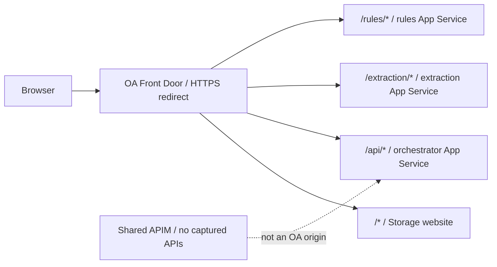
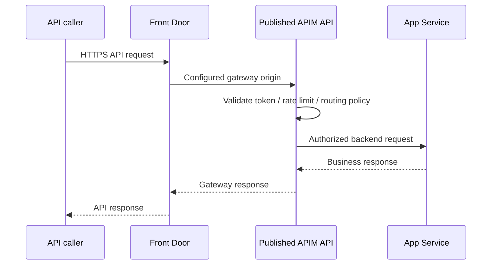

# 07 — API edge: Front Door, WAF, APIM and API Center

## TL;DR

- OA Front Door routes directly to Storage and App Services, not APIM. [Live]
- All five profiles are Standard_AzureFrontDoor with 120-second origin timeout. [Live]
- OA WAFs are Prevention but have no captured managed/custom rules. [Live]
- APIM DEV External and PROD Internal are Developer capacity 1; API lists empty. [Live]
- API Center catalogs contracts; it is not a gateway request hop.

## High-level: edge versus gateway

Front Door supplies global entry, TLS routing/probing and WAF association.
APIM supplies published APIs, policies, products/subscriptions and gateway execution when configured.
API Center supplies inventory/catalog/governance, not runtime reverse proxy.
The official all-requests-through-APIM diagram describes target intent. [Doc]
The live OA route inventory proves direct backend origins instead. [Live]

### Live request path

### Target gateway path: not currently observed

The sequence is conditional architecture teaching, not evidence of existing policy execution.
Front Door Standard direct public origins are not automatically private-link-connected to Internal PROD APIM.
A future cutover must solve gateway origin reachability, DNS/TLS, published API and callback contracts first.

## Low-level: profiles/endpoints

Five live profiles: three OA, one Assistant, one TODO-named shared profile.
TODO-existing-frontdoor-prefix-fd-dev is a real deployed profile with a TODO backend hostname. [Live]
No operational health test confirms that placeholder origin works.

### assistantfactory-dev endpoints [Live]

Source: `raw_azure.md`, line 1247.

- **name:** assistantfactory-dev
- **hostName:** assistantfactory-dev-b7g9bsb8f4amg4dt.a01.azurefd.net
- **enabledState:** Enabled
- **provisioningState:** Succeeded

### assistantfactory-dev profile [Live]

Source: `raw_azure.md`, line 1267.

- **name:** assistantfactory-dev
- **sku:** name=Standard_AzureFrontDoor
- **location:** Global
- **originResponseTimeoutSeconds:** 120

### order-automation-fd-dev endpoints [Live]

Source: `raw_azure.md`, line 1313.

- **name:** order-automation-dev
- **hostName:** order-automation-dev-d2end8fhgaemfncd.a01.azurefd.net
- **enabledState:** Enabled
- **provisioningState:** Succeeded

### order-automation-fd-dev profile [Live]

Source: `raw_azure.md`, line 1336.

- **name:** order-automation-fd-dev
- **sku:** name=Standard_AzureFrontDoor
- **location:** Global
- **originResponseTimeoutSeconds:** 120

### order-automation-fd-prod endpoints [Live]

Source: `raw_azure.md`, line 1417.

- **name:** order-automation-prod
- **hostName:** order-automation-prod-ecgadka5bpa9esf2.a01.azurefd.net
- **enabledState:** Enabled
- **provisioningState:** Succeeded

### order-automation-fd-prod profile [Live]

Source: `raw_azure.md`, line 1440.

- **name:** order-automation-fd-prod
- **sku:** name=Standard_AzureFrontDoor
- **location:** Global
- **originResponseTimeoutSeconds:** 120

### order-automation-fd-qa endpoints [Live]

Source: `raw_azure.md`, line 1521.

- **name:** order-automation-qa
- **hostName:** order-automation-qa-h4c4g8bma5bah5f0.a01.azurefd.net
- **enabledState:** Enabled
- **provisioningState:** Succeeded

### order-automation-fd-qa profile [Live]

Source: `raw_azure.md`, line 1544.

- **name:** order-automation-fd-qa
- **sku:** name=Standard_AzureFrontDoor
- **location:** Global
- **originResponseTimeoutSeconds:** 120

### TODO-existing-frontdoor-prefix-fd-dev endpoints [Live]

Source: `raw_azure.md`, line 1655.

- **name:** TODO-existing-frontdoor-prefix-dev
- **hostName:** TODO-existing-frontdoor-prefix-dev-gaa8ebdvcpc0encf.a01.azurefd.net
- **enabledState:** Enabled
- **provisioningState:** Succeeded

### TODO-existing-frontdoor-prefix-fd-dev profile [Live]

Source: `raw_azure.md`, line 1675.

- **name:** TODO-existing-frontdoor-prefix-fd-dev
- **sku:** name=Standard_AzureFrontDoor
- **location:** Global
- **originResponseTimeoutSeconds:** 120

### Environment endpoint drift

| Environment | Live edge hostname | Source build config |
|---|---|---|
| DEV | order-automation-dev-d2end8fhgaemfncd.a01.azurefd.net | .env.dev agrees |
| QA | order-automation-qa-h4c4g8bma5bah5f0.a01.azurefd.net | .env.qa agrees |
| PROD | order-automation-prod-ecgadka5bpa9esf2.a01.azurefd.net | .env.prod references orderautomation-prod-gsevf7f4e6dnf9bu.a03.azurefd.net |
| Explore | Not captured as CAIRO profile | orderautomation-explore-abgyfyckeqcrb9gv.a02.azurefd.net |

[Live][Code] A source file is not necessarily the deployed bundle.
Verify actual built VITE_API_BASE_URL/network request before correcting an assumed drift.
MSAL redirect registration must align with the hostname from which the SPA runs.
A frontend 200 does not prove login or backend health. [Chat]

## Origin groups, origins and routes

Each OA profile has StaticOriginGroup, ExtractionOriginGroup, OrchestratorApiOriginGroup and RulesEngineOriginGroup. [Live]
Corresponding origins use HTTPS port 443 and certificate-name checks.
OriginHostHeader matches intended backend hostname in captured OA metadata.
Static origins are *.z6.web.core.windows.net, not blob endpoint paths.
Session affinity/probe/sample values follow captured group metadata below.

### assistantfactory-dev origin groups [Live]

Source: `raw_azure.md`, line 1257.

- **name:** assistantfactory-dev
- **healthProbeSettings:** probeIntervalInSeconds=120; probePath=/; probeProtocol=Https; probeRequestType=GET
- **loadBalancingSettings:** additionalLatencyInMilliseconds=50; sampleSize=4; successfulSamplesRequired=3
- **sessionAffinityState:** Enabled

### assistantfactory-dev/assistantfactory-dev origins [Live]

Source: `raw_azure.md`, line 1285.

- **name:** assistantfactory-dev
- **hostName:** assistantfactory-appservice-dev.azurewebsites.net
- **originHostHeader:** assistantfactory-appservice-dev.azurewebsites.net
- **httpPort:** 80
- **httpsPort:** 443
- **priority:** 1
- **weight:** 500
- **enforceCertificateNameCheck:** true
- **enabledState:** Enabled
- **sharedPrivateLinkResource:** Not returned

### order-automation-fd-dev origin groups [Live]

Source: `raw_azure.md`, line 1323.

- **name:** ExtractionOriginGroup
- **healthProbeSettings:** probeIntervalInSeconds=120; probePath=/; probeProtocol=Https; probeRequestType=GET
- **loadBalancingSettings:** additionalLatencyInMilliseconds=0; sampleSize=4; successfulSamplesRequired=3
- **sessionAffinityState:** Enabled

- **name:** StaticOriginGroup
- **healthProbeSettings:** probeIntervalInSeconds=120; probePath=/; probeProtocol=Https; probeRequestType=GET
- **loadBalancingSettings:** additionalLatencyInMilliseconds=0; sampleSize=4; successfulSamplesRequired=3
- **sessionAffinityState:** Enabled

- **name:** OrchestratorApiOriginGroup
- **healthProbeSettings:** probeIntervalInSeconds=120; probePath=/; probeProtocol=Https; probeRequestType=GET
- **loadBalancingSettings:** additionalLatencyInMilliseconds=0; sampleSize=4; successfulSamplesRequired=3
- **sessionAffinityState:** Enabled

- **name:** RulesEngineOriginGroup
- **healthProbeSettings:** probeIntervalInSeconds=120; probePath=/; probeProtocol=Https; probeRequestType=GET
- **loadBalancingSettings:** additionalLatencyInMilliseconds=0; sampleSize=4; successfulSamplesRequired=3
- **sessionAffinityState:** Enabled

### order-automation-fd-dev/ExtractionOriginGroup origins [Live]

Source: `raw_azure.md`, line 1356.

- **name:** ExtractionOrigin
- **hostName:** extract-orderautomatio.azurewebsites.net
- **originHostHeader:** extract-orderautomatio.azurewebsites.net
- **httpPort:** 80
- **httpsPort:** 443
- **priority:** 1
- **weight:** 1000
- **enforceCertificateNameCheck:** true
- **enabledState:** Enabled
- **sharedPrivateLinkResource:** Not returned

### order-automation-fd-dev/OrchestratorApiOriginGroup origins [Live]

Source: `raw_azure.md`, line 1366.

- **name:** OrchestratorApiOrigin
- **hostName:** orchestrator-api-appservice-dev.azurewebsites.net
- **originHostHeader:** orchestrator-api-appservice-dev.azurewebsites.net
- **httpPort:** 80
- **httpsPort:** 443
- **priority:** 1
- **weight:** 1000
- **enforceCertificateNameCheck:** true
- **enabledState:** Enabled
- **sharedPrivateLinkResource:** Not returned

### order-automation-fd-dev/RulesEngineOriginGroup origins [Live]

Source: `raw_azure.md`, line 1389.

- **name:** RulesEngineOrigin
- **hostName:** rules-engine-appservice-dev.azurewebsites.net
- **originHostHeader:** rules-engine-appservice-dev.azurewebsites.net
- **httpPort:** 80
- **httpsPort:** 443
- **priority:** 1
- **weight:** 1000
- **enforceCertificateNameCheck:** true
- **enabledState:** Enabled
- **sharedPrivateLinkResource:** Not returned

### order-automation-fd-dev/StaticOriginGroup origins [Live]

Source: `raw_azure.md`, line 1399.

- **name:** StaticOrigin
- **hostName:** staticorderautomatio.z6.web.core.windows.net
- **originHostHeader:** staticorderautomatio.z6.web.core.windows.net
- **httpPort:** 80
- **httpsPort:** 443
- **priority:** 1
- **weight:** 1000
- **enforceCertificateNameCheck:** true
- **enabledState:** Enabled
- **sharedPrivateLinkResource:** Not returned

### order-automation-fd-prod origin groups [Live]

Source: `raw_azure.md`, line 1427.

- **name:** ExtractionOriginGroup
- **healthProbeSettings:** probeIntervalInSeconds=120; probePath=/; probeProtocol=Https; probeRequestType=GET
- **loadBalancingSettings:** additionalLatencyInMilliseconds=0; sampleSize=4; successfulSamplesRequired=3
- **sessionAffinityState:** Enabled

- **name:** RulesEngineOriginGroup
- **healthProbeSettings:** probeIntervalInSeconds=120; probePath=/; probeProtocol=Https; probeRequestType=GET
- **loadBalancingSettings:** additionalLatencyInMilliseconds=0; sampleSize=4; successfulSamplesRequired=3
- **sessionAffinityState:** Enabled

- **name:** OrchestratorApiOriginGroup
- **healthProbeSettings:** probeIntervalInSeconds=120; probePath=/; probeProtocol=Https; probeRequestType=GET
- **loadBalancingSettings:** additionalLatencyInMilliseconds=0; sampleSize=4; successfulSamplesRequired=3
- **sessionAffinityState:** Enabled

- **name:** StaticOriginGroup
- **healthProbeSettings:** probeIntervalInSeconds=120; probePath=/; probeProtocol=Https; probeRequestType=GET
- **loadBalancingSettings:** additionalLatencyInMilliseconds=0; sampleSize=4; successfulSamplesRequired=3
- **sessionAffinityState:** Enabled

### order-automation-fd-prod/ExtractionOriginGroup origins [Live]

Source: `raw_azure.md`, line 1460.

- **name:** ExtractionOrigin
- **hostName:** extract-orderautomation-prod.azurewebsites.net
- **originHostHeader:** extract-orderautomation-prod.azurewebsites.net
- **httpPort:** 80
- **httpsPort:** 443
- **priority:** 1
- **weight:** 1000
- **enforceCertificateNameCheck:** true
- **enabledState:** Enabled
- **sharedPrivateLinkResource:** Not returned

### order-automation-fd-prod/OrchestratorApiOriginGroup origins [Live]

Source: `raw_azure.md`, line 1470.

- **name:** OrchestratorApiOrigin
- **hostName:** orchestrator-api-appservice-prod.azurewebsites.net
- **originHostHeader:** orchestrator-api-appservice-prod.azurewebsites.net
- **httpPort:** 80
- **httpsPort:** 443
- **priority:** 1
- **weight:** 1000
- **enforceCertificateNameCheck:** true
- **enabledState:** Enabled
- **sharedPrivateLinkResource:** Not returned

### order-automation-fd-prod/RulesEngineOriginGroup origins [Live]

Source: `raw_azure.md`, line 1493.

- **name:** RulesEngineOrigin
- **hostName:** rules-engine-appservice-prod.azurewebsites.net
- **originHostHeader:** rules-engine-appservice-prod.azurewebsites.net
- **httpPort:** 80
- **httpsPort:** 443
- **priority:** 1
- **weight:** 1000
- **enforceCertificateNameCheck:** true
- **enabledState:** Enabled
- **sharedPrivateLinkResource:** Not returned

### order-automation-fd-prod/StaticOriginGroup origins [Live]

Source: `raw_azure.md`, line 1503.

- **name:** StaticOrigin
- **hostName:** ststaticorderautoprod.z6.web.core.windows.net
- **originHostHeader:** ststaticorderautoprod.z6.web.core.windows.net
- **httpPort:** 80
- **httpsPort:** 443
- **priority:** 1
- **weight:** 1000
- **enforceCertificateNameCheck:** true
- **enabledState:** Enabled
- **sharedPrivateLinkResource:** Not returned

### order-automation-fd-qa origin groups [Live]

Source: `raw_azure.md`, line 1531.

- **name:** StaticOriginGroup
- **healthProbeSettings:** probeIntervalInSeconds=120; probePath=/; probeProtocol=Https; probeRequestType=GET
- **loadBalancingSettings:** additionalLatencyInMilliseconds=0; sampleSize=4; successfulSamplesRequired=3
- **sessionAffinityState:** Enabled

- **name:** OrchestratorApiOriginGroup
- **healthProbeSettings:** probeIntervalInSeconds=120; probePath=/; probeProtocol=Https; probeRequestType=GET
- **loadBalancingSettings:** additionalLatencyInMilliseconds=0; sampleSize=4; successfulSamplesRequired=3
- **sessionAffinityState:** Enabled

- **name:** ExtractionOriginGroup
- **healthProbeSettings:** probeIntervalInSeconds=120; probePath=/; probeProtocol=Https; probeRequestType=GET
- **loadBalancingSettings:** additionalLatencyInMilliseconds=0; sampleSize=4; successfulSamplesRequired=3
- **sessionAffinityState:** Enabled

- **name:** RulesEngineOriginGroup
- **healthProbeSettings:** probeIntervalInSeconds=120; probePath=/; probeProtocol=Https; probeRequestType=GET
- **loadBalancingSettings:** additionalLatencyInMilliseconds=0; sampleSize=4; successfulSamplesRequired=3
- **sessionAffinityState:** Enabled

### order-automation-fd-qa/ExtractionOriginGroup origins [Live]

Source: `raw_azure.md`, line 1564.

- **name:** ExtractionOrigin
- **hostName:** extract-orderautomation-qa.azurewebsites.net
- **originHostHeader:** extract-orderautomation-qa.azurewebsites.net
- **httpPort:** 80
- **httpsPort:** 443
- **priority:** 1
- **weight:** 1000
- **enforceCertificateNameCheck:** true
- **enabledState:** Enabled
- **sharedPrivateLinkResource:** Not returned

### order-automation-fd-qa/OrchestratorApiOriginGroup origins [Live]

Source: `raw_azure.md`, line 1574.

- **name:** OrchestratorApiOrigin
- **hostName:** orchestrator-api-appservice-qa.azurewebsites.net
- **originHostHeader:** orchestrator-api-appservice-qa.azurewebsites.net
- **httpPort:** 80
- **httpsPort:** 443
- **priority:** 1
- **weight:** 1000
- **enforceCertificateNameCheck:** true
- **enabledState:** Enabled
- **sharedPrivateLinkResource:** Not returned

### order-automation-fd-qa/RulesEngineOriginGroup origins [Live]

Source: `raw_azure.md`, line 1597.

- **name:** RulesEngineOrigin
- **hostName:** rules-engine-appservice-qa.azurewebsites.net
- **originHostHeader:** rules-engine-appservice-qa.azurewebsites.net
- **httpPort:** 80
- **httpsPort:** 443
- **priority:** 1
- **weight:** 1000
- **enforceCertificateNameCheck:** true
- **enabledState:** Enabled
- **sharedPrivateLinkResource:** Not returned

### order-automation-fd-qa/StaticOriginGroup origins [Live]

Source: `raw_azure.md`, line 1607.

- **name:** StaticOrigin
- **hostName:** ststaticorderautoqa.z6.web.core.windows.net
- **originHostHeader:** ststaticorderautoqa.z6.web.core.windows.net
- **httpPort:** 80
- **httpsPort:** 443
- **priority:** 1
- **weight:** 1000
- **enforceCertificateNameCheck:** true
- **enabledState:** Enabled
- **sharedPrivateLinkResource:** Not returned

### TODO-existing-frontdoor-prefix-fd-dev origin groups [Live]

Source: `raw_azure.md`, line 1665.

- **name:** default-origin-group
- **healthProbeSettings:** probeIntervalInSeconds=100; probePath=/; probeProtocol=Https; probeRequestType=GET
- **loadBalancingSettings:** additionalLatencyInMilliseconds=50; sampleSize=4; successfulSamplesRequired=3
- **sessionAffinityState:** Enabled

### TODO-existing-frontdoor-prefix-fd-dev/default-origin-group origins [Live]

Source: `raw_azure.md`, line 1695.

- **name:** default-origin
- **hostName:** todo-app-service-hostname.azurewebsites.net
- **originHostHeader:** TODO-app-service-hostname.azurewebsites.net
- **httpPort:** 80
- **httpsPort:** 443
- **priority:** 1
- **weight:** 1000
- **enforceCertificateNameCheck:** true
- **enabledState:** Enabled
- **sharedPrivateLinkResource:** Not returned

### Route semantics

- /* → static website fallback.
- /api/* → orchestrator.
- /extraction/* → extraction.
- /rules/* → rules.
- API service routes associate CorsRuleSet; static route does not.
- HTTP/HTTPS accepted, HTTPS redirect enabled, forwarding HttpsOnly.
- Captured route customDomains arrays empty.
- CacheConfiguration not returned for OA routes. [Live]

More-specific route patterns take precedence over generic SPA paths.
Do not assume prefixes are stripped: source extraction prefix is empty, rules defaults /api, and originPath is not a rewrite policy.
The live inventory lists rule-set **references**, not complete rule actions.
Inspect effective rule definitions and deployed API requests before declaring prefix compatibility.

### assistantfactory-dev/assistantfactory-dev routes [Live]

Source: `raw_azure.md`, line 1295.

| Route | Match | Origin group | Forwarding | HTTPS redirect | Default domain | Custom domains | Rule sets |
| --- | --- | --- | --- | --- | --- | --- | --- |
| routing-rule | /* | assistantfactory-dev | MatchRequest | Enabled | Enabled | None returned | None returned |

### order-automation-fd-dev/order-automation-dev routes [Live]

Source: `raw_azure.md`, line 1376.

| Route | Match | Origin group | Forwarding | HTTPS redirect | Default domain | Custom domains | Rule sets |
| --- | --- | --- | --- | --- | --- | --- | --- |
| RulesEngineRoutingRule | /rules/* | RulesEngineOriginGroup | HttpsOnly | Enabled | Enabled | None returned | CorsRuleSet |
| OrchestratorApiRoutingRule | /api/* | OrchestratorApiOriginGroup | HttpsOnly | Enabled | Enabled | None returned | CorsRuleSet |
| StaticRoutingRule | /* | StaticOriginGroup | HttpsOnly | Enabled | Enabled | None returned | None returned |
| ExtractionRoutingRule | /extraction/* | ExtractionOriginGroup | HttpsOnly | Enabled | Enabled | None returned | CorsRuleSet |

### order-automation-fd-prod/order-automation-prod routes [Live]

Source: `raw_azure.md`, line 1480.

| Route | Match | Origin group | Forwarding | HTTPS redirect | Default domain | Custom domains | Rule sets |
| --- | --- | --- | --- | --- | --- | --- | --- |
| StaticRoutingRule | /* | StaticOriginGroup | HttpsOnly | Enabled | Enabled | None returned | None returned |
| RulesEngineRoutingRule | /rules/* | RulesEngineOriginGroup | HttpsOnly | Enabled | Enabled | None returned | CorsRuleSet |
| OrchestratorApiRoutingRule | /api/* | OrchestratorApiOriginGroup | HttpsOnly | Enabled | Enabled | None returned | CorsRuleSet |
| ExtractionRoutingRule | /extraction/* | ExtractionOriginGroup | HttpsOnly | Enabled | Enabled | None returned | CorsRuleSet |

### order-automation-fd-qa/order-automation-qa routes [Live]

Source: `raw_azure.md`, line 1584.

| Route | Match | Origin group | Forwarding | HTTPS redirect | Default domain | Custom domains | Rule sets |
| --- | --- | --- | --- | --- | --- | --- | --- |
| StaticRoutingRule | /* | StaticOriginGroup | HttpsOnly | Enabled | Enabled | None returned | None returned |
| ExtractionRoutingRule | /extraction/* | ExtractionOriginGroup | HttpsOnly | Enabled | Enabled | None returned | CorsRuleSet |
| OrchestratorApiRoutingRule | /api/* | OrchestratorApiOriginGroup | HttpsOnly | Enabled | Enabled | None returned | CorsRuleSet |
| RulesEngineRoutingRule | /rules/* | RulesEngineOriginGroup | HttpsOnly | Enabled | Enabled | None returned | CorsRuleSet |

### TODO-existing-frontdoor-prefix-fd-dev/TODO-existing-frontdoor-prefix-dev routes [Live]

Source: `raw_azure.md`, line 1705.

| Route | Match | Origin group | Forwarding | HTTPS redirect | Default domain | Custom domains | Rule sets |
| --- | --- | --- | --- | --- | --- | --- | --- |
| default-route | /* | default-origin-group | HttpsOnly | Enabled | Enabled | None returned | None returned |

## WAF and security-policy associations

### assistantapiwaf [Live]

Source: `raw_azure.md`, line 1229.

- SKU: name=Standard_AzureFrontDoor
- Policy settings: enabledState=Enabled; mode=Prevention; requestBodyCheck=Enabled
- Managed rule sets: None returned
- Custom rule count: 1
- Rule Rule1: action **Allow**; priority 1; Enabled.
  - SocketAddr: IPMatch; negate=True; match-value count=93.

### assistantfactory-dev security policies [Live]

Source: `raw_azure.md`, line 1277.

### order-automation-fd-dev security policies [Live]

Source: `raw_azure.md`, line 1346.

- Name: order-automation-securitypolicy-dev
- Type: WebApplicationFirewall
- WAF: id=rg-order_automation-dev/providers/Microsoft.Network/frontDoorWebApplicationFirewallPolicies/orderautomationwafdev; resourceGroup=rg-order_automation-dev
- Endpoint association: order-automation-dev; paths: /*

### order-automation-fd-prod security policies [Live]

Source: `raw_azure.md`, line 1450.

- Name: order-automation-securitypolicy-prod
- Type: WebApplicationFirewall
- WAF: id=rg-order_automation-prod/providers/Microsoft.Network/frontDoorWebApplicationFirewallPolicies/orderautomationwafprod; resourceGroup=rg-order_automation-prod
- Endpoint association: order-automation-prod; paths: /*

### order-automation-fd-qa security policies [Live]

Source: `raw_azure.md`, line 1554.

- Name: order-automation-securitypolicy-qa
- Type: WebApplicationFirewall
- WAF: id=rg-order_automation-qa/providers/Microsoft.Network/frontDoorWebApplicationFirewallPolicies/orderautomationwafqa; resourceGroup=rg-order_automation-qa
- Endpoint association: order-automation-qa; paths: /*

### orderautomationwafdev [Live]

Source: `raw_azure.md`, line 1617.

- SKU: name=Standard_AzureFrontDoor
- Policy settings: enabledState=Enabled; mode=Prevention; requestBodyCheck=Enabled
- Managed rule sets: None returned
- Custom rule count: 0

### orderautomationwafprod [Live]

Source: `raw_azure.md`, line 1627.

- SKU: name=Standard_AzureFrontDoor
- Policy settings: enabledState=Enabled; mode=Prevention; requestBodyCheck=Enabled
- Managed rule sets: None returned
- Custom rule count: 0

### orderautomationwafqa [Live]

Source: `raw_azure.md`, line 1637.

- SKU: name=Standard_AzureFrontDoor
- Policy settings: enabledState=Enabled; mode=Prevention; requestBodyCheck=Enabled
- Managed rule sets: None returned
- Custom rule count: 0

### TODO-existing-frontdoor-prefix-fd-dev security policies [Live]

Source: `raw_azure.md`, line 1685.

- Name: TODO-existing-frontdoor-prefix-security-policy-dev
- Type: WebApplicationFirewall
- WAF: id=rg-sharedresources-dev/providers/Microsoft.Network/frontDoorWebApplicationFirewallPolicies/TODOexistingfrontdoorprefixwafdev; resourceGroup=rg-sharedresources-dev
- Endpoint association: TODO-existing-frontdoor-prefix-dev; paths: /*

### TODOexistingfrontdoorprefixwafdev [Live]

Source: `raw_azure.md`, line 1715.

- SKU: name=Standard_AzureFrontDoor
- Policy settings: enabledState=Enabled; mode=Prevention; requestBodyCheck=Enabled
- Managed rule sets: None returned
- Custom rule count: 0

[Live] OA dev/qa/prod WAFs: enabled, Prevention, requestBodyCheck Enabled, managedRuleSets empty, custom rules empty.
Prevention is mode, not a protective rule set by itself.
Standard versus Premium feature availability matters when selecting managed WAF protections.
Do not claim OWASP managed rules are active from a WAF resource/name alone.

[Code] Assistant source intends negated IPMatch **Block** for non-allowlisted addresses.
[Live] assistantapiwaf custom Rule1 is negated SocketAddr IPMatch with action **Allow**.
That differs materially from source intent; it is not an enforced corporate allowlist as written.
Inventory does not prove actual blocked/allowed requests.
Review protected rule values/association with owner before changing; verify rule behavior and deployment source.

Front Door association scope/endpoints/patterns determine where WAF evaluates.
Do not conclude WAF protects direct App Service calls; OA direct app ingress remains allow-all. [Live]
Assistant sites show AFD Backend tag/deny-all; FDID must match intended profile, not a copied profile. [Live][Chat]

## CORS: policy, symptom and root cause

CORS is browser response permission, not backend authentication or firewall.
Cross-origin requests may preflight OPTIONS; allowed origin/method/header/credentials must align.
Wildcard origin plus credentials is not a safe equivalent to explicit origin.
FE API on same served AFD hostname may be same-origin, while developer/older FE host may differ.

[Code] IaC includes a CORS response-header rule; live routes reference CorsRuleSet.
[Chat] Manual App Service CORS added DEV Front Door origin on three services.
Actual current CORS allowed-origin values were not included in safe live app projection.

Historical investigation path:

1. Browser reported CORS/500/503.
2. Backend containers/schema were unhealthy due image pull/migrations.
3. Missing CORS headers on error responses obscured actual cause.
4. Repair startup/schema/pulls and explicit allowed origin.
5. Verify /api/regions 200 and a full frontend transaction, not header config alone. [Chat]

Changing CORS cannot repair empty DB schema or unauthorized ACR pull.

## APIM live instances

### apim-sharedresources-dev [Live]

Source: `raw_azure.md`, line 1727.

- **name:** apim-sharedresources-dev
- **location:** West Europe
- **sku:** capacity=1; name=Developer
- **gatewayUrl:** https://apim-sharedresources-dev.azure-api.net
- **gatewayRegionalUrl:** https://apim-sharedresources-dev-westeurope-01.regional.azure-api.net
- **virtualNetworkType:** External
- **virtualNetworkConfiguration:** subnetResourceId=rg-sharedresources-dev/providers/Microsoft.Network/virtualNetworks/vnet-sharedresources-dev/subnets/snet-apim; vnetid=00000000-0000-0000-0000-000000000000
- **publicNetworkAccess:** Enabled
- **publicIpAddresses:** 20.23.146.61
- **privateIpAddresses:** Not returned
- **identity:** principalId=e373ca7c-3980-475c-af02-b54898739152; tenantId=ecaa386b-c8df-4ce0-ad01-740cbdb5ba55; type=SystemAssigned

### apim-sharedresources-dev APIs [Live]

Source: `raw_azure.md`, line 1737.

No entries returned within captured scope.

### apim-sharedresources-prod [Live]

Source: `raw_azure.md`, line 1745.

- **name:** apim-sharedresources-prod
- **location:** West Europe
- **sku:** capacity=1; name=Developer
- **gatewayUrl:** https://apim-sharedresources-prod.azure-api.net
- **gatewayRegionalUrl:** https://apim-sharedresources-prod-westeurope-01.regional.azure-api.net
- **virtualNetworkType:** Internal
- **virtualNetworkConfiguration:** subnetResourceId=rg-sharedresources-prod/providers/Microsoft.Network/virtualNetworks/vnet-sharedresources-prod/subnets/snet-apim; vnetid=00000000-0000-0000-0000-000000000000
- **publicNetworkAccess:** Enabled
- **publicIpAddresses:** 20.23.174.168
- **privateIpAddresses:** 10.1.0.4
- **identity:** principalId=18b75921-ed90-4101-9b3a-6d2900de19b0; tenantId=ecaa386b-c8df-4ce0-ad01-740cbdb5ba55; type=SystemAssigned

### apim-sharedresources-prod APIs [Live]

Source: `raw_azure.md`, line 1755.

No entries returned within captured scope.

DEV:

- apim-sharedresources-dev, Developer capacity 1.
- External VNet on DEV snet-apim.
- Public metadata Enabled; gateway public IP 20.23.146.61.
- https://apim-sharedresources-dev.azure-api.net.
- Regional gateway https://apim-sharedresources-dev-westeurope-01.regional.azure-api.net.
- System-assigned identity, HTTP/2 true, legacy SSL/TLS options disabled. [Live]

PROD:

- apim-sharedresources-prod, Developer capacity 1.
- Internal VNet on PROD snet-apim.
- Private gateway IP 10.1.0.4; public metadata IP 20.23.174.168.
- https://apim-sharedresources-prod.azure-api.net.
- PublicNetworkAccess Enabled metadata does not change Internal gateway semantics.
- API list returned empty. [Live]

Developer SKU is not evidence of production SLA suitability.
Management/control-plane public dependencies are not the same as public gateway availability.
Empty API list means no returned published API entries at collection, not hidden future intent.

### History: adoption, import and public 443

[Chat][Code] Existing internal DEV APIM activation stuck Creating.
Management/dependency NSG ports, especially 3443 and load-balancer probes, were investigated.
Private gateway testing needs VNet/VPN/DNS reachability; public failure does not prove backend outage.
History includes adoption/import/recreation changes and enabling External gateway 443.
Current shared dev HCL is External Developer_1 with public create flag and explicit Internet 443 rule.
Current imports.tf imports subnets only; it is not proof APIM remains imported/owned by that state.
Current PROD remains Internal despite DEV's public evolution. [Live]

### Policies and APIs: what is not established

Official intent includes auth validation/rate limiting/shaping. [Doc]
Active shared HCL does not declare APIs/operations/products/policies/CORS. [Code]
Live API lists return empty; no per-API policy bodies were collected. [Live]
Therefore do not write “JWT validation and throttling already protect OA through APIM.”
A real onboarding must define backend URL, API path, operations, revision/version, validation, identity and network access.
Subscription-key settings, Entra tokens and caller application authorization are different gates.
Portal API test failure can also be missing APIM subscription/key-scope permission. [Chat]

## API Center

Live resource apic-mcp-dev in rg-mcp-registry-dev, Free SKU.
Identity/dataApiHostName/publicNetworkAccess fields not returned. [Live]
Source shared root declares apic-sharedresources-dev with system identity. [Code]
These names differ; code declaration is not live API Center identity.
MCP registry standardization/OBO/SAP bridge remains design work. [Doc]
No captured catalog API/version/deployment entry proves runtime MCP registration is complete.

## Verification and follow-up

1. Start with actual frontend hostname and browser API URL.
2. Match AFD profile/endpoint/route/group/origin.
3. Check origin DNS/TLS/host header/probe and response status.
4. Check WAF effective rules/association and direct-origin restriction.
5. Inspect rule actions for rewrite/CORS, not only rule-set names.
6. If using APIM, verify API publication/backend/policy and reachability.
7. Verify Entra audience/application scope and business response.
8. Test upload/extraction/webhook/SAP callback, not root page alone.
9. Persist edge/auth changes with rollback and approved callers.

## How it connects to other components

Front Door exposes chapter 05 runtime, routes chapter 06 completion/callback interactions and must respect chapter 04 audience/caller contracts. Networking chapter 03 explains Internal APIM/private origin constraints.

## Where to look in the Azure Portal / ADO

- Front Door profile → **Front Door manager** → endpoint → **Routes**, **Origin groups**, **Origins**.
- Profile → **Rule sets**, **Domains**, **Security policies**, **Metrics**, **Diagnostic settings**.
- **WAF policies** → policy → **Policy settings**, **Custom rules**, **Managed rules**, associations.
- App Service → **Networking / Access restrictions**, **CORS**, **Authentication**, **Log stream**.
- APIM → **Overview**, **Network**, **APIs**, API **Design/Test/Settings/Policies**, **Products**, **Subscriptions**, **Named values**, **Identity**.
- API Center → **APIs**, versions/definitions/deployments; verify catalog vs gateway.
- ADO FE run → build mode/artifact; IaC run → exact edge source/commit.

## Interview talking points

- Explain Front Door versus APIM versus API Center.
- Trace actual direct-app route, not ideal APIM diagram.
- Explain WAF Prevention without rules.
- Explain Internal APIM public metadata ambiguity.
- Explain CORS symptom/root-cause separation.
- Explain path matching versus rewriting.
- Explain FE build-time endpoint/redirect drift.

## Evidence & confidence

`raw_azure.md` Front Door/WAF 1227–1724, APIM 1725–1762, API Center 1763–1774; `raw_apps.md` frontend/source contract; `raw_iac.md` edge/API configuration; `raw_chats.md` APIM/CORS/auth evolution. Complete AFD rule actions, API policies/custom-domain resource lists and functional requests were not collected.
