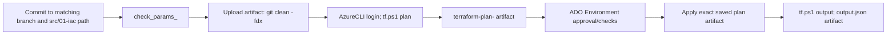

# 09 — CI/CD with Azure DevOps and GitHub Actions

> **Evidence:** `[Code]` repository YAML and application workflow review; `[Live]` current Azure
> inventory and access limitations; `[Chat]` historical operational incidents; `[Doc]` architecture
> summary. Pipeline YAML presence is not proof a pipeline is registered, enabled, authorized, or
> recently successful. Credentials and secret values are intentionally omitted.

## TL;DR

- `[Code]` Azure DevOps is organized under `basf4EMEA` → project `CAIRO`; IaC repositories have
DEV/QA/PROD pipelines and a shared validate/plan/approval/apply/output template. App pipelines
build containers, push ACR, then configure App Services. Logic Apps deploy ARM workflow
definitions; FE pipelines build Vite assets and deploy the Storage `$web` static site; Databricks
CD synchronizes a Git folder.
- `[Code]` IaC applies the saved Terraform plan artifact after an Azure DevOps Environment approval
gate. The approval list/checks are ADO UI configuration, not YAML content. Entry YAML filters
mostly watch `src/01-iac/*`; changes to pipeline YAML and `src/03-iac` alone may not trigger IaC
CD.
- `[Code][Chat]` Main Order Automation BE YAML uses Microsoft-hosted Ubuntu agents (`ubuntu-latest`)
and service connection `BASF_SC_CAIRO_PI_PROD`; hosted network reachability is distinct from
ACR/KV permissions. ACR private endpoint alone does not route a Microsoft-hosted agent into the
VNet.
- `[Live]` Live az CLI did not have sufficient authorization to list ADO pipelines, service
connections, or variable groups (`TF400813`). The handbook describes checked-in definitions only;
confirm actual registration, branch, approvals and effective protected values in ADO.

## 1. ADO topology and code path

Organization: `basf4EMEA`; project: `CAIRO`. Repositories include `EC_Shared_Resources_IaC`,
`EC_OrderAutomation_IaC`, `EC_OrderAutomation_BE`, `EC_OrderAutomation_FE`,
`EC_OrderAutomation_Databricks`, `EC_AssistantsFactory`, `EC_GenAI_Library`, and
`EC_Terraform_Modules`. `[Code][Live]`

| Pipeline class | Source location | Output / deployment target |
|---|---|---|
| IaC | `EC_*_IaC/.azuredevops/IaC-CD-{DEV,QA,PROD}.yaml` + templates | Terraform plan/state, Azure resources |
| Backend container CD | `EC_OrderAutomation_BE/.azuredevops/*_app_deployment.yml` | Container image in ACR, image configuration on App Service |
| Backend CI/tests | BE `extraction_service_tests.yml`, GitHub test workflows | Automated service checks; CI file existence/stage status must be verified |
| Logic Apps | BE `.azuredevops/azure-pipelines-email-*.yml` | ARM workflow definition and resource-group deployment |
| Frontend | `EC_OrderAutomation_FE/.azuredevops/static_website_deployment_*.yml` | `npm` production/dev build copied to Storage account `$web` |
| Databricks | `EC_OrderAutomation_Databricks/.azuredevops/Databricks-CD-QA.yaml` | Git folder/repo branch synchronization, not a notebook job run |
| Shared Python packages | `EC_GenAI_Library/.azuredevops/pipelines/*.yml` | Build/publish package(s) to private CAIRO artifact feed |
| Assistant Factory | Azure Pipeline and `.github/workflows/*` | Separate application and Databricks CD surfaces |

## 2. Infrastructure pipelines

### 2.1 Entry point matrix

| Repo | YAML | Branch trigger | Path | Group / tfvars | Connection variable |
|---|---|---|---|---|---|
| Shared | `IaC-CD-DEV.yaml` | `dev` | `src/01-iac/*` | `IaC_Variables_Shared_Resources_dev` / `vars_dev.tfvars` | `AzureServiceConnectionName_dev` |
| Shared | `IaC-CD-QA.yaml` | `master`, `releases/*` | same | `IaC_Variables_Shared_Resources` / `vars_qa.tfvars` | `AzureServiceConnectionName_qa` |
| Shared | `IaC-CD-PROD.yaml` | `master`, `releases/*` | same | `IaC_Variables_Shared_Resources` / `vars_prod.tfvars` | `AzureServiceConnectionName_prod` |
| Order Automation | `IaC-CD-DEV.yaml` | `dev` | same | `IaC_Variables_OrderAutomation` / `vars_dev.tfvars` | `AzureServiceConnectionName_dev` |
| Order Automation | `IaC-CD-QA.yaml` | `master`, `releases/*` | same | `IaC_Variables_Shared_Resources` / `vars_qa.tfvars` | `AzureServiceConnectionName_qa` |
| Order Automation | `IaC-CD-PROD.yaml` | `master`, `releases/*` | same | `IaC_Variables_Shared_Resources` / `vars_prod.tfvars` | `AzureServiceConnectionName_prod` |
| Assistant | `IaC-CD-DEV.yaml` | `development` | same | `IaC_Variables_Assistant_API_Dev` / `vars_dev.tfvars` | `AzureServiceConnectionName_dev` |
| Assistant | `IaC-CD-QA.yaml` | `master`, `releases/*` | same | `IaC_Variables_Assistant_API` / `vars_qa.tfvars` | `AzureServiceConnectionName_qa` |
| Assistant | `IaC-CD-PROD.yaml` | `master`, `releases/*` | same | `IaC_Variables_Assistant_API` / `vars_prod.tfvars` | `AzureServiceConnectionName_prod` |

`[Code]` Assistant QA and PROD YAML display names both say `IaC-CD-DEV`; actual
parameters/connection determine destination. Shared and Order Automation checked-out roots contain
only dev tfvars although QA/PROD YAML references other files. Confirm the selected branch before
dispatch. `[Code]`

`[Code]` Branch history lists `development`, `qa`, `main` and feature branches; pipeline triggers
use `dev`, `master`, `development`, and `releases/*` depending on repo. A merge into `main` does not
match a `master` trigger. Confirm repository default branch, pipeline YAML path and registration in
UI. `[Code][Chat]`

### 2.2 Shared stages and artifacts

1. `check_params_<env>` runs `IaC-CD-Check-Pipeline-Parameters.ps1`; input/pattern validation only,
not Terraform validation or Azure authorization. `[Code]`
2. `Upload_to_ArtifactRepository_<env>` uses upload template, runs `git clean -fdx` in the pipeline
checkout, publishes `terraform-validate-<env>`. This is agent workspace cleanup, not developer
worktree cleanup. `[Code]`
3. `validate_plan_<env>` downloads source, AzureCLI logs in via selected service connection with
`addSpnToEnvironment=true`, invokes `src/tf.ps1 -Plan -Force -DownloadTerraform`, then publishes
`terraform.tfplan` as `terraform-plan-<env>`. `[Code]`
4. `Terraform_<env>_approval` is a deployment job with Azure DevOps Environment
`terraform_$(region)_<env>`. Approvers and checks are configured under ADO Environments; YAML
does not enumerate them. `[Code]`
5. `apply_<env>` retrieves source and plan artifact, runs `tf.ps1 -Apply -UseExistingTerraformPlan -Force -DownloadTerraform`.
Review/apply the same saved plan rather than generating a different one after approval. `[Code]`
6. `output_<env>` (enabled when `publishOutput=true`) runs `-Output` and publishes `output.json`;
restrict artifact permissions/retention as output/state can expose sensitive values. `[Code]`

No explicit IaC `pr:` trigger was found. Path filters point at `src/01-iac/*`; changes only to YAML
or `src/03-iac` may not fire the same CD. Branch policies can add PR validation outside YAML.
`[Code]`

### 2.3 Backend state and hosted-agent implications

- `[Code]` `tf.ps1` creates/ensures backend storage from pipeline prefix/environment, obtains
backend auth for init and contains firewall open/cleanup controls. Backend container is
`tf-state`; backend key is supplied by root `backend.tf`.
- `[Live]` State resource groups include `tf_state_shared_dev`, `tf_state_orderautomation_qa`,
`tf_state_shared_prod`, `tf_state_orderautomation_prod`; inspect the real account/container and
state lock before running a new pipeline.
- `[Code]` IaC YAML uses pool `Azure Pipelines` (hosted by Microsoft unless org maps that pool
differently). Order Automation app/Logic/FE pipelines use `ubuntu-latest`; Databricks uses Ubuntu.
No self-hosted pool was declared in reviewed definitions.
- `[Chat]` ACR `acrsharedresourced2slfk` was switched public access off while the app build ran on a
Microsoft-hosted agent; login/push failed with 403 because the agent could not route to the
private endpoint. ACR auth credentials do not fix network reachability. Use an approved
VNet-connected agent or a permitted public registry path.
- `[Chat]` Key Vault 403 similarly involved hosted-agent egress/firewall and pipeline identity.
Confirm both service-principal data-plane role and current agent outbound addresses; do not widen
the vault to `0.0.0.0/0` to compensate.

## 3. Backend application build and deploy

### 3.1 Container pipeline pattern

`[Code]` The three Order Automation API service pipelines follow this shape:

```mermaid
flowchart LR
  A["BE commit to development / qa / prod branch"] --> B["Ubuntu agent: checkout + tag"]
  B --> C["Build Docker image"]
  C --> D["Trivy image assessment"]
  D --> E["AzureCLI / registry login"]
  E --> F["Push version tag to ACR"]
  F --> G["Deploy stage / environment gate"]
  G --> H["az webapp config container set"]
  H --> I["App Service pulls image using configured identity"]
  I --> J["Startup, DB migrations and health check"]
```

- `dev_extraction_service_app_deployment.yml`: branch `development`, `extraction-service-dev` group;
build/scanner and deploy to DEV; checked connection `BASF_SC_CAIRO_PI_PROD`. `[Code]`
- `dev_order_automation_orchestrator_api_deployment.yml`: `orchestrator-service-dev` group, same
connection, Docker build/Trivy/push/deploy. `[Code]`
- `dev_rules_service_app_deployment.yml`: `rules-service-dev` group, same pipeline pattern. `[Code]`
- QA/PROD ADO definitions for all three services exist in inspected branch surfaces (`qa_*`,
`prod_*`); registered pipeline/branch path needs UI verification. `[Code]`
- Build tags derive from build ID/version helper outputs such as `artifact_tag_creator` and
`artifact_version_descriptor`; avoid mutable `latest` as release identity. `[Code]`
- Build steps may use private `CAIRO_GenAI_Artifacts` feed access for Python package installation. A
2026-10 session records `uv sync --frozen --no-dev` failure at Dockerfile line 37; package read
permission/secret propagation was still unresolved. Never bake feed credentials into image layers.
`[Chat]`

### 3.2 Identity/auth model and deploy risk

- `[Code]` HCL creates shared app UAMI and grants `AcrPull`; app settings configure App Service to
use MI for image pulls. System-assigned identity may separately call application dependencies.
- `[Chat]` ADO `az webapp config container set` deployment path supplied registry username/password
in prior definitions and reset MI pull configuration; a PROD UAMI also lacked `AcrPull`. These are
different failure dimensions: pipeline push identity needs ACR data-plane/network access; app
runtime identity needs AcrPull; app service itself needs correct MI config.
- `[Chat]` Reliable verification: inspect App Service Deployment Center/Container settings, identity
client, ACR IAM, App Service Log stream (`ImagePullUnauthorized`/startup), actual image digest/tag
and `/health`. A running resource state alone is insufficient.
- `[Code]` Alembic DB migrations are part of deployment/startup behavior behind flags. Extraction
image must include migration directory; a pipeline deploying a container is not proof that
migration applied. Verify migration logs and schema before FE smoke tests.
- `[Chat]` Failed migrations/empty PostgreSQL regions table and unauthorized ACR pulls were
initially surfaced as browser CORS/500; fix backend root cause before adjusting browser CORS.

## 4. Frontend static deployment

- `[Code]` ADO files: `static_website_deployment_dev.yml`, `static_website_deployment_qa.yml`,
`static_website_deployment_prod.yml`. Dev uses group `orderautomation-static-dev`; one dev YAML
watches both `develop` and `development`; PROD definition was found on `origin/main`.
- `[Code]` Agent uses NodeTool and `npm ci`, then environment-specific `npm run build-*` (e.g.
`build-dev`), then AzureCLI deploys `dist` into Storage `$web` and sets static website index/error
documents. FE environment variables are build-time Vite values; changing API host requires a new
build/deploy.
- `[Chat]` Some storage deployments delete current `$web` content before upload; that sequence
creates a blank-site/rollback window. Verify deployment script and preserve prior
artifact/rollback route.
- `[Chat]` FE 200/static asset success does not prove Entra login, API auth, or app roles. Validate
signed-in browser API and server health.
- `[Code]` GitHub has `ci_tests.yml` and static website build/deploy workflows for `dev`, `explore`,
`qa`, and `prod`. File presence is not proof Actions workflow is enabled or that it is the release
authority.

## 5. Logic App workflows and test pipelines

- `[Code]` ARM workflow templates reside in `EC_OrderAutomation_BE/email_service/arm` and
`email_incident_service/arm`; pipeline deploys resource-group template with `az deployment group create`
using environment resource-group, location, workflow and connection parameters.
- `[Code]` ADO Logic App definition paths: `azure-pipelines-email-incident-service-dev.yml`,
`azure-pipelines-email-notification-dev.yml`, `azure-pipelines-email-service-logicapp-dev.yml`,
`...-qual.yml`, `...-prod.yml`. Branch trigger `development`, Ubuntu agent and named variable
groups are declared in reviewed definitions.
- `[Chat]` Workflow ARM provisioning does not authorize O365 connection. `office365-support-dev` was
noted as pre-authorized for one Logic App; connection identity and shared mailbox permissions
still require manual verification. PROD workflow resource has historically existed with empty
triggers/actions.
- `[Code]` ADO `extraction_service_tests.yml` and GitHub `extraction_service_tests.yml` /
`order_automation_tests.yml` exist. Commented YAML steps are not active tests or enforced
promotion gates; inspect job/stage conditions and run results.
- `[Chat]` Email incident intake pipeline creates a Logic App for mailbox capture, but current ARM
flow does not create a DevOps bug. The Databricks WIQL/work-item notebook is separate and live
end-to-end integration is not proven.

## 6. Databricks delivery

`EC_OrderAutomation_Databricks/.azuredevops/Databricks-CD-QA.yaml` is described as CLI-based
Git-folder sync. It uses `databricks_orderAutomation_qa`, AzureCLI service connection
`$(AzureServiceConnection_QA)`, gets Entra token for Databricks, configures workspace and invokes
`databricks repos update` on configured repo ID/branch. This updates workspace Git branch; it is not
an execution of notebook or job. `[Code]`

Historical setup steps include Azure DevOps CodeRead credential linked under Databricks workspace
Git settings, Git folder creation/branch selection, folder share permissions, service
principal/entitlement and repo ID configuration. The pipeline identity's AAD token and workspace
authorization do not automatically create a Git credential for Azure Repo clone. `[Chat]`

## 7. Legacy GitHub workflows and environment promotion

### 7.1 Order Automation BE GitHub surface

`[Code]` Discovered workflow families (some are branch variants or overlapping historical files; not
all are canonical/active):

- Dev: `dev_extraction_service_app_deployment.yml`, `dev_logicapp_deployment.yml`,
`dev_order_automation_orchestrator_api_deployment.yml`, `dev_rules_service_app_deployment.yml`.
- Explore: `explore_extraction_service_app_deployment.yml`, `explore_logicapp_deployment.yml`,
`explore_order_automation_orchestrator_api_deployment.yml`,
`explore_rules_service_app_deployment.yml`.
- QA/qual: `qual_extraction_service_app_deployment.yml`, `qual_logicapp_deployment.yml`,
`qual_order_automation_orchestrator_api_deployment.yml`, `qual_rules_service_app_deployment.yml`,
and `qa&prod_*` combined files.
- Prod / variations: `extraction_service_app_deployment_prod.yml`, `logicapp_deployment_prod.yml`,
`order_automation_orchestrator_api_deployment_prod.yml`, `rules_service_app_deployment_prod.yml`,
`prod_extraction_service_app_deployment.yml`, `prod_logicapp_deployment.yml`,
`prod_order_automation_orchestrator_api_deployment.yml`, `prod_rules_service_app_deployment.yml`.
- Tests: `extraction_service_tests.yml`, `order_automation_tests.yml`.

GitHub Actions and ADO pipelines coexist; branch YAML could be dormant or left from migration.
Choose one authoritative release path per environment; verify settings → Actions, ADO pipeline
registration and service connection/variable-group permissions.

### 7.2 Assistant Factory / library

- `[Code]` Assistant Factory GitHub workflows include `app_deployment_qa_prod_v1.yml`,
`app_deployment_qa_prod_v2.yml`, `dbr_deployment.yml`, `dbr_dev_deployment.yml`,
`github_workflows_app_deployment_dev.yml`, `github_workflows_app_deployment_dev_v1.yml`; an
`azure-pipelines.yml` is present too.
- `[Code]` GenAI Library has aggregate `azure-pipelines.yml` and package pipelines:
`cairoanalytics-devops`, `cairoanalytics-gevalidation`, `cairoanalytics-powerbi`,
`cairoanalytics-synapse`, `cairoanalytics-translator`; `cairogenai-aad-utils`,
`assistantfactoryutils`, `audiotranscriber`, `authlib`, `datapreprocessing`, `datautil`,
`email-utils`, `embeddingmodelslib`, `htmldataextraction`, `log-metrics`, `structured-output`,
`utils`.
- `[Code]` These library builds publish reusable packages to private `CAIRO_GenAI_Artifacts`;
package/feed credentials are not reproduced.
- `[Chat]` A service/release pipeline can be green while package consumption fails inside Docker
build due feed permission or credential propagation. Test actual dependency restore in the same
agent context.

## 8. Promotion and branch discipline

- `[Chat]` ADO stories highlighted development → QA → main progression, explicit PR merge
completion, and immutable QA-approved versions. A pipeline approval does not mean the PR was
merged or the intended branch selected.
- `[Code]` YAML trigger mismatches exist (`dev` vs `development`, `master` vs `main`, `develop` vs
`development`, `qual` as QA label). Treat trigger branch, pipeline YAML path and checked-out
branch as a combined configuration.
- `[Chat]` A QA pipeline once ran DEV settings because the wrong YAML/group/branch was selected;
explicit endpoint strings, DB, storage and AI host values also needed environment rewrite.
- `[Chat]` Do not copy a DEV variable group into QA/PROD blindly: inspect variable names and
explicit endpoint values. Avoid cross-environment storage or host strings hidden within a
connection setting.
- Recommended: build once, promote the identical image digest through QA then production; separate
environment config and secrets from image; record release/tag and rollback artifact. This is
hardening guidance, not proof of current universal practice.

## 9. Operating checklist

### Before dispatch

1. Confirm repo, source branch, YAML file path and target branch trigger.
2. Confirm path filters include changed files and environment tfvars exist in that branch.
3. Check Library group authorization and secret presence **without printing values**.
4. Confirm service connection subscription scope, authorization and required resource roles.
5. Confirm agent pool, egress/DNS and registry/KV/backend network reachability.
6. Inspect Environment approvals/checks, pipeline permissions and exclusive locks.
7. Review plan/build tag; never treat user-entered pipeline parameters as proof target environment
is correct.

### After deploy

1. Confirm exact image digest, App Service configuration and managed-identity registry pull.
2. Inspect container logs, correct service port (`orchestrator 3000`, `extraction 8000`, `rules 8001`
per application evidence), startup and health endpoint.
3. Verify DB migrations/extensions and app configuration before browser CORS diagnosis.
4. Check AFD origin health/routes/WAF, FE build-time API endpoint and successful Entra sign-in.
5. Test Logic App trigger and connector-authenticated send; ARM success alone is insufficient.
6. For Databricks, verify Git folder latest commit and separately execute/test intended job.

## Where to look in Azure Portal / ADO

- ADO → CAIRO → **Pipelines → Pipelines → pipeline → Runs** → stage logs and downloaded plan/build
artifacts.
- ADO → **Pipelines → Library → Variable groups** → `IaC_Variables_*`, `extraction-service-dev`,
`orchestrator-service-dev`, `rules-service-dev`, `orderautomation-static-dev`,
`databricks_orderAutomation_qa`; inspect permissions/authorized pipelines, never export secret
values.
- ADO → **Project settings → Service connections** → `BASF_SC_CAIRO_PI_PROD` and
environment-specific connection variables; check subscription and identity permissions.
- ADO → **Pipelines → Environments** → `terraform_<region>_<env>`, `DEV`, `QA`, `PROD`; check
approvals, checks, locks, bypass controls.
- ADO → **Project settings → Agent pools** → `Azure Pipelines`; determine whether organization pool
is Microsoft-hosted and which egress model applies.
- ADO → **Repos → Branches → Branch policies**; PR checks are not evident in YAML.
- Azure Portal → ACR → Networking/IAM; App Service → Deployment Center/Identity/Container
settings/Log stream; Key Vault → Networking/IAM; Storage → `$web`; Front Door →
origins/health/WAF.
- GitHub → Repository → Actions → workflow runs/settings; verify workflows are enabled before
calling them current.

## Interview talking points

- Walk through PR merge → trigger/path-filter selection → plan artifact → Environment check → exact
plan apply → output artifact.
- Explain why ADO service connection permissions and app managed-identity permissions are separate.
- Explain hosted agent networking versus ACR `AcrPush` / runtime `AcrPull` authorization.
- Explain Docker build, vulnerability scan, image tag, ACR push, App Service pull and
startup/migration health.
- Explain FE config is baked at build time and Logic App ARM deployment does not consent O365
connectors.
- Explain why a Databricks Git-folder update does not run a job.
- Explain how duplicate ADO/GitHub definitions and branch drift require one designated source of
truth.

## Evidence & confidence

- **High:** IaC YAML/templates and app pipeline inventory in `raw_iac.md` and `raw_apps.md`.
`[Code]`
- **High:** current Azure resource names and inability to list ADO metadata in `raw_azure.md`.
`[Live]`
- **Medium:** QA promotion, image-pull/KV firewall, Logic App/mail and Databricks setup incident
summaries in `raw_chats.md`. `[Chat]`
- ADO direct query denied `TF400813`; variable-group values and live pipeline registrations are not
independently confirmed. `[Live]`

## Further reading

- [08 Terraform/IaC](08-Terraform-IaC.md) · [10 End-to-end flows](10-End-to-End-Flows.md) · [11
Manual steps and runbooks](11-Manual-Steps-and-Runbooks.md) · [12 Incidents and
lessons](12-Incidents-and-Lessons-Learned.md)

## Appendix A — Exhaustive discovered pipeline definition paths

The application evidence catalog found **76 unique YAML definition paths** across the inspected
working trees/branches. This is a source-file inventory, not a claim that all are registered,
enabled or current. `[Code]`

### Assistant Factory (7)

- `EC_AssistantsFactory\.github\workflows\app_deployment_qa_prod_v1.yml`
- `EC_AssistantsFactory\.github\workflows\app_deployment_qa_prod_v2.yml`
- `EC_AssistantsFactory\.github\workflows\dbr_deployment.yml`
- `EC_AssistantsFactory\.github\workflows\dbr_dev_deployment.yml`
- `EC_AssistantsFactory\.github\workflows\github_workflows_app_deployment_dev.yml`
- `EC_AssistantsFactory\.github\workflows\github_workflows_app_deployment_dev_v1.yml`
- `EC_AssistantsFactory\azure-pipelines.yml`

### GenAI Library (18)

- `EC_GenAI_Library\.azuredevops\pipelines\azure-pipelines.yml`
- `EC_GenAI_Library\.azuredevops\pipelines\cairoanalytics-devops.yml`
- `EC_GenAI_Library\.azuredevops\pipelines\cairoanalytics-gevalidation.yml`
- `EC_GenAI_Library\.azuredevops\pipelines\cairoanalytics-powerbi.yml`
- `EC_GenAI_Library\.azuredevops\pipelines\cairoanalytics-synapse.yml`
- `EC_GenAI_Library\.azuredevops\pipelines\cairoanalytics-translator.yml`
- `EC_GenAI_Library\.azuredevops\pipelines\cairogenai-aad-utils.yml`
- `EC_GenAI_Library\.azuredevops\pipelines\cairogenai-assistantfactoryutils.yml`
- `EC_GenAI_Library\.azuredevops\pipelines\cairogenai-audiotranscriber.yml`
- `EC_GenAI_Library\.azuredevops\pipelines\cairogenai-authlib.yml`
- `EC_GenAI_Library\.azuredevops\pipelines\cairogenai-datapreprocessing.yml`
- `EC_GenAI_Library\.azuredevops\pipelines\cairogenai-datautil.yml`
- `EC_GenAI_Library\.azuredevops\pipelines\cairogenai-email-utils.yml`
- `EC_GenAI_Library\.azuredevops\pipelines\cairogenai-embeddingmodelslib.yml`
- `EC_GenAI_Library\.azuredevops\pipelines\cairogenai-htmldataextraction.yml`
- `EC_GenAI_Library\.azuredevops\pipelines\cairogenai-log-metrics.yml`
- `EC_GenAI_Library\.azuredevops\pipelines\cairogenai-structured-output.yml`
- `EC_GenAI_Library\.azuredevops\pipelines\cairogenai-utils.yml`

### Order Automation backend — Azure Pipelines (15)

- `EC_OrderAutomation_BE\.azuredevops\azure-pipelines-email-incident-service-dev.yml`
- `EC_OrderAutomation_BE\.azuredevops\azure-pipelines-email-notification-dev.yml`
- `EC_OrderAutomation_BE\.azuredevops\azure-pipelines-email-service-logicapp-dev.yml`
- `EC_OrderAutomation_BE\.azuredevops\azure-pipelines-email-service-logicapp-prod.yml`
- `EC_OrderAutomation_BE\.azuredevops\azure-pipelines-email-service-logicapp-qual.yml`
- `EC_OrderAutomation_BE\.azuredevops\dev_extraction_service_app_deployment.yml`
- `EC_OrderAutomation_BE\.azuredevops\dev_order_automation_orchestrator_api_deployment.yml`
- `EC_OrderAutomation_BE\.azuredevops\dev_rules_service_app_deployment.yml`
- `EC_OrderAutomation_BE\.azuredevops\extraction_service_tests.yml`
- `EC_OrderAutomation_BE\.azuredevops\prod_extraction_service_app_deployment.yml`
- `EC_OrderAutomation_BE\.azuredevops\prod_order_automation_orchestrator_api_deployment.yml`
- `EC_OrderAutomation_BE\.azuredevops\prod_rules_service_app_deployment.yml`
- `EC_OrderAutomation_BE\.azuredevops\qa_extraction_service_app_deployment.yml`
- `EC_OrderAutomation_BE\.azuredevops\qa_order_automation_orchestrator_api_deployment.yml`
- `EC_OrderAutomation_BE\.azuredevops\qa_rules_service_app_deployment.yml`

### Order Automation backend — GitHub Actions (26)

- `EC_OrderAutomation_BE\.github\workflows\dev_extraction_service_app_deployment.yml`
- `EC_OrderAutomation_BE\.github\workflows\dev_logicapp_deployment.yml`
- `EC_OrderAutomation_BE\.github\workflows\dev_order_automation_orchestrator_api_deployment.yml`
- `EC_OrderAutomation_BE\.github\workflows\dev_rules_service_app_deployment.yml`
- `EC_OrderAutomation_BE\.github\workflows\explore_extraction_service_app_deployment.yml`
- `EC_OrderAutomation_BE\.github\workflows\explore_logicapp_deployment.yml`
- `EC_OrderAutomation_BE\.github\workflows\explore_order_automation_orchestrator_api_deployment.yml`
- `EC_OrderAutomation_BE\.github\workflows\explore_rules_service_app_deployment.yml`
- `EC_OrderAutomation_BE\.github\workflows\extraction_service_app_deployment_prod.yml`
- `EC_OrderAutomation_BE\.github\workflows\extraction_service_tests.yml`
- `EC_OrderAutomation_BE\.github\workflows\logicapp_deployment_prod.yml`
- `EC_OrderAutomation_BE\.github\workflows\order_automation_orchestrator_api_deployment_prod.yml`
- `EC_OrderAutomation_BE\.github\workflows\order_automation_tests.yml`
- `EC_OrderAutomation_BE\.github\workflows\prod_extraction_service_app_deployment.yml`
- `EC_OrderAutomation_BE\.github\workflows\prod_logicapp_deployment.yml`
- `EC_OrderAutomation_BE\.github\workflows\prod_order_automation_orchestrator_api_deployment.yml`
- `EC_OrderAutomation_BE\.github\workflows\prod_rules_service_app_deployment.yml`
- `EC_OrderAutomation_BE\.github\workflows\qa&prod_extraction_service_app_deployment.yml`
- `EC_OrderAutomation_BE\.github\workflows\qa&prod_logicapp_deployment.yml`
- `EC_OrderAutomation_BE\.github\workflows\qa&prod_order_automation_orchestrator_api_deployment.yml`
- `EC_OrderAutomation_BE\.github\workflows\qa&prod_rules_service_app_deployment.yml`
- `EC_OrderAutomation_BE\.github\workflows\qual_extraction_service_app_deployment.yml`
- `EC_OrderAutomation_BE\.github\workflows\qual_logicapp_deployment.yml`
- `EC_OrderAutomation_BE\.github\workflows\qual_order_automation_orchestrator_api_deployment.yml`
- `EC_OrderAutomation_BE\.github\workflows\qual_rules_service_app_deployment.yml`
- `EC_OrderAutomation_BE\.github\workflows\rules_service_app_deployment_prod.yml`

### Databricks and frontend (10)

- `EC_OrderAutomation_Databricks\.azuredevops\Databricks-CD-QA.yaml`
- `EC_OrderAutomation_FE\.azuredevops\static_website_deployment_dev.yml`
- `EC_OrderAutomation_FE\.azuredevops\static_website_deployment_prod.yml`
- `EC_OrderAutomation_FE\.azuredevops\static_website_deployment_qa.yml`
- `EC_OrderAutomation_FE\.github\workflows\ci_tests.yml`
- `EC_OrderAutomation_FE\.github\workflows\static_website_build.yml`
- `EC_OrderAutomation_FE\.github\workflows\static_website_deployment_dev.yml`
- `EC_OrderAutomation_FE\.github\workflows\static_website_deployment_explore.yml`
- `EC_OrderAutomation_FE\.github\workflows\static_website_deployment_prod.yml`
- `EC_OrderAutomation_FE\.github\workflows\static_website_deployment_qa.yml`

Totals: 7 + 18 + 15 + 26 + 10 = **76**.
