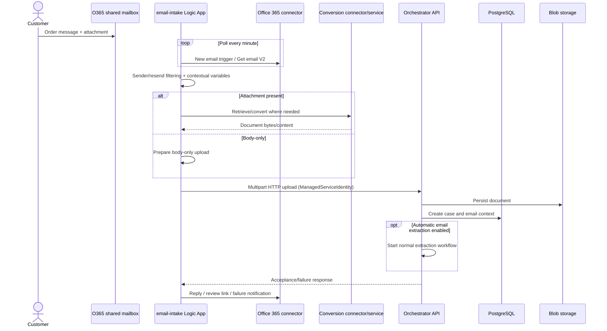
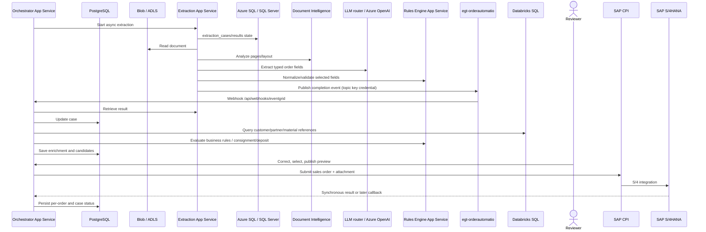
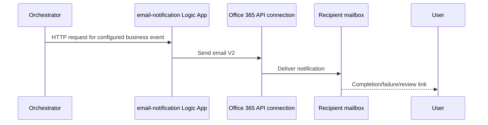
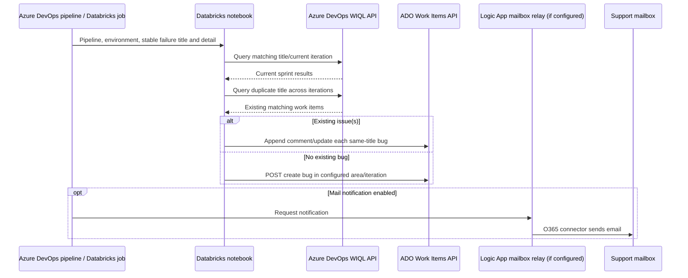
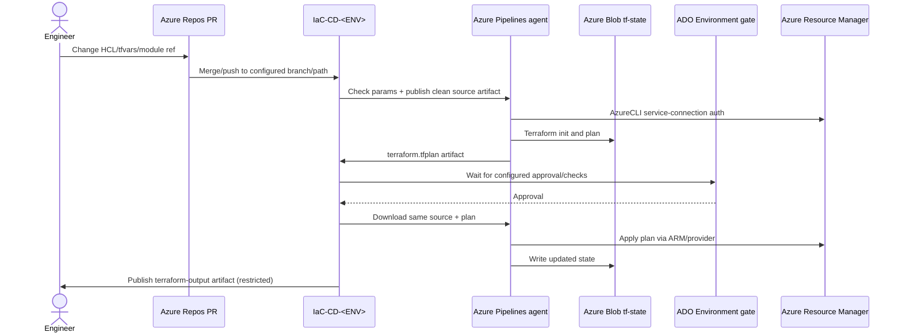
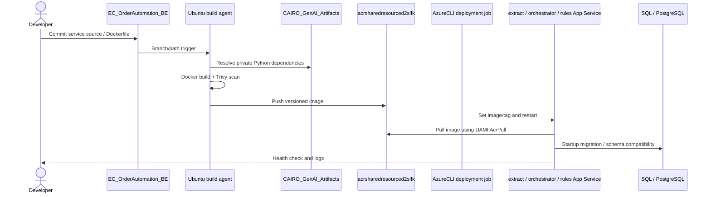
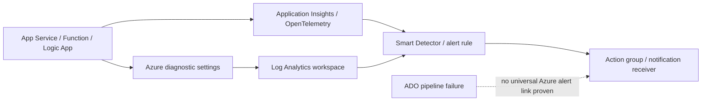

# 10 — End-to-end platform flows

> **How to read this chapter:** `[Live]` means named resources were in the 2026-10-13 subscription
> inventory; `[Code]` means application/HCL/workflow source; `[Chat]` means historical operational
> evidence; `[Doc]` means architecture/transcript. A solid arrow is evidenced; `?` marks
> authentication or wiring that must be verified in deployed configuration. Identity type is named,
> but secret/token values are never shown.

## TL;DR

The AIOA workload accepts orders through two routes: a signed-in user uploads from the React static
site, or a shared mailbox intake workflow submits mail attachments to the orchestrator. The
orchestrator stores case state and documents, starts asynchronous extraction, consumes Event Grid
completion notifications, enriches with SAP-derived master data, presents results for human
correction, then publishes orders through SAP CPI. `[Code][Doc]`

The current DEV edge has Azure Front Door Standard profile `order-automation-fd-dev` and endpoint
`order-automation-dev-d2end8fhgaemfncd.a01.azurefd.net`; routes use `/*`, `/api/*`, `/extraction/*`,
`/rules/*`. AFD's default origin hosts are App Service `*.azurewebsites.net`. APIM exists in shared
resource group but whether the FE API route traverses APIM is conditional and must be confirmed;
source describes it as optional/verify rather than a proved per-request hop. `[Live][Code]`

Authentication is not uniform: FE sends an Entra **ID token** to the BE; inter-service calls can use
managed identity; Logic App mail actions use the Office 365 connector; extraction Document
Intelligence/LLM/API and Event Grid paths may use keys or client-secret token auth; SAP CPI has
configured client credentials; no clear evidence that every call uses managed identity. `[Code]`

## 1. User sign-in and file upload

```mermaid
sequenceDiagram
  actor User
  participant FE as React SPA in Storage $web
  participant Entra as Microsoft Entra ID
  participant AFD as order-automation-fd-dev
  participant GW as APIM (conditional / verify)
  participant OA as orchestrator-api-appservice-dev
  participant PG as pgsql-orderautomatio
  participant Blob as bloborderautomatio / dlsecorderautodev
  User->>AFD: GET endpoint hostname
  AFD->>FE: /* route to static origin
  FE->>Entra: MSAL sign-in (openid/profile/email, User.Read)
  Entra-->>FE: ID token + separate Graph User.Read token
  User->>FE: Select PDF/XLS/XLSX, <=25 MiB
  FE->>AFD: HTTPS /api/fileupload with Bearer ID token
  AFD->>GW: /api/*; APIM only if live route confirms
  GW->>OA: Forward API request
  OA->>OA: Validate token/audience, roles and country/region scope
  OA->>PG: Create case and transactional metadata
  OA->>Blob: Store original / converted document
  OA-->>FE: Case/processing status
  loop Poll state
    FE->>AFD: GET /api/cases/{caseId}
    AFD->>OA: Route to OrchestratorApiOriginGroup
    OA->>PG: Read state
    OA-->>FE: Status and editable fields
  end
```

### Walkthrough and identity at each hop

1. **Browser resolves the AFD endpoint.** `[Live]` DEV AFD endpoint is
`order-automation-dev-d2end8fhgaemfncd.a01.azurefd.net`, profile `order-automation-fd-dev`
(`Standard_AzureFrontDoor`), resource group `rg-order_automation-dev`. HTTPS redirect enabled;
route patterns include static `/*` and API `/api/*`; WAF `orderautomationwafdev` is attached to
`/*`. `[Live]`
2. **Static site load.** The static origin points to Azure Storage static website, configured by the
FE deployment pipeline. Static web content is served to the browser; this is not a server-side
authenticated API call. AFD routes `/`/assets to `StaticOriginGroup`; browser config is Vite
build-time data. `[Code][Live]`
3. **Entra login.** FE MSAL uses client/tenant IDs from public `VITE_*` configuration, auth
authority `login.microsoftonline.com/<tenant>`, and requests `openid profile email User.Read`.
`apiClient` gets an ID token for BE calls; a separate access token is used for Microsoft Graph
profile. Never mistake this FE ID-token contract for an Azure resource managed identity. `[Code]`
4. **Upload validation.** FE accepts `.pdf`, `.xlsx`, `.xls`, with 25 MiB maximum and preview
support; the upload API is `/api/fileupload`. `[Code]`
5. **Edge route and gateway.** AFD forwards `/api/*` via `OrchestratorApiOriginGroup` to
`orchestrator-api-appservice-dev.azurewebsites.net`, HTTPS origin. APIM is a shared API gateway
resource (`apim-sharedresources-dev`); whether this exact AFD route targets APIM is unverified.
Do not describe APIM as definitely in the request chain until inspect origin/policies.
`[Live][Code]`
6. **Request identity.** Orchestrator validates Entra JWT and checks application user/role/country
scope. FE bearer token is the caller's token; it is not App Service system identity. Role names
include `system_admin`, `system_user`, `power_user`, which are application DB roles rather than
Azure RBAC. `[Code]`
7. **Persistence.** Orchestrator creates a PostgreSQL case and stores the source document in Blob.
Application code shows Blob connection-string auth; do not claim MI Blob authorization without
confirming deployed client/config. PostgreSQL uses configured async database connection. `[Code]`
8. **Status polling.** FE polls case state with API routes; extraction/enrichment status uses timers
and can take up to 20 minutes. Browser timeout does not necessarily cancel server work. `[Code]`

### Exact DEV resources and boundaries

- AFD: `order-automation-fd-dev`, endpoint `order-automation-dev-d2end8fhgaemfncd.a01.azurefd.net`,
WAF `orderautomationwafdev`. `[Live]`
- Frontend static account follows IaC name pattern `staticorderautomatio`; static website
configuration/containers are in `rg-order_automation-dev`. `[Code][Live]`
- API origin sites: `orchestrator-api-appservice-dev`, `extract-orderautomatio`,
`rules-engine-appservice-dev`; no AFD IP restriction appears on the inspected DEV extraction app,
and HCL gates restrictions on FDID inputs. Verify direct `azurewebsites.net` reachability.
`[Live][Code]`
- DB: `pgsql-orderautomatio`; app RG `rg-order_automation-dev`; PG dev public network was true in
HCL and PE also exists, so public/private access and DNS need separate checks. `[Live][Code]`

## 2. Email intake into orchestration



1. Shared mailbox receives customer mail. `[Doc]` and `[Code]` describe a one-minute Office 365
Logic App trigger with attachments and split-on message processing.
2. `email-intake.json` reads mail (Get email V2), filters sender/resend conditions and prepares
metadata. Logic App workflow resource is `logicapp-orderautomatio` in DEV RG. O365 connection
resources in inventory include `office365`, `office365-1`, `conversionservice`. `[Live][Code]`
3. The workflow branches for attachment/body handling and may use conversion connector/service;
exact conversion behavior should be reviewed from ARM action definitions and run history before
changing. `[Code]`
4. HTTP action sends multipart content/metadata to backend with `ManagedServiceIdentity` action
authentication. This is distinct from connector auth; the Office 365 API connection must
separately be authorized for a mailbox identity with suitable rights. `[Code][Chat]`
5. Orchestrator uses its normal upload path, creates the order case in PostgreSQL and stores
document in Blob. The Logic App is not the source of the processing database record itself.
`[Code]`
6. Automatic email extraction/enrichment depends on runtime flags/configuration; do not infer it
solely from successful mail trigger. `[Code]`
7. Workflow replies with case/review information or handles failure path. Verify actual successful
run and email; ARM deployment success does not show trigger fired or connector sent mail.
`[Chat]`

`[Chat]` Microsoft 365 blocked legacy mailbox reading via IMAP/EWS for script-based automation, even
when a username/password was known. Logic App/O365 connector became the appropriate route; manual
connection authorization and mailbox delegation remain mandatory. `[Chat]`

### Separate incident-support mailbox (not production order intake)

`logicapp-email-to-bug-dev` is a DEV incident intake workflow. It polls a support mailbox, retrieves
sender/subject/body/attachments/timestamps/message IDs, validates envelope, retries reads and
records the capture in run history. Current ARM definition does **not** persist a durable incident
record or create an ADO bug. `[Live][Code][Chat]`

The September 2026 meeting transcript describes a separate generic Databricks notebook: it accepts
pipeline/subject/body/environment inputs; calls Azure DevOps team-settings/current sprint API and
WIQL; checks for same bug title in current sprint before creation; searches matching titles across
sprints for duplicates; updates/comments on existing work items, creating a new bug when none match.
Stable titles are important; timestamps/incrementing values defeat dedupe. It uses ADO REST
work-item endpoints/WIQL and a work-item API principal/credential; exact secret/token is never
shown. Live mailbox→Logic App→Databricks→ADO job is not proven. `[Chat]`

## 3. Extraction, Event Grid, enrichment and SAP flow



### 3.1 Asynchronous extraction

- **Start:** orchestrator calls Extraction App Service using inter-service auth configurable as
managed identity; extraction endpoint accepts asynchronous work. `[Code]`
- **Document access:** source implementation uses Azure Blob clients from configured connection
string; no evidence establishes a universal MI Blob path. ADLS containers `land`, `processing`,
`output`, `report` exist by architecture/code intent; an end-to-end upstream Databricks writer is
not proven. `[Code][Doc]`
- **Extraction persistence:** Extraction writes SQL Server/Azure SQL case/result tables; separate
from orchestrator PostgreSQL case records. `[Code]`
- **Document AI:** `documentintel-orderautomation-dev` / `documentintel-orderautomation-prod` appear
in resource inventory. Extraction code uses Document Intelligence client/API key fallback. Managed
identity vs key depends on configured client path. `[Live][Code]`
- **LLM:** Extraction code calls an LLM router/GPT structured-prompt path; exact
account/model/deployment is config-dependent. Live inventory includes AI Foundry/OpenAI-type
accounts in shared RG, but no exact dedicated AIOA model binding should be assumed without runtime
settings. `[Code][Live]`
- **Rule evaluation:** `rules-engine-appservice-dev` uses HTTP API and Entra/JWKS-based auth;
allowed service callers include orchestrator/extraction identities. Port observed historically is
  8001. `[Code][Chat]`
- **Event publication:** extraction sends Event Grid event via `EventGridPublisherClient` /
AzureKeyCredential in reviewed implementation. Topic is `egt-orderautomatio`. Key value is secret
and omitted. `[Code][Live]`
- **Completion callback:** Event Grid subscription invokes orchestrator webhook
`/api/webhooks/eventgrid`; app callback validates event/auth then reads extraction result, updates
PG. A historical PROD path describes Entra-token callback; verify effective subscription endpoint,
validation event, retry policy and identity. `[Code][Chat]`
- **Idempotency/retry:** duplicate event and 409 `already processing` reports require trace
correlation and idempotent case transitions; transient HTTP retry policy does not mean event was
not delivered. `[Chat]`

### 3.2 Enrichment and human decision

1. Orchestrator joins extraction fields to SAP-derived reference data via Databricks SQL providers
(customer, sold-to/ship-to, partner, sales area, material, UOM). Direct KNMT, customer-specific,
embedded, ground truth and fuzzy matching are evidenced. `[Code]`
2. **Databricks connection/auth:** source proves SQL-provider use, but exact live SQL endpoint/token
identity is configuration-specific. Databricks pipeline's Entra service-principal token is for
workspace Git sync, not proof of runtime BE SQL identity. `[Code]`
3. Ground-truth feedback can affect future matches; PostgreSQL ground-truth/materialized data and
feedback status are app behavior, not an Azure resource auth role. `[Code]`
4. Rules service evaluates country normalization, delivery-date, sales-area and consignment/deposit
rules. Orchestrator/extraction call with managed identity where configured and audience/scope
must match receiving App Registration. `[Code]`
5. React FE displays document and suggested values; user can correct header/partners/materials/line
items/sales-org and request delta re-enrichment. FE ID token is sent to orchestrator; backend
app-role/country scope enforces permissions. `[Code]`
6. Publication preview/grouping may split one case into multiple order requests; a preview is not
SAP submission. `[Code]`

### 3.3 SAP publication / callback

- Orchestrator's SAP clients create order payloads/XML and submit via SAP CPI integration;
attachment sending is a separate call/path. App settings include SAP service-principal/CPI auth
values, but credentials are secret and identity specifics must be verified in the configured API
registration. `[Code]`
- SAP S/4HANA is the target/source enterprise system; SAP CPI mediates order submission.
`[Doc][Code]`
- Results can be synchronous or callback-driven; order and attachment states are separately
persisted and can be retried individually. Partial success is possible; case-level `successful`
does not imply every line/item/attachment succeeded. `[Code]`
- Historical Function `sapordercallback-prod` resource exists; a historical source branch callback
accepted XML and forwarded to configured webhook using a correlation header, but returned HTTP 202
even on forward failure. Current callback implementation/deployment parity must be checked.
`[Live][Code][Chat]`

## 4. Notifications



The notification ARM workflow has an HTTP request trigger and Office 365 `Send an email (V2)`
action. Orchestrator invokes it conditionally based on notification flags. API connection
authorization and trigger access-control/signature settings must be inspected live. No sender
address, body or signed URL is reproduced. `[Code]`

## 5. Failure-to-email and ADO bug flow



- `[Chat]` 2026-09-29 transcript described two key ADO API families: team-settings/current iteration
and WIQL query; work-item API creates with `POST`, dedupe queries title, comments repeat
incidents. It intentionally searches across sprints for duplicates, while new item iteration is
current sprint + configured area path.
- `[Code][Chat]` New DEV Logic App `email-to-bug` only captures mailbox email; it is not evidence of
this notebook chain or automatic ADO write.
- `[Chat]` Earlier direct SMTP/O365 mail code stopped working because Office 365 disallowed IMAP/EWS
for that code path; Logic App O365 connector was adopted for mailbox ingress/mail delivery.
- `[Chat]` Verify Databricks job exists and can retrieve its ADO credential through its actual
identity; repository sync alone is not job registration or execution.

## 6. Infrastructure-change flow



The pipeline plan/apply sequence is in chapter 09; state keys and manual state-account
initialization in chapter 08. Terraform pipeline's service principal must have both management-plane
permissions and data-plane/backend access. A human owner approving a run does not provide the
pipeline SP with Key Vault secret read or `roleAssignments/write`. `[Code][Chat]`

## 7. Application deployment flow



This flow distinguishes build agent ACR push/network identity, App Service UAMI ACR pull, App
Service runtime dependency identity, and application user's Entra identity. They are separate
principals. `[Code][Chat]`

## 8. Observability and alert path

- `[Live]` Workload RGs contain `appi-orderautomatio` / `appi-order_automation-qa` /
`appi-order_automation-prod`, LAW resources `law-orderautomatio`, `law-orderautomation-qa`,
`law-orderautomation-prod`, and action groups `monitor-order_automation-*`.
- `[Code]` `monitor.tf` sends only selected Extraction App Service, Function, SQL Server and SQL DB
diagnostic categories/metrics to LAW. Orchestrator, Rules, Logic App, Key Vault, PostgreSQL, Event
Grid, Storage and AFD/WAF are not declared in that root diagnostic graph.
- `[Doc]` Architecture says App Insights/OpenTelemetry are used across services and alerts catch
pipeline/App Service failures; correlate this with live exporters/workspace settings because IaC
is incomplete for all services.
- `[Chat]` App Service App Insights agent can collect traces/exceptions; code may export OTLP/New
Relic as configured. Live settings vary by environment; do not assume identical instrumentation.
- `[Live]` Platform inventory shows Smart Detector “Failure Anomalies” alerts and App
Insights-managed workspaces for some app components. These resources do not prove custom alert
coverage for all dependencies.



A useful investigation starts with trace/case ID, App Insights exceptions/dependencies, App Service
container logs, Event Grid delivery metrics, Logic App trigger/action history, DB
connectivity/schema, and AFD origin-health logs. Verify missing diagnostic settings before expecting
a query to return evidence.

## Resource/identity crosswalk

| Hop | Resource | Caller identity/auth evidenced | Evidence caveat |
|---|---|---|---|
| FE user → BE | AFD `order-automation-fd-dev`; orchestrator App Service | User's Entra ID token (FE sends ID token); backend validates token/audience and app role | Check matching app registration audience; not a managed identity. `[Code]` |
| AFD → App Service | Origins to `*.azurewebsites.net` | TLS HTTPS; no app-to-app MI at this edge hop | DEV app restrictions not set in inspected config; verify direct origin protection. `[Live][Code]` |
| App → PostgreSQL | `pgsql-orderautomatio` | DB credential/config (password stored in KV per IaC; runtime auth mode is app config) | Exact runtime driver credentials not disclosed. `[Code]` |
| App → Blob | `bloborderautomatio`, ADLS account | Orchestrator code uses configured storage connection string | Do not label MI unless code/config path proves it. `[Code]` |
| Orchestrator → Extraction / Rules | three App Services | Managed identity supported/configured; expected Entra token audience | Auth mode and exact audience/scope vary by environment. `[Code]` |
| Extraction → SQL | `sqlserver-orderautomatio` and DB | DB URL; app's Entra path uses client-secret SP token for pyodbc when enabled | Data-plane configuration must match. `[Code]` |
| Extraction → Event Grid | `egt-orderautomatio` | AzureKeyCredential topic key in inspected publisher | Store/rotate key safely; never expose value. `[Code]` |
| Extraction → Document Intelligence/LLM | Cognitive accounts / router endpoint | API-key fallback and configured endpoint; exact deployed auth differs by setting | Role/API key deployments need separate confirmation. `[Code]` |
| Logic App → mailbox | `office365` connection | OAuth API connection identity with delegated mailbox authorization | ARM deployment does not grant mailbox rights. `[Code][Chat]` |
| Logic App → Orchestrator | HTTP action | ManagedServiceIdentity | Audience/role on receiver still required. `[Code]` |
| Databricks → ADO | notebook if configured | ADO work-item credential/identity; WIQL and Boards APIs | Actual secret scope/job/live write not confirmed. `[Chat]` |
| App → SAP CPI | SAP client config | Configured client credentials for CPI/SAP endpoint | Credential values omitted; inspect API app/secret ownership. `[Code]` |
| IaC agent → ARM/State | service connection + Blob backend | federated/service principal Azure CLI identity; state auth initialized by wrapper | ADO service connection list access unavailable. `[Code][Live]` |
| App Service → ACR | ACR `acrsharedresourced2slfk` | UAMI with `AcrPull` | Some deployment commands historically reset MI flags. `[Code][Chat]` |

## Where to look in Azure Portal / ADO

- Azure Portal → AFD profile `order-automation-fd-dev` → Endpoint → Routes / Origin groups / Origins
/ Health / Security policies.
- Azure Portal → App Services → `orchestrator-api-appservice-dev`, `extract-orderautomatio`,
`rules-engine-appservice-dev` → Identity, Configuration, Deployment Center, Log stream,
Networking, Application Insights.
- Azure Portal → PostgreSQL `pgsql-orderautomatio` / SQL server `sqlserver-orderautomatio` →
Networking, Databases, server parameters, diagnostic settings.
- Azure Portal → Storage account → Containers/filesystems; Key Vault → Networking/Secrets/IAM; Event
Grid topic → Metrics/Subscriptions/Delivery attempts.
- Azure Portal → Logic Apps → `logicapp-orderautomatio`, `logicapp-email-to-bug-dev` → Designer,
Trigger history, Run history, API connections → Authorization.
- Azure Portal → Application Insights / Log Analytics → Logs, Failures, Dependencies, availability
and diagnostic settings.
- ADO → Pipelines → Runs → ACR/build/deploy logs; Databricks workspace → Repos/Jobs; Boards → Work
Items/Iterations/Area Paths.
- Portal/ADO are not applicable for the SAP internal CPI mapping details in this evidence; use the
approved SAP CPI/S4 operations console and integration team runbook.

## Interview talking points

- Narrate FE upload to async extraction and the reason event-driven completion decouples API latency
from document processing.
- Explain three distinct persistence systems: Blob/ADLS files, PostgreSQL workflow/case state, SQL
extraction state.
- Explain identity boundaries: interactive user token, service MI, connector OAuth, data-plane API
key/client credential, ADO work-item identity.
- Explain why CORS, AFD health and app health are separate layers; correct 500/auth/database
problems before changing CORS.
- Explain human review and per-order retry, partial success, case feedback, and why SAP attachment
delivery may fail independently.
- Be precise: shared resource exists does not mean the route traverses it; say APIM/Databricks/SAP
ingestion jobs are conditional where evidence is not complete.

## Evidence & confidence

- **High:** AFD live endpoint/origins/routes and workload resource names from `raw_azure.md`;
FE/backend/Logic App API/action details from `raw_apps.md`. `[Live][Code]`
- **Medium:** desired architecture sequence from `doc_aioa.txt`; details in app code distinguish it
from intended high-level topology. `[Doc][Code]`
- **Medium:** failure paths, manual identity/network repair and ADO incident logic from
`raw_chats.md` and `doc_call.txt`; not proof current job execution. `[Chat][Doc]`
- **Explicit unknowns:** current runtime auth flags/secret references, exact APIM hop in AFD route,
upstream Databricks SAP ingestion, live notebook job, and connector authorization state.

## Further reading

- [05 Compute and applications](05-Compute-and-Applications.md) · [06 Data and
AI](06-Data-and-AI.md) · [07 API edge/APIM](07-API-Edge-FrontDoor-APIM.md) · [09
CI/CD](09-CICD-Azure-DevOps.md) · [11 Runbooks](11-Manual-Steps-and-Runbooks.md)
