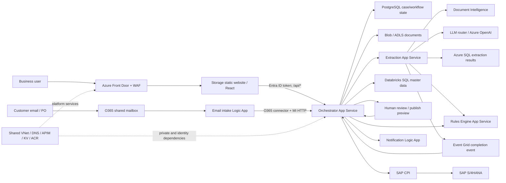

# 13 — Interview preparation

## TL;DR

Present yourself as the engineer who can explain the full AIOA path and its operational
boundaries—not just “Terraform created Azure.” The strongest examples are CORS masking missing
migrations/image-pull auth, splitting Key Vault 403 across human/CI/runtime identities and network,
and making subnet creation policy-compliant with atomic NSG attachment. Be candid that some flows
(APIM on every FE call, Databricks production job, live email-to-bug) were not fully verified.
`[Code][Chat][Live]`

## 1. Two-minute platform explanation

> “AIOA, or AI Order Automation, is a BASF CAIRO service that turns customer purchase
> orders—uploaded in a browser or received through a shared mailbox—into SAP sales orders. The React
> app is built into Azure Storage static website and exposed through Azure Front Door. AFD routes
> API calls to containerized App Services: an orchestrator, asynchronous extraction service, and
> rules service. The orchestrator persists case/workflow state in PostgreSQL and document content in
> Blob/ADLS; extraction stores its processing results in SQL and uses Document Intelligence plus an
> LLM path. Event Grid notifies the orchestrator when extraction completes. Enrichment queries
> SAP-derived master data through Databricks SQL, applies business rules, and presents candidate
> values for human review. Approved orders publish through SAP CPI to S/4, with per-order results
> and notifications.
>
> “The platform is split into shared-resource, Order Automation and Assistant Factory Terraform
> roots, backed by Azure Blob state. Azure DevOps pipelines plan, approve and apply infrastructure;
> application pipelines build and scan containers, push to ACR and deploy App Services. Workload
> identities are used for ACR pull and service-to-service calls, while user sign-in and app roles
> are separate. The operational lesson is that network reachability, data-plane authorization,
> runtime health and manual setup—O365 connector consent, Postgres extensions, ADLS ACLs and private
> endpoint approvals—must all be verified independently.” `[Code][Doc][Chat]`

## 2. Ten-minute technical narrative

1. **Business and ingress (1 min):** Customer PO arrives in O365 shared mailbox or FE upload. FE
supports PDF/Excel and 25 MiB limit. AFD hosts public edge; user signs in with Entra MSAL.
`[Code][Doc]`
2. **Edge and auth (1 min):** `order-automation-fd-dev` routes static `/*`, `/api/*`,
`/extraction/*`, `/rules/*` to separate origins. FE bearer token is an Entra ID token. APIM is
deployed shared platform, but do not say every request traverses it until route is confirmed.
`[Live][Code]`
3. **Case state (1 min):** Orchestrator validates user/app role/country scope, creates case in
PostgreSQL and stores source doc in Blob. App code uses configured Blob connection-string auth;
no universal MI claim. `[Code]`
4. **Extraction (1 min):** Extraction App Service runs async; stores extraction state/results in
SQL, invokes Document Intelligence and configured LLM router, calls Rules and publishes Event
Grid completion. Auth differs per dependency (managed identity where configured, key/SP in other
paths). `[Code]`
5. **Event completion (1 min):** Event Grid notifies orchestrator webhook; orchestration fetches
result and updates PG. Event retries/duplicate events require idempotency/correlation and
end-to-end run validation. `[Code][Chat]`
6. **Enrichment/review (1 min):** Orchestrator queries Databricks SQL SAP-derived
customer/partner/material references and applies rules. FE displays source and candidates for
human edits/delta re-enrichment. `[Code]`
7. **SAP publishing (1 min):** Preview/grouping may split case; publish calls SAP CPI/S4, records
each order and attachment state; partial outcomes can require retries. `[Code][Doc]`
8. **IaC/network (1 min):** shared/app/assistant roots own different graph slices; Blob state keys;
shared subnet/NSG policy; PEs require DNS and target approval; PE does not automatically disable
public access. `[Code][Live]`
9. **Delivery/monitoring (1 min):** Terraform pipeline plan artifact → Environment approval → exact
plan apply; BE Docker build/Trivy/ACR/App Service, FE static assets, Logic App ARM and Databricks
repo-sync pipeline. Logs/diagnostics are incomplete across every service, so inspect actual
coverage. `[Code]`
10. **Operations and improvements (1 min):** Distinguish user/CI/workload/connector identity;
diagnose CORS, 401/403 and 503 by layer; make manual config owned and tested; close
private-access, deployment, migration, observability and DR gaps. `[Chat]`

## 3. Whiteboard architecture

The figure shows conceptual interactions. APIM placement, Databricks upstream ingestion, exact
runtime auth per connector and private/public reachability must be checked in actual deployment.
`[Code][Live]`

## 4. Interview questions and platform-grounded answers

### Architecture, identity and networking

1. **How would you describe this platform?** A multi-service, event-assisted order workflow: FE/mail
ingress → case orchestration → AI extraction/rules → master-data enrichment → human review → SAP
CPI publication.
2. **What is the role of Front Door?** Global HTTPS entry, WAF, routes/static/API origin selection.
It does not prove backend health or enforce internal authorization.
3. **APIM vs Front Door?** Front Door is edge/global routing/WAF; APIM is API gateway/policy/product
layer. Shared APIM exists, but exact path for every AFD request needs live route verification.
4. **Why separate orchestrator/extraction/rules?** Distinct responsibilities, scaling/deploy cadence
and trust boundaries; extraction is asynchronous and event-completes back to orchestrator.
5. **Where is state stored?** Document bytes in Blob/ADLS, case/workflow in PostgreSQL, extraction
run/results in SQL; do not collapse into one database.
6. **Is dev isolated from prod by subscription?** No. Inventory places environment RGs in
`BASF_SC_CAIRO_PI_PROD`; environment suffix is resource/config separation, not subscription
isolation.
7. **What does a managed identity solve?** Avoid stored credential for supported Azure calls; still
needs correct principal selection, target role, audience and network path.
8. **System-assigned vs user-assigned identity?** System identity lifecycle follows app; UAMI can be
reused/stable across redeployments. AIOA UAMI is used for ACR pull; do not assume every app
dependency uses it.
9. **Why can a human access KV while pipeline fails?** Different principal and data-plane
authorization; also private endpoint/firewall/routing can independently block pipeline.
10. **What is the difference between Azure RBAC and app roles?** Azure RBAC governs Azure
resources/data roles; `system_admin`, `system_user`, `power_user` are application database
authorization.
11. **Does private endpoint mean private-only?** No. It adds a private route; `publicNetworkAccess`
and firewall must also restrict public path; DNS/approval/network integration must work.
12. **What are key private DNS checks?** Exact zone suffix, PE zone group, VNet link, A record and
resolution from actual app/agent network. Assistant KV suffix differs across roots.
13. **Why was atomic subnet+NSG important?** Policy denied subnets created without NSG; post-create
association failed. AzAPI puts subnet and NSG reference in one create request.
14. **How do you prevent CIDR conflict?** Maintain authoritative subnet ledger, inspect live
allocations and assign one state owner. Order app root's `10.0.2.0/24` is hardcoded.
15. **What breaks an APIM internal gateway?** NSG/service dependencies, subnet provisioning, client
network and internal DNS; public test cannot establish internal gateway failure.

### Terraform, state and governance

16. **How is Terraform state stored?** Azure Blob backend in `tf-state`; root key separates Shared
(`ec-shared.tfstate`), Order Automation (`ec-orderauto.tfstate`), Assistant
(`ec-assistfactory.tfstate`). Wrapper creates/initializes account dynamically.
17. **Why save and apply a plan artifact?** It lets approvers inspect intended changes and apply the
same plan rather than recompute after approval.
18. **How do you adopt an existing resource?** Confirm owner/resource ID, import to one state
address, configure equivalently, inspect non-destructive plan; imports do not alter Azure by
themselves.
19. **What does `terraform state rm` do?** Removes state tracking only; it does not delete resource
or fix a security issue. Require audited ownership handoff.
20. **What is drift?** Difference among HCL, state and live resource. Inspect Activity Log,
`ignore_changes`, app-CD writes, current state and plan before reconciliation.
21. **When is `ignore_changes` valid?** When ownership is deliberately delegated (e.g. app CD owns
image/settings). It is risky when no other reconciler owns the ignored fields.
22. **What happens to secret values from a Terraform data source?** They may be stored in state even
if output is sensitive; protect backend/artifacts and avoid exposing outputs.
23. **Why module version pinning?** Assistant Git modules have no explicit ref, so later module
branch changes can affect plan; pin reviewed commit/tag for reproducibility.
24. **What provider mismatch exists?** Shared/app roots use AzureRM 3.x; Assistant uses 4.x; legacy
module resources need compatibility testing before upgrade.
25. **What governance is active?** Shared HCL Azure Policy assignments are commented; policy
document recommends Audit-first CIS/ISO initiatives but is not proof they are assigned.
26. **How to handle partial apply?** Inspect deployment operation/state, correct root cause, review
next plan and dependencies, keep ownership/state coherent, approve cleanup only after
identifying created objects.
27. **How do you prevent environment mix-ups?** Validate branch, YAML path, trigger, varfile,
variable group, service connection, resource group and endpoint—not just environment variable
label.
28. **How do you import without downtime?** Treat it as state adoption, not recreate; exact
lifecycle depends resource/provider, so inspect import plan and replacement arguments before
apply.
29. **What is the risk of Assistant module source without `?ref`?** Private Git dependency is
mutable and needs pipeline authentication; a module default-branch change can alter later plans.
30. **How do you prove policy compliance?** Query subscription policy assignments/compliance and
resource result; Terraform source alone is insufficient, especially when assignment blocks are
commented.

### CI/CD, data and operations

31. **Describe IaC promotion.** Branch/path trigger → input check → source artifact → AzureCLI
init/plan → saved plan artifact → Environment gate → exact-plan apply → restricted output
artifact.
32. **Do YAML pipeline stages define who approves prod?** No. The Environment's checks/approvals in
ADO UI define that.
33. **How do you deploy a container?** Build/tag, scan (Trivy in checked flows), push to ACR, deploy
image ref, let App Service pull with UAMI/AcrPull, validate startup/health.
34. **Why separate AcrPush and AcrPull?** Pipeline build identity pushes; runtime UAMI pulls. They
can have different network paths too.
35. **Why could a hosted agent fail ACR login if creds are correct?** ACR network/firewall/PE
unreachable from public hosted agent; auth and connectivity are separate.
36. **How does FE config reach browser?** Vite `VITE_*` values are baked into build artifact; API
host/tenant change needs environment build/deploy.
37. **Does Logic App ARM deployment prove mailbox works?** No. O365 API connection must authorize
and mailbox access be delegated; trigger/run/send test required.
38. **What does Databricks CD do?** Updates workspace repo branch/Git folder; does not prove
notebook job execution or SAP data ingestion.
39. **Why allowlist PostgreSQL extensions separately?** Flexible Server extension setting is
server-level; per-env allowlist must precede DB migration/create-extension.
40. **How can CORS error mask backend issue?** Error response from failed DB migration or crashed
container may omit CORS headers; inspect server status and logs before header edit.
41. **How do you investigate 401 vs 403?** 401 token/issuer/audience/expiry/authn; 403 authenticated
caller lacks app role/data role/policy; then verify network/dns separately.
42. **What is the observability gap?** IaC diagnostic settings cover only selected
extraction/Function/SQL sources; other services must be checked for actual App Insights/LAW
export.
43. **What does Event Grid add?** Decouples async extraction completion from start API; design needs
validation event, auth, retry, duplicate handling, correlation and dead-letter monitoring.
44. **What if SAP submit partially fails?** Track each order/attachment independently, show case
aggregate, use idempotent per-item retry and reconcile callback/response status.
45. **What is manual vs Terraform?** O365 consent, Postgres extension allowlist, ADLS ACLs, PE
approval, Databricks Git credentials, secret content and ADO permissions are
manual/post-deployment.
46. **How would you monitor App Service deployment?** Build run status plus image tag/digest,
container logs, app health endpoint, DB migration outcome, AFD origin health and synthetic
transaction.
47. **Why can “Running” Function still return 503?** Resource lifecycle state differs from host
worker/runtime start and HTTP route health; inspect host logs/runtime settings. Historical root
cause here remained uncertain.
48. **How do you approach DR?** Ask RPO/RTO, region failover, database PITR/backup, storage
redundancy, Key Vault/identity recovery and tested restore. Current evidence does not prove full
app DR exercises.
49. **How do you reduce cloud cost?** Tag/budget by environment; review B3/EP1 and DB SKU
utilization, AI tokens/quota, logs retention, orphaned PEs/AFD/AI resources; do not remove
resources without owner/state check.
50. **What would you improve first?** Establish one CI authority per env, pin modules, formalize
identity+network matrix, close public endpoints, make migrations/extensions/connector consent
deployment gates, and expand telemetry/DR tests.

## 5. STAR stories grounded in incidents

Use only stories that accurately reflect your own role. Recast the “Action” to match work you
personally performed; the consolidated history records investigations/fixes across a team and should
not be claimed as sole ownership without confirmation.

### Story 1 — CORS symptom hid application failures

- **Situation:** Users saw browser CORS/500/503 while loading reference data.
- **Task:** Find the cause without adding broad CORS access blindly.
- **Action:** Follow request from FE through App Service; inspect container pull/startup, backend
exceptions, PostgreSQL schema and migrations; separate CORS response behavior from underlying
server failure.
- **Result:** Root causes were absent DB migrations/seed data and ACR pull authorization; migration,
correct UAMI AcrPull and explicit FE origin were the repair path. `/api/regions` and full FE flow
became acceptance checks.
- **Lesson:** Browser-visible CORS can be a secondary symptom. `[Chat]`

### Story 2 — Key Vault 403 across three identities

- **Situation:** Human could work with Key Vault but pipeline and application failed.
- **Task:** Identify the correct actor and authorization boundary.
- **Action:** Map human PIM/group, ADO service principal and App Service UAMI separately; verify
RBAC/data-plane scope plus private DNS/network. Move SQL/PostgreSQL passwords from tfvars into Key
Vault data references.
- **Result:** Human secret write and IaC secret lookup became distinct tasks; historical pipeline
still needed its own KV Secrets User grant and runtime still required its own path.
- **Lesson:** “I can read the secret” proves nothing about CI or workload access; state still
contains fetched secrets. `[Chat][Code]`

### Story 3 — Policy-compliant subnet deployment

- **Situation:** Subscription deny policy blocked subnet creates without NSG; partial Assistant
apply failed.
- **Task:** Make network creation policy compliant and avoid address conflicts.
- **Action:** Confirm actual VNet CIDR, remove duplicate DNS links, pass NSG ID in the subnet create
payload through AzAPI module; review partial deployment resources and state.
- **Result:** Static validation passed and subnet approach was corrected; online plan remained
blocked by Conditional Access and manual PE approval/QA parity remained open.
- **Lesson:** Report validation honestly; design subnet+NSG atomically and avoid overclaiming
complete deployment. `[Chat]`

### Story 4 — ACR image pull across build/runtime boundary

- **Situation:** Container image existed but App Service reported unauthorized pull; hosted agent
also encountered registry access issue.
- **Task:** Distinguish permissions from network and identify right identity.
- **Action:** Separate build pipeline push, App Service UAMI pull, registry network, `AcrPull` role
and App Service MI config; check Activity Log for deployment command overwriting MI setting.
- **Result:** Historical remediation granted AcrPull and selected UAMI; pipeline credential
configuration risk was identified. Each environment still needs current validation.
- **Lesson:** One registry can involve multiple principals and data paths. `[Chat]`

### Story 5 — Terraform state adoption and safe drift handling

- **Situation:** Existing APIM/subnets needed Terraform ownership changes; replacement risk and
address changes made direct apply unsafe.
- **Task:** Preserve live resource while bringing config/state into alignment.
- **Action:** Use import/moved/removed-state concepts, inspect `destroy=false`, check state
addresses/provider and compare plan against actual resource; avoid parallel VNet changes.
- **Result:** Subnet import/reconciliation represented in `imports.tf`; APIM adoption remains a
verify-live-state task, with no current APIM import block.
- **Lesson:** Import is state adoption, not cloud mutation; verify no forced replacement before
apply. `[Code][Chat]`

### Story 6 — Promotion branch/config mismatch

- **Situation:** QA deployments risked using DEV values and pipeline files/branches had naming
mismatch.
- **Task:** Ensure QA receives the correct config/image rather than trusting environment label.
- **Action:** Trace registered YAML/path, selected branch, trigger, variable group, tfvars, service
connection and explicit endpoint values; require approval against correct ADO Environment.
- **Result:** Root cause pattern documented; checked source has branch mismatches and missing
QA/PROD tfvars in two roots, while ADO registration could not be queried live.
- **Lesson:** Treat environment selection as a chain of independently configured values.
`[Code][Chat][Live]`

### Story 7 — Databricks Git automation versus job execution

- **Situation:** Workspace notebooks were to sync from Azure Repos using pipeline.
- **Task:** Automate repository branch synchronization without confusing it with notebook
deployment/execution.
- **Action:** Configure Databricks Entra auth, repo ID/branch and CLI update; separately inspect
workspace entitlement, folder ACL and ADO Git credential.
- **Result:** Repo sync command was corrected, but final evidence still showed Git AAD credential
error; notebook jobs and outputs remained unverified.
- **Lesson:** Git sync is not a running data pipeline; authenticate each hop and prove a job
separately. `[Chat][Code]`

### Story 8 — Logic App mail automation and ADO incident capture

- **Situation:** O365 blocked legacy mailbox protocols; engineering wanted email-driven incident
intake and repeat-failure dedupe.
- **Task:** Replace unsupported email code and prevent one ADO bug per pipeline failure.
- **Action:** Use Logic App/O365 connector for mailbox read; distinguish its captured-email workflow
from separate Databricks notebook logic using WIQL, current iteration, stable title, cross-sprint
query and work-item comment/create API.
- **Result:** Sept 29 transcript confirms notebook dedupe strategy; DEV Logic App captures mail but
does not itself create bugs; live integrated job remains unverified.
- **Lesson:** Separate mail connector, durable capture, dedupe, ADO permission and actual job
execution. `[Chat][Doc][Code]`

### Story 9 — PostgreSQL extension and migration readiness

- **Situation:** App deploy ran but database migrations failed because required extensions were
unavailable; prod connectivity was also time-sensitive.
- **Task:** Make environment schema ready without treating code migration as server configuration.
- **Action:** Inspect Flexible Server parameters/network and allowlist `pgcrypto`, `pg_trgm`,
`fuzzystrmatch` per environment; confirm image contains Alembic, startup migration flag and
tables.
- **Result:** Historical emergency firewall restored immediate access, but broad access was
identified as debt; server extension and private path require environment-specific verification.
- **Lesson:** Provisioning DB, network authorization, extension allowlist and schema migration are
four separate gates. `[Doc][Chat]`

### Story 10 — Function resource Running but endpoint 503

- **Situation:** PROD Function deployment succeeded and resource showed Running, but health request
returned 503.
- **Task:** Establish whether host runtime actually loaded the function.
- **Action:** Inspect worker runtime settings, deployment package, health path and App Insights/host
logs.
- **Result:** Runtime/health configuration suspected, but exact root cause was not confirmed;
reported as unresolved rather than presenting a guess as fact.
- **Lesson:** Resource state and app health are different; state the limit of evidence. `[Chat]`

## 6. What I would improve next (prioritized roadmap)

### Phase 0 — Stabilize and establish truth

- Select one release authority per environment (ADO or GitHub); remove/disable stale definitions
only after owner confirmation.
- Publish a machine-checked branch/YAML/tfvars/group/connection/environment map and fail preflight
on mismatches.
- Assign single Terraform ownership for every shared VNet/subnet/Private DNS zone; resolve the Order
Automation hardcoded subnet and Assistant QA→DEV VNet references.
- Pin `EC_Terraform_Modules` by reviewed tags/commits; test AzureRM 4.x/3.x module compatibility in
isolated plan.
- Inventory Azure Policy/Defender/backup/DR assignments instead of assuming commented HCL or old
change history.

### Phase 1 — Secure identity and network paths

- Replace broad/public KV and ACR build exceptions with approved VNet-connected build agents or
controlled private egress.
- Enforce MI image pull end-to-end and remove pipeline username/password writes that disable MI
config.
- Create per-hop principal/role/audience/DNS/route matrix; validate service data-plane roles, not
only ARM Contributor.
- Review public access flags on PostgreSQL, SQL, ADLS, Blob, Event Grid, ACR, KV, App Services and
Cosmos; PE and public flags must be evaluated together.
- Harmonize private DNS zone names (including Key Vault suffix discrepancy), links, PE zone groups
and record lifecycle.

### Phase 2 — Make deploy safe and repeatable

- Build image once, scan, record digest/SBOM and promote immutable artifact Dev→QA→Prod; no rebuild
with different FE or BE bytes during promotion.
- Add PR plan/validation checks for IaC and tests/quality gates for BE, FE, ARM and Databricks;
currently no IaC PR trigger was visible.
- Add Terraform plan security review for replacements, state imports, global names, subnet policy
and resource destroy; restrict outputs/state/plan artifacts.
- Add explicit migration stage with backup/expand-contract strategy and verify Alembic files are
packaged.
- Add environment preflight for Postgres extensions, O365 auth, PE approval, DNS, ADLS ACL and
Databricks repo/job state.

### Phase 3 — Observability, resilience, cost

- Add diagnostic settings/alerts for orchestrator, rules, Logic Apps, Key Vault, PostgreSQL, Event
Grid, Storage and AFD/WAF; standardize case/correlation ID across FE→BE→Event Grid→SAP.
- Make email and Event Grid flows durable/idempotent with dead-letter/replay support; make incident
capture stateful and monitor ADO write result.
- Add synthetic upload→extract→review→SAP test in non-production and a safe SAP test order; test
partial order/attachment retry.
- Define RPO/RTO and run restore/failover tests for PG/SQL, Blob/ADLS, Key Vault, AFD and state
backend; evidence does not prove full DR today.
- Add per-env budgets/alerts and review App Service/Function/DB/AI SKUs, AFD/WAF, data retention and
orphan resources.

## 7. Honest claims and avoid overclaiming

| Avoid saying | Better, evidence-grounded wording |
|---|---|
| “All infrastructure is Terraform.” | “Terraform covers three roots, but connector authorization, DB extension allowlisting, ADLS ACLs, ADO permissions, Databricks Git setup and workflow definitions include manual or separate pipeline work.” |
| “Every request goes through APIM.” | “APIM is deployed in shared resources; verify AFD origin/backend route before claiming it is in this FE request path.” |
| “Databricks runs SAP ingestion.” | “The app queries SAP-derived Databricks SQL master data; checked app repo proves a Git-sync pipeline, not upstream ingestion/job execution.” |
| “Managed identities secure everything.” | “MI supports selected hops such as ACR pull and service calls; code also uses connection strings, API keys, service-principal tokens and O365 connections.” |
| “A private endpoint makes service private.” | “PE provides a private path; public network setting, firewall, DNS, routing and approval determine effective exposure.” |
| “Azure DevOps pipelines are all live and healthy.” | “YAML inventory found definitions, but ADO listing was denied; verify registered runs and current permissions in UI.” |
| “Policy/Defender initiatives are assigned.” | “A governance recommendation exists, but shared Terraform policy assignments are commented; inspect subscription.” |
| “Function 503 was fixed by runtime config.” | “Runtime settings were suspected; exact cause was not confirmed in incident evidence.” |
| “A successful apply means app is healthy.” | “Apply proves resource API operations, not app startup, DB schema, identity access, mail trigger or business flow.” |
| “I personally implemented every fix.” | Attribute team work accurately: “I investigated/contributed to…” only where true; incident summary records team findings, not sole authorship. |

## 8. Where to look in Azure Portal / ADO

- Azure Portal → AFD → routes/origin health/WAF; App Service → identity/configuration/logs;
PostgreSQL/SQL → networking/extensions/database; KV/ACR → IAM/networking.
- ADO → CAIRO → Pipelines and Environments, Library, Service connections, Branch policies; verify
current run, branch, approval and ownership before interview claims.
- Databricks workspace → Repos/Jobs/Linked accounts; Azure Policy/Defender for Cloud → active
assignments and coverage.
- For interview whiteboarding, draw browser/mail paths, then data stores, managed identity/auth
boundaries and Azure DevOps plan/apply separately from application CD.

## Interview talking points

- Start with business outcome, then topology, then a real reliability/security incident and what
changed.
- Be explicit about system-of-record boundaries: PostgreSQL case state, SQL extraction result, Blob
documents, Databricks reference data, SAP order.
- Present a real debugging method: symptom → trace/correlation → identity/network/data-plane checks
→ root cause → verification.
- Use STAR stories conservatively; do not claim a proposed or blocked fix shipped.
- Finish with improvements focused on release reproducibility, least privilege/private path,
observability, idempotency and tested DR.

## Evidence & confidence

- Platform content from `raw_apps.md`, `raw_iac.md`, `raw_azure.md`, `raw_chats.md`, `doc_aioa.txt`,
`doc_policy.txt`, and Sept 29 meeting transcript `doc_call.txt`. `[Code][Live][Chat][Doc]`
- Strong evidence for resource topology and code-declared auth patterns; medium for past fixes;
low/explicitly unknown for ADO live registration, some external service configurations and
end-to-end production job execution.

## Further reading

- [00 README](00-README.md) · [01 Executive overview](01-Executive-Overview.md) · [08
Terraform/IaC](08-Terraform-IaC.md) · [09 CI/CD](09-CICD-Azure-DevOps.md) · [10 End-to-end
flows](10-End-to-End-Flows.md) · [12 Incidents](12-Incidents-and-Lessons-Learned.md)
